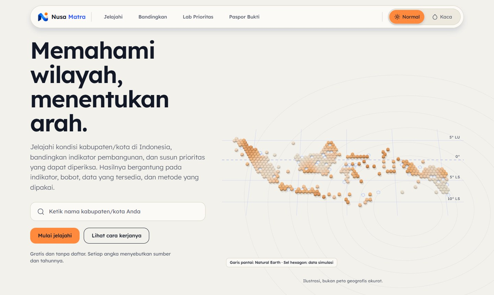
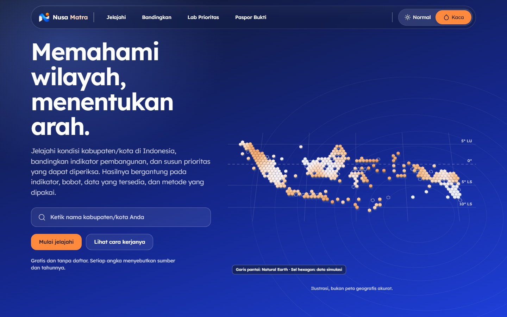
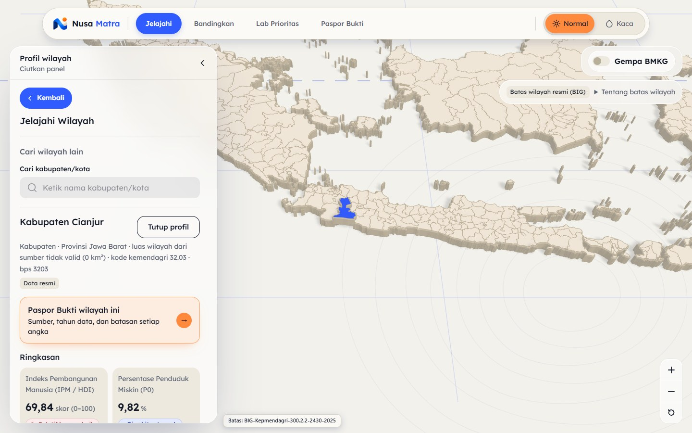
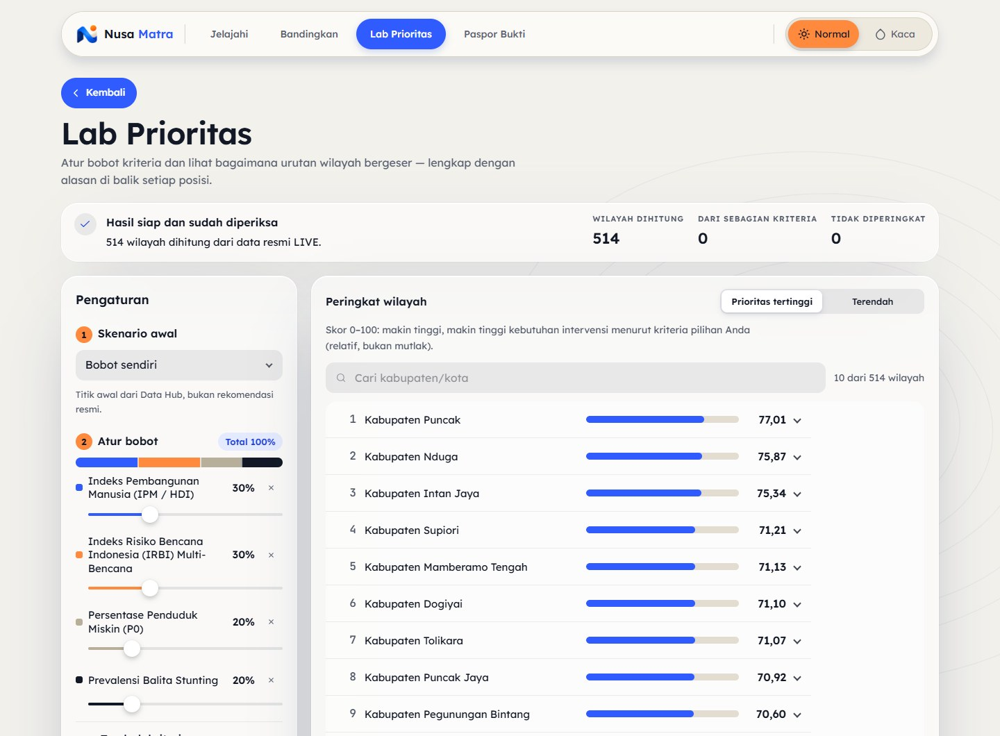

<div align="center">

# Nusa Matra

**Memahami wilayah, menentukan arah.**

Platform web untuk menjelajahi kondisi 514 kabupaten/kota di Indonesia, membandingkan dua wilayah, dan menguji prioritas pembangunan dengan bobot yang dapat diatur, lengkap dengan sumber dan tahun setiap angka.

[Buka situs](https://nusamatra.site) · [Data Hub (backend)](https://github.com/masean24/NusaMatra-DataHub) · [Dokumentasi API](https://api.nusamatra.site/docs)






</div>

Nusa Matra dibuat untuk Web In Action (WIA) 2026 dengan tema _Designing Digital Futures: Powering Public Transparency_. Data pembangunan dan kebencanaan dari BPS, BNPB, Kemenkes, Kemendikdasmen, BIG, dan BMKG tersebar dengan format dan kode wilayah yang berbeda. Nusa Matra menyatukannya, menandai data yang kosong, dan menahan perbandingan yang tidak setara, sehingga hasilnya dapat diperiksa.

Repositori ini hanya berisi frontend. Data, snapshot, skor, batas wilayah, dan feed gempa datang dari Nusa Matra Data Hub lewat REST API.

---

## Tech Stack

| Bagian      | Teknologi                                                                      |
| ----------- | ------------------------------------------------------------------------------ |
| Framework   | React 19, TypeScript 6 (strict), Vite 8                                        |
| Routing     | React Router 8                                                                 |
| Gaya        | CSS Modules dan CSS custom properties (palet Kapur & Kobalt, font Lexend)      |
| Peta dan 3D | Three.js dan React Three Fiber, batas wilayah resmi BIG                        |
| Animasi     | Motion                                                                         |
| Data        | Nusa Matra Data Hub (FastAPI), diakses lewat klien API dengan validasi respons |
| Deploy      | Docker, nginx, Coolify                                                         |

---

## Cara Menjalankan

**Prasyarat:** Node.js 24 atau lebih baru dan npm.

```bash
git clone https://github.com/masean24/NusaMatra.git
cd NusaMatra
npm install
npm run dev
```

Buka `http://localhost:5173`. Tanpa konfigurasi tambahan, situs memakai data LIVE dari API publik `https://api.nusamatra.site`.

### Konfigurasi opsional

Buat file `.env.local` bila perlu. Semua nilai `VITE_*` bersifat publik; jangan menaruh secret di sini.

| Variabel            | Default                      | Fungsi                                                            |
| ------------------- | ---------------------------- | ----------------------------------------------------------------- |
| `VITE_API_BASE_URL` | `https://api.nusamatra.site` | Alamat Data Hub, tanpa `/api/v1` dan tanpa garis miring di akhir. |
| `VITE_DATA_MODE`    | `live`                       | `live` atau `demo`.                                               |

### Perintah lain

| Perintah               | Fungsi                                                                                |
| ---------------------- | ------------------------------------------------------------------------------------- |
| `npm run build`        | Cek tipe lalu build produksi ke `dist/`.                                              |
| `npm run preview`      | Menjalankan hasil build secara lokal.                                                 |
| `npm test`             | Menjalankan uji unit dan komponen (Vitest).                                           |
| `npm run test:e2e`     | Menjalankan uji alur pengguna (Playwright; jalankan `npx playwright install` sekali). |
| `npm run lint`         | Menjalankan ESLint.                                                                   |
| `npm run typecheck`    | Memeriksa tipe TypeScript.                                                            |
| `npm run format:check` | Memeriksa format Prettier.                                                            |

### Docker

```bash
docker build -t nusa-matra .
docker run -p 8080:80 nusa-matra
```

Buka `http://localhost:8080`. Pemeriksaan kesehatan tersedia di `/healthz`.

---

## Progress Saat Ini

Status per 31 Oktober 2026. Situs sudah berjalan di https://nusamatra.site dengan data LIVE.

| Fitur                            | Status       | Keterangan                                                                                             |
| -------------------------------- | ------------ | ------------------------------------------------------------------------------------------------------ |
| Beranda                          | Selesai      | Pencarian wilayah, empat jalur fitur, pratinjau Lab Prioritas, sumber data.                            |
| Jelajahi                         | Selesai      | Peta 3D batas BIG, pencarian, profil wilayah dengan penilaian relatif, 29 indikator beserta sumbernya. |
| Gempa BMKG                       | Selesai      | Layer gempa terkini pada peta Jelajahi.                                                                |
| Bandingkan                       | Selesai      | Dua wilayah berdampingan; selisih hanya dihitung bila definisi dan periodenya setara.                  |
| Lab Prioritas                    | Selesai      | Atur bobot kriteria, peringkat 514 wilayah dihitung ulang, rincian kontribusi tiap kriteria.           |
| Paspor Bukti                     | Selesai      | Rangkuman sumber, tahun, kelas bukti, dan batasan; dapat disalin, diunduh sebagai JSON, atau dicetak.  |
| Tampilan Normal dan Kaca, ponsel | Selesai      | Dua tampilan yang tersimpan, tata letak ponsel, halaman Aksesibilitas.                                 |
| Uji Rekomendasi                  | Direncanakan | Uji sensitivitas bobot. Halaman sudah ada dan ditandai "dalam pengembangan".                           |
| Titik Buta Data                  | Direncanakan | Laporan kualitas data dari hasil validasi.                                                             |
| Cerita Wilayah                   | Direncanakan | Narasi per wilayah.                                                                                    |
| Metodologi                       | Direncanakan | Penjelasan cara skor dihitung.                                                                         |

**Data:** 514 kabupaten/kota dan 30 indikator, 29 di antaranya sudah berdata. Satu indikator (persentase desa dengan jalan beraspal) belum tersedia karena mikrodatanya belum dapat diakses, dan situs menandainya, tidak mengisinya dengan nol.

**Kualitas:** TypeScript strict, ESLint tanpa peringatan, dan lebih dari 700 uji otomatis lulus.

**Batasan:** skor prioritas adalah alat bantu menyaring, bukan rekomendasi kebijakan resmi, dan metodenya belum divalidasi lembaga yang berwenang.
