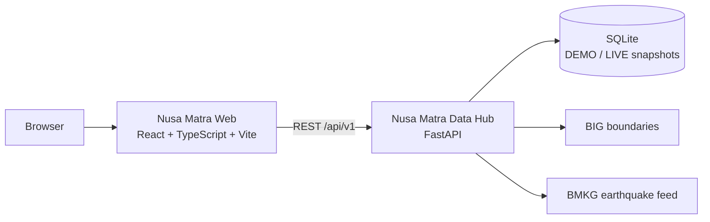

<div align="center">

# Nusa Matra Web

### Memahami wilayah, menentukan arah.

Platform eksplorasi dan pendukung keputusan geospasial untuk **514 kabupaten/kota** dan **38 provinsi** di Indonesia.

[](https://github.com/masean24/NusaMatra)
[](https://react.dev/)
[](https://www.typescriptlang.org/)
[](https://vite.dev/)
[](https://nodejs.org/)
[](#status-dan-fitur)
[](https://api.orangkeren.me)
[](https://github.com/masean24/NusaMatra-DataHub)

**Frontend resmi untuk [Nusa Matra Data Hub](https://github.com/masean24/NusaMatra-DataHub).**

**[Lihat preview](#preview) · [Jalankan lokal](#menjalankan-secara-lokal) · [API Docs](https://api.orangkeren.me/docs) · [Data Hub](https://github.com/masean24/NusaMatra-DataHub)**

</div>

Nusa Matra Web adalah antarmuka React untuk membaca kondisi wilayah Indonesia, membandingkan kabupaten/kota, dan menguji prioritas pembangunan dengan bobot yang transparan. Frontend ini **tidak memiliki database sendiri**: data resmi, snapshot, skor, batas wilayah, dan feed gempa berasal dari **Nusa Matra Data Hub** melalui REST API `/api/v1`.

> **Status repo:** prototipe frontend dengan lima halaman fitur utama yang sudah dibangun—Landing, Jelajahi, Bandingkan, Lab Prioritas, dan Paspor Bukti. Empat tujuan lain masih berupa halaman *in development* yang jujur. Repo ini hanya frontend; backend, database, ingestion, dan integrasi data resmi berada di repo Data Hub. Semua angka contoh pada landing diberi label **DEMO**.

> README ini menggunakan Bahasa Indonesia agar sejalan dengan README Data Hub. Spesifikasi teknis di `docs/` tetap berbahasa Inggris.

---

## Preview

--

> Screenshot berasal dari build prototipe di repo ini; angka dan tampilan dapat berubah setelah integrasi data berikutnya.

---

## Daftar Isi

- [Mengapa Nusa Matra](#mengapa-nusa-matra)
- [Status dan Fitur](#status-dan-fitur)
- [Product Tour](#product-tour)
- [Identitas Visual](#identitas-visual)
- [Tech Stack](#tech-stack)
- [Arsitektur Integrasi](#arsitektur-integrasi)
- [Kontrak API](#kontrak-api)
- [Menjalankan Secara Lokal](#menjalankan-secara-lokal)
- [Konfigurasi Environment](#konfigurasi-environment)
- [Deployment](#deployment)
- [Kualitas dan Pengujian](#kualitas-dan-pengujian)
- [Aksesibilitas dan Performa](#aksesibilitas-dan-performa)
- [Struktur Proyek](#struktur-proyek)
- [Prinsip Integritas Data](#prinsip-integritas-data)
- [Dokumentasi](#dokumentasi)

---

## Mengapa Nusa Matra

Dashboard wilayah sering menampilkan angka, tetapi tidak selalu menjelaskan apakah angka itu layak dipercaya, berasal dari tahun yang sama, atau boleh dibandingkan.

| Masalah yang sering terjadi | Pendekatan Nusa Matra |
|---|---|
| Data tersebar di banyak instansi dan kode wilayahnya berbeda. | Crosswalk 514 kabupaten/kota dan 38 provinsi, dengan batas resmi BIG 2026. |
| Data kosong diisi angka nol, sehingga wilayah yang tidak punya data terlihat “baik”. | Data kosong tetap kosong; indikator ditandai `UNAVAILABLE`, dan coverage gate mencegah ranking palsu. |
| Skor prioritas terlihat seperti kotak hitam. | Bobot dalam basis points, normalisasi yang dijelaskan, dan komponen yang bisa diperiksa. |
| Hasil analisis berubah tanpa jejak. | Snapshot immutable, checksum SHA-256, dan Paspor Bukti yang merangkai sumber di browser. |
| Perbandingan antarwilayah mencampur definisi yang berbeda. | Perbandingan hanya dilakukan bila definisi, satuan, dan metodenya setara; jika tidak, selisih ditahan. |

Nusa Matra tidak menggantikan keputusan kebijakan. Karya ini menyediakan **bahan bukti** agar keputusan bisa dibaca, diuji, dan dipertanggungjawabkan.

---

## Status dan Fitur

Status di bawah mengikuti route dan modul yang benar-benar ada di repo ini.

| Modul | Route | Status | Yang sudah ada |
|---|---|---|---|
| Landing | `/` | **Implemented** | Hero, cara kerja, pratinjau Lab, transparansi, sumber data, CTA, mode Normal/Kaca. |
| Jelajahi | `/jelajahi` | **Implemented** | Peta 3D, pencarian wilayah, panel profil, indikator, layer gempa BMKG, dan catatan batas wilayah. |
| Bandingkan | `/bandingkan` | **Implemented** | Perbandingan dua wilayah, indikator yang setara, dan penanganan data yang tidak dapat dibandingkan. |
| Rincian Perbandingan | `/bandingkan/rincian` | **Implemented** | Tahun, sumber, dataset, penjelasan selisih, dan alasan indikator ditahan. |
| Lab Prioritas | `/lab-prioritas` | **Implemented** | Bobot kriteria, preset, cakupan provinsi, ranking, grafik, dan penjelasan kontribusi. |
| Paspor Bukti | `/paspor-bukti` | **Implemented** | Catatan bukti yang dirangkai di browser, snapshot pinning, ekspor JSON, dan cetak. |
| Aksesibilitas | `/aksesibilitas` | **Implemented** | Daftar dukungan keyboard, mode tampilan, reduced motion, dan fallback 3D. |
| Uji Rekomendasi | `/uji-rekomendasi` | **In development** | Halaman shell yang menjelaskan uji sensitivitas dan ketahanan peringkat. |
| Cerita Wilayah | `/cerita-wilayah` | **In development** | Halaman shell untuk narasi wilayah per bab. |
| Batasan Data | `/titik-buta-data` | **In development** | Halaman shell untuk data kosong, basi, dan tidak sebanding. |
| Metodologi | `/metodologi` | **In development** | Halaman shell untuk rumus skor dan kebijakan data hilang. |
| Peta Utama | `/peta` | **Redirect** | Dialihkan ke `/jelajahi` (keputusan owner 2026-10-28). |

> Halaman *in development* sengaja tidak menampilkan data palsu. Mereka menjelaskan apa yang akan dibangun dan tetap mengikuti gaya visual produk.

---

## Product Tour

1. **Landing** — pengguna memahami masalah, melihat sumber data, dan memilih jalur: menjelajah, membandingkan, atau membuka Lab Prioritas.
2. **Jelajahi** — cari kabupaten/kota, pilih lewat peta, lalu baca nilai, satuan, tahun, definisi, dan sumber setiap indikator.
3. **Bandingkan** — sandingkan dua wilayah; hanya indikator yang setara yang dihitung selisihnya.
4. **Lab Prioritas** — atur bobot kriteria dan cakupan wilayah, lalu lihat ranking beserta komponen yang menyusunnya.
5. **Paspor Bukti** — bawa hasil analisis menjadi catatan bukti yang menyebut snapshot, sumber, dan batasannya.

Alur ini sengaja dibuat berlapis: dari cerita, ke eksplorasi, ke analisis, lalu ke bukti.

---

## Identitas Visual

- **Nama produk:** Nusa Matra. File Figma memakai judul historis **PrioritasKita**, yang bukan brand publik.
- **Design system:** Kapur & Kobalt; font utama Lexend; mode Normal dan Kaca.
- **Figma utama:** [PrioritasKita — UI/UX WIA 2026](https://www.figma.com/design/D8fuOoDZAGeBPG6nzxfFx4/PrioritasKita-%E2%80%94-UI-UX-WIA-2026?node-id=25-2)
- **Referensi animasi:** [21st.dev](https://21st.dev/) dan [Fuselab Cyberdefend](https://fuselabcreative.com/our-projects/cyberdefend/), digunakan sebagai inspirasi visual.

---

## Tech Stack

| Lapisan | Teknologi |
|---|---|
| UI | React 19, TypeScript strict, React Router 8 |
| Build | Vite 8, Node.js 24 LTS |
| Peta 3D | Three.js, React Three Fiber |
| Animasi | Motion |
| Styling | CSS Modules dan design token dari Figma |
| Tipografi | Lexend dan JetBrains Mono melalui Fontsource |
| Data | REST `/api/v1` ke Data Hub; service layer dan typed mapper |
| Testing | Vitest, Testing Library, Playwright |
| Kualitas | ESLint 9, Prettier 3, TypeScript strict |
| Deployment | Docker multi-stage dan nginx |

Frontend **tidak menghitung ulang skor komposit**. Data Hub yang menghitung; frontend memvalidasi kontrak, menampilkan hasil, dan menjelaskan komponennya.

---

## Arsitektur Integrasi



Prinsip integrasi:

- Frontend tidak menyimpan data resmi dan tidak melakukan ingestion.
- Semua request data melewati `/api/v1`; base URL hanya berisi origin.
- Mode `DEMO` dan `LIVE` dipilih melalui environment, bukan ditebak dari respons.
- Snapshot aktif ditentukan oleh API (`data[].is_active_default`), bukan di-hardcode di frontend.
- Data kosong ditampilkan sebagai kosong, bukan angka nol.
- Jika respons LIVE tidak dapat dibaca, frontend tidak diam-diam beralih ke DEMO.

---

## Kontrak API

### Endpoint yang dipakai

| Endpoint | Kegunaan |
|---|---|
| `GET /api/v1/health` | Health check backend. |
| `GET /api/v1/snapshots` | Daftar snapshot dan penanda snapshot aktif. |
| `GET /api/v1/regions` | Daftar 514 kabupaten/kota dan 38 provinsi. |
| `GET /api/v1/regions/{kode}` | Detail satu wilayah. |
| `GET /api/v1/indicators` | Kamus indikator dan metadata. |
| `GET /api/v1/indicators/{id}/values` | Nilai indikator per wilayah. |
| `GET /api/v1/indicators/coverage` | Matriks ketersediaan indikator. |
| `GET /api/v1/indicators/composite-presets` | Preset bobot untuk Lab Prioritas. |
| `POST /api/v1/indicators/composite-query` | Perhitungan skor prioritas. |
| `GET /api/v1/boundaries/kabupaten` | GeoJSON batas kabupaten/kota. |
| `GET /api/v1/earthquakes/geojson` | Gempa BMKG siap render 3D. |
| `GET /api/v1/earthquakes/latest` | Gempa terbaru. |
| `GET /api/v1/earthquakes/recent` | Gempa M ≥ 5.0 terbaru. |
| `GET /api/v1/earthquakes/felt` | Gempa yang dirasakan. |
| `GET /api/v1/earthquakes/summary` | Ringkasan dan status cache BMKG. |

### Aturan kontrak

| Ketentuan | Keterangan |
|---|---|
| `VITE_API_BASE_URL` hanya berisi origin, misalnya `http://localhost:8000`. | Frontend menambahkan `/api/v1` sendiri dan membuang suffix `/api/v1` yang tidak sengaja dimasukkan. |
| `meta.score_direction = "higher_is_need"`. | Persentil/skor tinggi berarti kebutuhan intervensi lebih tinggi. |
| Snapshot aktif ditandai `data[].is_active_default`. | Frontend selalu memakai snapshot aktif dari API. |
| Error `422`/`404`/`429` memakai envelope `{status, code, message, detail?}`. | Penanganan error dan pesan pengguna konsisten. |
| Origin frontend sama persis dengan `NM_CORS_ORIGINS`. | Request tidak diblokir oleh CORS di browser. |
| `boundary_version` dan `content_sha256` disertakan pada metadata. | Hasil dapat direproduksi dan diaudit. |

Kontrak lengkap: [`FRONTEND_HANDOFF_V2_4.md`](https://github.com/masean24/NusaMatra-DataHub/blob/main/docs/FRONTEND_HANDOFF_V2_4.md).

Contoh cepat:

```bash
curl -s "https://api.orangkeren.me/api/v1/health"
curl -s "https://api.orangkeren.me/api/v1/indicators/coverage?mode=live" | head -c 500
```

---

## Menjalankan Secara Lokal

### Prasyarat

- **Node.js 24 LTS** (lihat `.nvmrc`) dan npm
- **Git**
- **Python 3.11+**, hanya jika menjalankan Data Hub secara lokal

### 1. Frontend saja

Repo ini tidak menyertakan `.env`; tanpa konfigurasi tambahan, frontend memakai **LIVE** dan API publik `https://api.orangkeren.me`.

```bash
git clone https://github.com/masean24/NusaMatra.git
cd NusaMatra
npm install
npm run dev
```

Buka `http://localhost:5173`.

### 2. Frontend + backend lokal

Clone dan jalankan Data Hub:

```bash
git clone https://github.com/masean24/NusaMatra-DataHub.git
cd NusaMatra-DataHub

python -m venv .venv
# Windows
.venv\Scripts\activate
# macOS/Linux
# source .venv/bin/activate

pip install -r requirements.txt
uvicorn app.main:app --reload --port 8000
```

Cek health:

```bash
curl http://localhost:8000/api/v1/health
```

Lalu buat `.env.local` di repo frontend:

```env
VITE_DATA_MODE=live
VITE_API_BASE_URL=http://localhost:8000
```

Jalankan ulang `npm run dev`.

### 3. CORS lokal

`localhost` biasanya sudah diizinkan oleh regex backend. Untuk konfigurasi eksplisit, set di backend:

```env
NM_CORS_ORIGINS=http://localhost:5173,http://127.0.0.1:5173
```

---

## Konfigurasi Environment

Vite menyuntikkan environment saat build. Setelah mengubah `.env.local`, jalankan ulang `npm run dev`.

### Frontend

| Variabel | Default | Catatan |
|---|---|---|
| `VITE_DATA_MODE` | `live` | Nilai valid: `live` atau `demo`. Nilai lain dianggap error konfigurasi. |
| `VITE_API_BASE_URL` | `https://api.orangkeren.me` | Origin saja, tanpa `/api/v1` dan tanpa trailing slash. |
| `VITE_DATA_MODE_SWITCH` | mati | `1` hanya untuk pengujian/reviewer; pengunjung normal melihat LIVE saja. |
| `VITE_EARTHQUAKE_PREVIEW` | mati | `1` hanya untuk reviewer; data gempa yang tidak menyatakan statusnya akan diberi label “belum terverifikasi”. |

### Backend (Data Hub)

| Variabel | Contoh | Catatan |
|---|---|---|
| `NM_CORS_ORIGINS` | `https://domain-frontend-production` | Sama persis dengan origin frontend. |
| `NM_ENABLE_LIVE_MODE` | `true` | Mengaktifkan mode LIVE di Data Hub. |

Semua nilai `VITE_*` bersifat publik. Jangan menaruh API key atau secret di frontend.

---

## Deployment

Repo menyertakan `Dockerfile` multi-stage (`node:24-alpine` → `nginx:1.27-alpine`) dan `nginx.conf` dengan history fallback untuk route seperti `/jelajahi`, `/bandingkan`, dan `/paspor-bukti`.

```bash
docker build \
  --build-arg VITE_API_BASE_URL=https://api.orangkeren.me \
  -t nusa-matra-web .

docker run --rm -p 8080:80 nusa-matra-web
```

Konfigurasi produksi:

- `dist/` disajikan sebagai static files.
- `nginx.conf` mengarahkan semua path yang tidak dikenal ke `index.html`.
- Asset ber-hash di-cache lama; HTML tidak di-cache.
- `/healthz` tersedia untuk health check.
- `NM_CORS_ORIGINS` di backend diatur ke origin frontend production, tanpa trailing slash.
- Jika memakai Data Hub lain, ubah `VITE_API_BASE_URL` sebagai build argument.

---

## Kualitas dan Pengujian

```bash
npm run typecheck     # TypeScript strict
npm run lint          # ESLint, max-warnings=0
npm run format:check  # Prettier check
npm run test          # Vitest + Testing Library
npm run build         # type-check lalu build ke dist/
npm run test:e2e      # Playwright smoke test
```

Quality gate yang diterapkan:

- Type-check, lint, dan format check
- Unit/component test
- Build production
- E2E smoke test
- Label DEMO pada semua angka simulasi
- Pemeriksaan keyboard, kontras, reduced motion, dan fallback WebGL

Kontrak API juga diuji secara terpisah, termasuk snapshot pinning, error envelope, dan sample respons v2.4.

---

## Aksesibilitas dan Performa

Beberapa keputusan engineering yang sudah diterapkan:

- **Route-level code splitting** agar halaman fitur tidak membebani landing.
- **3D lazy-loaded** hanya saat zona 3D mendekati viewport; ponsel dan perangkat tanpa WebGL mendapat gambar statis.
- **Mode Normal/Kaca** dengan preferensi tersimpan; mode Kaca dimatikan otomatis bila perangkat meminta kontras tinggi atau transparansi rendah.
- **Reduced motion** menghentikan animasi tanpa menghilangkan isi.
- **Keyboard-first**: skip link, focus management setelah navigasi, dan kontrol peta yang dapat digunakan dengan papan ketik.
- **Warna bukan satu-satunya penanda status**; setiap status juga memakai ikon dan teks.

Audit aksesibilitas menyeluruh belum dilakukan. Halaman `/aksesibilitas` mencatat dukungan yang benar-benar ada, bukan klaim konformansi.

---

## Struktur Proyek

```text
src/
  app/                  # router, layout, halaman route
  components/           # komponen UI bersama
  features/             # landing, exploration, comparison, priority-lab, evidence-passport
  domain/               # aturan skor dan logika murni
  services/api/         # HTTP client, repository, mapper, kontrak
  hooks/                # hook bersama
  lib/                  # utilitas, WebGL, glass, format
  styles/               # token desain dari Figma
  test/                 # setup dan fixture

tests/                  # Playwright E2E
docs/
  adr/                  # architecture decision records
  implementation-notes/ # catatan implementasi
  integration/          # catatan integrasi dan screenshot
  01-13                 # spesifikasi produk, API, desain, testing, security
```

---

## Prinsip Integritas Data

1. **DEMO bukan LIVE.** Ranking dan contoh sintetis diberi label simulasi yang jelas.
2. Setiap nilai terukur disertai ID wilayah/indikator, satuan, periode, definisi, dan metadata sumber yang stabil.
3. Data kosong **bukan** angka nol.
4. Pengukuran dengan definisi tidak kompatibel tidak dibandingkan dengan delta terhitung.
5. Hasil analisis menyematkan snapshot dataset, cohort, model, dan parameter input.
6. Rekomendasi kebijakan produksi memerlukan metodologi yang telah ditinjau; model bobot DEMO bukan rekomendasi resmi.
7. Syarat API, lisensi, dan ketentuan penyedia data resmi diverifikasi secara independen.

---

## Dokumentasi

[`project_guidelines.md`](./project_guidelines.md) memuat nilai engineering produk, sedangkan dokumen `01–13` menjadi kontrak implementasi per fitur.

<details>
<summary><strong>Lihat 13 dokumen spesifikasi</strong></summary>

| File | Tujuan |
|---|---|
| [`project_guidelines.md`](./project_guidelines.md) | Branding, React, Clean Code, dan persyaratan animasi orisinal. |
| [`docs/01-PRODUCT-REQUIREMENTS.md`](./docs/01-PRODUCT-REQUIREMENTS.md) | Requirement, prioritas, dan non-goals. |
| [`docs/02-USER-FLOWS.md`](./docs/02-USER-FLOWS.md) | Navigasi, interaksi, state, dan perjalanan pengguna. |
| [`docs/03-UI-UX-DESIGN-SYSTEM.md`](./docs/03-UI-UX-DESIGN-SYSTEM.md) | Node Figma, warna, tipografi, komponen, dan UX responsif. |
| [`docs/04-TECH-STACK-ARCHITECTURE.md`](./docs/04-TECH-STACK-ARCHITECTURE.md) | Arsitektur React dan pilihan library. |
| [`docs/05-DATA-SOURCES.md`](./docs/05-DATA-SOURCES.md) | Penyedia data resmi, lisensi, dan provenance. |
| [`docs/06-DATA-MODEL.md`](./docs/06-DATA-MODEL.md) | Relasi entitas, persistensi, dan desain snapshot. |
| [`docs/07-DECISION-ENGINE.md`](./docs/07-DECISION-ENGINE.md) | Bobot, normalisasi, ranking, explainability, dan sensitivitas. |
| [`docs/08-API-SPECIFICATION.md`](./docs/08-API-SPECIFICATION.md) | Endpoint dan kontrak API. |
| [`docs/09-ANIMATION-GUIDELINES.md`](./docs/09-ANIMATION-GUIDELINES.md) | Figma G1–G11, animasi 3D, transisi tema, dan performa. |
| [`docs/10-TESTING-STRATEGY.md`](./docs/10-TESTING-STRATEGY.md) | Test pyramid, fixture, QA, dan CI. |
| [`docs/11-SECURITY-AND-PRIVACY.md`](./docs/11-SECURITY-AND-PRIVACY.md) | Threat model, secret, privasi, lisensi, dan proteksi. |
| [`docs/12-IMPLEMENTATION-ROADMAP.md`](./docs/12-IMPLEMENTATION-ROADMAP.md) | Milestone, dependensi, rilis, dan ownership. |
| [`docs/13-ACCEPTANCE-CRITERIA.md`](./docs/13-ACCEPTANCE-CRITERIA.md) | Kriteria yang dapat diuji, release gate, dan sign-off. |

</details>

**Status dokumentasi:** seluruh 13 dokumen spesifikasi sudah tersedia. Ini menunjukkan cakupan dokumentasi, bukan status implementasi produk.

---

<div align="center">

**Nusa Matra Web — Wilayah Indonesia (WIA) 2026**

*Membangun antarmuka yang terukur, transparan, dan tepercaya untuk pengambilan keputusan geospasial Indonesia.*

Frontend: repo ini · Data Hub: [masean24/NusaMatra-DataHub](https://github.com/masean24/NusaMatra-DataHub) · API: [api.orangkeren.me](https://api.orangkeren.me)

</div>
