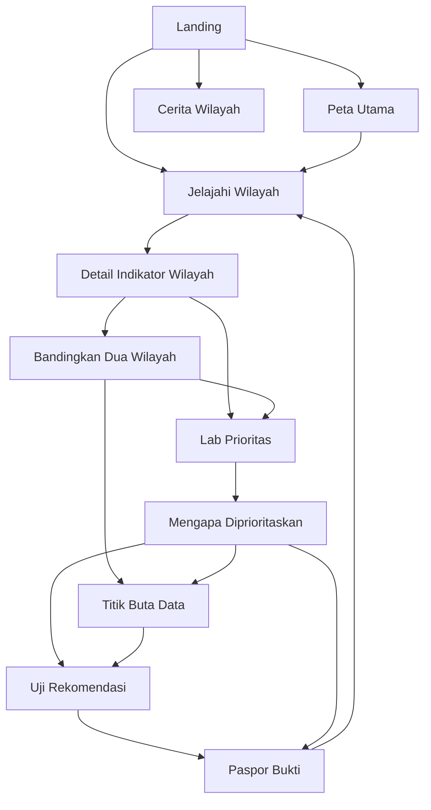
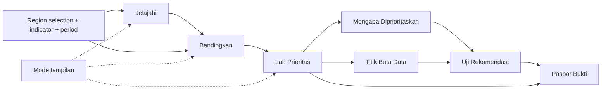
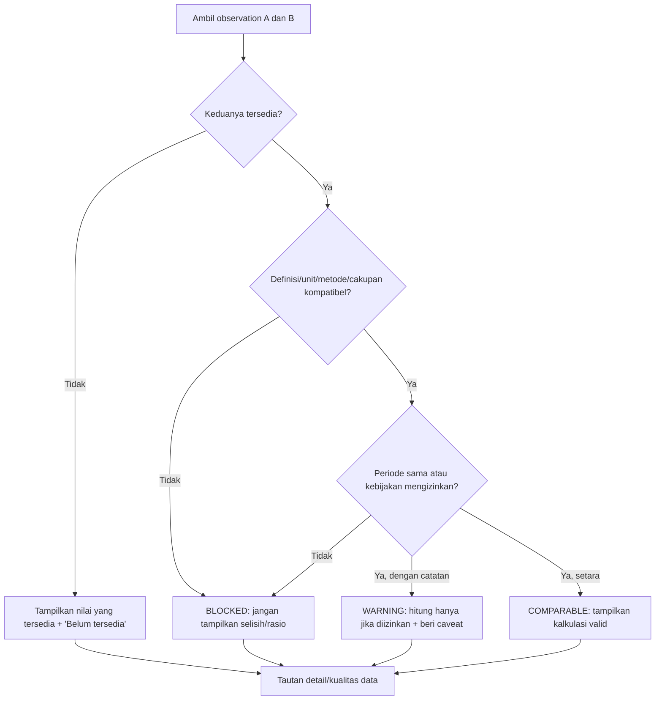

# 02 — User Flows & Interaction Specification

> **Produk:** Nusa Matra  
> **Program:** WIA 2026  
> **File:** `docs/02-USER-FLOWS.md`  
> **Versi:** 1.0  
> **Tanggal:** 19 Oktober 2026  
> **Status:** Implementation-ready interaction baseline; detail URL, dataset, dan metode analisis masih sebagian **PROPOSED/TBD**  
> **Teknologi frontend:** React + TypeScript (LOCKED)  
> **Bahasa UI:** Bahasa Indonesia (`id-ID`)

---

## 0. Tujuan, cakupan, dan cara membaca

Dokumen ini menjawab pertanyaan: **apa yang pengguna lakukan, apa yang aplikasi lakukan, apa yang terlihat pada setiap state, dan apa yang harus terjadi jika sesuatu gagal?** Gunakan bersama:

- [`../CLAUDE.md`](../CLAUDE.md) — instruksi operasional Claude Code.
- [`../project_guidelines.md`](../project_guidelines.md) — standar proyek dan Clean Code.
- [`01-PRODUCT-REQUIREMENTS.md`](01-PRODUCT-REQUIREMENTS.md) — tujuan, prioritas, dan ID functional requirements (`FR-*`).
- [`03-UI-UX-DESIGN-SYSTEM.md`](03-UI-UX-DESIGN-SYSTEM.md) — token dan spesifikasi visual (akan dibuat).
- [`06-DATA-MODEL.md`](06-DATA-MODEL.md), [`07-DECISION-ENGINE.md`](07-DECISION-ENGINE.md), [`08-API-SPECIFICATION.md`](08-API-SPECIFICATION.md) — data, matematika, API (akan dibuat).
- [`09-ANIMATION-GUIDELINES.md`](09-ANIMATION-GUIDELINES.md), [`10-TESTING-STRATEGY.md`](10-TESTING-STRATEGY.md), [`13-ACCEPTANCE-CRITERIA.md`](13-ACCEPTANCE-CRITERIA.md) — perilaku gerak, tes, dan acceptance (akan dibuat).

**Figma final (sumber utama visual):**  
https://www.figma.com/design/D8fuOoDZAGeBPG6nzxfFx4/PrioritasKita-%E2%80%94-UI-UX-WIA-2026?node-id=25-2

**Ketetapan:** nama brand di UI adalah **Nusa Matra**, bukan nama lama pada URL Figma.

### 0.1 Status keputusan

| Penanda          | Makna                                                | Aturan implementasi                                              |
| ---------------- | ---------------------------------------------------- | ---------------------------------------------------------------- |
| `LOCKED`         | Keputusan yang sudah disepakati                      | Ikuti tanpa mengganti sepihak                                    |
| `FIGMA-VERIFIED` | Elemen/label/annotasi terlihat di desain             | Cocokkan frame dan tampilannya                                   |
| `PROPOSED`       | Kontrak UX atau route yang direkomendasikan          | Terapkan konsisten hanya setelah memeriksa existing code         |
| `TBD`            | Bergantung keputusan/dataset/metode yang belum final | Jangan mengarang data atau klaim; catat dependensi               |
| `DEMO`           | Fixture/prototipe/simulasi                           | Selalu beri label eksplisit; jangan dinyatakan sebagai data live |

Tidak semua interaksi prototipe Figma sudah merupakan spesifikasi behavior produksi. **Untuk perilaku yang belum ditentukan Figma**, gunakan alur PROPOSED di dokumen ini, bukan menebak seolah-olah telah diverifikasi.

### 0.2 Arti istilah

- **Region**: wilayah administratif diidentifikasi oleh **kode stabil + level + versi geografi**, bukan hanya string nama.
- **Observation**: satu nilai indikator untuk wilayah dan periode tertentu, plus metadata sumber/metode.
- **Comparable**: dua observation dapat dibandingkan dengan metode yang valid; `warning` berbeda dengan `blocked`.
- **Scenario**: kumpulan bobot, indikator, scope, periode, versi model, dan identitas dataset yang digunakan analisis.
- **Snapshot**: salinan keadaan analisis yang konsisten pada satu waktu, bukan referensi mutable ke halaman sebelumnya.
- **Data mode**: `LIVE_VERIFIED` atau `DEMO`; hanya ditentukan oleh data adapter/provenance yang benar, **bukan pilihan visual user**.
- **Route**: alamat aplikasi; contoh pada dokumen ini belum diputuskan sebagai URL publik final.

---

## 1. Prinsip interaksi lintas halaman (invariants)

Prinsip ini berlaku untuk semua user flow, tidak hanya saat kondisi ideal.

| ID       | Invariant wajib                                                          | Konsekuensi pada implementasi                                         |
| -------- | ------------------------------------------------------------------------ | --------------------------------------------------------------------- |
| `INV-01` | Tidak ada tombol/CTA tampak aktif tetapi tidak bekerja                   | Aksi nyata, disabled dengan alasan, atau jangan render                |
| `INV-02` | Perpindahan route tidak boleh menampilkan konteks data yang salah        | Validasi route/query, identitas kode wilayah dan abort stale requests |
| `INV-03` | Nilai `null` bukan `0`; semua angka faktual punya konteks                | Tampilkan `Data belum tersedia`, unit, tahun, sumber, kualitas        |
| `INV-04` | Kualitas data dapat menghentikan kalkulasi yang tak valid                | `blocked` melarang rasio/selisih/skor yang tak sah                    |
| `INV-05` | Semua state utama dapat dicapai tanpa hover atau 3D                      | Keyboard, touch, kontrol alternatif peta dan cerita                   |
| `INV-06` | Theme Normal/Kaca mengubah presentasi **saja**                           | Tidak mereset wilayah/bobot/indikator, tidak mengubah hasil           |
| `INV-07` | DEMO dan LIVE tidak boleh tampak setara tanpa label                      | Badge/penjelasan yang jelas di setiap hasil relevan                   |
| `INV-08` | Navigasi Back/Forward dan reload tidak menyebabkan konteks kontradiktif  | Restore URL state tervalidasi dan preferensi visual dengan aman       |
| `INV-09` | Sumber asinkron lama tidak boleh menimpa state baru                      | AbortController/query key/sequence guard                              |
| `INV-10` | Grafik menyertakan representasi tekstual                                 | Label, angka, satuan, periode, legenda, penjelasan pembaca layar      |
| `INV-11` | Animasi/3D tidak menjadi satu-satunya akses informasi                    | Fallback statis, reduced-motion, non-WebGL                            |
| `INV-12` | Setiap perhitungan analitik berasal dari model yang sama                 | Tidak ada skor/ranking/narasi hardcoded di JSX                        |
| `INV-13` | Error terlihat, dapat dimengerti, dan dapat dipulihkan bila memungkinkan | Retry yang benar; jangan silent fallback ke fixture demo              |
| `INV-14` | UI menggunakan Bahasa Indonesia yang natural                             | Identifier internal boleh berbahasa Inggris                           |
| `INV-15` | Clean Code wajib dinilai untuk flow, bukan sekadar screenshot            | Domain rules di pure functions, UI modular, tes terkait               |

### 1.1 Prioritas pengembangan

- **P0:** Landing/shell, Peta Utama, Jelajahi, detail indikator, Bandingkan 2 wilayah, quality warning inline, aksesibilitas inti, theme dasar.
- **P1:** Lab Prioritas, Mengapa Diprioritaskan, Titik Buta Data versi halaman ketika datanya sudah dapat dipercaya.
- **P2:** Uji Rekomendasi, Paspor Bukti, Cerita Wilayah, polish animasi premium bila fondasi stabil.
- **Catatan:** Semua modul punya frame Figma; **adanya desain tidak otomatis berarti wajib LIVE/MVP**. Bila P1/P2 belum dibuat, jangan tampilkan navigasi palsu.

---

## 2. Information architecture & peta layar

### 2.1 Pemetaan view ke Figma

| Flow/view              | Route PROPOSED      | Frame ID Figma       | Keterangan                               |
| ---------------------- | ------------------- | -------------------- | ---------------------------------------- |
| Landing                | `/`                 | `27:2`, `27:118`     | Normal dan Kaca; halaman penuh           |
| Peta Utama (hub)       | `/peta`             | `61:1183`, `61:1619` | Hub navigasi/peta awal                   |
| Jelajahi Wilayah       | `/jelajahi`         | `29:34`, `29:485`    | Peta, cari wilayah, layer, panel detail  |
| Bandingkan             | `/bandingkan`       | `12:840`             | Pilih A/B, tukar, perbedaan dan kualitas |
| Lab Prioritas          | `/lab-prioritas`    | `11:152`             | Slider bobot, peringkat, model demo      |
| Mengapa Diprioritaskan | `/mengapa`          | `12:263`             | Kontribusi skor, alternatif bobot        |
| Titik Buta Data        | `/titik-buta-data`  | `14:541`             | Audit isu, severity, alasan              |
| Uji Rekomendasi        | `/uji-rekomendasi`  | `13:854`             | Uji asumsi dan stabilitas                |
| Paspor Bukti           | `/paspor-bukti`     | `13:446`             | Dokumen hasil dan sumber                 |
| Cerita Wilayah         | `/cerita-wilayah`   | `14:927`             | Narasi bab; ilustrasi 3D                 |
| Navbar mengambang      | Seluruh app terkait | `49:304`, `49:447`   | Komponen navigasi                        |
| Pil halaman mengambang | View terkait        | `62:1291`            | Pelengkap navigasi                       |
| Tema cair              | Beberapa view       | `30:1467`            | Spesifikasi Normal ↔ Kaca                |
| Motion & 3D            | Landing/narasi      | `43:713`, `43:250`   | Aturan G1–G11 dan zona 3D                |

**Peringatan:** Nama route, query params, pilihan default region, dan posisi CTA pada flow ini **PROPOSED** kecuali telah dipastikan di Figma atau repository. Jangan menganggap route sebagai URL final yang telah diputuskan.

### 2.2 High-level sitemap



Diagram menunjukkan **kemungkinan perjalanan**, bukan seluruh tautan yang pasti tampil pada setiap frame. Navigation affordance wajib mengikuti Figma yang telah diinspeksi.

### 2.3 Arus data/konteks lintas fitur



**Aturan utama:** hasil perhitungan harus membawa dataset/model snapshot reference. Mengirim hanya `regionName` atau nilai skor tampilan antarhalaman **tidak cukup** untuk mempertahankan ketepatan.

---

## 3. Kontrak state dan navigasi lintas halaman

### 3.1 Kategori state: jangan dicampur

| Kategori          | Contoh                                         | Tempat penyimpanan PROPOSED                             | Lifetime                        |
| ----------------- | ---------------------------------------------- | ------------------------------------------------------- | ------------------------------- |
| Route identity    | Halaman saat ini                               | React Router / route layer                              | Browser history                 |
| Shareable filters | `regionCode`, `indicatorId`, periode, A/B      | URL query jika valid dan tidak sensitif                 | Reload/share                    |
| Server state      | Metadata indikator, observasi, geojson, sumber | Data-fetching cache atau query service                  | Sesuai TTL/invalidation         |
| Ephemeral UI      | Panel terbuka, hover, modal, temporary input   | Local React state dalam fitur                           | Selama screen aktif             |
| User preference   | Normal/Kaca, reduced motion preference manual  | Browser preference storage setelah pemeriksaan dukungan | Antar route/sesi                |
| Analysis scenario | Bobot, scope, model/dataset version            | Feature/domain state atau server snapshot ID            | Sesuai kebijakan P1/P2          |
| Result snapshot   | Perhitungan/hasil pada satu versi input        | Immutable domain model                                  | Sampai analisis diganti/direset |
| Data provenance   | LIVE/DEMO, source, period, quality flags       | Data model dari adapter                                 | Tidak boleh dikuasai user URL   |

**Dilarang:** simpan nilai hasil analisis sebagai satu-satunya `useState` terpisah dari input dan versi model; menampilkan data lama saat route telah berubah; menaruh credential atau data pribadi di query string.

### 3.2 Contoh tipe konsep (PROPOSED; final ada pada dokumen 06)

```ts
export type RegionLevel = 'province' | 'regency' | 'city';

export type RouteContext = {
  regionCode?: string;
  regionLevel?: RegionLevel;
  indicatorId?: string;
  period?: string;
  compareRegionA?: string;
  compareRegionB?: string;
};

export type AsyncState<T> =
  | { status: 'idle' }
  | { status: 'loading'; previous?: T }
  | { status: 'success'; data: T }
  | { status: 'empty'; reason: string }
  | { status: 'error'; message: string; retryable: boolean };

export type ComparisonStatus =
  { kind: 'comparable' } | { kind: 'warning'; reasons: string[] } | { kind: 'blocked'; reasons: string[] };

export type Availability = 'available' | 'missing' | 'out_of_scope';
export type DataOrigin = 'LIVE_VERIFIED' | 'DEMO';
```

Kode di atas **bukan klaim schema final**. Implementasi seharusnya menggunakan nama/types dari `docs/06-DATA-MODEL.md` begitu sudah diputuskan. Jangan membangun tipe paralel yang bersaing.

### 3.3 Kebijakan URL PROPOSED

| Halaman         | Query PROPOSED                                             | Validasi                                                  |
| --------------- | ---------------------------------------------------------- | --------------------------------------------------------- |
| Jelajahi        | `/jelajahi?wilayah=<CODE>&indikator=<ID>&periode=<PERIOD>` | Kode/ID valid di katalog, periode didukung                |
| Bandingkan      | `/bandingkan?a=<CODE_A>&b=<CODE_B>&indikator=<ID>`         | A/B valid dan berbeda; tidak wajib keduanya sudah dipilih |
| Mengapa         | `/mengapa?wilayah=<CODE>&skenario=<ID>`                    | Scenario ID harus resolve ke snapshot yang sesuai         |
| Uji rekomendasi | `/uji-rekomendasi?skenario=<ID>`                           | Snapshot analitik tersedia/valid                          |
| Paspor Bukti    | `/paspor-bukti?id=<SNAPSHOT_ID>`                           | Laporan punya asal dan kontrol akses sesuai desain final  |
| Cerita Wilayah  | `/cerita-wilayah?bab=<INDEX>`                              | Clamp/reject invalid bab; jangan lompat ke konten palsu   |

Contoh `<CODE>` dan `<ID>` adalah placeholder, **bukan ID resmi**. Jika backend snapshot belum ada, flow bergantung pada feature-state dan direct link ke scenario dapat diberi status **belum tersedia**, bukan mengarang sesi.

**Browser Back/Forward** harus merekonstruksi state yang tampak. Jika query tidak valid, tampilkan koreksi/penjelasan dan state aman; jangan diam-diam mengalihkan kode wilayah tidak dikenal ke wilayah lain.

### 3.4 Transisi request

```text
idle → loading → success
              → empty
              → error → retry → loading

selectedRegion A → selectedRegion B
     |                  |
     +-- abort A        +-- ignore stale A response
```

- Gunakan `AbortController` atau pembatas sequence untuk request yang dapat saling mendahului.
- Saat indikator atau periode berubah, detail dan legenda harus beralih **atomik** atau menunjukkan loading sinkron; jangan menampilkan label periode B dengan nilai periode A.
- State `error` tidak boleh diam-diam menampilkan DEMO sebagai LIVE.
- Cache data boleh digunakan bila jelas versi/periodenya dan aturan invalidasi terpenuhi.
- `Retry` menjalankan ulang operasi yang gagal (bukan full reload bila bisa dihindari).

---

## 4. Katalog flow dan kriteria sukses

| ID      | Flow                                          | Prioritas                | Referensi utama                   |
| ------- | --------------------------------------------- | ------------------------ | --------------------------------- |
| `UF-01` | Landing → temukan wilayah → eksplorasi        | P0                       | `FR-CORE-01..07`, `FR-MAP-02..04` |
| `UF-02` | Hub/nav → berpindah fitur                     | P0                       | `FR-CORE-03`, `FR-CORE-06`        |
| `UF-03` | Jelajahi wilayah, layer, indikator, periode   | P0                       | `FR-MAP-01..10`                   |
| `UF-04` | Membaca detail indikator dan provenance       | P0                       | `FR-MAP-04..07`, `FR-DQ-01`       |
| `UF-05` | Bandingkan dua wilayah                        | P0                       | `FR-CMP-01..09`                   |
| `UF-06` | Normal ↔ Kaca + motion preferences            | P0/P1 visual             | `FR-CORE-04`, `FR-CORE-07`        |
| `UF-07` | Lab Prioritas: ubah bobot dan ranking         | P1                       | `FR-LAB-01..08`                   |
| `UF-08` | Mengapa diprioritaskan                        | P1                       | `FR-WHY-01..05`                   |
| `UF-09` | Titik Buta Data                               | P0 inline; P1/P2 halaman | `FR-DQ-01..05`                    |
| `UF-10` | Uji Rekomendasi                               | P2                       | `FR-SENS-01..05`                  |
| `UF-11` | Paspor Bukti                                  | P2                       | `FR-EVID-01..05`                  |
| `UF-12` | Cerita Wilayah                                | P2                       | `FR-STORY-01..05`                 |
| `UF-13` | Deep link, reload, Back/Forward, direct entry | P0                       | `FR-CORE-03..06`, `INV-02/08`     |
| `UF-14` | Kondisi jaringan/data/perangkat bermasalah    | P0 lintas modul          | `INV-03..14`                      |

---

## 5. `UF-01` — Landing → mencari wilayah

**Prioritas:** P0  
**Entry:** buka `/` atau CTA dari situs/tautan  
**Exit sukses:** `/jelajahi` dengan wilayah valid terpilih; atau masuk ke `/peta` untuk eksplorasi manual  
**Figma:** `27:2`, `27:118`, motion `43:713`  
**Tujuan pengguna:** “Saya ingin menemukan wilayah dan mulai memahami kondisinya.”

### 5.1 Happy path

1. Halaman memuat identitas **Nusa Matra**, headline, konten pengantar, kolom cari dan/atau CTA eksplorasi sesuai Figma.
2. Pengguna membuka pencarian dan mengetik nama wilayah yang dikenal.
3. UI memberi hasil yang relevan dengan label jenis wilayah serta provinsi induk untuk disambiguasi.
4. Pengguna memilih satu hasil valid menggunakan pointer, Enter, atau touch.
5. Aplikasi menyimpan **kode wilayah** (tidak hanya namanya), menavigasi ke Jelajahi, lalu menyorot wilayah tersebut.
6. Informasi wilayah dan indikator yang tersedia dimuat; status sumber/DEMO ditampilkan sebelum klaim analitik.

### 5.2 Cabang keadaan

| Trigger                                 | State              | Feedback & aksi                                                        |
| --------------------------------------- | ------------------ | ---------------------------------------------------------------------- |
| Kolom kosong                            | `idle`             | Placeholder informatif; tombol submit invalid tidak menavigasi         |
| Proses pencarian                        | `loading`          | Indikator progres/skeleton yang aksesibel                              |
| Tidak ada kecocokan                     | `empty`            | “Wilayah tidak ditemukan”; edit kata kunci atau lihat wilayah tersedia |
| Nama mirip/ambigu                       | `multiple-results` | Tunjukkan kode/level/provinsi; pengguna memilih sendiri                |
| Pencarian gagal                         | `error`            | Error jelas + `Coba lagi`, input tetap ada                             |
| Wilayah di luar cakupan                 | `unavailable`      | Katakan cakupan belum tersedia; jangan mengganti ke wilayah lain       |
| Hero 3D gagal                           | `static-fallback`  | Pencarian, CTA, dan judul tetap berfungsi                              |
| Pengguna pilih “Jelajahi” tanpa wilayah | `hub/open-map`     | Masuk ke hub/eksplorasi dengan state awal yang jujur                   |

### 5.3 Acceptance flow

- Pilihan wilayah bisa dipulihkan dari route state/query yang valid.
- Keyboard-only dapat membuka dan memilih hasil.
- Animasi G1/G2 mengikuti Figma tanpa menunda akses tombol.
- Data Figma/mock tidak tampil sebagai data real kecuali benar-benar tervalidasi.

---

## 6. `UF-02` — Navigasi utama, hub, dan fitur yang belum tersedia

**Prioritas:** P0  
**Entry:** navbar mengambang, tombol CTA, Peta Utama hub  
**Figma:** `49:304`, `49:447`, `62:1291`, `61:1183`, `61:1619`

### 6.1 Happy path

1. Pengguna membuka navbar/hub dan memilih fitur.
2. Aplikasi mengecek apakah route benar-benar tersedia dalam build saat ini.
3. Jika tersedia, transisi route berlangsung; tab aktif/fokus/accessibility state ikut diperbarui.
4. Filter wilayah/indikator/skenario yang relevan dibawa sesuai kontrak pada §3.
5. Fokus berpindah ke heading utama layar baru (atau mekanisme fokus yang sesuai dengan aksesibilitas router), scroll dipulihkan dengan kebijakan yang konsisten.

### 6.2 Navigation constraints

- Tidak ada `<a href="#">` pada item yang tampak berfungsi.
- Jika fitur P1/P2 belum dirilis, gunakan **disabled state informatif**, kartu “Dalam pengembangan”, atau sembunyikan sesuai desain; jangan melempar ke halaman kosong.
- Logo merek mengarah ke Landing jika merupakan elemen navigasi.
- Hub/peta ilustratif harus mengarahkan ke fitur aktif, bukan berpura-pura semua pulau dapat dipilih sebagai geometri presisi.
- Route tidak ditemukan → halaman Not Found dengan aksi `Kembali ke beranda`.
- Tautan sumber eksternal → URL valid dan protokol aman; tidak mengeksekusi HTML dari sumber.
- Menu mobile dapat dibuka/tutup dengan touch/keyboard, memiliki tombol yang benar, dan tidak menyisakan overlay tak dapat ditutup.

### 6.3 Output

- Navigasi jelas dan tidak buntu.
- Deep link bisa dibuka langsung tanpa harus melalui Landing.
- Active navigation tidak bergantung pada warna saja; gunakan semantik (`aria-current="page"` untuk link aktif).

---

## 7. `UF-03` — Jelajahi: memilih wilayah dan layer peta

**Prioritas:** P0  
**Entry:** `/jelajahi`, Peta Utama, atau hasil pencarian Landing  
**Figma:** `29:34`, `29:485`  
**Figma-verified:** pencarian “Cari kabupaten/kota”, filter “Semua risiko / Banjir / Longsor”, legenda prioritas lima tingkat, petunjuk data belum tersedia, panel contoh Cianjur.

### 7.1 State khusus

```ts
type ExploreViewState = {
  selectedRegionCode: string | null;
  activeIndicatorId: string | null;
  selectedPeriod: string | null;
  regionLevel: 'province' | 'regency' | 'city';
  mapLayerId: string | null;
  detailPanelOpen: boolean;
  // Map camera/viewport UI state is not an analytical input.
};
```

Tipe ini contoh **PROPOSED**; sesuaikan dengan model geografi final, jangan menduplikasi tipe domain.

### 7.2 Happy path

1. Buka Jelajahi; tampilkan peta, filter yang **didukung dataset**, legenda, pencarian, dan status sumber/data.
2. Pengguna memilih level wilayah jika kemampuan tersebut tersedia pada dataset.
3. Pengguna memilih indikator/layer (misalnya contoh desain “Banjir”).
4. Sistem memuat observation untuk indikator dan periode tersebut.
5. Peta, legenda, status kualitas, dan warna hanya diperbarui sesudah data yang tepat tersedia.
6. Pengguna memilih sebuah wilayah dari peta, daftar aksesibel, atau hasil pencarian.
7. Wilayah disorot dan panel detail menampilkan nama, unit administratif, nilai, periode, sumber, status kualitas.
8. Pengguna dapat mengubah periode (jika tersedia), menutup panel, mengubah indikator, atau menuju perbandingan.

### 7.3 State transitions

| Dari              | Event                          | Ke                  | Aturan                                              |
| ----------------- | ------------------------------ | ------------------- | --------------------------------------------------- |
| `idle`            | Halaman siap, dataset diminta  | `loading-map`       | Tampilkan fallback, bukan layar putih               |
| `loading-map`     | Geometri dan metadata valid    | `map-ready`         | Layer peta dapat diakses                            |
| `map-ready`       | Pilih indikator/periode        | `loading-layer`     | Legend dan data menunggu versi yang sama            |
| `loading-layer`   | Observasi valid                | `layer-ready`       | Tampilkan legenda/hasil sinkron                     |
| `layer-ready`     | Klik wilayah / pilih dari list | `region-selected`   | Panel cocok dengan selected `regionCode`            |
| `region-selected` | Ganti wilayah                  | `region-loading`    | Abort/ignore request detail lama                    |
| `region-selected` | Tutup panel                    | `layer-ready`       | Boleh mempertahankan selection highlight, sesuai UI |
| Any data state    | Offline/timeout                | `recoverable-error` | Retry dapat mengulangi request yang gagal           |
| Any data state    | Unsupported region/indicator   | `unavailable`       | Tidak menggantinya dengan angka fiktif              |

### 7.4 Geografi dan representasi

- Peta heksagon Figma **ilustratif**. Jangan dipakai untuk `hit-testing` batas administratif atau klaim geospasial akurat tanpa layer geometri resmi.
- Jika view menampilkan ilustrasi, label “Ilustrasi, bukan peta akurat” saat konteks dapat menyesatkan.
- Jika geometri resmi belum tersedia, tampilkan daftar/pencarian wilayah yang tetap bisa digunakan atau mode DEMO berlabel.
- Skala prioritas pada peta harus mempunyai definisi model/metodologi sebelum digunakan sebagai **prioritas aktual**. Jangan memetakan risiko banjir dengan label seolah ranking kebijakan jika metriknya berbeda.
- Legenda untuk nilai kosong tetap berbeda secara visual **dan tekstual** dari kategori rendah.
- Seluruh warna dan label memakai design token Kapur & Kobalt; jangan menetapkan threshold angka arbitrer tanpa sumber/model.

### 7.5 Edge cases

| Kasus                              | Perilaku                                                               |
| ---------------------------------- | ---------------------------------------------------------------------- |
| Klik wilayah belum didukung        | Info bahwa data belum tersedia, tanpa nilai palsu                      |
| Data `null`                        | Tulisan “Data belum tersedia”; peta menggunakan not-available style    |
| Query wilayah ambigu               | Daftar disambiguasi nama, provinsi, jenis wilayah                      |
| Perubahan indikator cepat          | Request lama tidak menimpa indikator terbaru                           |
| Peta gagal dimuat                  | Daftar wilayah & detail dapat dipakai, plus tombol retry peta          |
| Zoom terlalu jauh/perangkat lambat | Gunakan simplifikasi render, jangan hilangkan data tanpa pemberitahuan |
| Mobile panel menutup peta          | Gunakan drawer atau panel responsif dengan close/focus yang jelas      |
| Keyboard tanpa map interaction     | Region list/search sebagai alternatif 1:1                              |

### 7.6 Handoff

**Output:** region selection + indicator + period + availability + provenance.  
**Next possible:** `UF-04` detail; `UF-05` bandingkan; `UF-07` lab jika rilis dan data layak.

---

## 8. `UF-04` — Detail indikator wilayah & jejak sumber

**Prioritas:** P0  
**Entry:** panel Jelajahi / kartu indikator  
**Goal:** memahami satu nilai secara benar, bukan sekadar melihat grafik.

### 8.1 Jalur utama

1. Pengguna memilih wilayah dan indikator.
2. Sistem mengambil observation yang identitas wilayah/indikator/periode-nya cocok.
3. Panel menampilkan: nama wilayah, kode bila sesuai UX, nama indikator, nilai, satuan, periode, definisi, sumber, dan status kualitas.
4. Jika tersedia, pengguna dapat membuka penjelasan metode/sumber melalui tautan yang valid.
5. Jika data berstatus warning, pesan ringkas menjelaskan keterbatasan dan tindakan yang dapat dilakukan.
6. Pengguna dapat kembali ke peta, mengganti indikator, atau memilih wilayah untuk dibandingkan.

### 8.2 Format dan penanganan

- Nilai dari API tetap berupa angka presisi; format `Intl.NumberFormat('id-ID', ...)` hanya pada presentation layer.
- Nilai negatif tidak otomatis invalid jika indikator memang memungkinkan nilai negatif.
- Nilai `0` tampil sebagai nol **hanya jika terukur sah**.
- `period` tidak tersedia → tandai tidak diketahui dan batasi klaim; jangan menebak tahun terkini.
- Sumber berlabel `direncanakan` dalam mockup → jangan dianggap tautan API live yang sudah diverifikasi.
- Jangan mengubah label “tinggi/rendah” menjadi “baik/buruk” tanpa arah indikator yang disetujui.

### 8.3 Kriteria selesai

- Informasi provinsi/parent, indikator, satuan, sumber, tahun, dan status berasal dari observation yang sama.
- Sumber eksternal tidak menampilkan URL palsu.
- Terdapat state `loading`, `empty`, `error`, dan `warning` yang berbeda.

---

## 9. `UF-05` — Bandingkan dua wilayah

**Prioritas:** P0  
**Entry:** CTA “Bandingkan” atau `/bandingkan`  
**Figma:** `12:840`  
**Figma-verified:** dua wilayah A/B, tombol **Tukar posisi**, tabel indikator, ringkasan perbedaan, catatan metode/tahun.

### 9.1 Happy path

1. Pilih wilayah A dan B dengan identitas kanonik; A dan B harus berbeda untuk membandingkan.
2. Sistem mendapatkan indikator yang ada pada kedua wilayah dan metadata kompatibilitas.
3. Validator mengembalikan status per indikator: `comparable`, `warning`, atau `blocked`.
4. UI menampilkan dua nilai dasar beserta unit, tahun, sumber; bar/grafik memakai pasangan yang tepat.
5. Kalkulasi selisih/rasio hanya ditampilkan jika status dan aturan indikator **mengizinkannya**.
6. Ringkasan bahasa Indonesia dihitung dari hasil yang valid; tidak menggunakan kalimat hardcoded dari Figma sebagai fakta.
7. Pengguna menekan **Tukar posisi** → A/B bertukar bersama semua label, warna seri, data, dan ringkasan.
8. Pengguna dapat memilih wilayah baru, menelusuri keterbatasan, atau kembali menjelajah.

### 9.2 Decision tree keterbandingan



### 9.3 Tabel kondisi

| Kondisi                                    | Tampilkan A/B mentah?                | Tampilkan delta/rasio?          | Catatan                                        |
| ------------------------------------------ | ------------------------------------ | ------------------------------- | ---------------------------------------------- |
| Setara, kedua angka valid                  | Ya                                   | Ya bila operasi sah             | Uraikan satuan & arah indikator                |
| Tahun berbeda tetapi kebijakan mengizinkan | Ya                                   | Tergantung kebijakan indikator  | Tampilkan **kedua tahun** dan warning          |
| Definisi/unit/denominator/metode berbeda   | Ya bila aman                         | **Tidak**                       | `blocked`, alasan konkret                      |
| Salah satu `null`                          | Nilai yang ada + missing label       | **Tidak**                       | Jangan konversi null jadi nol                  |
| B = 0 untuk rasio A/B                      | Ya                                   | **Tidak** untuk rasio tersebut  | Boleh selisih jika memenuhi aturan             |
| Nilai negatif/mendekati nol                | Ya                                   | Hanya metrik bermakna dan valid | Jangan menghasilkan Infinity/rasio menyesatkan |
| Dua wilayah sama                           | Pilihan sama disorot sebagai invalid | **Tidak**                       | Minta wilayah berbeda                          |
| A/B dari provenance bercampur tanpa policy | Label masing-masing                  | **Tidak** kecuali policy tegas  | Jangan seolah kualitas setara                  |

### 9.4 Swap behavior

- Swap mengubah **identitas** A ↔ B, bukan sekadar posisi label UI.
- Chart keys, ringkasan, label dan source refs ikut disusun ulang.
- Jika A dan B baru sedang loading, gunakan state terkoordinasi; jangan menunjukkan nilai lama di bawah nama baru.
- Undo via browser Back/Forward (jika swap diserialisasi ke history) mengikuti kebijakan routing yang dipilih.
- Jika salah satu region tidak tersedia, state `incomplete-selection` dipertahankan sampai user memilih yang valid.

### 9.5 Copy yang dapat dipertanggungjawabkan

- Boleh: “Nilai paparan banjir di wilayah A **lebih tinggi** dari B pada data yang dapat dibandingkan.”
- Jangan otomatis: “Wilayah A **lebih buruk** dari B” tanpa arah dan konteks indikator.
- Tidak boleh: “A lebih berisiko **karena** X” jika tidak ada analisis kausal.
- Saat blocked: “Tidak dibandingkan karena definisi/metode pengukuran berbeda.”

### 9.6 Done jika

- Semua `FR-CMP-01..08` dipenuhi untuk MVP.
- Ada uji 2 region, swap, `null`, denominator nol, tahun berbeda, definisi tidak cocok.
- Ringkasan menyatu dengan hasil validator; tabel responsif dan aksesibel.

---

## 10. `UF-06` — Mode Normal ↔ Kaca dan preferensi gerak

**Prioritas:** Tema fungsional P0, transisi premium bertahap  
**Figma:** `26:37`, `30:1467`; frame Normal/Kaca pada Landing, Hub, Jelajahi.

### 10.1 Happy path

1. Saat aplikasi mulai, baca preferensi mode dari storage jika tersedia dan valid.
2. Jika tidak ada preferensi, gunakan default tema yang ditetapkan design system; **jangan menebaknya dari mockup**.
3. Pengguna mengoperasikan switch berlabel **“Mode tampilan kaca”**.
4. Aplikasi menjalankan transisi cair bila perangkat/pengaturan mendukung, lalu menerapkan tema tujuan.
5. Preferensi disimpan jika storage diizinkan; perubahan berlaku pada view lain tanpa me-reset data.
6. Reload mempertahankan preferensi bila penyimpanan tersedia.

### 10.2 Motion yang terverifikasi dari Figma

Figma `30:1467` menjelaskan rangkaian yang saling overlap: tetes switch ±420 ms, ekspansi cairan ±420 ms, reveal/fade ±520 ms; total yang ditargetkan sekitar **0,95 s**. Implementasi boleh memakai animasi SVG/clip-path/gooey/custom WebGL **jika** stabil dan mudah dirawat.

Fallback wajib:

- `prefers-reduced-motion` / toggle kurangi gerak → crossfade sederhana atau langsung tanpa cairan; konten tidak menghilang.
- `prefers-reduced-transparency` (bila tersedia) / `prefers-contrast: more` → surface solid atau disable Glass presentation agar teks terbaca.
- `localStorage` blocked/unavailable → tema tetap bisa diubah dalam sesi, tanpa crash.
- WebGL gagal / perangkat lemah → CSS/theme switch tetap bekerja.
- Rapid toggles → batalkan/rekonsiliasi transisi terdahulu, state akhir sesuai input terakhir.

### 10.3 State machine tema

```text
normal ── toggle ──> transitioning-to-glass ── complete ──> glass
 glass ── toggle ──> transitioning-to-normal ── complete ──> normal

Any transition + reduced-motion/interrupt → settle to last requested state
```

**Invariant:** nilai analitik, pilihan wilayah, dan filter tidak berubah saat mode berubah. Jika animasi memakai dua lapis layar, hanya **satu** lapis boleh interactive/accessibility exposed selama transisi.

---

## 11. `UF-07` — Lab Prioritas: mengubah bobot

**Prioritas:** P1 (hanya setelah model/data memadai)  
**Figma:** `11:152`  
**Figma-verified:** slider kriteria, indikator total **100%**, auto-adjust bobot lain, **Atur ulang**, daftar ranking, model contoh “v0.1 · rata-rata berbobot”.

### 11.1 Happy path

1. Masuk Lab dengan scope data, region set, indikator, model version, dan baseline bobot yang jelas.
2. Pastikan input lengkap dan valid menurut kebijakan model.
3. UI menampilkan slider bobot serta total 100% **dari nilai domain**, bukan persentase tampilan yang dihitung berbeda.
4. User menggeser satu slider; aturan redistribusi bobot lain dijalankan secara deterministik.
5. Semua bobot dijaga dalam batas valid; total tepat 100% menurut unit representasi yang diputuskan.
6. Domain scoring menghasilkan skor dan ranking terbaru; perubahan dianimasikan hanya sebagai presentasi (misalnya FLIP).
7. Pengguna menekan `Atur ulang` → bobot, ranking, dan penjelasan kembali ke baseline.
8. Pengguna memilih baris ranking → `UF-08` dengan scenario snapshot yang identik.

### 11.2 Kehati-hatian algoritmik

- Model dan kebijakan normalisasi/direksi indikator pada Figma **DEMO**; keputusan final harus mengikuti `07-DECISION-ENGINE.md`.
- Jangan hardcode angka ranking contoh, misalnya “8 dari 514” atau persentase stabilitas.
- Jika `weightA` dinaikkan, bobot lain bisa disesuaikan proporsional (PROPOSED), tetapi aturan fallback bila semua bobot lain nol harus terdokumentasi dan diuji.
- Gunakan tipe integer untuk unit bobot paling kecil atau strategi numerik yang menghindari total UI 99%/101% karena pembulatan; strategi tepat diputuskan dalam `07`.
- Perubahan satu slider tidak boleh menghasilkan update async tidak terurut.
- Jika input data tidak memadai, blokir kalkulasi sesuai policy: **jangan mengarang score**.

### 11.3 State transitions

| Event                                       | UI response                                           | Data response                             |
| ------------------------------------------- | ----------------------------------------------------- | ----------------------------------------- |
| Load lab valid                              | Slider, baseline, ranking                             | Gunakan versi dataset/model tertentu      |
| Drag slider                                 | Nilai slider, total, peringkat diperbarui             | Pure domain compute; tidak dalam JSX      |
| Drag cepat                                  | Motion throttle opsional tanpa kehilangan value final | Debounce hanya untuk operasi mahal        |
| Reset                                       | Kembali baseline + feedback ringan                    | Perhitungan ulang identik baseline        |
| Input invalid                               | Tampilkan constraint/cause                            | Hentikan ranking invalid                  |
| Dataset DEMO                                | Label Data simulasi selalu terlihat                   | Tidak mengklaim rekomendasi resmi         |
| Sumber/model diperbarui ketika user bekerja | Minta evaluasi ulang atau lock snapshot               | Tidak mencampur versi tanpa pemberitahuan |

### 11.4 Output

Sebuah `AnalysisScenario` immutable/logically-versioned yang mencakup model, dataset version, region scope, periode, criterion IDs, bobot valid, dan computed results. Dipakai oleh `UF-08`, `UF-10`, `UF-11`.

---

## 12. `UF-08` — Mengapa Diprioritaskan

**Prioritas:** P1  
**Figma:** `12:263`  
**Figma-verified:** “Mengapa Kab. Garut diprioritaskan?”, ringkasan sebab menurut skenario, batang kontribusi, alternatif bobot, sumber data.

### 12.1 Happy path

1. Dari satu ranking Lab, pilih sebuah wilayah.
2. Layar menerima **scenario snapshot valid + kode wilayah**; ambil versi data/model yang sama.
3. Tampilkan peringkat, skor aktual, dan ringkasan alasan yang dihitung/diturunkan dari kriteria berkontribusi.
4. Untuk setiap kriteria, tampilkan nilai asli/ternormalisasi, bobot, kontribusi, dan sumber bila tersedia.
5. Total kontribusi cocok dengan skor perhitungan sebelum pembulatan tampilan.
6. User mencoba alternatif bobot → hasil dihitung ulang dan dapat dikembalikan, tidak mengubah baseline secara tak sengaja.
7. Tautan `Periksa kualitas data` dan `Uji rekomendasi` hanya aktif bila fitur relevan/tersedia.

### 12.2 Edge cases

- Snapshot tidak ditemukan/expired → tampilkan “Skenario tidak tersedia”; CTA kembali ke Lab, bukan nilai contoh.
- Wilayah tidak ada dalam scenario scope → tampilkan invalid state.
- Normalisasi/metodologi input tidak sah → tidak memberi alasan palsu; report blocked.
- Data kosong atau bobot dialihkan menurut policy → ungkapkan pengaruhnya pada kontribusi.
- Counterfactual seperti “tanpa bobot X menjadi urutan Y” **harus diuji dari model**, bukan teks static Figma.
- Ranking tie → jelaskan penanganan jika berdampak pada interpretasi.

### 12.3 Acceptance

- Uji `sum(contributions) ≈ score` pada presisi internal yang dipilih.
- Perubahan alternatif bobot memengaruhi angka dan narasi secara konsisten.
- Sumber dan versi model tidak berubah diam-diam di halaman.

---

## 13. `UF-09` — Titik Buta Data / quality audit

**Prioritas:** Inline warning P0, halaman lengkap P1/P2  
**Figma:** `14:541`  
**Figma-verified:** status kualitas, laporan ketidaksetaraan definisi data, tahun berbeda, data kosong, jumlah data lengkap. Angka di frame bersifat ilustratif.

### 13.1 Happy path

1. Pengguna membuka notifikasi kualitas data di Jelajahi, Bandingkan, atau hasil Lab.
2. Jika halaman lengkap telah dirilis, navigasi menuju Titik Buta Data dengan konteks scope/snapshot.
3. Validator mengeluarkan daftar masalah aktual: tipe, severity, indikator/wilayah terdampak, penjelasan, dan konsekuensi.
4. Tampilkan kelompok `blocked`, `warning`, `info` secara jelas.
5. Pengguna memilih masalah → melihat detail alasan dan rute kembali ke indikator/aksi asal.
6. Temuan yang relevan menjadi bagian limitasi Paspor Bukti pada snapshot yang sama.

### 13.2 Taxonomy dan perlakuan

| Kode konseptual           | Severity yang mungkin                         | Contoh tindakan                                        |
| ------------------------- | --------------------------------------------- | ------------------------------------------------------ |
| `MISSING_VALUE`           | blocked/info tergantung penggunaan            | Jangan mengisi nol; minta sumber/periode lain          |
| `INCOMPATIBLE_DEFINITION` | blocked                                       | Nonaktifkan rasio/selisih; berikan deskripsi perbedaan |
| `INCOMPATIBLE_UNIT`       | blocked atau warn jika konversi terverifikasi | Jelaskan syarat satuan                                 |
| `INCOMPATIBLE_METHOD`     | blocked                                       | Tidak boleh bandingkan langsung                        |
| `YEAR_MISMATCH`           | warn/blocked sesuai policy                    | Tampilkan kedua tahun dan pengaruhnya                  |
| `LOW_COVERAGE`            | warn/blocked sesuai ambang valid              | Jelaskan cakupan yang kurang                           |
| `UNVERIFIED_SOURCE`       | blocked untuk klaim LIVE                      | Pastikan tidak diklaim resmi                           |
| `GEOGRAPHY_MISMATCH`      | warn/blocked                                  | Jelaskan perbedaan batas administrasi                  |

Severity **bukan** hardcode berdasarkan nama kode semata: tergantung operation yang ingin dilakukan dan kebijakan indikator.

### 13.3 Empty state yang benar

- Jika validator selesai dan tidak menemukan isu, tampilkan “Tidak ditemukan masalah kualitas dalam pemeriksaan yang dijalankan” + cakupan pemeriksaan.
- Jangan menyimpulkan data “sempurna” hanya karena tidak ditemukan flag.
- Jika validator tidak dapat berjalan, tampilkan `audit unavailable`, bukan “semua aman”.

---

## 14. `UF-10` — Uji Rekomendasi / stabilitas

**Prioritas:** P2  
**Figma:** `13:854`  
**Figma-verified:** opsi mengubah bobot ±10%, hilangkan satu indikator, data tahun sebelumnya bila tersedia, grafik rentang peringkat. Jumlah **500** percobaan dan statistik stabilitas di frame adalah DEMO.

### 14.1 Happy path

1. User membuka Uji Rekomendasi dari scenario Lab/Why yang valid.
2. UI menampilkan model, dataset, parameter awal, opsi perturbasi/leave-one-out/historis **yang benar-benar didukung**.
3. User memilih opsi uji, lalu memulai analisis.
4. Sistem membuat job atau menjalankan kalkulasi nonblocking; tampilkan progress bila durasi berarti.
5. Semua random trials memakai seed eksplisit, jumlah percobaan nyata, dan kriteria yang sama.
6. Hasil menunjukkan distribusi/rentang rank, top-k retention, dan indikator ketidakpastian yang benar dihitung.
7. User dapat memeriksa detail, mengulang dengan seed sama, atau melanjutkan ke Paspor Bukti.

### 14.2 Failure states

| Masalah                         | Behavior                                                  |
| ------------------------------- | --------------------------------------------------------- |
| Snapshot/model tidak valid      | Disabled run, alasan dan kembali ke Lab                   |
| Data historis tak tersedia      | Nonaktifkan opsi historis, teks alasan                    |
| Parameter out of bounds         | Validasi sebelum run                                      |
| Long-running computation        | Progress, cancel jika tersedia, UI tetap responsif        |
| Refresh saat komputasi berjalan | Jangan mengklaim output; recover bila job persistence ada |
| Random seed sama                | Hasil identik bila dataset/model/parameter sama           |
| Tidak ada hasil layak           | Jelaskan keterbatasan, tanpa persentase fiktif            |

### 14.3 Interpretation rules

- Klaim “92% stabil” hanya boleh jika metrik dan sample uji sungguh menghasilkan angka tersebut.
- Jelaskan apa arti stabil: misalnya bertahan dalam top-k, perubahan rank, rentang rank; jangan memakai kata “stabil” tanpa definisi.
- Ranking sensitif tidak boleh dipresentasikan sebagai rekomendasi pasti.

---

## 15. `UF-11` — Paspor Bukti / evidence snapshot

**Prioritas:** P2  
**Figma:** `13:446`  
**Figma-verified:** dokumen mirip laporan: pertanyaan, peringkat, sumber/tahun, bobot/model, batasan. Nomor contoh Figma bukan ID produksi.

### 15.1 Happy path

1. User menyelesaikan atau memilih scenario yang memenuhi syarat (data/model/scope/provenance valid).
2. User memilih `Buat Paspor Bukti` (label/CTA final mengikuti desain yang diinspeksi).
3. Sistem membuat snapshot **immutable**: timestamp, scenario, input hash/version bila tersedia, hasil, sumber, pemeriksaan kualitas, dan robustness jika benar-benar dijalankan.
4. Render preview dokumen yang dapat dibaca/di-scroll dan diakses keyboard.
5. User dapat meninjau satuan, tahun, sumber, bobot, versi model, limitasi, status LIVE/DEMO.
6. Jika fitur ekspor disetujui **dan** terimplementasi, tombol ekspor menyediakan file sungguhan dan diujicoba.

### 15.2 Guard rails

- Tidak boleh membuat Paspor Bukti “valid” dari hasil blocked/data tak sah.
- Tanda `DEMO` tetap tampil pada paspor contoh.
- Jangan menggunakan nomor laporan “NM-2026-0412” dari frame sebagai nomor nyata.
- Jika hasil analisis berubah setelah paspor dibuat, paspor tetap memuat **snapshot lama** dengan versinya, bukan memutasi ulang laporan.
- Jika laporan tidak ditemukan, tampilkan error `Laporan tidak ditemukan` dan tombol menuju Lab.
- Jika PDF/export belum diimplementasikan, jangan render tombol unduh yang terlihat bekerja tetapi tidak melakukan aksi.
- Bila sumber URL tidak aman/tidak valid, jangan tampilkan sebagai clickable link.

### 15.3 Snapshot checklist

- Pertanyaan analitik dan scope wilayah.
- Region set dan indikator terpilih.
- Data version + model version dan bobot persis.
- Tanggal pembuatan, identitas snapshot valid.
- Skor/ranking dan penjelasan sesuai input.
- Sources, periode, definisi, unit, catatan kualitas.
- Sensitivitas **hanya** bila perhitungannya dijalankan.
- Label DEMO bila ada fixture.

---

## 16. `UF-12` — Cerita Wilayah / story-driven exploration

**Prioritas:** P2  
**Figma:** `14:927`, 3D/motion `43:713`  
**Figma-verified:** bab/progress, navigasi scroll/panah, diorama sticky, toggle **Kurangi gerak**, anotasi “Ilustrasi, bukan peta akurat”.

### 16.1 Happy path

1. User membuka Cerita Wilayah dari Landing/hub/tautan.
2. Halaman memuat **bab valid** dengan judul, narasi, fakta berbasis data, sumber, dan visual bila tersedia.
3. User scroll normal atau menekan Next/Back; progress bab bergerak sesuai state.
4. Diorama/camera mengikuti chapter/scroll progress secara dekoratif, tanpa mengambil alih scroll default browser.
5. Jika user mengaktifkan `Kurangi gerak`, efek camera/parallax dinonaktifkan tetapi bab, teks, angka, dan CTA tetap ada.
6. Saat bab terakhir, berikan aksi yang benar-benar tersedia (contoh: Jelajahi) tanpa tautan mati.

### 16.2 Responsif dan aksesibilitas

- Sticky visual di desktop boleh menjadi ilustrasi statis di mobile; narasi tetap urut.
- Tombol next/back punya accessible name dan disabled state pada batas bab.
- Setiap bab dapat dicapai dengan keyboard dan punya heading jelas.
- Status bab (mis. “Bab 2 dari 4”) berdasarkan array konten aktual, bukan hardcode mockup.
- Angka narasi punya source dan periode; tidak boleh dibuat oleh 3D shader atau teks contoh.
- Render label “Ilustrasi, bukan peta akurat” saat visual berpotensi ditafsir sebagai geometri nyata.

### 16.3 State

```text
chapter-ready(index=0)
   ├─ next → chapter-ready(index+1), if index < last
   ├─ back → chapter-ready(index-1), if index > 0
   ├─ scroll → update active chapter without forcing scroll
   ├─ reduced motion → same content, limited movement
   └─ unsupported 3D → static visual + full text
```

---

## 17. `UF-13` — Direct entry, history, share, dan reload

**Prioritas:** P0 (route yang aktif)  
**Problem:** pengguna sering datang dari tautan langsung atau memakai Back/Forward.

### 17.1 Happy path

1. User membuka URL Jelajahi/Bandingkan dengan query yang valid.
2. Router memvalidasi format route dan ID terhadap katalog data.
3. State sesuai URL direkonstruksi tanpa membutuhkan sesi navigasi sebelumnya.
4. Bila data masih fetching, shell dan loading status muncul dengan konteks benar.
5. Back/Forward memulihkan pilihan lama secara konsisten dengan history.
6. Reload tidak mereset preferensi Normal/Kaca bila penyimpanan tersedia.

### 17.2 Invalid cases

| Kasus                                                         | Hasil aman                                                                            |
| ------------------------------------------------------------- | ------------------------------------------------------------------------------------- |
| `regionCode` tidak dikenal                                    | Tampilkan invalid region dan pilihan cari wilayah lain; jangan auto-pilih region lain |
| `indicatorId` sudah dihapus                                   | Penjelasan indikator tidak tersedia, kembali ke pemilih indikator                     |
| Query period tidak didukung                                   | Info periode tidak tersedia, tunjukkan daftar yang benar-benar ada                    |
| A/B sama                                                      | Validasi, minta salah satu wilayah diganti                                            |
| URL mengarah scenario yang sudah expired                      | Jelaskan scenario tidak tersedia; CTA balik ke Lab                                    |
| Screenshot/URL ke P2 yang belum dirilis                       | Informasi status fitur, bukan blank page                                              |
| Browser storage tak tersedia                                  | UI berfungsi dengan default sesi, tanpa exception                                     |
| Direct entry di host statis (SPA rewrite belum dikonfigurasi) | Deployment harus route fallback ke app entry, bukan 404 server                        |

### 17.3 Canonicalization PROPOSED

- Jangan melakukan history push untuk **setiap** karakter input search yang belum dipilih.
- Pilihan final wilayah/indikator bisa commit ke URL memakai navigasi yang sesuai.
- Debounce/filter input dan browser history policy harus dirancang konsisten.
- Jangan menyimpan analisis besar atau token rahasia dalam URL.
- Data origin tidak boleh dipercaya hanya dari parameter `mode=live` yang dikirim user.

---

## 18. `UF-14` — Alur kegagalan lintas fitur

**Prioritas:** P0  
**Tujuan:** situs tetap informatif, tidak menipu data, dan tidak crash pada kondisi dunia nyata.

| Error/constraint                 | Feedback untuk pengguna             | Perilaku internal                         | Recovery                               |
| -------------------------------- | ----------------------------------- | ----------------------------------------- | -------------------------------------- |
| Offline/timeout                  | “Data tidak dapat dimuat saat ini”  | Timeout/abort, safe error state           | `Coba lagi`                            |
| HTTP non-OK, invalid schema      | “Sumber data tidak dapat diproses”  | Validasi response gagal, log tanpa secret | Retry/buka data lain                   |
| Region tidak ada                 | “Wilayah belum tersedia”            | Kode dipertahankan untuk context error    | Cari kembali                           |
| Observation null                 | “Data belum tersedia”               | Tidak membuat skor/rasio dari `null`      | Ganti periode/indikator                |
| Perbandingan non-kompatibel      | “Tidak dapat dibandingkan” + alasan | Blokir operasi beda/rasio                 | Buka detail/sumber                     |
| Model scoring invalid            | “Analisis belum dapat dijalankan”   | Tolak NaN/Infinity/scenario inconsistent  | Perbaiki input/kembali Lab             |
| 3D/WebGL unavailable             | Visual alternatif                   | Skip renderer, cleanup resources          | Gunakan UI 2D                          |
| Reduced motion                   | Konten langsung tampil              | Matikan efek dekoratif                    | Tidak perlu mengubah data              |
| Glass/contrast issue             | Surface normal/solid                | Fallback mode visual                      | Toggle setelah kondisi normal          |
| Latency + perubahan filter cepat | Spinner pada konteks terbaru        | Cancel old promises                       | Tampilkan hasil versi terbaru          |
| Demo data only                   | Label “Data simulasi”               | Adapter DEMO jelas                        | Gunakan LIVE bila benar-benar tersedia |
| Deep-link invalid                | Penjelasan + navigasi keluar        | Jangan memalsukan state                   | Pilih ulang                            |
| Laporan tidak ditemukan          | “Paspor Bukti tidak ditemukan”      | Jangan generate ID/nilai placeholder      | Kembali Lab                            |

**Prohibisi:** `catch {}` kosong, silent fallback ke fixture, infinite spinner, forced navigation ke halaman lain tanpa penjelasan, klik tombol yang tidak melakukan apa-apa.

---

## 19. Interaction inventory / daftar kontrol wajib

| Elemen             | Expected action                    | Jika tidak tersedia                  | State aksesibel                            |
| ------------------ | ---------------------------------- | ------------------------------------ | ------------------------------------------ |
| Logo Nusa Matra    | Kembali Landing jika clickable     | Jadikan gambar biasa bila bukan link | Alt/accessible name sesuai identitas       |
| Floating nav item  | Navigate ke route valid            | Disabled/upcoming/suppressed         | `aria-current`, focus visible              |
| Pencarian wilayah  | Query, disambiguate, pilih wilayah | Empty/error/retry                    | Combobox/listbox pattern bila autocomplete |
| Klik wilayah peta  | Set canonical selectedRegion       | Alternative list/search              | Focusable alternative, region description  |
| Indikator/layer    | Ganti data dan legend sinkron      | Disabled dengan penjelasan           | Native button/select jika sesuai           |
| Periode            | Pilih periode didukung             | Tahun tak tersedia jelas             | Select/controls terlabel                   |
| Detail panel close | Tutup panel, bukan hilangkan data  | N/A                                  | Tombol label “Tutup detail”                |
| Bandingkan A/B     | Pilih dua wilayah berbeda          | Incomplete/invalid message           | Dua kontrol berlabel berbeda               |
| Tukar posisi       | Swap A dan B + semua data          | Disabled jika belum lengkap          | Button “Tukar wilayah”                     |
| Kualitas data      | Buka alasan/data issue             | Tampilkan ringkasan inline           | Link ke issue detail jika ada              |
| Tema Kaca          | Switch mode tanpa data reset       | Fallback Normal bila high-contrast   | `role=switch`, `aria-checked`              |
| Slider bobot       | Update scenario domain             | Disabled jika model unavailable      | Label, min/max/current value               |
| Atur ulang         | Reset baseline weights             | N/A                                  | Button, feedback jika perlu                |
| Detail ranking     | Buka Why untuk region + snapshot   | Feature gated                        | Link/button jelas                          |
| Sensitivity switch | Memilih asumsi uji                 | Disabled dengan alasan               | `aria-checked`/native checkbox             |
| Mulai Uji          | Jalankan analisis nyata            | Disabled tanpa input                 | Progress/status                            |
| Buat Paspor        | Membekukan snapshot nyata          | Disabled jika invalid                | Hasil atau error yang jelas                |
| Unduh Paspor       | File benar-benar tersedia          | Tidak dirender bila belum dibuat     | File action + busy state                   |
| Cerita Next/Back   | Ganti bab dalam batas              | Disabled di ujung                    | Nama tombol/bab aktif                      |
| Kurangi gerak      | Ubah motion preference             | Static fallback                      | Switch aksesibel                           |
| Retry              | Ulang permintaan yang gagal        | N/A                                  | Fokus dan status setelah retry             |

**Catatan:** label kontrol yang benar-benar tampak di Figma diprioritaskan. Teks pada tabel merupakan kontrak semantik dan dapat disesuaikan sepanjang aksinya sama.

---

## 20. Perilaku layout, motion, dan aksesibilitas

### 20.1 Desktop, tablet, mobile

- Frame desktop referensi Figma berukuran 1440px; **bukan berarti breakpoint lain sudah didesain final**.
- Pada mobile, peta dan detail tetap bisa dioperasikan melalui drawer/stacking/list fallback.
- Tabel Bandingkan boleh scroll horizontal di kontainer, tanpa membuat body scroll horizontal.
- Floating navbar berubah bentuk secara responsive tanpa menutupi CTA/data penting.
- Tidak ada operasi yang hanya aktif lewat hover; touch dan keyboard harus setara.
- Focus dialog/drawer dikendalikan masuk dan keluar; Escape menutup bila cocok, fokus dikembalikan ke pemicu.

### 20.2 Motion constraints

- Anotasi Figma `43:713`: reveal ketika ±20% elemen memasuki viewport, geser 16–32px, opacity 600–700ms, easing `cubic-bezier(0.16,1,0.3,1)`, stagger 80–100ms sesuai konteks.
- G1–G11 dan 3D-1–3D-4 harus dirinci dalam `09-ANIMATION-GUIDELINES.md`.
- Motion tidak boleh menunda teks agar tak dapat dibaca, mengubah nilai data, merusak fokus, atau hijack scrolling.
- Animasi ranking dari demo landing tidak boleh disalahartikan sebagai hasil kalkulasi live.
- Jika komponen cocok tidak tersedia pada 21st.dev/Fuselab, **Claude Code wajib merancang implementasi animasi custom** yang clean, reusable, dan testable.
- Cek lisensi, dependency size, performa, dan kesesuaian brand saat mengambil inspirasi/kode pihak ketiga.

### 20.3 Accessibility minimum

- Landmarks semantik: `header`, `nav`, `main`, `footer` bila relevan.
- Judul halaman dan heading hierarchy logis.
- Focus visible dan keyboard navigation dengan urutan alami.
- Status async diumumkan secukupnya (mis. `aria-live="polite"`), tanpa spam tiap slider bergerak.
- Grafik punya angka/teks ekuivalen; warna tidak menjadi satu-satunya petunjuk.
- Penyajian data memakai label Bahasa Indonesia dan formatting `id-ID`.
- Switch theme dan reduced-motion tersinkron dengan state aksesibel.
- Map/diorama punya alternatif tekstual/daftar region yang dapat dioperasikan.
- High-contrast/reduced transparency menghasilkan permukaan yang terbaca.

---

## 21. Implementasi React + Clean Code untuk user flows

### 21.1 Pemisahan yang wajib

```text
UI event / input
      │
      ▼
Route or feature controller / hook
      │
      ├── domain validation / pure use-case
      ├── data repository / API adapter
      └── navigation + state persistence
      │
      ▼
Stable view model
      │
      ▼
Presentational React component
      │
      ▼
Motion renderer (optional, no business math)
```

### 21.2 Struktur feature-based yang direkomendasikan (PROPOSED)

```text
src/
├── app/
│   ├── routes/                 # route config, loaders, focus/navigation policy
│   └── providers/              # theme, server-state, feature flags
├── features/
│   ├── landing/
│   ├── map-exploration/
│   ├── region-comparison/
│   ├── priority-lab/
│   ├── explanation/
│   ├── data-quality/
│   ├── robustness/
│   ├── evidence-passport/
│   └── region-story/
├── components/
│   ├── ui/                     # Buttons, Inputs, Skeleton, Feedback
│   ├── layout/                 # Shell, Navbar, PageContainer
│   └── visual/                 # 3D/animation presentational components
├── domain/
│   ├── geography/
│   ├── indicators/
│   ├── comparability/
│   └── prioritization/
├── services/
│   ├── repositories/           # data access via interfaces
│   └── adapters/               # DEMO/live isolated
└── tests/
```

Jangan membuat folder kosong untuk sekadar mengikuti struktur ini. Ikuti repository yang sudah ada jika lebih rapi, dan jangan membangun abstraksi palsu.

### 21.3 Contract praktik implementasi

1. React functional components + TypeScript strict.
2. Business logic comparison/scoring/quality di **pure functions**; component hanya orchestration dan render.
3. State async berupa discriminated union, bukan banyak boolean konflik (`isLoading`, `isError`, `isSuccess` bisa serentak).
4. Validasi input query dan payload server di boundary; tidak mempercayai URL/JSON mentah.
5. Gunakan AbortController atau query cancellation dan stable query keys.
6. Pisahkan domain value dari formatted text; jangan melakukan perhitungan di string berformat lokal.
7. Hindari prop drilling kompleks, tetapi jangan menambah global store jika local state cukup.
8. Reuse komponen UI dan tokens; hindari inline style yang menyebarkan hardcode.
9. Motion harus cancel/unsubscribe/cleanup ketika component unmount.
10. Bila tersedia dan relevan, gunakan skill Matt Pocock/TypeScript, Taste, UI UX Pro Max tanpa mengesampingkan kontrak proyek.
11. Jangan mengklaim semua flow selesai hanya karena UI static cocok dengan screenshot.

### 21.4 Example: domain vs presentation (pseudocode)

```ts
// Domain: boleh diuji tanpa browser, JSX, atau animasi.
function evaluateComparison(
  left: Observation,
  right: Observation,
  policy: ComparisonPolicy,
): ComparisonResult {
  // Compare metadata first; if blocked, return reasons.
  // Only then compute allowed numeric differences.
  // Do not use formatted strings for arithmetic.
  throw new Error('Pseudocode — define in 06/07 before implementation');
}

// Feature orchestration: URL → validation → repository → domain → view model.
// Visual layer: ComparisonTable renders the supplied view model.
```

**Penting:** contoh `throw` di atas menegaskan bahwa kode ini **bukan implementasi siap tempel**. Claude Code harus mengimplementasikan domain contract sesungguhnya di file yang sesuai, bukan membiarkan placeholder runtime di produksi.

---

## 22. Test scenarios berbasis Given/When/Then

Skenario ini adalah **identitas tes stabil**. Detail matcher dan fixture terdefinisi lebih lanjut di `10-TESTING-STRATEGY.md`/`13-ACCEPTANCE-CRITERIA.md`.

| Test ID | Given                                | When                               | Then                                                      |
| ------- | ------------------------------------ | ---------------------------------- | --------------------------------------------------------- |
| `FT-01` | Landing aktif                        | Cari wilayah valid & pilih         | Jelajahi memuat kode wilayah yang benar                   |
| `FT-02` | Ada dua nama wilayah ambigu          | Ketik nama umum                    | Disambiguasi terlihat; tidak auto-pilih sembarang         |
| `FT-03` | Search provider return empty         | Lakukan pencarian                  | “Tidak ada hasil” + input tetap bisa diubah               |
| `FT-04` | Peta siap                            | Pilih wilayah dengan klik          | Panel dan highlight menunjuk kode sama                    |
| `FT-05` | Peta siap                            | Pilih wilayah via list/keyboard    | Hasil identik dengan klik peta                            |
| `FT-06` | Request A belum selesai              | Ganti ke wilayah B                 | Response A tidak mengganti detail B                       |
| `FT-07` | Indikator X, periode 2023            | Ganti periode tersedia             | Angka, label, legenda semua dari periode baru             |
| `FT-08` | Nilai `null`                         | Buka detail indikator              | Teks “Data belum tersedia”, bukan angka `0`               |
| `FT-09` | A/B valid                            | Tekan Tukar posisi                 | Nilai, label, chart, summary ikut swapped                 |
| `FT-10` | Metadata A/B tidak kompatibel        | Bandingkan                         | Delta/rasio diblokir + alasan ditampilkan                 |
| `FT-11` | A/B beda tahun, policy warning       | Bandingkan                         | Kedua tahun terlihat + warning, operasi sesuai policy     |
| `FT-12` | Denominator B=0                      | Minta rasio                        | Tidak ada NaN/Infinity; rasio unavailable                 |
| `FT-13` | Data DEMO                            | Buka peta/lab/compare              | Label “Data simulasi” relevan dan konsisten               |
| `FT-14` | Normal mode                          | Toggle Kaca                        | Tema berubah, region/filter tetap, switch ARIA benar      |
| `FT-15` | Preference mode tersimpan            | Reload                             | Tema benar sebelum tampilan konten pertama                |
| `FT-16` | Reduced motion aktif                 | Buka landing/cerita/toggle         | Konten lengkap, efek dekoratif dimatikan                  |
| `FT-17` | Browser tanpa WebGL                  | Buka halaman 3D                    | Fallback tetap memuat isi dan navigasi                    |
| `FT-18` | Lab scenario valid                   | Ubah satu bobot                    | Total tetap 100% & ranking recompute                      |
| `FT-19` | Lab scenario dimodifikasi            | Atur ulang                         | Bobot/ranking kembali baseline                            |
| `FT-20` | Rank & contribution valid            | Buka Mengapa                       | Jumlah kontribusi cocok skor internal                     |
| `FT-21` | Snapshot hilang                      | Buka tautan Mengapa                | Error terarah, bukan angka contoh                         |
| `FT-22` | Validator menemukan incompatible     | Buka Titik Buta                    | Issue blocked menjelaskan metode & terdampak              |
| `FT-23` | Tidak ada issue setelah audit sukses | Buka Titik Buta                    | Keterangan scope audit, bukan klaim kesempurnaan          |
| `FT-24` | Sensitivity seed/input sama          | Run dua kali                       | Output numerik identik                                    |
| `FT-25` | Tidak ada data historis              | Pilih tes tahun lalu               | Opsi disabled dengan alasan                               |
| `FT-26` | Paspor dibuat dari scenario S        | Scenario S diubah                  | Paspor lama tetap identik                                 |
| `FT-27` | Report/demo snapshot                 | Buka Paspor                        | ID/status/sumber/limitasi terlihat                        |
| `FT-28` | Cerita 4 bab valid                   | Next/Back/scroll                   | Active chapter & progress sinkron                         |
| `FT-29` | Deep link wilayah valid              | Buka langsung/reload               | State dipulihkan, tidak butuh sesi awal                   |
| `FT-30` | Query region invalid                 | Buka direct link                   | Informasi invalid + pilihan recovery                      |
| `FT-31` | API timeout                          | Muat data                          | Error + retry, tidak silently show demo                   |
| `FT-32` | Fitur P2 belum dirilis               | Navigasi ke route                  | Informasi unavailable, tidak blank/CTA mati               |
| `FT-33` | Mobile width                         | Pakai search/compare               | Tidak ada layout terpotong dan kontrol dapat dioperasikan |
| `FT-34` | Keyboard only                        | Navigasi navbar/forms/story        | Semua aksi kritis terjangkau & focus jelas                |
| `FT-35` | Semua flow implementasi selesai      | Jalankan typecheck/lint/test/build | Tidak ada kegagalan kualitas yang disembunyikan           |

### 22.1 Test layers

- **Unit:** format (tanpa math pada string), comparability, score, weight redistribution, route validation, quality taxonomy.
- **Component:** search combobox, map alternative list, region card, swap, theme switch, slider, empty/error views.
- **Integration:** route + data adapter + domain calculation; stale response cancellation; source metadata.
- **End-to-end:** happy paths `UF-01 → UF-05`, `UF-07 → UF-11`, theme persistence, mobile, keyboard, reduced motion.
- **Visual regression:** desktop Figma 1440px dan adaptasi tablet/mobile; state Normal/Kaca dan animasi bila memungkinkan.

Tidak wajib mengimplementasikan seluruh P1/P2 test sebelum fitur tersedia; tetapi test terhadap setiap flow yang **diklaim selesai** wajib relevan dan berjalan.

---

## 23. UX copy dan konten status (draft; PROPOSED)

| State               | Microcopy disarankan                                                                    | CTA                     |
| ------------------- | --------------------------------------------------------------------------------------- | ----------------------- |
| Search empty        | “Belum ada wilayah yang cocok. Coba nama atau ejaan lain.”                              | Ubah pencarian          |
| No selected region  | “Pilih wilayah untuk melihat indikatornya.”                                             | Cari wilayah            |
| Missing data        | “Data indikator ini belum tersedia untuk wilayah dan periode terpilih.”                 | Ganti indikator/periode |
| Compare blocked     | “Kedua nilai tidak dapat dibandingkan karena metode pengukurannya berbeda.”             | Lihat alasan            |
| Year mismatch       | “Tahun data berbeda. Baca catatan sebelum menafsirkan perbedaan.”                       | Lihat metadata          |
| API error           | “Data belum berhasil dimuat. Periksa koneksi atau coba lagi.”                           | Coba lagi               |
| Unavailable feature | “Fitur ini sedang disiapkan dan belum tersedia.”                                        | Kembali ke Jelajahi     |
| Demo                | “Data simulasi — hanya untuk demonstrasi antarmuka.”                                    | Lihat sumber/status     |
| Missing scenario    | “Skenario analisis tidak ditemukan atau sudah tidak tersedia.”                          | Kembali ke Lab          |
| Unsupported 3D      | “Visualisasi interaktif tidak tersedia di perangkat ini; informasi tetap dapat dibaca.” | Lanjut baca             |
| Report unable       | “Paspor Bukti belum dapat dibuat dari data/skenario ini.”                               | Tinjau data             |

Final copy harus mengikuti desain/kebutuhan konten yang telah diverifikasi; jangan memaksakan semua CTA jika aksinya tidak tersedia.

---

## 24. Decision log dan pertanyaan terbuka

| ID terkait PRD | Keputusan yang masih diperlukan               | Dampak pada flow                      | Sikap aman sementara                               |
| -------------- | --------------------------------------------- | ------------------------------------- | -------------------------------------------------- |
| `DEC-01`       | Provinsi vs kabupaten/kota untuk MVP          | Map search, list, panel, perbandingan | State berbasis level, cakupan UI jujur             |
| `DEC-02`       | Indikator MVP                                 | Filter dan data preview               | Render katalog didukung tanpa hardcode             |
| `DEC-03`       | API/sumber resmi dan hak penggunaan           | Status LIVE, provenance, retry        | DEMO transparan; jangan klaim LIVE                 |
| `DEC-04`       | Geografi/kode/boundary vintage                | Deep link dan map selection           | Identitas versioned, tidak pakai hex sebagai batas |
| `DEC-05`       | Apakah scoring boleh produksi                 | Lab/Why/Paspor                        | Gated P1 + label simulasi                          |
| `DEC-06`       | Kebijakan missing dalam scoring               | Lab dan quality reporting             | Block secara default                               |
| `DEC-07`       | Baseline bobot/metode normalisasi             | Slider/score/ranking                  | Hanya scenario demo terdokumentasi                 |
| `DEC-08`       | Export/share Paspor Bukti                     | CTA dokumen                           | Tidak render unduh sebelum nyata                   |
| `DEC-09`       | Perlu auth/login?                             | Snapshot/share                        | Asumsikan tanpa login pada MVP                     |
| `DEC-10`       | Backend/host/routing final                    | Deep links dan server endpoints       | Adapter/route modular                              |
| `DEC-11`       | Deadline/device constraints                   | Tahapan rilis dan performance         | Prioritaskan P0 & quality gates                    |
| `DEC-12`       | Mobile Figma variants                         | Layout/navigation adaptation          | Rancang responsive tanpa klaim verified            |
| `FLOW-DEC-01`  | Default mode Normal/Kaca                      | Theme first render                    | Tentukan token mode default sebelum deploy         |
| `FLOW-DEC-02`  | URL query naming & scenario snapshot lifetime | Sharing, Back/Forward                 | Candidate only, validator wajib                    |
| `FLOW-DEC-03`  | Persyaratan state warnings tahun berbeda      | Bandingkan delta                      | Policy per-indicator, tidak global permisif        |
| `FLOW-DEC-04`  | Detail toast/focus after route                | Aksesibilitas navigasi                | Gunakan kebijakan router konsisten                 |

Keputusan baru harus dicatat pada decision log proyek. Jika behavior berubah, perbarui dokumen ini **dan** tes serta FR mapping.

---

## 25. Handoff instructions untuk Claude Code

**Saat diminta mengimplementasikan sebuah flow:**

1. Baca `CLAUDE.md`, `project_guidelines.md`, FR pada PRD, dan flow `UF-*` relevan.
2. Temukan route/component/layout yang sudah ada; **jangan scaffold ulang proyek tanpa perlu**.
3. Inspeksi frame Figma sesuai ID pada §2.1, termasuk artboard state Normal/Kaca dan komponen terkait.
4. Tulis daftar event, state, error branches, dependensi data, dan navigation context yang akan diubah.
5. Pastikan `DEMO`/`LIVE_VERIFIED`, coverage, dan model policy secara eksplisit; jangan mengira fixture adalah data nyata.
6. Implementasikan domain validator/use cases secara terpisah dari UI React.
7. Implementasikan fitur dalam komponen kecil, dengan kontrol keyboard/touch/focus yang bekerja.
8. Sambungkan route dan handoff context; validasi URL dan cegah stale response.
9. Implementasikan animasi sesuai Figma; cari pattern berkualitas dari 21st.dev/Fuselab bila relevan, atau **buat custom animation** sendiri jika tidak ditemukan.
10. Jalankan tes unit/integrasi/e2e yang relevan, typecheck, lint, dan build; jangan melaporkan PASS tanpa eksekusi.
11. Audit mobile, Normal/Kaca, reduced-motion, dan no-WebGL.
12. Berikan completion report dengan `UF-*`, `FR-*`, mode data, file berubah, hasil test aktual, limitasi, dan keputusan pending.

### 25.1 Definition of Done per flow

- [ ] Seluruh entry point dan CTA aktif memiliki aksi valid.
- [ ] Happy path dan edge/failure paths berfungsi.
- [ ] Route dan state handoff konsisten; reload/back tidak membingungkan.
- [ ] Data demo/live, source, period, unit, dan kualitas jelas.
- [ ] Tidak ada kalkulasi tidak valid atau klaim yang tidak didukung.
- [ ] Semua kontrol penting dapat digunakan dengan keyboard/touch.
- [ ] Mode Normal/Kaca dan reduced motion tidak merusak flow.
- [ ] 3D fallback tetap memungkinkan tugas utama selesai.
- [ ] Komponen React modular; domain logic terpisah dan testable.
- [ ] TypeScript strict, lint, tes relevan, build: benar-benar dijalankan.
- [ ] Tidak ada dead buttons, duplicate logic yang tidak perlu, resource leaks, atau placeholder disamarkan sebagai fitur selesai.

### 25.2 Format laporan tugas

```markdown
## Flow completion report

- Flow: UF-XX — ...
- Priority: P0/P1/P2
- FR coverage: FR-..., FR-...
- Design frame inspected: ...
- Data mode: LIVE_VERIFIED / DEMO / no-data
- State branches implemented: success/loading/empty/error/blocked/...
- Files changed: ...
- Tests executed: typecheck ..., lint ..., test ..., build ...
- Accessibility/responsive/reduced-motion: ...
- Open decisions: DEC-..., FLOW-DEC-...
- Known limitations: ...
```

---

## 26. Ringkasan kontrol kualitas

**Produk yang berhasil bukan sekadar satu gambar Figma yang terlihat sama.** Pengguna harus dapat bergerak **Landing → Jelajahi → Bandingkan → memahami keterbatasan data** tanpa kehilangan konteks dan tanpa tertipu oleh nilai contoh. Pada rilis analitik, perjalanan diperluas menjadi **Lab → Mengapa → Uji → Paspor** dengan model dan provenance yang identik. Animasi 3D, navigasi melayang, dan transisi cair merupakan penguat pengalaman — bukan pengganti data yang benar, aksesibilitas, atau Clean Code.

**Next document:** [`03-UI-UX-DESIGN-SYSTEM.md`](03-UI-UX-DESIGN-SYSTEM.md).
