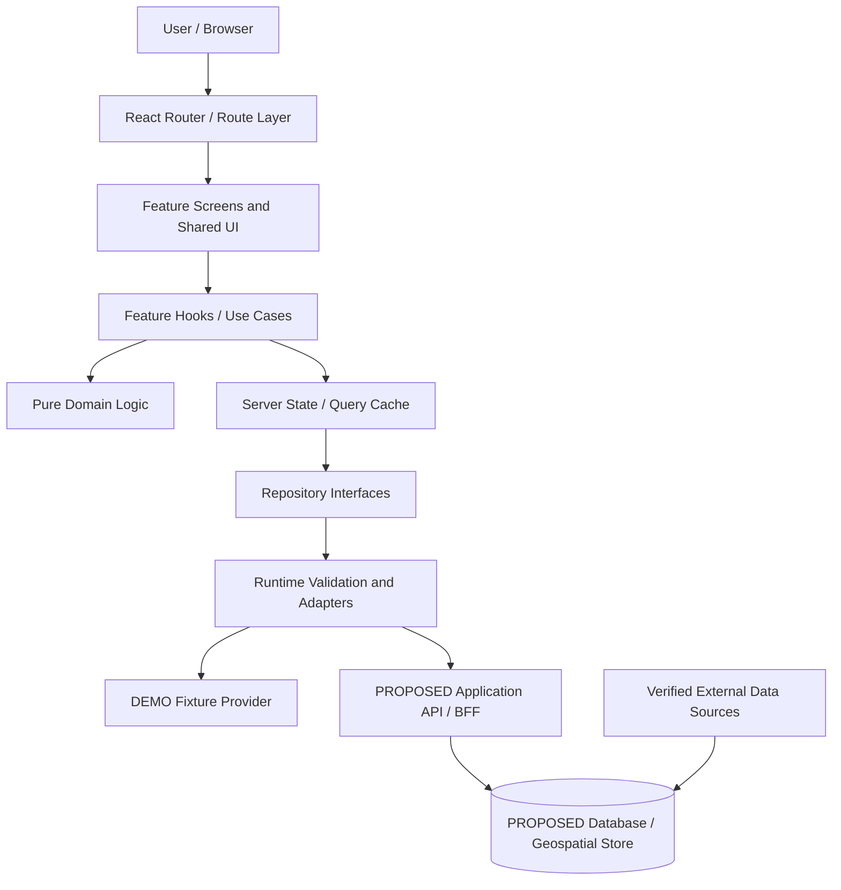
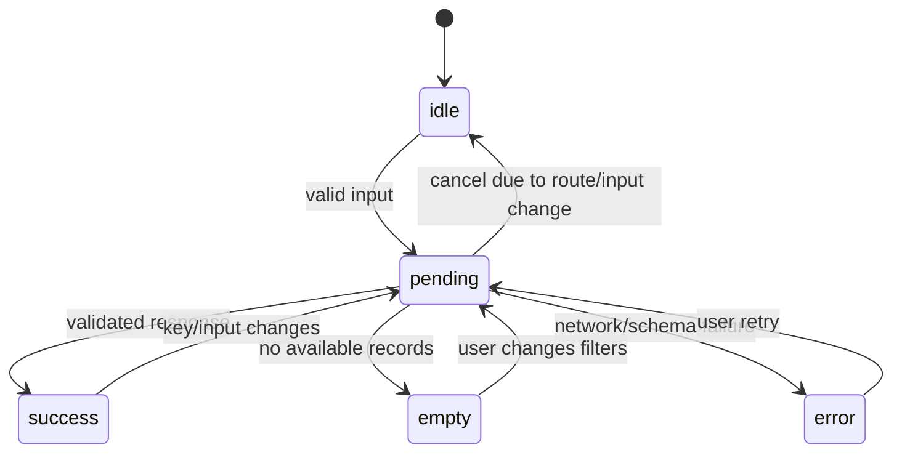
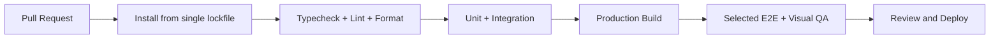

# 04 — Tech Stack & Software Architecture

> **Product:** Nusa Matra — WIA 2026  
> **File:** `docs/04-TECH-STACK-ARCHITECTURE.md`  
> **Version:** 1.0  
> **Updated:** 2026-10-19  
> **Audience:** Claude Code, frontend/backend engineers, architecture reviewers, QA  
> **Documentation language:** English; user-facing product language: **Bahasa Indonesia**  
> **Implementation status:** React + TypeScript **LOCKED**; other technology decisions clearly classified below.

---

## 0. How Claude Code must use this document

This is the **engineering architecture contract** for Nusa Matra. It explains _how to organize, connect, test, and deploy code_ without confusing approved product requirements with implementation proposals.

**Before changing code, read in this order:**

1. `CLAUDE.md` — project execution rules and authority order.
2. `project_guidelines.md` — brand, quality, and engineering principles.
3. `docs/01-PRODUCT-REQUIREMENTS.md` — what must exist, requirements `FR-*`, P0/P1/P2 priorities.
4. `docs/02-USER-FLOWS.md` — flows `UF-*`, navigation, state transitions, edge cases.
5. `docs/03-UI-UX-DESIGN-SYSTEM.md` — Figma-derived tokens, layout, Normal/Kaca, accessibility.
6. **This document** — implementation boundaries and recommended technology decisions.
7. Later specifications when present: `05-DATA-SOURCES`, `06-DATA-MODEL`, `07-DECISION-ENGINE`, `08-API-SPECIFICATION`, `09-ANIMATION-GUIDELINES`, `10-TESTING-STRATEGY`, `11-SECURITY-AND-PRIVACY`, `12-IMPLEMENTATION-ROADMAP`, `13-ACCEPTANCE-CRITERIA`.

### 0.1 Evidence labels and their meanings

| Label            | Meaning                                            | Engineering action                                            |
| ---------------- | -------------------------------------------------- | ------------------------------------------------------------- |
| `LOCKED`         | Explicit decision by project owner                 | Implement; obtain approval before changing.                   |
| `FIGMA-VERIFIED` | Observed in the approved Figma document            | Reinspect relevant node when implementing; follow the design. |
| `PROPOSED`       | Recommended, not owner-approved                    | Safe to explore provisionally; do not call it final.          |
| `TBD`            | Requires evidence or explicit decision             | Keep the seam flexible and document the blocker.              |
| `DEMO`           | Mock/stub/illustrative input or outcome            | Clearly label in UI and isolate from live data.               |
| `LIVE-VERIFIED`  | Data successfully traced to a source and validated | Display with source metadata and coverage limitations.        |

Do not promote a `PROPOSED`, `TBD`, or `DEMO` item to `LOCKED` or `LIVE-VERIFIED` without evidence.

### 0.2 Non-negotiable invariants

- Public branding is **Nusa Matra**, not the old Figma file name.
- Frontend is **React + TypeScript with strict type checking**.
- Clean Code, readability, sensible boundaries, tests, and maintainability are **evaluation criteria**, not optional polish.
- Figma is the authority for appearance; PRD/user flows are the authority for behavior; valid source metadata and approved methodology are the authority for data claims.
- A view must not render sample regional numbers, rankings, or simulations as factual production results.
- UI labels, onboarding copy, errors, data explanations, chart legends, and accessible names use **Bahasa Indonesia**.
- Third-party UI snippets, 3D examples, and animation references must not override approved Nusa Matra design, data integrity, accessibility, or licensing rules.
- If an appropriate animation does not exist elsewhere, **implement an original animation** rather than dropping the requirement or pasting a poor-quality component.
- Do **not** recreate the repository, reset configuration, or replace working libraries before inspecting the actual codebase.

### 0.3 What this file does _not_ decide

It does not select final statistical datasets; certify API availability; approve a ranking formula; define production DB schema; promise a backend provider; or determine deployment vendor. Those require the next specialized documents and project-owner decisions.

---

## 1. Architecture goals and quality attributes

Design toward these outcomes in priority order:

1. **Correctness and trust.** Region IDs, timestamps, units, data provenance, missing values, and comparison rules must remain correct across every feature.
2. **UI fidelity.** Reproduce the approved 1440px Figma reference and design responsive adaptations without distorting the identity.
3. **Understandability.** A new engineer or Claude session can locate the feature, domain logic, adapter, test, and documentation quickly.
4. **Independent evolution.** Data providers, map tiles, animation techniques, and backend storage can change without rewriting screens.
5. **Progressive enhancement.** Website remains usable with reduced motion, blocked WebGL, weak hardware, missing network, or incomplete data.
6. **Performance and accessibility.** Interactive visuals must not block core reading or navigation.
7. **Efficient project delivery.** Build a working P0 MVP before investing in optional P2 infrastructure.

### 1.1 Architectural style

**PROPOSED:** A React single-page application (SPA) with feature-based boundaries and a replaceable repository/data-access layer. Start with a small, modular monorepo-like folder structure **within one application**, not mandatory microservices or a multi-package monorepo.



The `DEMO` and API provider paths represent **alternative sources selected explicitly**, not an instruction to merge demo data with live data.

### 1.2 The dependency rule

```text
app (composition/root/routing)
  └── features (user-facing tasks)
       ├── components (shared visual primitives)
       ├── domain (pure rules and models)
       ├── services/repositories (capability interfaces)
       └── data adapters (implementation of repositories)

Do not import features into domain or infrastructure-level models.
```

The diagram is conceptual: composition wiring may import adapters, but pure domain code must never depend on React, DOM APIs, HTTP clients, map SDKs, or animation libraries.

---

## 2. Technology decision matrix

**Mandatory technology:** React + TypeScript. All others are conditional recommendations; inspect the existing repository before installing anything.

| Area                     | Candidate                                                               | Status     | Why / adoption rule                                                        |
| ------------------------ | ----------------------------------------------------------------------- | ---------- | -------------------------------------------------------------------------- |
| Frontend                 | **React**                                                               | `LOCKED`   | Owner instruction. Functional components; use hooks responsibly.           |
| Language                 | **TypeScript, strict**                                                  | `LOCKED`   | Prevent implicit API/model assumptions; maintainability.                   |
| Build/dev server         | **Vite**                                                                | `PROPOSED` | Lightweight React SPA; adopt if no incompatible existing toolchain.        |
| Package manager          | Existing lockfile (`npm`/`pnpm`/`yarn`)                                 | `TBD`      | One manager only; never create competing lockfiles.                        |
| Navigation               | **React Router**, Declarative/Data mode as appropriate                  | `PROPOSED` | Deep links, History API, routes, optional loaders.                         |
| Server-state cache       | **TanStack Query**                                                      | `PROPOSED` | Deduplication, stale handling, async status, retries.                      |
| Local state              | React state/context + URL                                               | `PROPOSED` | Keep transient/local preferences simple; add Zustand only if necessary.    |
| Forms                    | Native HTML + typed React state; form library if justified              | `PROPOSED` | Do not add an extra framework for a few controls.                          |
| Runtime input validation | Zod or equivalent                                                       | `PROPOSED` | Validate untrusted API/config/URL input at boundaries.                     |
| Styling                  | CSS custom properties + CSS Modules; reuse existing Tailwind if present | `PROPOSED` | Centralized tokens with scoped maintainable styles.                        |
| Primary animation        | CSS + **Motion OR GSAP**                                                | `PROPOSED` | Choose by actual Figma requirements; avoid duplicate engines.              |
| Complex 3D               | Three.js / React Three Fiber                                            | `PROPOSED` | Only if actual WebGL scene is warranted.                                   |
| Geographic map           | MapLibre GL JS                                                          | `PROPOSED` | Interactive geospatial layers; distinct from illustrative diorama.         |
| Charts                   | Recharts **or** ECharts                                                 | `PROPOSED` | Pick one based on feature demands; text/table fallback.                    |
| Unit/component tests     | Vitest + React Testing Library                                          | `PROPOSED` | Fits a Vite client app; test behavior.                                     |
| E2E                      | Playwright                                                              | `PROPOSED` | Exercise browser flows and theme/navigation/motion.                        |
| API server               | Node.js + TypeScript (e.g. Fastify) or equivalent                       | `TBD`      | Only after deciding real data access, hosting, credentials, and ingestion. |
| Relational database      | PostgreSQL; PostGIS if geometry queries needed                          | `TBD`      | Avoid provisioning before source requirements are known.                   |
| CI/CD                    | Host-appropriate pipeline (GitHub Actions candidate)                    | `PROPOSED` | Lint, tests, build, security checks and gated deployment.                  |
| Hosting                  | Static SPA host + optional API service                                  | `TBD`      | Decide URL rewrite, CORS, CSP, secrets, and storage at deployment time.    |

**Selection principle:** Prefer the smallest coherent set of libraries. The table is **not a dependency installation list**.

### 2.1 Why Vite is only provisional

A client-rendered React + Vite SPA is a good initial fit for dashboards and visual exploration. But if public landing-page SEO, crawlable narratives, social previews, or server-rendering become hard requirements, evaluate a pre-rendering/SSR approach _before committing infrastructure_; this does not negate the `LOCKED` React decision.

If an app already uses another React bundler and works, review migration benefit/cost rather than replacing it automatically.

### 2.2 Dependency policy

- Pin dependencies using the chosen lockfile; use compatible currently supported versions verified at installation time.
- Do not hardcode outdated package versions based on an old tutorial.
- Search existing imports/config before adding a new package.
- Ensure licenses are compatible, particularly from 21st.dev and other contributed snippets.
- Check bundle impact and runtime performance for map, 3D, chart, and animation packages.
- Prefer lazy imports for heavy optional scenes.
- Keep a short decision record for nontrivial dependency changes.

---

## 3. Repository structure and ownership

**PROPOSED baseline** (create only folders that contain actual code):

```text
nusa-matra/
├── CLAUDE.md
├── project_guidelines.md
├── README.md
├── .env.example
├── .gitignore
├── package.json
├── <one-lockfile>
├── index.html                         # If Vite SPA is selected
├── public/                            # Static assets intentionally served verbatim
├── docs/
│   ├── 01-PRODUCT-REQUIREMENTS.md
│   ├── 02-USER-FLOWS.md
│   ├── 03-UI-UX-DESIGN-SYSTEM.md
│   ├── 04-TECH-STACK-ARCHITECTURE.md
│   ├── 05-DATA-SOURCES.md
│   ├── 06-DATA-MODEL.md
│   ├── 07-DECISION-ENGINE.md
│   ├── 08-API-SPECIFICATION.md
│   ├── 09-ANIMATION-GUIDELINES.md
│   ├── 10-TESTING-STRATEGY.md
│   ├── 11-SECURITY-AND-PRIVACY.md
│   ├── 12-IMPLEMENTATION-ROADMAP.md
│   └── 13-ACCEPTANCE-CRITERIA.md
├── src/
│   ├── main.tsx
│   ├── app/
│   │   ├── App.tsx
│   │   ├── router.tsx                 # Routes, lazy boundaries, link conventions
│   │   ├── providers/                # QueryClient, theme, error boundaries
│   │   └── config/                   # Runtime-safe, validated public config
│   ├── components/
│   │   ├── ui/                       # Button, Input, Chip, Dialog, Slider
│   │   ├── layout/                   # Navigation, app shell, headers
│   │   ├── data-display/             # Reusable indicator/chart/table shell
│   │   └── feedback/                 # Loading, Empty, Error, Unavailable
│   ├── features/
│   │   ├── landing/
│   │   ├── map-hub/
│   │   ├── exploration/
│   │   ├── comparison/
│   │   ├── priority-lab/
│   │   ├── explanation/
│   │   ├── recommendation-test/
│   │   ├── evidence-passport/
│   │   ├── data-blindspots/
│   │   └── region-stories/
│   ├── domain/
│   │   ├── geography/                # Region identity, hierarchy
│   │   ├── indicators/               # Units, meaning, provenance
│   │   ├── comparability/            # Comparison decisions, reasons
│   │   ├── prioritization/           # Pure score and ranking functions
│   │   └── data-quality/             # Rule-based issues and severity
│   ├── data/
│   │   ├── schemas/                  # Runtime schemas at I/O boundaries
│   │   ├── adapters/                 # External wire DTO -> domain
│   │   ├── repositories/             # DEMO/LIVE concrete implementations
│   │   └── fixtures/                 # DEMO only; labeled and traceable
│   ├── services/                      # Repository interfaces, HTTP abstraction
│   ├── hooks/                         # Truly cross-feature hooks only
│   ├── lib/                           # Small generic utilities
│   ├── workers/                       # Optional heavy calculation workers
│   ├── styles/                        # CSS variables, font/type rules
│   ├── assets/                        # Bundled approved visual assets
│   └── test/                          # Shared test helpers/mocks
└── tests/e2e/                         # Optional Playwright test suite
```

### 3.1 Feature-local layout

For each active feature, use a compact feature-specific structure:

```text
src/features/comparison/
├── components/
│   ├── ComparisonSelectors.tsx
│   ├── ComparisonSummary.tsx
│   └── ComparisonIndicatorTable.tsx
├── hooks/
│   └── useComparison.ts
├── pages/
│   └── ComparisonPage.tsx
├── comparison.query.ts              # Feature query key builders
└── __tests__/
    └── ComparisonPage.test.tsx
```

A directory is justified by actual complexity, not by abstract future-proofing. Keep single-file functionality in one file until separating it improves readability.

### 3.2 Import boundary rules

**Allowed:**

- `app` imports features, repositories, and providers to compose the application.
- `features` import shared components, domain functions, and public repository interfaces.
- `data/repositories` import domain types, schemas, adapters, and the HTTP client.
- `domain` imports only domain modules and pure utilities.

**Disallowed:**

- Domain importing React, `window`, MapLibre, Three.js, HTTP clients, or UI components.
- Data adapters importing JSX/components.
- Shared `components/ui` importing feature pages, scoring rules, or global feature state.
- Features directly importing another feature's internal component or deep private file.
- `components` or domain code reading `import.meta.env` scattered throughout the codebase.
- Circular imports and cross-feature private re-exports.

If an interaction genuinely spans features, use explicit shared use cases/contracts or coordinate at the app route level.

### 3.3 Naming conventions

| Element          | Pattern                        | Example                       |
| ---------------- | ------------------------------ | ----------------------------- |
| React components | PascalCase                     | `RegionComparisonPage.tsx`    |
| Custom hooks     | `use` + PascalCase             | `useRegionSelection.ts`       |
| Domain functions | verb + noun, camelCase         | `assessComparability()`       |
| Domain types     | PascalCase                     | `ComparisonAssessment`        |
| CSS Modules      | Component name + `.module.css` | `RegionCard.module.css`       |
| Query keys       | scoped object or factory       | `regionKeys.detail(code)`     |
| Test files       | Same basename + `.test.ts(x)`  | `assessComparability.test.ts` |
| Routes           | readable kebab-case            | `/lab-prioritas`              |
| Environment vars | required platform prefix       | `VITE_API_BASE_URL` (PUBLIC)  |

Avoid `utils.ts` files containing unrelated business logic and generic `DataManager` classes with many responsibilities.

---

## 4. Application composition, boot sequence, and providers

A functional application boot should:

1. Load HTML and accessible base fonts/CSS.
2. Apply stored theme preference **before first meaningful paint** where feasible, without causing flash or hydration mismatch.
3. Validate public environment configuration and select explicit data mode.
4. Mount top-level providers.
5. Initialize routing and lazy-load the current route.
6. Fetch only required datasets; cancel or ignore obsolete results.
7. Initialize MapLibre or 3D contexts **only on routes that need them**.
8. Render complete fallback UI when storage, WebGL, API access, or animation is unavailable.

### 4.1 Suggested provider responsibilities

| Provider / mechanism    | Owns                                      | Must not own                               |
| ----------------------- | ----------------------------------------- | ------------------------------------------ |
| Router                  | Route location, navigation, query state   | Cached API responses, 3D rendering context |
| Query client            | Remote data lifecycle, cache              | Theme/animation preferences, domain truth  |
| Theme preference        | Normal/Kaca mode + persistence            | Geography/indicator selection              |
| Motion preference       | Manual reduction + system preference      | Any analytical calculation                 |
| Feature local state     | Slider hover, menu toggle, expanded panel | Global single-source-of-truth ranking copy |
| Data repository binding | Selected DEMO or live provider            | JSX and business interpretation            |

Do not create an all-in-one `GlobalContext` for unrelated state. Context is suitable for low-frequency stable values; high-frequency pointer/map camera state belongs near the consumer or in the rendering engine.

### 4.2 Example app composition (conceptual)

```tsx
// src/app/App.tsx — illustrative only; adapt to installed router/query APIs.
export function App() {
  return (
    <AppErrorBoundary>
      <QueryProvider>
        <ThemePreferenceProvider>
          <MotionPreferenceProvider>
            <AppRouter />
          </MotionPreferenceProvider>
        </ThemePreferenceProvider>
      </QueryProvider>
    </AppErrorBoundary>
  );
}
```

Provide real implementations of these wrappers before using this pattern; placeholder provider components are not a completed feature.

---

## 5. Routing and screen boundaries

**Routes below are `PROPOSED`**, aligned with earlier user-flow documentation. Preserve existing codebase routing if already established.

| Route              | Page                      | Source Figma node(s) | Release priority                         |
| ------------------ | ------------------------- | -------------------- | ---------------------------------------- |
| `/`                | Landing                   | `27:2`, `27:118`     | P0                                       |
| `/peta`            | Main Map Hub              | `61:1183`, `61:1619` | P0                                       |
| `/jelajahi`        | Explore Regions           | `29:34`, `29:485`    | P0                                       |
| `/bandingkan`      | Compare Two Regions       | `12:840`             | P0                                       |
| `/lab-prioritas`   | Priority Lab              | `11:152`             | P1                                       |
| `/mengapa`         | Why Prioritized           | `12:263`             | P1                                       |
| `/titik-buta-data` | Data Blind Spots          | `14:541`             | P1/P2 dedicated route; P0 inline quality |
| `/uji-rekomendasi` | Recommendation Robustness | `13:854`             | P2                                       |
| `/paspor-bukti`    | Evidence Passport         | `13:446`             | P2                                       |
| `/cerita-wilayah`  | Region Story              | `14:927`             | P2                                       |

**Special states:** Not Found (`404`), Data Unavailable, Request Error, Feature Not Released, and Invalid/Expired Snapshot.

### 5.1 URL as shareable state

Use validated query params for navigation-relevant choices, not large mutable object blobs:

```text
/jelajahi?wilayah=<OFFICIAL_REGION_CODE>&indikator=<INDICATOR_ID>&periode=<PERIOD>
/bandingkan?a=<REGION_A>&b=<REGION_B>&indikator=<INDICATOR_ID>
/mengapa?wilayah=<REGION_CODE>&skenario=<VALID_SNAPSHOT_ID>
/uji-rekomendasi?skenario=<VALID_SNAPSHOT_ID>
/paspor-bukti?id=<VALID_SNAPSHOT_ID>
/cerita-wilayah?bab=<SUPPORTED_CHAPTER_INDEX>
```

- These are **candidate names**, not a finalized public URL contract.
- Validate all IDs against actual catalog/snapshot availability.
- Do not put credentials, personal information, full datasets, or analysis secrets into URLs.
- Distinguish an absent param from an invalid or unsupported value.
- Decide whether to use replace-navigation or push-navigation intentionally; browser Back must make sense.
- Recover missing context gracefully (prompt for region/snapshot) rather than showing a fabricated default result.
- Define server/static-host rewrite to `index.html` for SPA deep links; otherwise route refresh can return a server 404.

### 5.2 Route-level code splitting

- Lazy-load P1/P2 page components and heavy map/3D modules when not on the active route.
- Provide semantic loading fallbacks and error boundaries.
- Keep navigation focus/heading management and scroll restoration consistent.
- Never load all heavy diorama models on initial landing if they are below the fold and not yet needed.
- Do not put core critical text inside a lazy 3D-only bundle.

### 5.3 Example navigation ownership

```text
Link / CTA (UI) → navigate(validated route + params)
  → route parser → feature hook → query/repository
  → domain validation → presentation + provenance
```

A floating navbar is still semantic navigation: use links, `aria-current`, keyboard focus, and real destinations—not divs with onClick handlers.

---

## 6. State-management model

There are **four** distinct categories. Do not conflate them.

| Category                | Examples                                                | Preferred owner                   | Persistence                               |
| ----------------------- | ------------------------------------------------------- | --------------------------------- | ----------------------------------------- |
| Shareable navigation    | Region, indicator, period, A/B selection, story chapter | URL/router                        | Browser history / copied link             |
| Remote server data      | Regions list, observations, metadata, boundary manifest | Query cache                       | Memory; optional configured cache         |
| Local UI state          | Modal, active tab, hover, draft slider, tooltip         | Component/hook                    | Typically none                            |
| Durable user preference | Normal/Kaca mode, manual reduced motion                 | Focused preference store          | localStorage with safe fallback           |
| Derived analysis        | Scores, ranked order, comparison result                 | Pure domain selectors/calculation | Recompute or immutable/versioned snapshot |

### 6.1 No duplicate sources of truth

- The URL's selected region is not independently copied into another global `useState` without synchronization rules.
- Scores are derived from **inputs + dataset/model version + missing-data policy**, not hand-edited in UI state.
- API data belongs in a server-data cache, not copied into local state only to be re-fetched manually.
- Persisted theme should not silently change the meaning of data, charts, or animations.

### 6.2 Choosing a state library

**Start with:** native React state, Context for narrowly scoped preferences, URL params for shareable navigation, and TanStack Query _if chosen_ for server state.

**Only add Zustand or another client store when** several unrelated feature areas must update a genuinely shared mutable client workflow state and simpler mechanisms cause substantial complexity. Document owner, writes, selectors, persistence, and reset behavior. **Do not introduce Redux by habit** for this MVP.

### 6.3 Asynchronous request lifecycle



- Maintain an identity-bearing query key (`region code`, `indicator ID`, `period`, `data mode`, dataset version when relevant).
- Use `AbortSignal` for cancellation when possible.
- Do not render previous-region results beneath a newly selected region without an explicit loading/stale indication.
- Classify schema errors separately from not-found and network outage when appropriate.
- Do not blindly retry invalid requests, blocked comparisons, or known permanent 4xx errors.

---

## 7. Domain-first data architecture

The public website is a **data reasoning interface**. Its accuracy depends on first-class identities, units, definitions, periods, and provenance.

### 7.1 Domain entities (minimum concepts)

| Entity                          | Required responsibility                                                  | Full spec               |
| ------------------------------- | ------------------------------------------------------------------------ | ----------------------- |
| `Region`                        | Stable official code, administrative level, parent relation, code system | `06-DATA-MODEL.md`      |
| `IndicatorDefinition`           | Semantic ID, unit, direction, methodology, coverage                      | `06-DATA-MODEL.md`      |
| `Observation`                   | Region + indicator + time + nullable measured value                      | `06-DATA-MODEL.md`      |
| `DataSource` / `DatasetVersion` | Publisher, source URL, retrieved/published time, license, lineage        | `05-DATA-SOURCES.md`    |
| `DataQualityIssue`              | Missing/incompatible/stale/etc. with severity and reason                 | `06-DATA-MODEL.md`      |
| `ComparisonAssessment`          | Allowed/blocked/warning; comparable values and reasons                   | `07-DECISION-ENGINE.md` |
| `PriorityScenario`              | Criteria, weights, normalization, dataset, model version                 | `07-DECISION-ENGINE.md` |
| `SensitivityRun`                | Seed, perturbation policy, simulation count, outputs                     | `07-DECISION-ENGINE.md` |
| `EvidenceSnapshot`              | Immutable report with exact source and model references                  | `06/07/08` documents    |

### 7.2 Recommended discriminated types (illustrative)

```ts
export type GeographicLevel = 'province' | 'regency' | 'city';

export interface Region {
  code: string;
  codeSystem: string; // e.g. source authority/version; do not invent values
  name: string;
  level: GeographicLevel;
  parentCode: string | null;
}

export interface IndicatorDefinition {
  id: string;
  displayName: string;
  description: string;
  unit: string;
  methodologyId: string;
  direction: 'higher_is_better' | 'higher_is_worse' | 'contextual';
}

export type ObservationValue =
  | { status: 'available'; value: number }
  | { status: 'missing'; reason: string }
  | { status: 'suppressed'; reason: string };

export interface Observation {
  regionCode: string;
  indicatorId: string;
  period: string;
  result: ObservationValue;
  sourceId: string;
  datasetVersion: string;
  qualityFlags: string[];
}

export interface ComparisonAssessment {
  outcome: 'allowed' | 'allowed_with_warning' | 'blocked';
  blockers: string[];
  warnings: string[];
}
```

**Important:** These types are architecture examples, **not an approved backend wire schema**. Refine and finalize them in `06-DATA-MODEL.md` and `08-API-SPECIFICATION.md` before implementation. Keep raw DTOs separate from validated domain models.

### 7.3 Trust rules

- Numeric zero is valid and must not be confused with missing.
- Time periods may have different meanings (year, month, fiscal year, survey wave); do not silently coerce.
- An indicator's title is **not** sufficient for comparability.
- Store measurement unit, denominator, definition/methodology, publisher, reference geography, and vintage.
- A model score is **not** a raw indicator; label them separately.
- If measurements are collected at a different geographic level, do not silently aggregate/disaggregate without an approved transformation.
- Store original source value and transformation metadata so displayed outputs are traceable.
- Never claim that a prototype hexagon/diorama represents authoritative administrative boundaries.

### 7.4 Comparison policy

```text
compare(A, B, indicator):
  validate A/B region identity
  resolve A/B observation + metadata
  check definition, method, denominator, unit, level, source, time policy
  if incompatible -> BLOCK with reason, no numeric difference or ratio
  if partial but allowed -> WARN with explicit limitations
  if comparable -> calculate safe difference / ratio and show source+period
```

- Divisions by zero must yield a defined unavailable/not-applicable result.
- Avoid ratio labels for unsuitable measurement scales or negative-valued data without explicit policy.
- _Higher_ does not always imply _better_; respect indicator direction.
- Do not fill in missing comparison numbers with zero.
- The data-quality checker and comparison view must use the **same underlying assessment**, not duplicated divergent frontend conditionals.

### 7.5 Priority model architecture

A provisional Figma example uses normalized measurements and user-adjustable weights. This is **DEMO/FIGMA context**, not yet a certified recommendation engine.

```text
validated observations
  → methodology-aware normalization
  → direction/orientation transformation
  → approved missing-value rule
  → weighted contributions
  → deterministic score
  → stable sort + ranking tie policy
  → explanation + quality warnings
  → optional sensitivity simulations
  → immutable evidence snapshot
```

Rules:

- `score = Σ(value_i × normalized_weight_i)` **only after** normalization, scoring direction, valid coverage, and weight sum policy are approved.
- Use pure functions with complete input metadata and deterministic outputs.
- Recompute explanation contribution from the same calculation output; **never independently hardcode it**.
- Tie-breaking and rounding must not change actual ranking unexpectedly; distinguish calculation precision from display precision.
- Keep model version, criterion IDs, dataset version, reference group, seed (when applicable), timestamp, and missing-data policy.
- For many trials, offload large computations to a Web Worker or controlled backend worker; keep a cancellable UI.
- Never display claims such as “92% stable” unless actually computed from the loaded scenario.

---

## 8. Data access and repository abstraction

### 8.1 Contract first: UI does not call providers directly

```ts
export interface RegionRepository {
  search(query: string, signal?: AbortSignal): Promise<Region[]>;
  getByCode(code: string, signal?: AbortSignal): Promise<Region | null>;
}

export interface IndicatorRepository {
  getDefinitions(signal?: AbortSignal): Promise<IndicatorDefinition[]>;
  getObservations(
    input: {
      regionCodes: string[];
      indicatorIds: string[];
      periods?: string[];
    },
    signal?: AbortSignal,
  ): Promise<Observation[]>;
}
```

**Use interface-driven composition** to replace the source:

```text
Feature → repository interface
            ├── DemoRepository (labeled fixtures only)
            └── ApiRepository (validated real response)
```

Do not build an entire generic repository framework; these small interfaces only abstract real provider differences.

### 8.2 Explicit data-mode configuration

Use a deliberate boot-time mode with fail-closed behavior:

```ts
export type DataMode = 'demo' | 'live';

export interface PublicAppConfig {
  dataMode: DataMode;
  apiBaseUrl?: string;
}
```

- No hidden auto-fallback from failed live API to demo numbers.
- `demo` renders a visible **“Data simulasi — bukan data resmi”** disclosure on affected pages, results, and exports.
- `live` requires a verified compatible API and data provenance; if unavailable, show an honest error/empty state and offer retry.
- An unknown/unset mode must produce a configuration error, not guess `live`.
- Do not equate `production build` with verified live data: an explicitly authorized demo can be deployed, but must stay labeled.

### 8.3 HTTP and validation boundary

The adapter must:

1. Compose authorized base URLs; do not allow arbitrary user-controlled hosts.
2. Pass a request cancellation signal.
3. Check status codes/content type and manage rate limits/timeouts/retries deliberately.
4. Validate JSON at runtime against a defined schema.
5. Convert external field names, units, period formats, and nullability into domain types.
6. Attach/provide source metadata, ingestion version, and quality issues.
7. Return explicit typed errors; do not return silent empty arrays for failed requests.

#### Illustrative HTTP error classification

```ts
export type DataAccessError =
  | { type: 'network'; message: string; retryable: true }
  | { type: 'not_found'; message: string; retryable: false }
  | { type: 'rate_limited'; message: string; retryable: true }
  | { type: 'invalid_payload'; message: string; retryable: false }
  | { type: 'unavailable'; message: string; retryable: true };
```

The production error representation (exceptions vs `Result` return type) is an implementation decision; choose **one consistent strategy** instead of mixing both unpredictably.

### 8.4 Query cache contract

If using TanStack Query:

- Query keys include every result-defining input (region, indicator, period, data mode, source/dataset version when relevant).
- Make stale/refetch durations intentional based on source cadence; never default to “forever” without evidence.
- Use the injected `signal` from query execution for transport cancellation when possible.
- Invalidate related cached data only after actual backend mutations or known source-version changes.
- Keep demo and live caches separated by key or query-client lifecycle.
- Prevent large geospatial tiles/3D resources from being inappropriately stored as ordinary JSON query state.
- Retry only transient failures, with bounded backoff; don't retry schema-invalid data indefinitely.

**Example query-key factory:**

```ts
export const observationKeys = {
  all: ['observations'] as const,
  forRegion: (code: string, indicatorId: string, period: string, dataMode: DataMode) =>
    ['observations', dataMode, code, indicatorId, period] as const,
};
```

This example assumes a single active dataset version per mode. If versions can switch without a full cache reset, also include `datasetVersion`.

### 8.5 Error, empty, stale, and retry UX

**UI copy examples (Bahasa Indonesia):**

| Condition             | Expected UX copy                                             | Behavior                                  |
| --------------------- | ------------------------------------------------------------ | ----------------------------------------- |
| No matching region    | “Wilayah tidak ditemukan.”                                   | Change search text; keep controls usable. |
| No observation        | “Data untuk wilayah dan periode ini belum tersedia.”         | Show null/unknown, not zero.              |
| Offline/network error | “Data belum dapat dimuat. Coba lagi.”                        | Real retry, preserve selection.           |
| Incompatible values   | “Angka tidak dapat dibandingkan karena definisinya berbeda.” | Block difference and ratio.               |
| DEMO provider         | “Data simulasi — bukan data resmi.”                          | Always visible near affected results.     |
| Expired scenario      | “Skenario tidak tersedia atau sudah kedaluwarsa.”            | Recover or recreate; no fake result.      |

---

## 9. Frontend interaction and composition contracts

### 9.1 UI owns rendering, not interpretation

A React component may:

- Render a loading state, indicator value, bar chart, story chapter, or map legend.
- Translate the domain response into local copy.
- Dispatch a user action to a hook/use case.

It must **not**:

- Decide source comparability with ad hoc JSX string checks.
- Compute priority math inside a render function.
- Treat missing observations as zero.
- Create network calls inside mapped list components.
- Assert a geographic value simply from map fill color.
- Couple animation progress to statistical calculations.

### 9.2 Design-system integration

Follow `03-UI-UX-DESIGN-SYSTEM.md`. Verified Figma anchors:

- Kapur & Kobalt token set: `26:38`.
- Normal/Kaca switch: `26:37`.
- Aksen/Kaca/Garis button variants: `26:14`.
- Floating navbar: `49:447`.
- Explorer Normal/Kaca: `29:34` / `29:485`.
- Theme liquid transition spec: `30:1467`.

Centralize tokens; prefer semantic CSS variables over repeated hex values or inline styles. Use Lexend, approved assets, accessible focus indicators, and robust spacing. Responsive breakpoints remain `PROPOSED` pending design review; do not claim mobile frame measurements were verified.

### 9.3 Theme and motion preferences

- Theme (`normal` or `glass`) is a **presentation preference**, not a data state.
- Persist with safely wrapped `localStorage` access, including private-mode/security exceptions.
- Use the boot-time class/data-attribute strategy documented in the design system to avoid flicker.
- Respect `prefers-reduced-motion`; provide immediate access to content.
- Handle `prefers-reduced-transparency` where supported and `prefers-contrast: more`; use readable, opaque fallbacks as needed.
- Never block scroll or keyboard navigation to complete liquid animations.
- In the glass mode, avoid global `backdrop-filter` on every nested element.

### 9.4 Accessible visualizations

- Every chart has a title and nearby table/text equivalent showing values, units, year and source.
- Never rely only on color to encode five priority levels; keep labels and accessible legend.
- Every map selection has a keyboard-accessible list/search alternative.
- Tooltip information essential for comprehension must also be reachable by keyboard and touch.
- Screen reader reading order must match content hierarchy independent of 3D layering.
- Story chapters provide summaries that do not require visual motion to understand.

---

## 10. Maps, geospatial layers, and 3D

### 10.1 Two visually related but semantically distinct engines

| Visual                                 | Purpose                                                                 | Rules                                                                |
| -------------------------------------- | ----------------------------------------------------------------------- | -------------------------------------------------------------------- |
| **Authoritative map layer**            | Show geographic identity, administrative boundaries, indicator overlays | Uses verified geometry and matching region codes / boundary vintage. |
| **Illustrative diorama / hexagon map** | Tell the visual story and demonstrate interaction                       | Cannot support precise geographic claims. Label when needed.         |

Do not use the illustrative Figma hexagons as real boundary polygons. If official boundaries are unavailable, keep the map in an explicitly illustrative/demo mode.

### 10.2 MapLibre integration (`PROPOSED`)

- Instantiate the map inside a dedicated React component that mounts only in the browser.
- Keep the map instance in `useRef`, not React state.
- Dispose via the MapLibre API on unmount and remove custom DOM listeners/controls.
- Treat style/tiles as separately licensed/hosted services; never imply MapLibre includes production-ready Indonesian data or a free unrestricted tile provider.
- Select a geometry source/version that matches the administrative code catalog.
- Use appropriate vector tiles or simplified GeoJSON/TopoJSON depending on validated complexity.
- Apply map layer state changes via map API rather than rebuilding the entire map on each filter change.
- Provide clear loading/error/empty states and alternative region selection.
- Test repeated mount/unmount, switch modes, route changes, filter changes, and renderer failures.

### 10.3 Resource lifecycle sketch

```text
Mount Map View
  → create map + attach style/layers after readiness
  → subscribe to selection and viewport interactions
  → sync selected region with route/source of truth
  → on filter update: update source/layer styling only
  → on unmount: unsubscribe, abort in-flight requests, remove map
```

Avoid registering event handlers on every render. Keep `useEffect` dependency arrays precise and avoid closing over stale region/filter state.

### 10.4 Three.js / React Three Fiber (`PROPOSED`)

The Figma design includes a hero Nusantara diorama, layered island visualization, moving data columns, and a floating Evidence Passport concept. The rendering choice depends on the inspected assets and desired interaction, not on the word “3D” alone.

- Prefer CSS transforms/SVG for lightweight faux-3D where visual fidelity remains high.
- Use WebGL scenes only for real 3D spatial effects, not generic card hover.
- Lazy-load the 3D runtime and scene models; reuse shared geometry/materials judiciously.
- Respect device pixel ratio and low-power hardware.
- Dispose graphics resources appropriately; pause animations when not visible.
- Prefer one clear render-loop owner per scene.
- Provide static image, SVG, or CSS fallback with the **same meaning and navigation affordances**.
- Do not allow a GPU failure to blank the content shell or all routes.

### 10.5 Heavy computation

- For Monte Carlo/sensitivity tests, evaluate workers when UI blocking is measurable or likely.
- Make job requests identifiable and cancellable.
- Carry `seed`, scenario config, dataset/model version through request and result.
- Workers return domain results, not HTML/JSX.
- If a backend worker is used, define progress and lifetime semantics in the API specification.

---

## 11. Animation architecture

**Source precedence:** Approved Figma motion annotations → existing clean code → inspected external patterns (21st.dev/Fuselab) → original custom animation.

### 11.1 Figma motion contracts that architecture must support

- General scroll reveal: once near 20% visibility, translate + fade, reduced-motion bypass.
- G1–G11 section motions; details in Figma `43:713` and `03-UI-UX-DESIGN-SYSTEM.md`.
- Hero 3D entry/parallax and contextual map morph when requested by relevant flow.
- User-controlled priority weight animations tied to valid **computed state**, not hardcoded sample rankings.
- Normal ↔ Kaca liquid theme transition: Figma `30:1467` contains explicit stages, timing direction, gooey effect proposal, accessibility and performance guidance.
- Scroll-linked section transformation must not hijack native scrolling.

### 11.2 Motion code boundaries

```text
features/landing/components/HeroDiorama.tsx
features/landing/motion/hero.motion.ts
components/ui/RevealOnScroll.tsx
components/layout/ThemeTransitionOverlay.tsx
styles/motion-tokens.css
```

These are **illustrative names**; create only modules required by current implementation.

- Animations should consume component state as input and never authoritatively set domain data.
- Separate motion configs from semantic data logic.
- Clean up `IntersectionObserver`, `ResizeObserver`, timers, RAF loops, and pointer listeners.
- Avoid scattered magic durations; centralize key tokens, but do not invent a massive timing registry.
- Prefer transform and opacity over layout-thrashing top/left animation.
- Test rapid route changes and interrupted theme transitions.

### 11.3 Original animation rule for Claude

When existing references do not achieve the approved Figma result:

1. Describe the intended motion and interaction contract.
2. Choose CSS, SVG, Motion, GSAP, Canvas, or WebGL based on actual complexity.
3. Build the smallest reusable primitive with clear start/stop behavior.
4. Include reduced-motion and no-WebGL fallbacks.
5. Verify both visual fidelity and resource cleanup.
6. Do not paste huge opaque minified animation code or unrelated dependency bundles.

Never claim a specific Figma animation is complete without viewing/validating the actual implementation.

---

## 12. Backend and ingestion architecture (`TBD` / `PROPOSED`)

> **Repository scope (owner decision 2026-10-20):** this website repository is the React frontend only. Backend, database, ingestion and validated datasets belong to the separate **Data Hub** service and repository. Read the backend sections of this document as the contract the Data Hub is expected to satisfy, not as code to build here. See `docs/adr/0001-frontend-foundation.md`.

Backend selection depends on available source formats, API access policy, dataset size, computation burden, and hosting.

### 12.1 MVP options

| Option                                      | When it is suitable                                                                          | Risks / conditions                                            |
| ------------------------------------------- | -------------------------------------------------------------------------------------------- | ------------------------------------------------------------- |
| **Static validated datasets + React**       | Source data can be legally preprocessed and periodically published; early demo/MVP           | Need clear provenance, update process, practical asset sizes. |
| **React + thin Backend-for-Frontend (BFF)** | Sources require secret credentials, normalization, CORS workarounds, caching, or aggregation | Requires operations, auth/secrets handling, service uptime.   |
| **React + dedicated API + relational DB**   | Many regions/periods, frequent refreshes, spatial filters, saved snapshots                   | More complexity; only justify with concrete requirements.     |

**Recommended first step:** audit sources in `05-DATA-SOURCES.md`, then select the simplest architecture that supports **verified** P0 regional search, observations, and comparison.

### 12.2 Candidate BFF / API services

If an API is warranted, a **Node.js + TypeScript** service (Fastify as a candidate) can keep language/models consistent. Do not assume Fastify is selected or install it without a decision.

```text
External source APIs / open datasets
        ↓
Isolated ingestion jobs (validate, record metadata, normalize)
        ↓
Versioned normalized data store / cache
        ↓
Application API (stable Nusa Matra response contract)
        ↓
Browser repositories (runtime validation)
        ↓
Domain → React presentation
```

- **Ingestion is not the same as serving**: never live-scrape unpredictable third-party APIs directly during every user interaction if the service license, latency, or format makes that unsafe.
- Maintain original source version, transformation logs, timestamps, and schema checks.
- Service responses must include data provenance and meaningful failure statuses.
- Credentials and provider secrets remain server-side only.
- API contracts must be specified in `08-API-SPECIFICATION.md` before becoming stable.

### 12.3 Database selection

**PROPOSED:** PostgreSQL for normalized entities/observations if persistent data is required; PostGIS only for spatial queries, geometry joins, or processing that actually benefit from a geospatial extension.

Do not choose a document database solely to store JSON files or a complicated microservice architecture for a WIA MVP.

Define actual tables, primary keys, foreign keys, indexes, unique `(region, indicator, period, dataset version)` semantics, admin boundary versions, and provenance in `06-DATA-MODEL.md`.

### 12.4 Caching and publishing

- Prefer versioned immutable snapshots for large public reference datasets.
- Define cache keys including region/indicator/time/source version.
- Invalidate/cycle datasets atomically when source vintages change.
- Explicitly separate client cache freshness from original data recency.
- Document rate limits and provider attribution; no unlicensed redistribution.

---

## 13. Configuration, environments, and deployment

### 13.1 Environment classification

| Environment       | Purpose                                                     | Restrictions                                                   |
| ----------------- | ----------------------------------------------------------- | -------------------------------------------------------------- |
| Local development | Build/test with deterministic fixtures or approved API      | Demo visibly labeled.                                          |
| CI                | Static checks, unit/integration/e2e tests                   | Do not require live production credentials for ordinary tests. |
| Preview/staging   | Stakeholder QA, visual comparison, sample data verification | No misleading production claims.                               |
| Production        | Public website with approved content/data                   | Verified providers, monitoring, safe error behavior.           |

### 13.2 `.env.example` (`PROPOSED`)

```dotenv
# Public values bundled by Vite; NEVER store secrets in VITE_* variables.
VITE_APP_NAME=Nusa Matra
VITE_DATA_MODE=demo
VITE_API_BASE_URL=
VITE_ENABLE_3D=true
```

- Treat `.env.example` as non-secret documentation only.
- Define a schema validating all public configuration on application start.
- An empty base URL is legitimate only when `dataMode` does not need it; otherwise fail clearly.
- Do not expose any private token in `VITE_*`, JavaScript bundles, query strings, or browser storage.
- If Vite is not selected, adapt naming to the actual build environment.

### 13.3 Hosting prerequisites

- History-fallback rewrite to the SPA entry for deep links, if using BrowserRouter + static host.
- HTTPS, appropriate cache headers, security headers and Content Security Policy tested with chosen map/3D SDKs.
- Separate public static assets and private API credentials.
- Content type handling for JSON, fonts, 3D assets, map tiles and workers.
- Fail-safe deploy/rollback or preview validation, when hosting provider supports it.
- Evaluate landing-page SEO/social cards as part of deployment strategy; do not promise SSR from Vite SPA by default.
- Enforce asset/license attribution.

---

## 14. Security and privacy baseline

See `11-SECURITY-AND-PRIVACY.md` for the complete threat model. Minimum architecture controls:

1. Runtime-validate external data and URL params; do not trust TypeScript declarations as security checks.
2. Keep keys/private data on server. `VITE_*` values are visible to users.
3. Use safe DOM rendering; do not use `dangerouslySetInnerHTML` for fetched text or data labels.
4. Restrict external API/map/style endpoints to approved providers; do not construct fetch URLs from untrusted arbitrary hosts.
5. Limit potentially expensive free-form queries, analytics jobs, and snapshot generation on backend when applicable.
6. Do not introduce authentication/PII collection without a product requirement; assume browse-without-login for P0 unless changed.
7. Avoid storing sensitive region/search activity without user consent and a documented retention purpose.
8. Use least-privilege hosting secrets and dependency scanning.
9. Explain error causes without leaking private server paths, keys, raw stack traces, or payloads.
10. Assess licenses and terms for map tiles, third-party animations, Figma assets, and official datasets.

---

## 15. Testing architecture and enforceable quality gates

Clean Code is an explicit judging concern. Prefer a **testing pyramid with domain-heavy coverage** rather than only screenshot matching.

### 15.1 Test layers

| Level              | Examples                                                                                                   | Suggested tool                                  |
| ------------------ | ---------------------------------------------------------------------------------------------------------- | ----------------------------------------------- |
| Unit / domain      | Region validation, comparability, normalization, weights, tie handling, missing value policy, ratio safety | Vitest                                          |
| Component          | Search, selectors, loading/errors, keyboard focus, button states, glass toggle                             | React Testing Library                           |
| Integration        | Route → repository → adapter → domain → UI; stale requests and provider mode                               | Vitest + HTTP mocks (MSW candidate)             |
| E2E                | Search → Jelajahi → Bandingkan; reload/back; theme; sample/real data labels                                | Playwright                                      |
| Visual regression  | Representative Figma 1440px, Normal/Kaca, responsive states                                                | Approved screenshot workflow                    |
| Performance / a11y | Core Web Vitals, reduced motion, contrast, keyboard, WebGL fallback                                        | Browser instrumentation and accessibility audit |

### 15.2 Non-negotiable domain tests

- Two compatible observations compare correctly.
- Identically named but methodologically incompatible observations are blocked.
- Differing years produce correct warning or block according to approved policy.
- `0`, `null`, suppressed, and unknown have different behavior.
- Division by zero and negative-value ratios do not produce `Infinity`/misleading labels.
- Scoring weights sum according to the approved policy; effects on rank are deterministic.
- Explanations are consistent with computed contributions and rounding policy.
- Missing inputs do not silently redistribute without an authorized rule.
- Same seed/scenario/version produces the same sensitivity result.
- `DEMO` mode never claims results are official or live.

### 15.3 Non-negotiable UI / lifecycle tests

- Route change invalidates stale region-specific responses.
- Query params are validated and history restoration works.
- Normal/Kaca persistence does not alter data state and does not flash noticeably.
- Keyboard-only users can select regions without requiring map pointer interaction.
- Missing API / WebGL / reduced-motion still shows complete functional content.
- Repeated map and 3D mounts do not create obvious listener/context leaks.
- Charts and priority legends have non-color labels plus accessible summaries.
- All active CTA/nav buttons have a meaningful action; P1/P2 unreleased states are honest.

### 15.4 Example scripts (`PROPOSED`)

Use actual scripts matching the existing `tsconfig` structure; this is a suggested `package.json` shape **if Vite + TypeScript + Vitest are selected**:

```json
{
  "scripts": {
    "dev": "vite",
    "build": "tsc -b && vite build",
    "typecheck": "tsc -b --pretty false",
    "lint": "eslint . --max-warnings=0",
    "format:check": "prettier --check .",
    "test": "vitest run",
    "test:watch": "vitest",
    "test:e2e": "playwright test"
  }
}
```

If the project does not use TypeScript build references, `tsc -b` may be inappropriate; select the correct `tsc --noEmit`/project command after inspecting the config. Do not claim tests pass unless executed.

### 15.5 CI pipeline proposal



- CI must fail on type, lint, or test regressions once those gates are established.
- Do not make network-dependent external APIs necessary for deterministic tests.
- Report skipped tests, environment limitations, and evidence gaps honestly.
- Prevent autogenerated `dist/`, credentials, and other local artifacts from being committed by accident.

---

## 16. Performance architecture and observability

### 16.1 Performance strategy

- Keep the initial React shell small; load geospatial engines, charts, model viewers, and 3D components on demand.
- Avoid shipping high-resolution full-Indonesia polygon data if simplified tiles suffice; preserve geographic correctness and source metadata.
- Use efficient layer updates rather than remounting WebGL on each selection change.
- Avoid React renders on every animation frame or pointer move; let the renderer/imperative animation own high-frequency updates.
- Compress and precompute appropriate assets with correct licenses.
- Ensure mobile/reduced-motion fallback is usable without loading full 3D infrastructure.
- Cache immutable assets with content hashes, while data APIs use version-aware freshness.
- Measure real-world and lab performance; do not report imaginary scores.

### 16.2 Proposed performance targets (not measured)

| Metric / behavior | Candidate target                                            | Decision status            |
| ----------------- | ----------------------------------------------------------- | -------------------------- |
| LCP               | ≤2.5s at p75 on representative public traffic               | `PROPOSED`; measure first. |
| INP               | ≤200ms at p75                                               | `PROPOSED`; measure first. |
| CLS               | ≤0.1 at p75                                                 | `PROPOSED`; measure first. |
| Core navigation   | Remains interactive during map and 3D loading               | Architecture requirement.  |
| Reduced motion    | Content and interactions complete without decorative motion | Accessibility requirement. |
| Map/3D failure    | Functional selection/text fallback, no blank application    | Resilience requirement.    |

Targets are measurement goals, **not claims of current performance**. Define test devices/network and the release budget after profiling.

### 16.3 Logging/telemetry

- Log structured request/data errors with safe codes and context, excluding secrets and personal information.
- Distinguish `network`, `schema`, `data_missing`, `incompatible`, `render_failure`, and `config_error`.
- Correlate dataset version and model version in analytic errors when safe.
- Add telemetry only when justified and documented; do not start collecting individual behavioral analytics invisibly.
- Publish no user-facing numeric claim without traceable evidence.

---

## 17. Feature implementation slices and dependency mapping

**Build testable vertical slices; do not implement every folder/module upfront.**

| Slice             | Required vertical behavior                                                     | Depends on                       | Stage      |
| ----------------- | ------------------------------------------------------------------------------ | -------------------------------- | ---------- |
| 0. Repo audit     | Existing code, package manager, Figma assets/tokens, decision log              | Owner design/reference           | Foundation |
| 1. Shell          | React app, router, Lexend/tokens, shared components, navigation, errors, theme | 03 design-system                 | P0         |
| 2. Landing / Hub  | CTA to valid route, illustrations/fallback, responsive shell                   | Slice 1                          | P0         |
| 3. Region catalog | Search by code/name, validation, explicit DEMO/LIVE mode                       | Data source or labeled fixtures  | P0         |
| 4. Explorer       | Verified geographic mapping, map/list selection, indicators, provenance        | Slice 3 + geometry and dataset   | P0         |
| 5. Compare        | A/B, swap, metadata-aware comparison/block/warnings                            | Slice 3/4 + comparison rules     | P0         |
| 6. Priority lab   | Scenario weights, deterministic ranking and display                            | Approved model + data            | P1         |
| 7. Explanation    | Score contributions and counterfactuals from same engine                       | Slice 6                          | P1         |
| 8. Quality page   | Validated issues aggregated into dedicated view                                | Data validators                  | P1/P2      |
| 9. Sensitivity    | Reproducible experiments with seed/progress/cancellation                       | Approved model + worker strategy | P2         |
| 10. Passport      | Immutable, attributable snapshot/report                                        | Prior validated results          | P2         |
| 11. Stories       | Source-backed copy with a11y and 3D fallbacks                                  | Validated data + animation plan  | P2         |

**Important:** Some high-fidelity animations may be implemented progressively after working P0 functionality, but the architecture must allow original custom animation without refactoring data logic.

### 17.1 Traceability

For every feature change, identify:

```text
FR-*   — product requirement(s)
UF-*   — user flow(s)
Figma  — source frame ID(s)
Module — changed React/domain/data files
State  — URL/local/remote-derived owner
Data   — DEMO or LIVE-VERIFIED, dataset/method version
Tests  — unit/component/integration/e2e evidence
Status — implemented / blocked / proposed / deferred
```

Suggested example:

```text
Feature: Bandingkan
Requirements: FR-CMP-01 through FR-CMP-08
Flow: UF-05
Figma: 12:840
Domain: comparability/
Feature module: features/comparison/
Data: region/indicator repositories, observed years and methods
Tests: comparability unit tests + A/B swap interaction + blocked-row e2e
```

---

## 18. Clean Code review checklist — mandatory for WIA

### 18.1 Architectural quality

- [ ] Code follows the selected runtime/stack; no simultaneous duplicate routing or state systems.
- [ ] Feature directories correspond to actual responsibilities.
- [ ] Domain math is pure and independent of UI/browser APIs.
- [ ] Repository boundaries prevent direct provider coupling in JSX.
- [ ] Shared components do not import feature-private code.
- [ ] No circular imports, giant God-components, speculative class hierarchies, or unbounded generic abstractions.
- [ ] No silent fallback from live failure to demo statistics.

### 18.2 Type safety and correctness

- [ ] `strict: true` and meaningful typed props/models.
- [ ] No unjustified `any`, `@ts-ignore`, unsafe casts, or non-null assertions.
- [ ] All external data and route/config inputs validated at runtime.
- [ ] `null`, zero, missing, suppressed, and blocked comparison handled distinctly.
- [ ] Data lineage, units, periods, codes, versions, and warnings preserved end to end.
- [ ] No unverified source names or prototype numbers presented as live data.

### 18.3 UI and visual engineering

- [ ] Inspected exact Figma frame; respected token hierarchy and approved static assets.
- [ ] React components are cohesive and appropriately reusable.
- [ ] Buttons/links and UI states are functional, accessible, and testable.
- [ ] Normal/Kaca, responsiveness, reduced motion, and no-WebGL fallbacks are checked.
- [ ] Animation listeners, observers, controllers, and WebGL resources are disposed.
- [ ] Styling and motion values avoid untraceable scattered magic numbers.

### 18.4 Verification and handoff

- [ ] Actual typecheck, lint, format check, tests, and build commands executed if supported.
- [ ] Actual results (PASS/FAIL/SKIPPED) reported; no fabricated success.
- [ ] Known gaps and `TBD` decisions documented with a next action.
- [ ] Existing out-of-scope code untouched.
- [ ] Documentation and test expectations updated when public behavior or architecture changes.

---

## 19. Architecture Decision Records (ADRs)

For any nontrivial decision, add a compact dated ADR in `docs/adr/` **only when the decision is genuinely made**. Do not create 20 empty ADR files.

Suggested template:

```markdown
# ADR-0001 — Decision title

- Date: YYYY-MM-DD
- Status: Proposed | Accepted | Superseded
- Context: What constraint forces a choice?
- Options: A / B / C with tradeoffs
- Decision: What is selected, and by whom?
- Consequences: Known benefits, costs, migration impact
- Validation: How to confirm the decision worked
- Related: FR-_, UF-_, source links
```

### 19.1 Decisions still open

| Decision ID | Open question                                 | Current safe position                            | Owner action needed                       |
| ----------- | --------------------------------------------- | ------------------------------------------------ | ----------------------------------------- |
| `ARCH-01`   | Is Vite the final app scaffold?               | `PROPOSED`; retain working stack.                | Confirm repository state.                 |
| `ARCH-02`   | React Router mode/version?                    | `PROPOSED`; keep simple route model.             | Inspect need for loaders/SSR.             |
| `ARCH-03`   | Server-state cache strategy?                  | `PROPOSED` TanStack Query.                       | Confirm fetched data complexity.          |
| `ARCH-04`   | CSS Modules vs Tailwind?                      | Use existing convention; tokens mandatory.       | Choose after initial repo inspection.     |
| `ARCH-05`   | Motion vs GSAP?                               | Use one main motion engine plus CSS.             | Audit Figma motion complexity.            |
| `ARCH-06`   | MapLibre, map provider, admin boundaries?     | `PROPOSED`; no invented geometry.                | Verify source/license/accuracy.           |
| `ARCH-07`   | Chart library?                                | Pick one after comparison/priority requirements. | Evaluate chart and a11y needs.            |
| `ARCH-08`   | Backend/BFF required?                         | Do not assume one exists.                        | Audit API credentials/CORS and ingestion. |
| `ARCH-09`   | PostgreSQL/PostGIS needed?                    | Defer schema/host until data confirmed.          | Verify query scale and geometry need.     |
| `ARCH-10`   | Static host, SSR, SEO and deep-link fallback? | Keep routing strategy reversible.                | Define production hosting needs.          |
| `ARCH-11`   | Data version and official code system?        | Treat unknown as `TBD`.                          | Resolve in 05/06 before live analysis.    |
| `ARCH-12`   | Scoring and missing-data policy approval?     | DEMO-only calculation until approved.            | Resolve in 07.                            |
| `ARCH-13`   | Snapshot persistence/auth?                    | Guest-first P0, no hidden auth.                  | Decide for Paspor Bukti.                  |
| `ARCH-14`   | Date of UI mobile sign-off?                   | Use responsive `PROPOSED` layout and QA.         | Review against actual mobile screens.     |

---

## 20. Implementation instructions for Claude Code

**For each requested feature:**

1. **Audit first:** inspect existing repository structure, package manager/lockfile, TypeScript and lint configs, design tokens, related components, tests, and Figma node(s).
2. **Map scope:** cite relevant `FR-*`, `UF-*`, Figma IDs and `P0/P1/P2` priorities.
3. **Resolve evidence:** distinguish `LOCKED`, `FIGMA-VERIFIED`, `PROPOSED`, `TBD`, and `DEMO` before choosing dependencies or sources.
4. **Plan one vertical slice:** define UI entry/exit, state owner, data repository, domain function, errors, fallbacks, and test cases.
5. **Implement bottom-up:** domain and boundary validation → repository/adapter → hook/use case → React component → animation.
6. **Respect Figma:** match existing Normal/Kaca components, Lexend, palette, and sourced assets; no unauthorized redesign.
7. **Implement motion:** inspect Figma; consider 21st.dev/Fuselab patterns only after license/quality review; write custom clean animation if needed.
8. **Verify:** typecheck, lint, format, unit/component tests, relevant e2e, build, and responsive/a11y checks.
9. **Report facts only:** exact files modified, executed commands/results, data mode, unmet dependencies, visual deviations, and remaining work.
10. **Do not mark done** if the feature uses dead controls, untraceable statistics, hidden DEMO state, nonfunctional errors, or broken imports.

### 20.1 Response format for Claude Code after implementation

```text
Feature:
Scope / P-level:
FR / UF references:
Figma node(s):
Confirmed vs proposed decisions:
Implementation summary:
Files created/changed:
Data mode and provenance:
Validation performed (command + actual result):
UX / responsive / accessibility validation:
Known limitations or blockers:
Next small slice:
```

### 20.2 Stop conditions

Stop and ask for a decision **only when** the missing choice cannot be safely implemented behind a reversible boundary, especially when it concerns:

- A source/API with unclear licensing, credentials, or unverified regional coverage.
- A public-facing ranking/decision formula that could produce misleading conclusions.
- A destructive codebase migration or a new service that substantially affects deployment.
- Authentication or storage of sensitive/personal data.
- A material change from the approved Figma visual identity or interaction design.

Otherwise, proceed with a conservative, explicitly documented `PROPOSED` implementation and clear test evidence.

---

## 21. Cross-document interface contracts

| Document                     | What it owns                                         | What this architecture must NOT duplicate                 |
| ---------------------------- | ---------------------------------------------------- | --------------------------------------------------------- |
| `01-PRODUCT-REQUIREMENTS`    | Scope, functional requirements, priority             | Do not change P0/P1/P2 casually.                          |
| `02-USER-FLOWS`              | Navigation interactions/state transitions            | Do not invent user-visible behavior in routing code.      |
| `03-UI-UX-DESIGN-SYSTEM`     | Tokens/components/motion appearance                  | Do not diverge by designing an alternate visual system.   |
| `04-TECH-STACK-ARCHITECTURE` | Boundaries, stack options, infrastructure choices    | This document.                                            |
| `05-DATA-SOURCES`            | Official sources, access, licensing, update strategy | Do not assume API availability here.                      |
| `06-DATA-MODEL`              | Canonical entities/schema and normalization fields   | Do not freeze illustrative TS interfaces here.            |
| `07-DECISION-ENGINE`         | Approved comparability/scoring/sensitivity rules     | Do not assert Figma demo math is scientifically approved. |
| `08-API-SPECIFICATION`       | Request/response contracts and error schemas         | Do not publish speculative endpoint paths here.           |
| `09-ANIMATION-GUIDELINES`    | Frame-by-frame motion, performance/fallback details  | Do not replace the animation spec with generic notes.     |
| `10-TESTING-STRATEGY`        | Test plans, coverage, fixtures, automation           | Do not claim unrun tests.                                 |
| `11-SECURITY-AND-PRIVACY`    | Threat model, retention, secrets, user rights        | Do not invent a privacy policy.                           |
| `12-IMPLEMENTATION-ROADMAP`  | Milestones, owners, dependency gates                 | Do not overrule scope priorities.                         |
| `13-ACCEPTANCE-CRITERIA`     | Formal release signoff                               | Do not self-certify incomplete work.                      |

---

## 22. Official technical documentation and design references

All library decisions must be rechecked against **currently installed versions**, compatibility notes, and the actual repository before implementation.

**Framework, tooling, and data handling**

- React: <https://react.dev/learn>
- TypeScript: <https://www.typescriptlang.org/docs/>
- Vite: <https://vite.dev/guide/>
- Vite public environment variables: <https://vite.dev/guide/env-and-mode>
- React Router modes: <https://reactrouter.com/start/modes>
- TanStack Query for React: <https://tanstack.com/query/latest/docs/framework/react/overview>
- Vitest: <https://vitest.dev/guide/>
- React Testing Library: <https://testing-library.com/docs/react-testing-library/intro/>
- Playwright: <https://playwright.dev/docs/intro>
- Zod: <https://zod.dev/>

**Visualization and animation**

- MapLibre GL JS: <https://maplibre.org/maplibre-gl-js/docs/>
- Three.js: <https://threejs.org/docs/>
- React Three Fiber: <https://r3f.docs.pmnd.rs/>
- Motion for React: <https://motion.dev/docs/react>
- GSAP: <https://gsap.com/docs/v3/>
- 21st.dev: <https://21st.dev/>
- Fuselab reference: <https://fuselabcreative.com/our-projects/cyberdefend/>

**Authoritative design file**

- Figma: <https://www.figma.com/design/D8fuOoDZAGeBPG6nzxfFx4/PrioritasKita-%E2%80%94-UI-UX-WIA-2026?node-id=25-2>

> **Architecture summary:** Build Nusa Matra as a clean, modular React + TypeScript product. Keep domain calculations and data provenance independent of the interface, replace DEMO data with verified sources through explicit repositories, preserve the approved Figma, implement accessible and maintainable custom animation when needed, and deliver test-backed P0 functionality before adding P1/P2 complexity.
