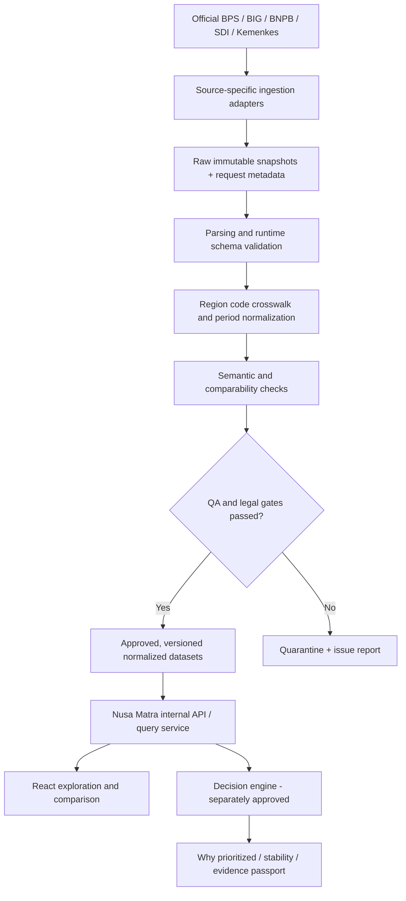
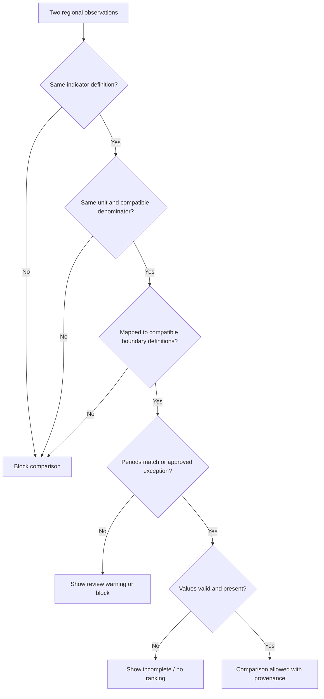

# 05 — Data Sources & External Data Governance

> **Product:** Nusa Matra — WIA 2026  
> **Path:** `docs/05-DATA-SOURCES.md`  
> **Version:** 1.0  
> **Last reviewed:** 2026-10-19  
> **Audience:** Claude Code, backend/frontend engineers, data engineers, product owner, QA  
> **Documentation language:** English · **UI copy:** Bahasa Indonesia  
> **Status:** Official portals and documentation verified; individual production datasets and credentials **NOT YET APPROVED**.

---

## 0. Operating contract for Claude Code

**Read these project documents before implementing any data-dependent feature:**

1. `CLAUDE.md` — overarching execution policy, project name, and code-quality requirements.
2. `project_guidelines.md` — non-negotiable visual/engineering principles.
3. `docs/01-PRODUCT-REQUIREMENTS.md` — functional and quality requirements, priority tiers.
4. `docs/02-USER-FLOWS.md` — how data is experienced through navigation and interaction.
5. `docs/03-UI-UX-DESIGN-SYSTEM.md` — data legends, label vocabulary, visual states.
6. `docs/04-TECH-STACK-ARCHITECTURE.md` — adapter contracts and architectural boundaries.
7. **This file** — source discovery, admissibility, ingestion, provenance, and quality gates.
8. `docs/06-DATA-MODEL.md`, `07-DECISION-ENGINE.md`, `08-API-SPECIFICATION.md` once created.

### 0.1 Non-negotiable rules

- **Never invent data values, official claims, source links, region counts, publication dates, or API endpoints.**
- **Never use Figma placeholder values as verified data.** E.g., illustrative rankings, score `0.79`, coverage `514`, and example stability percentages remain `DEMO` until independently reproduced from approved datasets.
- **The existence of a government portal does not prove an API is public, stable, licensed for reuse, complete, or suitable for automated scraping.**
- Validate every dataset's definition, year, administrative level, geographic coverage, unit, numerator/denominator where relevant, license, and right to redistribute.
- Keep API secrets on a trusted server or ingestion environment. Do not put tokens in browser JavaScript, public assets, Vite `VITE_*` env vars, query logs, or committed fixtures.
- Use explicit **data mode**: `DEMO` or `LIVE`. Do not blend them silently. A partially live dashboard must label simulated sections distinctly.
- Preserve missing values as `null` with machine-readable missing reason. **Never turn missing into zero.**
- Do not compare or rank incompatible observations; declare incomparability before charting/scoring.
- Prefer reproducible published snapshots to direct browser calls to external services for MVP.
- Be precise about source semantics: _hazard_ is not automatically _risk_; _forecast_ is not _historical exposure_; _facility count_ is not _capacity_ without a definition.
- Produce simple, testable, maintainable adapters. Clean Code is a WIA judging requirement.

### 0.2 Evidence/status vocabulary

| Status               | Meaning                                                               | UI / engineering use                                        |
| -------------------- | --------------------------------------------------------------------- | ----------------------------------------------------------- |
| `PORTAL_VERIFIED`    | Official site or documentation was found and inspected                | Candidate only, **not** approved dataset                    |
| `API_DOCUMENTED`     | An official endpoint family or service was documented                 | Probe with legal access, do not assume production readiness |
| `ACCESS_PENDING`     | API key, account, approval, or license is missing                     | Block live integration; use marked demo fixtures            |
| `DATASET_DISCOVERED` | Individual dataset name, URL, granularity, unit and metadata recorded | Begin suitability review                                    |
| `DATASET_APPROVED`   | Governance review passed, lawful usage confirmed                      | Eligible for ingestion                                      |
| `INGESTED_STAGED`    | Retrieved and transformed, not yet validated                          | Not eligible for end-user live display                      |
| `LIVE_VERIFIED`      | Ingestion and QA pass; provenance and availability recorded           | Eligible for sourced UI                                     |
| `DEMO`               | Explicitly simulated/test fixture                                     | Only show with visible demo label                           |
| `REJECTED`           | Insufficient evidence, invalid license, or incompatible content       | Do not use                                                  |

**Important:** Registry source statuses are not the same as record-specific data-quality statuses. A provider can be verified while a particular observation is invalid.

---

## 1. Product data requirements

Nusa Matra is primarily a **regional exploration, comparison, and explainable priority-analysis** application, not a realtime weather app. Requirements derive from the approved product flows and Figma modules.

| Figma / feature        | Needed data                                                | Essential metadata                                                       | MVP relevance              |
| ---------------------- | ---------------------------------------------------------- | ------------------------------------------------------------------------ | -------------------------- |
| Peta Utama / Jelajahi  | Region names/IDs, geometry and indicator observations      | Region-code scheme, boundary edition, indicator/year/source              | P0                         |
| Detail Wilayah         | Selected region's values and plain-language interpretation | Definition, unit, year, source, note, quality                            | P0                         |
| Bandingkan             | Two comparable regional observations per indicator         | Same semantic definition, unit, scope, acceptable temporal comparability | P0                         |
| Lab Prioritas          | Normalized indicators + configurable weights               | Polarity, normalization population, missing policy, approved model       | P1; model approval pending |
| Mengapa Diprioritaskan | Score contributions and alternative weight scenarios       | Formula version, raw + normalized values, weights, source versions       | P1                         |
| Titik Buta Data        | Completeness, stale-year, mismatches, blocked comparisons  | Quality flags and original field-level evidence                          | P1                         |
| Uji Rekomendasi        | Repeatable perturbation runs and rank ranges               | Seed, simulation settings, dataset + model versions                      | P1/P2                      |
| Paspor Bukti           | Exportable evidence and exact analysis inputs              | Provenance, parameters, warnings, exclusions, export timestamp           | P1                         |
| Cerita Wilayah         | Sourced descriptions and optional geographic illustration  | Narrative sources, disclaimers on illustrative 3D                        | P2                         |

### 1.1 Proposed first dataset theme

**PROPOSED, not LOCKED:** To reflect the approved Figma's flood-focused examples, prove an MVP slice using a limited flood-related regional analysis, with supportive social and service indicators **only when credible comparable data exists**.

1. A stable canonical region list and suitable boundaries (province and/or regency/city subject to approval).
2. One defensible flood **hazard/exposure** indicator with explicit definition.
3. One social vulnerability **proxy** that is scientifically justified (e.g., a precisely defined poverty indicator) and has compatible coverage.
4. One services **proxy** with defensible units/denominator and directionality.
5. Optional landslide indicator if the coverage and methodology match.

Do **not** force four indicators simply to match a mock graphic. If official data cannot be aligned, narrow the launch scope or present an honest `DEMO` experience while live datasets are prepared.

### 1.2 Primary decision still needed

`DEC-DATA-01`: Does the first real-data release cover **provinces**, **kabupaten/kota**, or a curated subset? The Figma shows regency/city examples, but **visual examples do not prove full geographic data coverage**. Choose granularity based on verified datasets, not the other way around.

---

## 2. Verified source inventory (as of 2026-10-19)

These are **official portal/documentation references**, not certification of a production dataset. Links are direct references, not invented endpoints.

| ID                  | Official provider                     | Official entry/documentation                                                                                                                                       | Candidate purpose                                                           | Current evidence                                                              |
| ------------------- | ------------------------------------- | ------------------------------------------------------------------------------------------------------------------------------------------------------------------ | --------------------------------------------------------------------------- | ----------------------------------------------------------------------------- |
| `SRC-BPS`           | Badan Pusat Statistik                 | [Developer](https://webapi.bps.go.id/developer/) · [WebAPI Documentation](https://webapi.bps.go.id/documentation/)                                                 | Poverty, demography, social/economic indicators, statistical tables         | `API_DOCUMENTED`; BPS token needed for API calls                              |
| `SRC-BIG`           | Badan Informasi Geospasial            | [Geoportal](https://geoportal.big.go.id/) · [Ina-Geoportal](https://tanahair.indonesia.go.id/portal-web/webmap)                                                    | Authoritative basemaps/administrative geography; boundary discovery         | `PORTAL_VERIFIED`; layer licensing to confirm                                 |
| `SRC-BIG-REST`      | BIG ArcGIS server                     | [ArcGIS service example](https://geoservices.big.go.id/gis/rest/services/PTRA/Atlas_250K_NKRI/MapServer)                                                           | Service discovery/technical validation                                      | `API_DOCUMENTED`; **this example explicitly states restricted atlas app use** |
| `SRC-BNPB`          | BNPB / InaRISK                        | [Official FAQ](https://inarisk.bnpb.go.id/perb/faq.html) · [InaRISK WebGIS](https://inarisk.bnpb.go.id/webgis/)                                                    | Flood/landslide hazard, vulnerability, disaster-risk studies                | `API_DOCUMENTED` GIS family; access/reuse and layer selection pending         |
| `SRC-BNPB-IRBI`     | BNPB                                  | [IRBI 2025 official publication excerpt](https://service1.inarisk.bnpb.go.id/IRBI-2025/files/basic-html/page20.html)                                               | Disaster risk context and methodology comparison                            | `PORTAL_VERIFIED`; not a direct drop-in Nusa Matra score                      |
| `SRC-SDI`           | Satu Data Indonesia (Bappenas portal) | [Dataset catalog](https://data.go.id/dataset) · [Indicator references](https://data.go.id/reference)                                                               | Discovery and validation of datasets/definitions from ministries/local gov. | `PORTAL_VERIFIED`; per-resource access/rights vary                            |
| `SRC-BPS-CROSSWALK` | BPS Geographic Information System     | [BPS ↔ Kemendagri code crosswalk](https://sig.bps.go.id/bridging-kode/)                                                                                            | Historical region-code and ID reconciliation                                | `PORTAL_VERIFIED`; edition/version must be recorded                           |
| `SRC-KEMKES`        | Kementerian Kesehatan                 | [Health profile publications](https://www.kemkes.go.id/id/category/profil-kesehatan) · [2025 profile](https://www.kemkes.go.id/id/profil-kesehatan-indonesia-2025) | Healthcare capacity/service context                                         | `PORTAL_VERIFIED`; file extraction/indicator coverage to evaluate             |
| `SRC-BMKG`          | BMKG Open Data                        | [Open Data home](https://data.bmkg.go.id/) · [Forecast API](https://data.bmkg.go.id/prakiraan-cuaca/)                                                              | Optional current forecast overlays                                          | `API_DOCUMENTED`; not the same as risk exposure                               |
| `SRC-BMKG-NOWCAST`  | BMKG                                  | [Weather alerts CAP](https://data.bmkg.go.id/peringatan-dini-cuaca/)                                                                                               | Optional alerts distinct from historic scores                               | `API_DOCUMENTED`; scope P2                                                    |
| `SRC-BIG-PIKSEL`    | BIG Piksel                            | [Official web-services docs](https://piksel.big.go.id/docs/services/web-services/)                                                                                 | Optional raster/remote-sensing WMS/WMTS/WCS                                 | `API_DOCUMENTED`; not needed for P0                                           |

**Source caveat:** Even a queryable ArcGIS service may restrict reuse. `Supported Query Formats` is a technical feature, **not a content license**.

### 2.1 Recommended provider order

1. **BPS** for statistical indicators and crosswalks.
2. **BIG** for approved administrative shapes and geographic reference.
3. **BNPB/InaRISK** for flood/landslide-related hazard or risk indicators, with methodology explicitly preserved.
4. **Satu Data Indonesia** for targeted supplementary official datasets and metadata.
5. **Kemenkes** when comparing properly normalized service infrastructure or health outcomes.
6. **BMKG** only if a separate, timely weather/alert feature is justified; **never repurpose three-day forecasts as long-term regional vulnerability**.

This is a practical discovery order, **not an assertion that every source has already approved reuse**.

---

## 3. BPS WebAPI — recommended statistical backbone

### 3.1 Verified technical facts

The official BPS documentation states that its API:

- Offers static tables, dynamic data, publications, and other content.
- Uses a user-issued **key token** for authentication.
- Returns JSON.
- Documents `/v1/api/domain` and `/v1/api/list` families, with `model` parameters for specific resources.
- Provides a documented response structure that may include pagination, metadata arrays and nested data structures.

References:

- https://webapi.bps.go.id/developer/
- https://webapi.bps.go.id/documentation/

### 3.2 Safe, **documented** discovery example

```bash
# BPS endpoint family and parameter names come from official documentation.
# Set token in your shell; do NOT commit it and do NOT run in browser code.
export BPS_API_KEY='YOUR_SERVER_SIDE_TOKEN'

curl --fail-with-body --silent --show-error \
  --get 'https://webapi.bps.go.id/v1/api/domain' \
  --data-urlencode 'type=prov' \
  --data-urlencode "key=${BPS_API_KEY}"
```

**Warning:** The BPS API documentation uses a `key` query parameter. Query URLs can leak tokens through access logs. Keep requests strictly server-side, sanitize logs, and store keys in a secret manager. The above is an illustrative call based on the documented contract; **it has not been executed with a valid user token here**.

### 3.3 BPS discovery procedure

1. Create/obtain permitted BPS API credentials from the official portal.
2. Call `/v1/api/domain` and record available domain IDs; do not hardcode regional domain IDs from memory.
3. Discover relevant `subject`, `subcat`, `var`, `vervar`, `th` (period), and `turvar` (derived variable) through the **official** `/v1/api/list` documentation.
4. Identify specific datasets/tables with official dataset titles and original units.
5. Validate **which geography is represented in each table**. A province-level domain does not imply province-level observations; check `vervar` and table dimensions.
6. Download a small legal test sample, inspect raw response in a non-public staging area, and write a typed parser with runtime schema validation.
7. Capture indicator metadata (`unit`, name, description/notes, release/source, period, domain, chosen dimension values).
8. Confirm all target regions, years, and region mapping; publish only after QA.

### 3.4 Recommended storage mapping

| Source attribute              | Internal concept                         | Rule                                                                      |
| ----------------------------- | ---------------------------------------- | ------------------------------------------------------------------------- |
| BPS domain ID                 | `sourceRegionScopeId`                    | Preserve as received; do not assume it is Kemendagri ID                   |
| BPS `vervar` code/value       | `sourceRegionCode`                       | Map through a versioned crosswalk                                         |
| BPS variable and variants     | `sourceIndicatorKey`                     | Preserve variable/derived-variable identifiers                            |
| BPS `tahun` / `turtahun`      | `period`                                 | Confirm whether annual, quarterly, or another derived time period         |
| BPS `unit`                    | `unit`                                   | Normalize only through explicit audited transforms                        |
| BPS note, metadata, table URL | `definition`, `methodology`, `sourceUrl` | Keep full lineage to avoid information loss                               |
| BPS value                     | `rawValue`                               | Missing remains null; do not use displayed rounded values in calculations |

### 3.5 BPS failure scenarios

- API key invalid or expired → server logs redacted error, UI shows unavailable source.
- 200 response with unavailable data → `source_unavailable`, not `0`.
- Different yearly statistical methods → version definition and mark comparability as needing review.
- Incomplete regency coverage → record `coverage` and `missingReason`, no fabricated filler.
- BPS changed codes → explicit historical crosswalk, never fuzzy name matching in production.
- Current JSON structure differs from docs → fix adapter and snapshot a regression fixture; do not silently swallow parse errors.

---

## 4. BIG — geographic reference and map layers

### 4.1 Intended use

Prefer authorized BIG reference layers for geographic boundaries, place context, coordinate systems and regional map joins. Official portals:

- https://geoportal.big.go.id/
- https://tanahair.indonesia.go.id/portal-web/webmap
- https://www.big.go.id/content/produk/ina-geoportal

**Do not claim that a simplified decorative hexagon or hero diorama is a scientifically accurate geographic boundary.** The Figma calls some illustrations _ilustratif_. Real choropleths must use suitable geographic data.

### 4.2 Technical possibilities

Depending on the selected authorized layer and service, providers may expose ArcGIS REST map/feature services and/or OGC formats. For example, an official BIG ArcGIS directory lists layer names and `JSON`/`geoJSON` query support:

- https://geoservices.big.go.id/gis/rest/services/PTRA/Atlas_250K_NKRI/MapServer

**Restriction:** The linked example states the service is intended for `atlas.big.go.id`. **Do not integrate or redistribute this particular layer in Nusa Matra without explicit authorization.** It is included only to document how to evaluate a source, not as an approved production basemap.

BIG Piksel documents separate optional WMS, WMTS and WCS capabilities:

- https://piksel.big.go.id/docs/services/web-services/

Do not assume this raster stack supplies administrative vector polygons without additional dataset discovery.

### 4.3 Geographic source acceptance checks

- Identify exact layer/dataset, owner, edition/date, coverage, update policy, projection/CRS, geometry type, permitted license, attribution.
- Confirm the region semantics: **administrative borders vs Wilkerstat statistical areas** are not always identical.
- Verify province/regency geometry coverage and matches with canonical `regionId`s.
- Use EPSG:4326 for interoperable source GeoJSON when appropriate, convert geometry carefully if source CRS differs.
- Repair invalid geometries deterministically; log repair and never silently change boundaries.
- Ensure simplification respects topology and does not create overlaps/gaps that alter membership.
- Create vector tiles or simplified multi-resolution geometry **only after securing redistribution rights**.
- Test islands, multipolygons, coastal fragments, antimeridian edge cases, and click targeting at zoom levels.
- Keep original/source version and transformed presentation geometry separate.

### 4.4 Map performance requirements

- Lazy load full regional geometry and heavy processing.
- Precompute polygon bounds and centroids where suitable.
- Use lightweight vector tiles or controlled GeoJSON subsets for map interaction.
- Cache static geometry by edition/version; invalidate on boundary updates.
- Avoid expensive per-render geospatial processing in React components.
- Prefer offline ETL for geometry transformations.
- Keep the map usable while an optional WebGL/3D diorama is unavailable.

---

## 5. BNPB InaRISK and IRBI — disaster information

### 5.1 Verified official entry

BNPB's own FAQ states that displayed InaRISK spatial risk study data can be accessed through a GIS Services URL:

- Official FAQ: https://inarisk.bnpb.go.id/perb/faq.html
- Stated GIS Services directory: https://inarisk1.bnpb.go.id:6443/arcgis/rest/services/inaRISK
- Map context: https://inarisk.bnpb.go.id/webgis/

**This confirms published discovery information, not guaranteed unrestricted bulk downloading, uptime, permissions, or a specific numeric polygon layer.** Check individual services/layers, intended use, license and technical reliability before production use.

### 5.2 Critical conceptual distinction

| Concept                      | Do not confuse with                     | Example of how UI must describe it                                  |
| ---------------------------- | --------------------------------------- | ------------------------------------------------------------------- |
| `bahaya` (hazard)            | realized losses or forecast weather     | “Tingkat bahaya banjir berdasarkan kajian ...”                      |
| `paparan` (exposure)         | disaster probability                    | “Penduduk/aset yang berada pada area terpapar ...”, only if defined |
| `kerentanan` (vulnerability) | danger from the hazard alone            | “Kerentanan menurut metodologi sumber ...”                          |
| `kapasitas` (capacity)       | number of facilities without evaluation | “Kapasitas penanganan menurut indikator ...”                        |
| `risiko` (risk)              | a simple 0–1 hazard index               | Use published risk methodology and its definition                   |

Do not label a model derived from flood hazard alone as BNPB's **official disaster risk index**.

### 5.3 IRBI methodology change warning

The published _IRBI 2025_ discussion describes updated risk inputs relative to earlier years, including a different hazard baseline and dynamically projected vulnerability. **This is a methodological discontinuity requiring explicit review before comparing IRBI across years.**

Source: https://service1.inarisk.bnpb.go.id/IRBI-2025/files/basic-html/page20.html

Engineering consequences:

- Version the methodology used for each observation (`methodologyVersion`).
- Record whether a historical series is comparable before drawing a trend line.
- If methodology differs materially, annotate or block direct trends.
- Do not import published IRBI weighting and simultaneously claim an independent Nusa Matra weighted model is identical.
- Separate `official_risk_index` (source-published) from `nusa_matra_priority_score` (app-derived with reviewed formula).

### 5.4 BNPB pilot checklist

- [ ] Identify approved flood hazard/exposure layer or statistic and official meaning.
- [ ] Confirm geographic and time coverage at chosen region level.
- [ ] Confirm raster-vs-vector-vs-tabular access and allowed transformations.
- [ ] Document native risk/hazard scale and whether higher means worse.
- [ ] Get redistribution/attribution authorization if necessary.
- [ ] Build regional aggregation only with reviewed area/population weighting rules.
- [ ] Cross-check sample observations with official outputs.
- [ ] Explain uncertainty and limitations in _Titik Buta Data_.

---

## 6. Satu Data Indonesia — discovery and supplementary datasets

**Portal:** https://data.go.id/dataset  
**Indicator code-reference section:** https://data.go.id/reference

The official portal advertises many datasets with varied formats and accessibility conditions, and also notes ongoing dataset curation. It is a **catalog/aggregation starting point**, not proof of a universal, authorized bulk API. Different resources may be CSV, JSON, XLSX, or hosted files; some are marked restricted.

### 6.1 Resource-specific evaluation

For each chosen dataset, document:

1. Dataset title and unique catalog URL.
2. Data steward (`walidata`) and publisher/producer.
3. File distribution/download URL **actually observed**.
4. Format and sample validity.
5. License, attribution and reuse restrictions.
6. Geographic level and code scheme.
7. Reporting period, update timing and publication date.
8. Indicator unit, formal definition, methodology, caveats.
9. Duplicates/versions already published by BPS or responsible ministries.
10. Stable resource ID or checksum for ingestion provenance.

### 6.2 Disallowed shortcuts

- Do **not** invent `https://data.go.id/api/v1/...` endpoints merely because a portal exists.
- Do **not** assume all catalog entries are fully open for redistribution.
- Do **not** scrape interactive pages until permitted machine-access/download options are evaluated.
- Do **not** choose a local-government data product solely because it has a matching title; check its concept and provenance.

### 6.3 Choosing between SDI and primary publisher

If the same measure appears in several sources, prefer the **primary authoritative publishing organization** and use SDI for discoverability, provided the dataset's original owner and version can be identified. Record both the catalog URI and the primary document URI when available.

---

## 7. Kementerian Kesehatan — optional service/health indicators

Official publication list: https://www.kemkes.go.id/id/category/profil-kesehatan  
Official 2025 edition: https://www.kemkes.go.id/id/profil-kesehatan-indonesia-2025

Kemenkes' publications provide official health-context material, but the presence of a PDF is **not** evidence that every desired regency/city indicator is available as a stable machine-readable API.

### 7.1 Candidate types (NOT approved indicators)

- Hospitals by region with consistent facility definition.
- Puskesmas by region with consistent year and denominator.
- Health-personnel ratios if clearly reported.
- Life expectancy where methodology and geography match.

### 7.2 Required transformations

- Keep both numerator and denominator when deriving rates.
- Example: `facilitiesPer10000 = (facilityCount / population) * 10_000` **only if** same region, compatible year, and metric definitions are validated.
- Mark unavailable/missing population as `null`, not infinite or zero.
- Distinguish **quantity of facilities** from **quality or ability to provide service**.
- Use documented table identifiers/page/source edition if extracting from a publication, with a human-reviewed audit sample.
- Validate any OCR/extraction result before production; prefer official spreadsheets/CSV when offered.

---

## 8. BMKG — optional live weather and warnings, not foundational risk scoring

Official entry: https://data.bmkg.go.id/

### 8.1 Weather forecast API (documented example)

- Documentation: https://data.bmkg.go.id/prakiraan-cuaca/
- Documented endpoint: `GET https://api.bmkg.go.id/publik/prakiraan-cuaca?adm4={KODE_WILAYAH}`
- Scope: short-range forecasts at **desa/kelurahan** administration codes.
- Official documentation states a **60 requests/minute per IP** rate limit and requires BMKG attribution.

```bash
# Officially documented code example; optional P2 feature.
curl --fail-with-body --silent --show-error \
  'https://api.bmkg.go.id/publik/prakiraan-cuaca?adm4=31.71.03.1001'
```

**Do not** map a single village's forecast to an entire kabupaten/kota hazard index. Nor should an active weather forecast be used as a historical vulnerability baseline.

### 8.2 Nowcast CAP alerts

- Documentation: https://data.bmkg.go.id/peringatan-dini-cuaca/
- Feed: `https://www.bmkg.go.id/alerts/nowcast/id`
- Format: CAP/XML (or feed thereof); official 60 req/min/IP limit applies according to its documentation.
- Separate notification/warning UI from persistent statistical indicators and derived scores.

### 8.3 Rules for live/short-lived data

- Display forecast issuance time, valid-from and expires time.
- Use short, documented TTLs; do not keep expired forecasts as current.
- Rate-limit on backend and apply caching/coalescing.
- Label sourced forecasts as “Prakiraan BMKG”, not “Skor risiko Nusa Matra”.
- Attribution is compulsory as stated in BMKG documentation.
- Keep optional weather widgets from blocking the core map/compare experience.

---

## 9. Canonical region identity and crosswalks

Official BPS bridging portal: https://sig.bps.go.id/bridging-kode/

BPS documents relations between **Wilayah Kerja Statistik (Wilkerstat)** codes and **Kemendagri administrative codes**, including historical periods. Therefore **one area name or code is not a universal permanent key**.

### 9.1 Stable app-facing key (PROPOSED)

```ts
export type RegionLevel = 'national' | 'province' | 'regency';

export interface CanonicalRegion {
  id: string; // Nusa Matra internal, immutable, never a name
  name: string; // e.g. "Kabupaten Cianjur"
  level: RegionLevel;
  parentId: string | null;
  activeFrom: string | null; // ISO date, if known
  activeTo: string | null;
  boundaryEdition: string | null;
}

export interface SourceRegionMapping {
  sourceId: string;
  sourceCodeScheme: 'BPS_WILKERSTAT' | 'KEMENDAGRI' | 'BIG' | 'OTHER';
  sourceCode: string;
  canonicalRegionId: string;
  effectiveFrom: string | null;
  effectiveTo: string | null;
  mappingVersion: string;
  mappingQuality: 'exact' | 'reviewed' | 'unresolved';
}
```

### 9.2 Matching policy

1. Keep source-native IDs and their edition/year, even after mapping.
2. Perform exact mapping through a versioned reference where possible.
3. Detect renamed, merged, split, newly formed, or retired administrative regions.
4. If a source area aggregates differently than the chosen target boundary, require an explicitly approved allocation/interpolation method or mark incompatible.
5. Do not trust fuzzy name matching (e.g., `Kab. Bandung` vs `Kota Bandung`).
6. Do not infer an area's historic membership only from modern boundary geometry.
7. Keep per-year mapping history and source reference URL.
8. Include boundary edition in exports and reproducibility information.

### 9.3 Map display types

- **Analytical boundary:** approved administrative geometry with reproducible joins.
- **Visual indicator geometry:** choropleth or selected overlay based on accepted analytical boundary.
- **Decorative map:** illustration/hexagon/3D diorama, explicitly non-analytical.

These are not interchangeable.

---

## 10. Candidate indicator catalog and readiness

The following are **discovery candidates**, not claimed available measurements. The final list depends on P0 scope and source evaluation.

| Candidate code            | Display term (Bahasa Indonesia)         | Possible provider                      | Raw semantics                                         | Higher-is-worse?                                | Required proof                                      |
| ------------------------- | --------------------------------------- | -------------------------------------- | ----------------------------------------------------- | ----------------------------------------------- | --------------------------------------------------- |
| `flood_hazard`            | Paparan/bahaya banjir                   | BNPB InaRISK                           | Specify if class, probability, area, people, or index | Depends on approved definition                  | Source layer, aggregation, units                    |
| `landslide_hazard`        | Bahaya longsor                          | BNPB InaRISK                           | Hazard class/area/index                               | Generally only if definition says so            | Source layer, aggregation                           |
| `poverty_rate`            | Persentase penduduk miskin              | BPS                                    | Percentage of population                              | Context-dependent proxy; typically greater need | Table, release, poverty definition                  |
| `social_vulnerability`    | Kerentanan sosial                       | BNPB and/or well-defined derived model | Official score **or** explicitly derived index        | Based on definition                             | Methodology, input lineage                          |
| `health_facility_density` | Fasilitas kesehatan per 10.000 penduduk | Kemenkes/BPS                           | Derived ratio                                         | Usually invert for unmet need                   | Counts, population denominator, facility definition |
| `population_density`      | Kepadatan penduduk                      | BPS                                    | Population per km²                                    | **Not automatically** negative                  | Period, area denominator, interpretation            |
| `access_to_water`         | Akses air minum layak                   | BPS or SDI resource                    | Percent households/population                         | Usually lower is worse                          | Survey/admin concept, denominator                   |
| `life_expectancy`         | Umur harapan hidup                      | BPS/Kemenkes                           | Years                                                 | Usually lower is worse                          | Method and coverage                                 |
| `bmkg_weather`            | Prakiraan cuaca                         | BMKG                                   | Future forecast                                       | Not eligible for baseline score                 | Valid time and location resolution                  |

**Never combine an `official_risk_index` with hazard and vulnerability components from the same index without checking for double counting.**

### 10.1 Minimum candidate selection scoring (governance heuristic, PROPOSED)

Rate each potential dataset `PASS`, `WARN`, or `FAIL` on:

- Lawful access and redistribution rights.
- Geographic coverage at approved level.
- Period coverage and timeliness.
- Definition and consistent measurement methodology.
- Presence of unit and reference metadata.
- Region-code interoperability.
- Reasonable extraction and maintainability costs.
- Reproducibility/ability to version.

Any **licensing failure**, **unresolvable identity mismatch**, or **missing essential definition** is a **hard rejection** for LIVE. Do not average away a hard failure into a positive numeric quality score.

---

## 11. Source registry and inventory schema

Maintain a **data-source registry**, stored in code or data storage, backed by reviewable records. The application should not use a source merely because a developer knows its URL.

### 11.1 Example registry entry (`PROPOSED` structure; non-production example)

```yaml
source_id: SRC-BPS
provider: Badan Pusat Statistik
homepage_url: https://webapi.bps.go.id/developer/
docs_url: https://webapi.bps.go.id/documentation/
source_type: api
verification:
  source_status: API_DOCUMENTED
  last_checked_at: 2026-10-19
  checked_by: research
access:
  authentication: token-required
  credentials_obtained: false
  automated_download_approved: false
legal:
  redistribution_permission: pending-review
  attribution_text: 'Sumber: Badan Pusat Statistik (BPS)'
operations:
  default_fetch_strategy: server-side-ingestion
  observed_rate_limit: null
  retry_policy: limited-backoff
  direct_browser_access: false
production:
  approved_dataset_ids: []
  live_enabled: false
```

**Do not mistake this template's proposed runtime policy for BPS's published terms.** The example merely records facts verified so far and conservatively blocks live use pending approval.

### 11.2 Required source/dataset fields

```ts
export type SourceLifecycle =
  | 'PORTAL_VERIFIED'
  | 'API_DOCUMENTED'
  | 'ACCESS_PENDING'
  | 'DATASET_DISCOVERED'
  | 'DATASET_APPROVED'
  | 'INGESTED_STAGED'
  | 'LIVE_VERIFIED'
  | 'DEMO'
  | 'REJECTED';

export interface SourceRecord {
  sourceId: string;
  provider: string;
  homepageUrl: string;
  documentationUrl: string | null;
  lifecycle: SourceLifecycle;
  accessedAt: string | null;
  accessMethod: 'api' | 'download' | 'gis' | 'manual-reviewed' | 'none';
  authenticationRequirement: 'none' | 'token' | 'account' | 'unknown';
  licenseId: string | null;
  redistributionApproved: boolean;
  attribution: string;
  stewardContactUrl?: string;
  notes: string[];
}

export interface DatasetManifest {
  datasetId: string;
  sourceId: string;
  catalogUrl: string;
  resourceUrl: string | null;
  officialTitle: string;
  description: string;
  format: 'json' | 'csv' | 'xlsx' | 'geojson' | 'shapefile' | 'raster' | 'pdf';
  targetRegionLevel: 'province' | 'regency' | 'other';
  referencePeriods: string[];
  nativeRegionCodeScheme: string;
  indicatorDefinitionUrl: string | null;
  methodologyVersion: string | null;
  unit: string | null;
  downloadedAt: string | null;
  publishedAt: string | null;
  licenseAndAttributionReviewed: boolean;
  checksumSha256: string | null;
  reviewStatus: 'PENDING' | 'APPROVED' | 'REJECTED';
}
```

Avoid unnecessary optional fields in live production rows; missing critical metadata should block promotion into `LIVE_VERIFIED`.

---

## 12. Data acquisition and ingestion architecture

### 12.1 Data flow



### 12.2 Three layers of data (mandatory separation)

1. **Raw snapshot:** Immutable bytes, source URI, retrieval timestamp, response status/ETag if applicable, checksum, permissions.
2. **Staging:** Parsed rows with source-native codes/units and validation failures; never directly public as trusted values.
3. **Published normalized:** Approved observations joined to canonical region IDs, with provenance and quality flags.

No UI component should parse raw external provider responses.

### 12.3 Adapter interfaces

```ts
export interface SourceFetchContext {
  abortSignal: AbortSignal;
  requestedAt: string;
  datasetId: string;
}

export interface RawArtifact {
  sourceId: string;
  datasetId: string;
  resourceUrl: string;
  fetchedAt: string;
  mimeType: string;
  checksumSha256: string;
  storageKey: string;
}

export interface SourceAdapter {
  readonly sourceId: string;
  fetchSnapshot(ctx: SourceFetchContext): Promise<RawArtifact>;
  // Parse *staged* artifact; never claim verified here.
  parseSnapshot(artifact: RawArtifact): Promise<StagedObservation[]>;
}

export interface StagedObservation {
  sourceRegionCode: string;
  sourceIndicatorCode: string;
  rawValue: unknown;
  rawUnit: string | null;
  rawPeriod: string;
  rawDefinitionRef: string | null;
}
```

Use explicit adapters (`BpsAdapter`, `InaRiskAdapter`, `OfficialCsvAdapter`), not a single large fetcher with provider-specific switch statements spread across React components.

### 12.4 Scheduling and caching (PROPOSED)

| Dataset kind               | Initial refresh approach                                     | Notes                                              |
| -------------------------- | ------------------------------------------------------------ | -------------------------------------------------- |
| Annual official statistics | Scheduled metadata check, e.g. weekly; ingest on new edition | Refresh does not mean values change weekly         |
| Administrative boundaries  | Event/edition driven and manual review                       | Boundaries change infrequently but are high impact |
| Disaster-risk study layers | Scheduled release check, e.g. monthly                        | Do not treat study layer as realtime hazard sensor |
| BMKG forecasts (optional)  | Cache within documented freshness/usage constraints          | Short time validity; respect provider limits       |
| User analysis results      | Keyed by immutable data snapshot + model version + weights   | Recalculate when inputs change                     |

These intervals are **engineering proposals**, not official source release frequencies.

### 12.5 Reliability

- Limit concurrency and request volume per provider.
- Prefer HTTPS and TLS verification; no bypassing access controls.
- Set finite timeouts, cancellation and bounded exponential backoff with jitter.
- Honor `429`, `Retry-After`, `ETag`, `Last-Modified` where provided.
- Retry idempotent retrievals only; do not retry invalid schema indefinitely.
- If a provider is down, serve **last verified snapshot with its age clearly shown**, or report unavailable.
- Never silently switch to demo values after live fetch failure.
- Track each dataset's freshness and known release lag.

---

## 13. Normalized observation and provenance contract

This is a **logical schema draft**, not finalized SQL. `docs/06-DATA-MODEL.md` will formalize tables and indexes.

```ts
export type ObservationQuality =
  'verified' | 'estimated' | 'incomplete' | 'outdated' | 'incomparable' | 'invalid';

export type MissingReason =
  | 'not_published'
  | 'not_applicable'
  | 'suppressed'
  | 'unmapped_region'
  | 'invalid_measurement'
  | 'provider_unavailable'
  | null;

export interface Provenance {
  sourceId: string;
  datasetId: string;
  sourceUrl: string;
  sourceTitle: string;
  publisher: string;
  publishedAt: string | null;
  retrievedAt: string;
  snapshotId: string;
  checksumSha256: string;
  methodologyVersion: string | null;
  transformationIds: string[];
}

export interface NormalizedObservation {
  regionId: string;
  regionLevel: 'province' | 'regency';
  indicatorId: string;
  referencePeriod: string; // e.g. '2023' or '2023-Q4'
  value: number | null;
  unit: string;
  quality: ObservationQuality;
  missingReason: MissingReason;
  comparableGroupId: string | null;
  dataEditionId: string;
  provenance: Provenance;
}
```

### 13.1 Mandatory invariants

- `value === null` must not become `0` in API mapping, chart rendering, rank computation, or exported documents.
- Reject non-finite numbers (`NaN`, `Infinity`, `-Infinity`).
- `quality === 'verified'` requires valid provenance.
- `quality === 'incomparable'` means direct cross-region visual comparison is **disabled** for that case.
- Store full internal numeric precision; round only for display.
- `dataEditionId` and `snapshotId` enable reproducibility and auditing.
- `comparableGroupId` comes from governance review, not an arbitrary algorithmic hash of labels.
- Do not mix periods with different definitions in an unqualified ranking.

### 13.2 Distinguish observed from calculated values

- `SOURCE_REPORTED`: reported by authoritative publisher.
- `DERIVED`: calculated by Nusa Matra from multiple source-reported inputs.
- `MODEL_OUTPUT`: normalized/weighted priority score; not published official statistic.
- `DEMO`: synthetic or illustrative.

Every resulting indicator should store derivation type and dependencies, to be formalized in `06` and `07`.

---

## 14. Comparability and completeness validation

### 14.1 Guardrail decision tree



### 14.2 Comparison outcomes

| Case                                                                               | Program status                        | UI copy                                                     |
| ---------------------------------------------------------------------------------- | ------------------------------------- | ----------------------------------------------------------- |
| Definition and year match                                                          | `COMPARABLE`                          | “Data dapat dibandingkan.”                                  |
| Difference in reference year, definition still compatible                          | `COMPARABLE_WITH_WARNING` if approved | “Tahun data berbeda; interpretasikan dengan hati-hati.”     |
| Different household survey vs administrative measure with incompatible definitions | `BLOCKED_DEFINITION`                  | “Tidak dibandingkan karena definisi pengukurannya berbeda.” |
| Missing in either region                                                           | `BLOCKED_MISSING`                     | “Data tidak tersedia untuk salah satu wilayah.”             |
| Region boundary/code mismatch                                                      | `BLOCKED_BOUNDARY`                    | “Batas wilayah data tidak sebanding.”                       |
| Invalid/out-of-range values                                                        | `BLOCKED_INVALID`                     | “Data sedang ditinjau karena tidak valid.”                  |

**Figma precedent:** The comparison screen explicitly blocks a water-access comparison with incompatible definitions, and marks year differences with a footnote. Preserve this meaning in production.

### 14.3 Suggested validation dimensions

- Completeness by `(indicator, region, period)`.
- Uniqueness of approved observation keys.
- Numeric finiteness and semantic range (percent `0–100`, not blindly all indicators).
- Unit and scale (`percent` vs `fraction`, `per 1,000` vs `per 10,000`).
- Region crosswalk success and unmatched share.
- Release date, reference period and publication lag.
- Definition/methodology edition compatibility.
- Duplicate records/conflicting providers.
- GIS geometry validity and expected CRS.
- Source metadata fields required for citation and export.

### 14.4 Missing data policy for decision engine

Default: **exclude incomplete candidate scores until a domain-approved strategy exists**. The Figma illustrates weight redistribution in one case; **do not copy that behavior into production without an explicit approved method** in `07-DECISION-ENGINE.md`.

If eventually approved, document exactly whether missing dimensions cause:

1. Region exclusion.
2. Indicator exclusion for **all** regions in the cohort.
3. Per-region weight redistribution (potentially non-comparable across regions).
4. Estimation/imputation with an explicit uncertainty model.

Never decide on this silently in a React hook.

---

## 15. Frontend UX labeling and source attribution

### 15.1 Required indicator metadata in UI

A user must be able to see:

- Indicator title in **Bahasa Indonesia**.
- Numeric value and unit, or “Data tidak tersedia”.
- Reference year/period.
- Official source name and link to the source/dataset.
- Context/definition/“Apa arti indikator ini?”.
- Methodology or transformed metric description when derived.
- Data quality and comparability caveats.
- “Data simulasi” when using fixtures or sample scenario values.

### 15.2 Suggested presentation pattern

```text
Paparan banjir
Nilai: Data tidak tersedia
Tahun acuan: —
Sumber: BNPB InaRISK (sumber direncanakan; dataset belum terverifikasi)
Status: Menunggu dataset yang disetujui
```

When LIVE data has been verified:

```text
[Nama indikator sesuai definisi resmi]
[Nilai resmi beserta satuan]
Tahun data: [Tahun acuan]
Sumber: [Penerbit resmi] · [Link dataset]
Keterangan: [Catatan bila ada]
```

These are UI **templates, not real statistics**. Never use a fake numeric sample inside a real-looking card without its demo badge.

### 15.3 Titik Buta Data

The module should surface issues from actual validation output, e.g.:

- Incomplete indicator-region cells.
- Different reference years.
- Definitions that block comparisons.
- Unmapped/changed region codes.
- Outdated data or source methodology changes.
- Assumptions used by the derived model.

Do not hardcode the Figma's prototype counts as production audit results.

### 15.4 Paspor Bukti

An evidence export must persist:

- Request/question and scenario label.
- Region cohort and boundary edition.
- Dataset manifests and original URLs.
- Normalized indicators, source periods, units, transformation versions.
- Model version, weights, normalization scope and missing-data rules.
- Reproducible analysis ID/hash and timestamp.
- Quality alerts and blocked comparisons.
- Clearly labeled `DEMO` vs `LIVE` environment.

---

## 16. API and security integration policy

### 16.1 Avoid direct provider-to-browser coupling

**Recommended internal flow:**

```text
React UI -> Nusa Matra typed data client -> Nusa Matra backend/internal API
         -> versioned published datastore -> scheduled source-specific ingestion
```

Advantages: no leaked BPS token, deterministic data, control over provider availability, consistent schemas, reproducibility, and lower client complexity.

If the project lacks a backend initially, use a **prebuilt public JSON snapshot of legally redistributable approved data** with provenance (not a secret-bearing proxy), keeping exactly the same typed repository interface in React.

### 16.2 Security rules

- No provider token in `VITE_*` variables, bundle output, client requests, screenshot examples or Git history.
- Env file names and secret names must be documented in `.env.example` **without real values**.
- Limit request URLs to source allowlists; prevent arbitrary end-user-controlled server-side fetching (SSRF).
- Validate every external payload with runtime schema checking and size limits.
- Protect downloaded files against path traversal, decompression bombs, untrusted formulas/macros, and unsafe markup.
- Use safe CSV/Excel export escaping for cells beginning with formulas (`=`, `+`, `-`, `@`) when user-controlled text is present.
- Track third-party asset/data licenses separately from open-source code licenses.
- Redact API tokens and personal information in logs and CI artifacts.
- Respect official robots, terms, quotas, rate limits, and takedown requests.

---

## 17. Recommended implementation structure

**PROPOSED**: Keep the source-specific pipeline in a back-end/scripts layer, not mixed into presentation components. Adapt to existing repository layout rather than blindly scaffolding a new monorepo.

```text
nusa-matra/
├── CLAUDE.md
├── project_guidelines.md
├── docs/
│   ├── 05-DATA-SOURCES.md
│   ├── 06-DATA-MODEL.md             # future
│   ├── 07-DECISION-ENGINE.md       # future
│   └── 08-API-SPECIFICATION.md    # future
├── src/
│   ├── features/
│   │   ├── exploration/
│   │   ├── comparison/
│   │   ├── priority-analysis/
│   │   └── data-quality/
│   ├── data/
│   │   ├── contracts/
│   │   ├── repositories/
│   │   └── fixtures/               # explicitly DEMO
│   └── services/
│       └── api/
├── server/                           # if backend approved
│   ├── ingestion/
│   │   ├── adapters/
│   │   │   ├── bps/
│   │   │   ├── big/
│   │   │   ├── bnpb/
│   │   │   └── file-import/
│   │   ├── validators/
│   │   └── pipelines/
│   └── data-api/
├── data/
│   ├── manifests/
│   ├── crosswalks/
│   └── snapshots/                  # raw restricted data gitignored
└── tests/
    ├── source-adapters/
    ├── data-validation/
    ├── integration/
    └── fixtures/
```

### 17.1 Clean Code requirements

- One adapter per provider family, with documented responsibilities.
- Separate `fetch`, `parse`, `validate`, `normalize`, `publish` operations.
- Functional/pure transformations wherever possible.
- Domain naming uses `referencePeriod`, `regionCodeScheme`, `sourceId`; avoid ambiguous `data`, `code`, `val` across module boundaries.
- Side effects only at ingestion/storage/API boundaries.
- Narrow use of `unknown` at parsing boundaries; resolve with runtime validation rather than `any`.
- No redundant copies of region maps or indicator catalogs in separate features.
- No implicit default values for missing measurements or source metadata.
- Tests for source format changes, invalid inputs and edge cases.
- All published calculations document transformation lineage.

---

## 18. Test strategy for data sources

### 18.1 Unit tests

| ID           | Test                                               | Expected behavior                               |
| ------------ | -------------------------------------------------- | ----------------------------------------------- |
| `DS-UNIT-01` | Null observation                                   | No zero substitution                            |
| `DS-UNIT-02` | Invalid `NaN` / infinity                           | Reject/quarantine                               |
| `DS-UNIT-03` | Percent outside `[0,100]` for percentage indicator | Flag semantic error                             |
| `DS-UNIT-04` | Mismatched units                                   | Block or convert only when explicitly approved  |
| `DS-UNIT-05` | Unmapped region code                               | Quarantine/flag; no fuzzy auto-join             |
| `DS-UNIT-06` | Same-year but different indicator definitions      | Block comparison                                |
| `DS-UNIT-07` | Cross-year approved comparison                     | Display year-warning metadata                   |
| `DS-UNIT-08` | Source vs derived values                           | Preserve value type and lineage                 |
| `DS-UNIT-09` | Re-ingestion same raw artifact                     | Idempotent, no duplicate published observations |
| `DS-UNIT-10` | API timeout, 429 and malformed JSON                | Controlled error, no demo fallback              |
| `DS-UNIT-11` | Old boundary edition                               | Mismatch flagged                                |
| `DS-UNIT-12` | Quality failures                                   | Never promote to live                           |

### 18.2 Contract/integration tests

- Record sanitized provider response fixtures when legally permitted.
- Assert parser version and schema validation on every saved example.
- Test partial availability, pagination, unexpected null values and changes in source field names.
- Verify source/indicator/year counts against validated manifests, not Figma placeholders.
- Confirm no secrets in generated client bundle and source maps.
- Test screen copy and export attribution.
- Test snapshot preservation and reproducibility of a previously published result.
- Do not hammer official APIs from every PR CI job; use fixtures locally and limited scheduled integration probes.

### 18.3 Manual source review

A data reviewer must inspect at least one sample record per source/indicator and relevant edge cases (different region code, missing data, year mismatch). The reviewer signs off before `LIVE_VERIFIED` publication.

---

## 19. Release gates: when can a dataset go LIVE?

**All checkboxes required for each published dataset.**

- [ ] Official dataset or primary publisher is identified with a stable URL.
- [ ] Source authenticity and appropriate intended use verified.
- [ ] Rights/license and required attribution reviewed and recorded.
- [ ] Auth and access constraints respected.
- [ ] Dataset title, period, owner, unit and statistical definition captured.
- [ ] Geographic level and native administrative code system recorded.
- [ ] Region crosswalk validated for required coverage.
- [ ] Missing values, footnotes, outliers and measurement methods inspected.
- [ ] Valid import and a stable `snapshotId` exist.
- [ ] Reproducible transformation code with tests exists.
- [ ] Basic QA and comparability constraints pass.
- [ ] No known critical contradictions between source and published result.
- [ ] UI uses proper source/year/quality labels.
- [ ] Source URL and snapshot version visible in evidence export.
- [ ] Provider keys absent from client bundles and repository.
- [ ] Human review approval recorded.

If one fails, keep it `ACCESS_PENDING`, `INGESTED_STAGED`, `DEMO`, or `REJECTED` — **not `LIVE_VERIFIED`**.

---

## 20. Claude Code step-by-step work order

### Phase DS-0: Repository and contract inspection

- Read all existing project docs first.
- Check actual React project structure before creating folders.
- Identify any existing data adapters, scripts, caches, and keys **without printing secrets**.
- Create a concise plan with exact files to modify.

### Phase DS-1: Source discovery

- Register candidate official sources with direct URLs.
- Create a separate **dataset discovery worksheet** using individual exact dataset URLs.
- Identify intended geographic level and time coverage.
- Record license/access blockers; ask project owner where authorization is required.

### Phase DS-2: One vertical slice

- Choose one indicator and one small region cohort after owner/data approval.
- Build one adapter and immutable snapshot import.
- Implement region crosswalk and a validation report.
- Publish only after quality and rights checks.
- Build one React view connected to the approved normalized observation.

### Phase DS-3: Extend safely

- Add other indicators using independent adapters and the same normalized contract.
- Provide indicator-level `COMPARABLE` / `BLOCKED` outcomes.
- Connect exploration and comparison before introducing the decision engine.
- Create deterministic model outputs only after `07-DECISION-ENGINE.md` is approved.

### Phase DS-4: Evidence and verification

- Add provenance UI, data-quality diagnostics and exported evidence as functionality matures.
- Test report generation against pinned datasets and model versions.
- Document unavailable APIs and human decisions without claiming unresolved work is complete.

### Status report Claude should give after a data task

```text
Data task: [feature / dataset]
Mode: DEMO | LIVE
Source / dataset URL: [verified URL]
Access & licensing: [confirmed / pending]
Geographic level + coverage: [result]
Reference year / update time: [result]
Ingestion snapshot and checksum: [IDs]
Region mapping validation: [result]
Quality findings / excluded data: [result]
Tests run: [commands + results]
Changes made: [file paths]
Remaining blockers: [specific approvals / missing data]
```

---

## 21. Open decisions and owner approvals

| ID            | Decision                                             | Why it matters                            | Default until approved                   |
| ------------- | ---------------------------------------------------- | ----------------------------------------- | ---------------------------------------- |
| `DEC-DATA-01` | MVP geographic level/cohort                          | Dataset feasibility and valid comparisons | Keep flexible, validate candidates first |
| `DEC-DATA-02` | Exact official datasets and indicator definitions    | Prevent semantic guesswork                | `DATASET_DISCOVERED` only                |
| `DEC-DATA-03` | BPS API credentials and usage permissions            | Programmatic access                       | Use server-only fixture adapters         |
| `DEC-DATA-04` | BNPB layers, license and regional aggregation method | Legitimate hazard/exposure measures       | No live ranking                          |
| `DEC-DATA-05` | BIG boundary data edition and reuse rights           | Geographic joins and display              | No implied production geometry           |
| `DEC-DATA-06` | Legal redistribution of cached public snapshots      | Deployment and offline build              | Keep private/staged                      |
| `DEC-DATA-07` | Comparable-year tolerance and exceptions             | Valid comparisons                         | Same compatible period only              |
| `DEC-DATA-08` | Missing data policy for scoring                      | Model fairness/reproducibility            | Exclude from ranking pending `07`        |
| `DEC-DATA-09` | Data update/release cadence                          | Freshness, ETL budgets                    | Conservative periodic checks             |
| `DEC-DATA-10` | Official index vs derived Nusa Matra score           | Accuracy of risk claims                   | Label separately                         |
| `DEC-DATA-11` | Persistence solution/hosting                         | Snapshot store and user analysis state    | Provider-neutral contracts               |
| `DEC-DATA-12` | Optional BMKG forecast/alerts                        | Scope control and time semantics          | P2, not ranking input                    |

---

## 22. Reference links and verification notes

**Official sources directly inspected on 2026-10-19:**

1. [BPS WebAPI developer home](https://webapi.bps.go.id/developer/).
2. [BPS API documentation: domain, dynamic data, static table families](https://webapi.bps.go.id/documentation/).
3. [BIG Geoportal](https://geoportal.big.go.id/).
4. [BIG Ina-Geoportal](https://tanahair.indonesia.go.id/portal-web/webmap).
5. [BIG ArcGIS REST catalog example — explicitly restricted intended use](https://geoservices.big.go.id/gis/rest/services/PTRA/Atlas_250K_NKRI/MapServer).
6. [BIG Piksel web services](https://piksel.big.go.id/docs/services/web-services/).
7. [BNPB InaRISK FAQ with GIS service address](https://inarisk.bnpb.go.id/perb/faq.html).
8. [BNPB InaRISK WebGIS](https://inarisk.bnpb.go.id/webgis/).
9. [BNPB IRBI 2025 methodological publication](https://service1.inarisk.bnpb.go.id/IRBI-2025/files/basic-html/page20.html).
10. [Satu Data Indonesia dataset catalog](https://data.go.id/dataset).
11. [Satu Data Indonesia indicator reference](https://data.go.id/reference).
12. [BPS GIS BPS–Kemendagri code bridging](https://sig.bps.go.id/bridging-kode/).
13. [Kemenkes health profile list](https://www.kemkes.go.id/id/category/profil-kesehatan).
14. [Kemenkes 2025 health profile](https://www.kemkes.go.id/id/profil-kesehatan-indonesia-2025).
15. [BMKG Open Data](https://data.bmkg.go.id/).
16. [BMKG published forecast API and conditions](https://data.bmkg.go.id/prakiraan-cuaca/).
17. [BMKG weather warning CAP documentation](https://data.bmkg.go.id/peringatan-dini-cuaca/).

### 22.1 What was verified vs not verified

**Verified:** These official portals/documents exist; BPS documents token-based REST/JSON access and named endpoint families; BNPB FAQ publishes a GIS service location; selected BIG catalog services expose descriptions and layers, with a specific example's intended-use restriction; BMKG documents forecast and CAP endpoints and usage conditions.

**Not verified:** The availability/accuracy of any specific chosen poverty or hazard dataset for all intended Nusa Matra regions; dataset-level licensing; authorized bulk ingestion; operational production credentials; correct flood indicator for regional ranking; full geometry permission; uniform API on `data.go.id`; final data model/score parameters. These remain explicitly **OPEN**.

### 22.2 Change-control rule

Whenever a source, endpoint, license, indicator definition, region edition, or methodology changes:

1. Update the dataset manifest and this document when relevant.
2. Pin a new raw snapshot and transformation version.
3. Re-run validation and quality tests.
4. Re-evaluate comparative charts, model ranks and evidence exports.
5. Announce any material change to users if the interpretation of existing results changes.

---

## 23. Completion criteria for this documentation

This document is sufficient to **guide disciplined source discovery and ingestion design**, but does not claim the actual datasets are acquired.

The **data-source implementation milestone** is complete only when:

- [ ] A production candidate has a recorded individual dataset URL and approved usage.
- [ ] A sample snapshot is retrieved without exposing a secret.
- [ ] Parser and normalization tests pass.
- [ ] Region mapping and availability are validated for the chosen MVP cohort.
- [ ] Comparability controls work in the Bandingkan UI.
- [ ] Source provenance and age are visible.
- [ ] The data quality module reports real validation failures.
- [ ] No Figma/demo number is passed off as a real observation.
- [ ] Clean Code quality gates pass.
- [ ] Human review approves `LIVE_VERIFIED` status.

**Next document:** `docs/06-DATA-MODEL.md` — database entities, constraints, migrations, crosswalks, snapshots, model provenance, API-facing DTOs and indexes.  
**After that:** `docs/07-DECISION-ENGINE.md` — mathematically specified scoring, sensitivity, missing-data and explainability contracts.

> **Nusa Matra principle:** The most beautiful map is still misleading if the underlying measurement has the wrong definition, period, or territory. Preserve provenance before adding visual polish.
