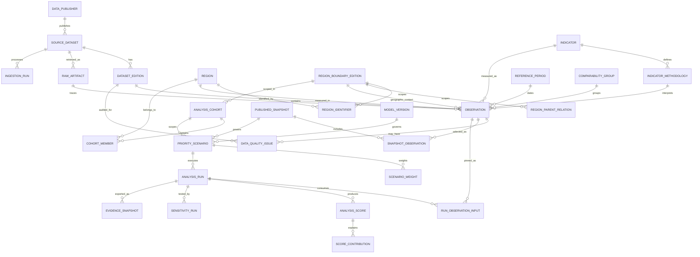
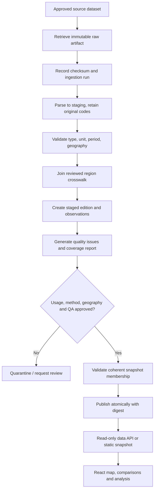

# 06 — Canonical Data Model & Database Design

> **Product:** Nusa Matra — WIA 2026  
> **Path:** `docs/06-DATA-MODEL.md`  
> **Version:** 1.0  
> **Updated:** 2026-10-19  
> **Audience:** Claude Code, backend/data engineers, frontend integrators, reviewers and QA  
> **Document language:** English · **Public UI language:** Bahasa Indonesia  
> **Status:** `PROPOSED` relational reference model; final datastore, statistical definitions, region scope, and analysis policies are not yet approved.

---

> **Repository scope (owner decision 2026-10-20):** this website repository is the React frontend only. Backend, database, ingestion and validated datasets belong to the separate **Data Hub** service and repository. Read the backend sections of this document as the contract the Data Hub is expected to satisfy, not as code to build here. See `docs/adr/0001-frontend-foundation.md`.

## 0. Implementation contract for Claude Code

This document defines the canonical **logical entities, relational integrity rules, provenance and reproducibility boundaries** for Nusa Matra. It is not evidence that a database has been deployed or that real datasets are available.

Read, in this order, before implementing data storage or data-dependent features:

1. [`CLAUDE.md`](../CLAUDE.md) — primary execution instructions.
2. [`project_guidelines.md`](../project_guidelines.md) — brand and engineering principles, especially Clean Code.
3. [`01-PRODUCT-REQUIREMENTS.md`](./01-PRODUCT-REQUIREMENTS.md) — required product capabilities and priorities.
4. [`02-USER-FLOWS.md`](./02-USER-FLOWS.md) — interactions, error states, and cross-feature workflows.
5. [`03-UI-UX-DESIGN-SYSTEM.md`](./03-UI-UX-DESIGN-SYSTEM.md) — Figma-derived data and map presentation rules.
6. [`04-TECH-STACK-ARCHITECTURE.md`](./04-TECH-STACK-ARCHITECTURE.md) — module boundaries and selected/proposed stack.
7. [`05-DATA-SOURCES.md`](./05-DATA-SOURCES.md) — sources, permitted ingestion, legal review and data QA.
8. **This document** — model and persistence rules.
9. Future `docs/07-DECISION-ENGINE.md` and `docs/08-API-SPECIFICATION.md` — scoring behavior and wire contracts (not yet created).

**Priority of authority:** Owner's explicit decisions > approved Figma for visuals > product specifications for behavior > source evidence for factual data > documented approved analysis methodology > reversible engineering proposals.

### 0.1 Mandatory invariants

- Public name is **Nusa Matra**; former Figma filename is not a product name.
- Frontend: **React + TypeScript (LOCKED)**. Backend, PostgreSQL and PostGIS are `PROPOSED`, not locked.
- Data has an explicit **`DEMO`** or **`LIVE`** classification. A live failure never silently falls back to demo figures.
- **`NULL` is not zero.** Missing, suppressed, invalid, and not applicable measurements remain distinguishable.
- A geographic code is **not** a globally unique, timeless region identity. Track its authority, edition and administrative boundary context.
- Indicator labels do not prove two measurements are comparable. Preserve exact methodology, unit, definition, geography, period and comparability group.
- No production result without source, dataset edition, timestamp, approved usage and traceable lineage.
- Never treat illustrative Figma numbers (e.g. example score `0.79`, example region count `514`, example test `500` trials) as real observations or verified analyses.
- Published data snapshots are **immutable**; publish a new snapshot rather than modifying historical evidence.
- Rankings, weighted scores, simulations and reports depend on **explicitly pinned inputs**, algorithms and configuration, not component state or cosmetic UI changes.
- Preserve numeric precision internally; round only when formatting for display.
- Do not create redundant caches or tables unless a measured requirement justifies them. **Clean Code and maintainability are WIA evaluation criteria.**
- Ask the project owner before finalizing disputed methodology or irreversible architecture; prefer reversible adapters for `TBD` choices.

### 0.2 Classification legend

| Label            | Meaning                                         | Model treatment                                                          |
| ---------------- | ----------------------------------------------- | ------------------------------------------------------------------------ |
| `LOCKED`         | Approved by owner                               | Apply directly.                                                          |
| `FIGMA-VERIFIED` | Present in approved Figma                       | Implement intended presentation; not proof of real data.                 |
| `PROPOSED`       | Technical recommendation                        | May implement behind a replaceable boundary after repository inspection. |
| `TBD`            | Requires research/decision                      | Record unresolved question; do not fabricate.                            |
| `DEMO`           | Synthetic, mock, or illustrative                | Isolate and label throughout storage/API/UI.                             |
| `LIVE_VERIFIED`  | Approved, ingested, provenance and QA validated | Eligible for live publication, subject to remaining limitations.         |

---

## 1. Scope, non-goals and design decisions

### 1.1 Covered by this model

1. Stable geographic identity and versioned administrative codes.
2. Dataset publishers, dataset catalogs, raw artifacts, ingestion runs and dataset editions.
3. Indicator definitions, versions of measurement methodology, units and allowed comparisons.
4. Time periods, raw/derived numerical observations, statuses and explicit missing reasons.
5. Data-quality findings and source-to-observation lineage.
6. Immutable published snapshots and pinned snapshot selections.
7. Cohorts (sets of eligible regions) and analysis inputs.
8. User-defined analysis scenarios, weights, result runs and explanations.
9. Sensitivity/robustness runs and exportable **Paspor Bukti** records.
10. Map geometry as an **optional** spatial extension.

### 1.2 Not in scope

- Choosing/approving actual BPS, BNPB, BIG, Kemenkes or SDI dataset editions.
- Defining scientifically approved indicator directions, normalization formulas or default weights.
- Granting API licenses or claiming production access.
- Designing user accounts, public collaboration, payments, comments or notification services.
- Designing the API's final URLs; see document 08.
- Treating frontend browser localStorage as an authoritative dataset database.

### 1.3 Storage options (`TBD`)

| Option                                      | When appropriate                                                 | Compatibility requirement                                                     |
| ------------------------------------------- | ---------------------------------------------------------------- | ----------------------------------------------------------------------------- |
| Versioned JSON/Parquet/GeoJSON snapshots    | Small, validated MVP and no backend persistence required         | Preserve the **same domain IDs, edition/version/provenance rules**.           |
| PostgreSQL 16+ (`PROPOSED`)                 | Relational integrity, queryable history and provenance           | Use reviewed migrations and a published-only read boundary.                   |
| PostgreSQL + PostGIS (`PROPOSED`, optional) | Spatial joins, clipping, boundary processing, geographic indexes | Keep geometry and heavy spatial processing separate from indicator semantics. |

**Default recommendation:** Start with an abstract `DataRepository` interface. Choose persistence based on real source availability and query needs. The SQL below is a **reviewable reference**, not authorization to provision infrastructure.

### 1.4 Naming standards

- TypeScript: `PascalCase` for types, `camelCase` for values; explicit discriminated unions.
- SQL: snake_case tables/columns, plural table names, `*_id` UUID FKs, dates/UTC timestamps with meaningful names.
- Source-native identifiers: preserve as text; never convert administrative codes into integers.
- Do not rename old Figma/legacy identifier strings in ways that break source tracing; translate labels at presentation boundaries.

---

## 2. Feature-to-entity traceability

| Figma/product feature  | Required canonical entities                                                                | Invariant                                                                               |
| ---------------------- | ------------------------------------------------------------------------------------------ | --------------------------------------------------------------------------------------- |
| Peta Utama / Jelajahi  | Region, RegionIdentifier, RegionBoundaryEdition, Indicator, Observation, PublishedSnapshot | Selected map region resolves to the **same** canonical region used by indicators.       |
| Bandingkan             | Two Regions, Observation, IndicatorMethodology, ComparabilityGroup, QualityIssue           | Incompatible definitions are blocked; year differences are assessed, never hidden.      |
| Lab Prioritas          | AnalysisCohort, Scenario, ScenarioWeight, AnalysisRun, Score                               | Changing a weight creates new or cached-identical results; no manual hardcoded ranking. |
| Mengapa Diprioritaskan | AnalysisRun, ScoreContribution, ModelVersion, InputObservation                             | Contributions reconcile with the stored run and configuration.                          |
| Uji Rekomendasi        | SensitivityRun, sensitivity configuration and rank distribution                            | Results identify trial count, seed, perturbation rules and base run.                    |
| Paspor Bukti           | EvidenceSnapshot, AnalysisRun, source editions, limitations                                | Download reproducibly identifies sources, model, cohort, result and caveats.            |
| Titik Buta Data        | DataQualityIssue, Observation, DatasetEdition                                              | Missingness and comparability limitations are visible, not silently imputed.            |
| Cerita Wilayah         | Approved observations + chapter content/assets (separate CMS if needed)                    | Narrative statistics link to pinned verified evidence or say `DEMO`.                    |

**Figma evidence:** The approved design includes nodes `29:34` (Jelajahi), `12:840` (Bandingkan), `11:152` (Lab Prioritas), `12:263` (Mengapa Diprioritaskan), `13:854` (Uji Rekomendasi), `13:446` (Paspor Bukti), `14:541` (Titik Buta Data), and `14:927` (Cerita Wilayah). These are _design contexts_, not actual database records.

---

## 3. Logical entity catalog

### 3.1 Geography domain

| Entity                  | Suggested PK                                       | Fields and purpose                                                                                   |
| ----------------------- | -------------------------------------------------- | ---------------------------------------------------------------------------------------------------- |
| `Region`                | `region_id`                                        | Persistent internal ID, preferred display name, administrative level, lifecycle status.              |
| `RegionBoundaryEdition` | `boundary_edition_id`                              | Authority, specific edition, effective dates, and boundary evidence URL.                             |
| `RegionIdentifier`      | `region_identifier_id`                             | Authority/code-system + code + region + boundary edition.                                            |
| `RegionParentRelation`  | Composite `(boundary_edition_id, child_region_id)` | Administrative parent relationship _within one boundary edition_.                                    |
| `RegionGeometry`        | `(boundary_edition_id, region_id)`                 | Optional spatial geometry and source artifact reference.                                             |
| `RegionCrosswalk`       | `crosswalk_id`                                     | Explicit correspondence across authorities/editions, confidence, status, reviewer and justification. |

Rules:

- A single canonical region may have BPS and Kemendagri identifiers; code values **must never be assumed identical**.
- A split, merger, abolition or boundary revision is not handled by reusing a code blindly.
- A one-to-many crosswalk is not automatically a value conversion; aggregation requires an approved method.
- Parent-child relations reference the **same boundary edition**, not current geography applied retroactively.
- Keep names in Indonesian as published; alias/search terms are an optional normalized child table.
- Do not assume all regions or years use the same administrative count.

### 3.2 Sources and ingestion

| Entity           | PK                   | Responsibility                                                                         |
| ---------------- | -------------------- | -------------------------------------------------------------------------------------- |
| `DataPublisher`  | `publisher_id`       | Authoritative organization, official URL.                                              |
| `SourceDataset`  | `dataset_id`         | Dataset description, original landing/API URI, license and usage review.               |
| `RawArtifact`    | `artifact_id`        | Immutable source bytes in object storage, SHA-256, collection timestamps and metadata. |
| `IngestionRun`   | `ingestion_run_id`   | Parser/config version, retrieval statuses, staging and QA counts.                      |
| `DatasetEdition` | `dataset_edition_id` | One traceable source revision, scope and lifecycle status.                             |

Never store API credentials in these rows. `storage_uri` points to protected object storage; do not write secrets into it or expose it as a public URL.

### 3.3 Metrics and measurements

| Entity                  | PK                                               | Responsibility                                                                        |
| ----------------------- | ------------------------------------------------ | ------------------------------------------------------------------------------------- |
| `Indicator`             | `indicator_id`                                   | Semantic indicator family; name, unit and policy direction need formal review.        |
| `IndicatorMethodology`  | `methodology_id`                                 | Specific definition, publisher method, edition, denominator, formula/direction notes. |
| `ComparabilityGroup`    | `comparability_group_id`                         | Reviewer-approved compatible methodological grouping.                                 |
| `ReferencePeriod`       | `period_id`                                      | Unambiguous start/end and period granularity.                                         |
| `Observation`           | `observation_id`                                 | One measurement in a particular region, time, edition and methodology.                |
| `ObservationDependency` | `(derived_observation_id, input_observation_id)` | Links a derived value to its explicit input values.                                   |
| `DataQualityIssue`      | `quality_issue_id`                               | Actionable warning/blocker, reason, affected entity and resolution state.             |

**Important:** The `Observation` uniqueness key intentionally includes dataset edition. Two official editions can revise the same region/indicator/period. The system chooses the _published_ representative through snapshot membership rather than deleting history.

### 3.4 Publication and analysis

| Entity                    | PK                                           | Responsibility                                                                           |
| ------------------------- | -------------------------------------------- | ---------------------------------------------------------------------------------------- |
| `PublishedSnapshot`       | `snapshot_id`                                | Immutable coherent publication, mode `DEMO`/`LIVE`, digest and publish status.           |
| `SnapshotObservation`     | `(snapshot_id, observation_id)`              | Exact measurement membership; prevent duplicate region/indicator/period in one snapshot. |
| `AnalysisCohort`          | `cohort_id`                                  | Explicit reference group and boundary edition for ranking.                               |
| `CohortMember`            | `(cohort_id, region_id)`                     | Membership of a region in a versioned cohort.                                            |
| `ModelVersion`            | `model_version_id`                           | Reviewed algorithm identifier, code version, normalization/missingness policy.           |
| `PriorityScenario`        | `scenario_id`                                | Snapshot, cohort, model, scenario title and calculation options.                         |
| `ScenarioWeight`          | `(scenario_id, indicator_id)`                | Explicit raw weight per selected indicator.                                              |
| `AnalysisRun`             | `analysis_run_id`                            | Exact inputs hash, status, start/end times, explanation and result metadata.             |
| `RunObservationInput`     | `(analysis_run_id, observation_id)`          | Exact observation rows consumed by the model.                                            |
| `AnalysisScore`           | `(analysis_run_id, region_id)`               | Computed score, optional rank, eligibility and missingness explanation.                  |
| `ScoreContribution`       | `(analysis_run_id, region_id, indicator_id)` | Numerical explanation of each criterion's contribution.                                  |
| `SensitivityRun`          | `sensitivity_run_id`                         | Tested assumptions, seed, trials and status.                                             |
| `SensitivityRegionResult` | `(sensitivity_run_id, region_id)`            | Rank range and top-k stability statistics.                                               |
| `EvidenceSnapshot`        | `evidence_snapshot_id`                       | Immutable report manifest, lineage fingerprint and render artifact.                      |

### 3.5 Clean separation of concerns

1. **Source semantics:** official publishers/datasets and their methodology.
2. **Geographic semantics:** who/where was measured and under which code/boundary edition.
3. **Measurement semantics:** what/when was measured and its status.
4. **Publication semantics:** which coherent, verified combination is exposed to users.
5. **Analysis semantics:** which published measurements, cohort and mathematical model produce a result.
6. **Presentation semantics:** text, charts, effects, locale and 3D. Presentation must not redefine any of the above.

---

## 4. Relationship diagram (logical ERD)



The ERD shows logical relationships; the DDL below includes constraints, and subsequent tables are optional/phase-specific.

---

## 5. Reference SQL migration — PostgreSQL 16+ (`PROPOSED`)

**Usage:** The following is a **reference starting migration**, not a command Claude should execute in an unknown production environment. Inspect existing migrations and approve the storage architecture first. PostgreSQL `gen_random_uuid()` is used; use a compatible version or an application-generated UUID when the environment requires it.

Migrations should be split by dependency order and covered by database-level tests. Keep service code independent of this precise vendor schema.

### 5.1 Catalog, source provenance and geographies

```sql
CREATE SCHEMA IF NOT EXISTS nm;

CREATE TABLE nm.data_publishers (
  publisher_id uuid PRIMARY KEY DEFAULT gen_random_uuid(),
  publisher_key text NOT NULL UNIQUE,
  display_name text NOT NULL,
  official_homepage text,
  created_at timestamptz NOT NULL DEFAULT now(),
  CONSTRAINT publisher_key_nonempty CHECK (length(trim(publisher_key)) > 0)
);

CREATE TABLE nm.source_datasets (
  dataset_id uuid PRIMARY KEY DEFAULT gen_random_uuid(),
  publisher_id uuid NOT NULL REFERENCES nm.data_publishers(publisher_id),
  dataset_key text NOT NULL UNIQUE,
  title text NOT NULL,
  landing_url text NOT NULL,
  license_url text,
  usage_status text NOT NULL DEFAULT 'PENDING'
    CHECK (usage_status IN ('PENDING', 'APPROVED', 'REJECTED')),
  geographic_granularity text,
  access_notes text,
  created_at timestamptz NOT NULL DEFAULT now(),
  CONSTRAINT source_dataset_key_nonempty CHECK (length(trim(dataset_key)) > 0)
);

CREATE TABLE nm.ingestion_runs (
  ingestion_run_id uuid PRIMARY KEY DEFAULT gen_random_uuid(),
  dataset_id uuid NOT NULL REFERENCES nm.source_datasets(dataset_id),
  adapter_version text NOT NULL,
  status text NOT NULL DEFAULT 'QUEUED'
    CHECK (status IN ('QUEUED', 'RUNNING', 'FAILED', 'STAGED', 'VALIDATED')),
  started_at timestamptz,
  finished_at timestamptz,
  row_count bigint CHECK (row_count IS NULL OR row_count >= 0),
  error_count bigint CHECK (error_count IS NULL OR error_count >= 0),
  nonsecret_summary jsonb NOT NULL DEFAULT '{}'::jsonb,
  created_at timestamptz NOT NULL DEFAULT now(),
  CHECK (finished_at IS NULL OR started_at IS NOT NULL)
);

CREATE TABLE nm.raw_artifacts (
  artifact_id uuid PRIMARY KEY DEFAULT gen_random_uuid(),
  dataset_id uuid NOT NULL REFERENCES nm.source_datasets(dataset_id),
  ingestion_run_id uuid REFERENCES nm.ingestion_runs(ingestion_run_id),
  source_resource_url text NOT NULL,
  storage_uri text NOT NULL,
  checksum_sha256 char(64) NOT NULL,
  media_type text,
  fetched_at timestamptz NOT NULL,
  source_etag text,
  source_last_modified timestamptz,
  created_at timestamptz NOT NULL DEFAULT now(),
  UNIQUE (dataset_id, checksum_sha256),
  CHECK (checksum_sha256 ~ '^[0-9a-f]{64}$')
);

CREATE TABLE nm.dataset_editions (
  dataset_edition_id uuid PRIMARY KEY DEFAULT gen_random_uuid(),
  dataset_id uuid NOT NULL REFERENCES nm.source_datasets(dataset_id),
  edition_key text NOT NULL,
  status text NOT NULL DEFAULT 'STAGED'
    CHECK (status IN ('STAGED', 'QUARANTINED', 'VERIFIED', 'REJECTED')),
  source_published_at timestamptz,
  ingested_at timestamptz NOT NULL DEFAULT now(),
  manifest_sha256 char(64) NOT NULL,
  reviewer_note text,
  UNIQUE (dataset_id, edition_key),
  CHECK (manifest_sha256 ~ '^[0-9a-f]{64}$')
);

CREATE TABLE nm.regions (
  region_id uuid PRIMARY KEY DEFAULT gen_random_uuid(),
  canonical_name text NOT NULL,
  admin_level text NOT NULL CHECK (admin_level IN ('PROVINCE', 'REGENCY', 'CITY')),
  lifecycle_status text NOT NULL DEFAULT 'ACTIVE'
    CHECK (lifecycle_status IN ('ACTIVE', 'HISTORICAL', 'REVIEW')),
  created_at timestamptz NOT NULL DEFAULT now()
);

CREATE TABLE nm.region_boundary_editions (
  boundary_edition_id uuid PRIMARY KEY DEFAULT gen_random_uuid(),
  authority_key text NOT NULL,
  edition_key text NOT NULL,
  evidence_url text NOT NULL,
  effective_from date,
  effective_to date,
  review_status text NOT NULL DEFAULT 'PENDING'
    CHECK (review_status IN ('PENDING', 'APPROVED', 'REJECTED')),
  UNIQUE (authority_key, edition_key),
  CHECK (effective_to IS NULL OR effective_from IS NULL OR effective_from <= effective_to)
);

CREATE TABLE nm.region_identifiers (
  region_identifier_id uuid PRIMARY KEY DEFAULT gen_random_uuid(),
  region_id uuid NOT NULL REFERENCES nm.regions(region_id),
  boundary_edition_id uuid NOT NULL REFERENCES nm.region_boundary_editions(boundary_edition_id),
  code_system text NOT NULL,
  code text NOT NULL,
  UNIQUE (boundary_edition_id, code_system, code),
  UNIQUE (boundary_edition_id, region_id, code_system),
  CHECK (length(trim(code)) > 0)
);

CREATE TABLE nm.region_parent_relations (
  boundary_edition_id uuid NOT NULL REFERENCES nm.region_boundary_editions(boundary_edition_id),
  child_region_id uuid NOT NULL REFERENCES nm.regions(region_id),
  parent_region_id uuid NOT NULL REFERENCES nm.regions(region_id),
  PRIMARY KEY (boundary_edition_id, child_region_id),
  CHECK (child_region_id <> parent_region_id)
);

CREATE TABLE nm.region_crosswalks (
  crosswalk_id uuid PRIMARY KEY DEFAULT gen_random_uuid(),
  source_identifier_id uuid NOT NULL REFERENCES nm.region_identifiers(region_identifier_id),
  target_identifier_id uuid NOT NULL REFERENCES nm.region_identifiers(region_identifier_id),
  mapping_kind text NOT NULL
    CHECK (mapping_kind IN ('EXACT', 'RENAMED', 'SPLIT', 'MERGED', 'APPROXIMATE')),
  review_status text NOT NULL DEFAULT 'PENDING'
    CHECK (review_status IN ('PENDING', 'APPROVED', 'REJECTED')),
  justification text NOT NULL,
  reviewed_at timestamptz,
  UNIQUE (source_identifier_id, target_identifier_id, mapping_kind),
  CHECK (source_identifier_id <> target_identifier_id)
);
```

**Cross-table rules requiring a transactional service or audited trigger:** `region_parent_relations` must have valid hierarchy/edition membership (e.g. city or regency → province); no cycles. The source dataset referenced by an artifact must equal the source dataset of its ingestion run. Geographic edition applicability must be validated. SQL foreign keys alone do not establish these facts.

### 5.2 Indicators, periods, comparability and observations

```sql
CREATE TABLE nm.indicators (
  indicator_id uuid PRIMARY KEY DEFAULT gen_random_uuid(),
  indicator_key text NOT NULL UNIQUE,
  display_name_id text NOT NULL,
  explanation_id text,
  canonical_unit text NOT NULL,
  analysis_direction text NOT NULL DEFAULT 'CONTEXTUAL'
    CHECK (analysis_direction IN ('HIGHER_IS_BETTER', 'HIGHER_IS_WORSE', 'CONTEXTUAL')),
  created_at timestamptz NOT NULL DEFAULT now()
);

CREATE TABLE nm.indicator_methodologies (
  methodology_id uuid PRIMARY KEY DEFAULT gen_random_uuid(),
  indicator_id uuid NOT NULL REFERENCES nm.indicators(indicator_id),
  version_key text NOT NULL,
  definition text NOT NULL,
  source_method_url text,
  denominator_definition text,
  reported_unit text NOT NULL,
  transformation_spec jsonb NOT NULL DEFAULT '{}'::jsonb,
  review_status text NOT NULL DEFAULT 'PENDING'
    CHECK (review_status IN ('PENDING', 'APPROVED', 'REJECTED')),
  UNIQUE (indicator_id, version_key),
  UNIQUE (methodology_id, indicator_id)
);

CREATE TABLE nm.comparability_groups (
  comparability_group_id uuid PRIMARY KEY DEFAULT gen_random_uuid(),
  indicator_id uuid NOT NULL REFERENCES nm.indicators(indicator_id),
  group_key text NOT NULL,
  rationale text NOT NULL,
  review_status text NOT NULL DEFAULT 'PENDING'
    CHECK (review_status IN ('PENDING', 'APPROVED', 'REJECTED')),
  UNIQUE (indicator_id, group_key),
  UNIQUE (comparability_group_id, indicator_id)
);

CREATE TABLE nm.reference_periods (
  period_id uuid PRIMARY KEY DEFAULT gen_random_uuid(),
  period_key text NOT NULL UNIQUE,
  granularity text NOT NULL
    CHECK (granularity IN ('DAY', 'MONTH', 'QUARTER', 'YEAR', 'AS_OF')),
  starts_on date NOT NULL,
  ends_before date NOT NULL,
  display_label text NOT NULL,
  CHECK (ends_before > starts_on),
  UNIQUE (granularity, starts_on, ends_before)
);

CREATE TABLE nm.observations (
  observation_id uuid PRIMARY KEY DEFAULT gen_random_uuid(),
  dataset_edition_id uuid NOT NULL REFERENCES nm.dataset_editions(dataset_edition_id),
  source_artifact_id uuid REFERENCES nm.raw_artifacts(artifact_id),
  source_row_locator text,
  region_id uuid NOT NULL REFERENCES nm.regions(region_id),
  boundary_edition_id uuid NOT NULL REFERENCES nm.region_boundary_editions(boundary_edition_id),
  indicator_id uuid NOT NULL REFERENCES nm.indicators(indicator_id),
  methodology_id uuid NOT NULL,
  comparability_group_id uuid,
  period_id uuid NOT NULL REFERENCES nm.reference_periods(period_id),
  value_amount numeric(30, 10),
  value_status text NOT NULL CHECK (value_status IN ('AVAILABLE', 'MISSING', 'SUPPRESSED')),
  missing_reason text CHECK (missing_reason IN (
    'NOT_PUBLISHED', 'NOT_APPLICABLE', 'SUPPRESSED',
    'UNMAPPED_REGION', 'INVALID_MEASUREMENT', 'PROVIDER_UNAVAILABLE'
  )),
  quality_state text NOT NULL DEFAULT 'PENDING'
    CHECK (quality_state IN ('PENDING', 'VERIFIED', 'WARNING', 'BLOCKED')),
  origin text NOT NULL CHECK (origin IN ('SOURCE_REPORTED', 'DERIVED', 'DEMO')),
  data_mode text NOT NULL CHECK (data_mode IN ('DEMO', 'LIVE')),
  created_at timestamptz NOT NULL DEFAULT now(),
  UNIQUE (dataset_edition_id, region_id, indicator_id, methodology_id, period_id),
  UNIQUE (observation_id, region_id, indicator_id, period_id),
  FOREIGN KEY (methodology_id, indicator_id)
    REFERENCES nm.indicator_methodologies(methodology_id, indicator_id),
  FOREIGN KEY (comparability_group_id, indicator_id)
    REFERENCES nm.comparability_groups(comparability_group_id, indicator_id),
  CONSTRAINT observation_value_consistency CHECK (
    (value_status = 'AVAILABLE' AND value_amount IS NOT NULL AND missing_reason IS NULL)
    OR
    (value_status IN ('MISSING', 'SUPPRESSED') AND value_amount IS NULL AND missing_reason IS NOT NULL)
  ),
  CONSTRAINT suppressed_has_reason CHECK (
    value_status <> 'SUPPRESSED' OR missing_reason = 'SUPPRESSED'
  ),
  CONSTRAINT demo_origin_consistency CHECK (
    (data_mode = 'DEMO' AND origin = 'DEMO') OR
    (data_mode = 'LIVE' AND origin IN ('SOURCE_REPORTED', 'DERIVED'))
  )
);

CREATE TABLE nm.observation_dependencies (
  derived_observation_id uuid NOT NULL REFERENCES nm.observations(observation_id),
  input_observation_id uuid NOT NULL REFERENCES nm.observations(observation_id),
  dependency_role text NOT NULL DEFAULT 'INPUT',
  PRIMARY KEY (derived_observation_id, input_observation_id),
  CHECK (derived_observation_id <> input_observation_id)
);

CREATE TABLE nm.data_quality_issues (
  quality_issue_id uuid PRIMARY KEY DEFAULT gen_random_uuid(),
  dataset_edition_id uuid NOT NULL REFERENCES nm.dataset_editions(dataset_edition_id),
  observation_id uuid REFERENCES nm.observations(observation_id),
  issue_code text NOT NULL,
  severity text NOT NULL CHECK (severity IN ('INFO', 'WARNING', 'BLOCKER')),
  status text NOT NULL DEFAULT 'OPEN'
    CHECK (status IN ('OPEN', 'ACKNOWLEDGED', 'RESOLVED')),
  details text NOT NULL,
  evidence jsonb NOT NULL DEFAULT '{}'::jsonb,
  created_at timestamptz NOT NULL DEFAULT now(),
  resolved_at timestamptz,
  CHECK (status <> 'RESOLVED' OR resolved_at IS NOT NULL)
);
```

**Rules beyond the DDL:**

- An observation's `source_artifact_id` (if present) must belong to the same source dataset as `dataset_edition_id`.
- A `DERIVED` live observation must have a documented transform and nonempty `observation_dependencies` before publication; dependency graphs must be acyclic.
- A `SOURCE_REPORTED` live observation must have a source artifact/lineage and verifiable source method.
- An observation marked `VERIFIED` still requires approved dataset, methodology, crosswalk, period, license and comparator review before publication.
- `comparability_group_id = NULL` means **not approved for comparable cross-region analytics**, not “compare all”.
- `quality_state = WARNING` does not imply comparability; the decision engine must interpret precise issue codes.
- Missing from an import can be explicitly recorded with `MISSING`, or absent until coverage QA materializes a gap. **Absence in the table is not proof that the official source reports missing.**
- `period_key` is a stable internal key like `2023`, but the start/end interval is authoritative. `AS_OF` represents an instant as a one-day interval in this baseline; revisit if sub-day data becomes relevant.

### 5.3 Publication snapshots and pinned inputs

```sql
CREATE TABLE nm.published_snapshots (
  snapshot_id uuid PRIMARY KEY DEFAULT gen_random_uuid(),
  snapshot_key text NOT NULL UNIQUE,
  data_mode text NOT NULL CHECK (data_mode IN ('DEMO', 'LIVE')),
  status text NOT NULL DEFAULT 'DRAFT'
    CHECK (status IN ('DRAFT', 'VALIDATING', 'PUBLISHED', 'RETIRED')),
  digest_sha256 char(64) NOT NULL,
  created_at timestamptz NOT NULL DEFAULT now(),
  published_at timestamptz,
  release_notes text,
  CHECK (digest_sha256 ~ '^[0-9a-f]{64}$'),
  CHECK (status <> 'PUBLISHED' OR published_at IS NOT NULL)
);

CREATE TABLE nm.snapshot_observations (
  snapshot_id uuid NOT NULL REFERENCES nm.published_snapshots(snapshot_id),
  observation_id uuid NOT NULL,
  region_id uuid NOT NULL,
  indicator_id uuid NOT NULL,
  period_id uuid NOT NULL,
  PRIMARY KEY (snapshot_id, observation_id),
  UNIQUE (snapshot_id, region_id, indicator_id, period_id),
  FOREIGN KEY (observation_id, region_id, indicator_id, period_id)
    REFERENCES nm.observations(observation_id, region_id, indicator_id, period_id)
);

CREATE TABLE nm.analysis_cohorts (
  cohort_id uuid PRIMARY KEY DEFAULT gen_random_uuid(),
  cohort_key text NOT NULL UNIQUE,
  title_id text NOT NULL,
  boundary_edition_id uuid NOT NULL REFERENCES nm.region_boundary_editions(boundary_edition_id),
  admin_level text NOT NULL CHECK (admin_level IN ('PROVINCE', 'REGENCY', 'CITY', 'MIXED_APPROVED')),
  review_status text NOT NULL DEFAULT 'PENDING'
    CHECK (review_status IN ('PENDING', 'APPROVED', 'REJECTED')),
  criteria_notes text NOT NULL,
  created_at timestamptz NOT NULL DEFAULT now()
);

CREATE TABLE nm.cohort_members (
  cohort_id uuid NOT NULL REFERENCES nm.analysis_cohorts(cohort_id),
  region_id uuid NOT NULL REFERENCES nm.regions(region_id),
  PRIMARY KEY (cohort_id, region_id)
);
```

**Snapshot publication is a privileged atomic operation, not a simple `UPDATE status = 'PUBLISHED'`.** Required transactional validation before publication:

1. All members have the same snapshot `data_mode`; `DEMO` and `LIVE` cannot mix.
2. Every referenced dataset edition is `VERIFIED`, source dataset usage is `APPROVED`, indicator methodology reviewed, and geography mapping valid (for `LIVE`).
3. Every value has a valid status and either required lineage or an explicit demo label.
4. No blocking data-quality issue affects material being promoted for the promised use; quality warnings are enumerated.
5. Snapshot manifest digest is calculated from a deterministic sorted list of observation IDs + key version identifiers (not from unordered JSON serialization).
6. Integrity check passes in the same transaction that moves from `VALIDATING` to `PUBLISHED`.
7. Write access to published rows is revoked or blocked by immutability triggers/policies; retirement creates a new status event, not a mutation of the published measurements.

**Enforcement note:** The DDL above alone does **not** prohibit later mutations or every cross-table mismatch. Implement publication and immutability enforcement with database privileges/triggers plus application tests. Never rely on a browser request as a trusted gatekeeper.

### 5.4 Decision engine persistence (Phase 2/3; `PROPOSED`)

```sql
CREATE TABLE nm.model_versions (
  model_version_id uuid PRIMARY KEY DEFAULT gen_random_uuid(),
  model_key text NOT NULL,
  version_key text NOT NULL,
  implementation_digest_sha256 char(64) NOT NULL,
  methodology_document_url text,
  normalization_policy jsonb NOT NULL,
  missing_value_policy jsonb NOT NULL,
  approval_status text NOT NULL DEFAULT 'DEMO_ONLY'
    CHECK (approval_status IN ('DEMO_ONLY', 'PENDING', 'APPROVED', 'REJECTED')),
  UNIQUE (model_key, version_key),
  CHECK (implementation_digest_sha256 ~ '^[0-9a-f]{64}$')
);

CREATE TABLE nm.priority_scenarios (
  scenario_id uuid PRIMARY KEY DEFAULT gen_random_uuid(),
  snapshot_id uuid NOT NULL REFERENCES nm.published_snapshots(snapshot_id),
  cohort_id uuid NOT NULL REFERENCES nm.analysis_cohorts(cohort_id),
  model_version_id uuid NOT NULL REFERENCES nm.model_versions(model_version_id),
  title text NOT NULL,
  config jsonb NOT NULL DEFAULT '{}'::jsonb,
  created_at timestamptz NOT NULL DEFAULT now()
);

CREATE TABLE nm.scenario_weights (
  scenario_id uuid NOT NULL REFERENCES nm.priority_scenarios(scenario_id),
  indicator_id uuid NOT NULL REFERENCES nm.indicators(indicator_id),
  weight numeric(18, 12) NOT NULL CHECK (weight >= 0 AND weight <= 1),
  PRIMARY KEY (scenario_id, indicator_id)
);

CREATE TABLE nm.analysis_runs (
  analysis_run_id uuid PRIMARY KEY DEFAULT gen_random_uuid(),
  scenario_id uuid NOT NULL REFERENCES nm.priority_scenarios(scenario_id),
  inputs_sha256 char(64) NOT NULL,
  status text NOT NULL DEFAULT 'PENDING'
    CHECK (status IN ('PENDING', 'RUNNING', 'COMPLETED', 'FAILED')),
  executed_at timestamptz,
  completed_at timestamptz,
  failure_code text,
  result_summary jsonb NOT NULL DEFAULT '{}'::jsonb,
  CHECK (inputs_sha256 ~ '^[0-9a-f]{64}$'),
  CHECK (status <> 'COMPLETED' OR completed_at IS NOT NULL),
  CHECK (status <> 'FAILED' OR failure_code IS NOT NULL)
);

CREATE TABLE nm.run_observation_inputs (
  analysis_run_id uuid NOT NULL REFERENCES nm.analysis_runs(analysis_run_id),
  observation_id uuid NOT NULL REFERENCES nm.observations(observation_id),
  PRIMARY KEY (analysis_run_id, observation_id)
);

CREATE TABLE nm.analysis_scores (
  analysis_run_id uuid NOT NULL REFERENCES nm.analysis_runs(analysis_run_id),
  region_id uuid NOT NULL REFERENCES nm.regions(region_id),
  eligibility text NOT NULL CHECK (eligibility IN ('ELIGIBLE', 'EXCLUDED', 'BLOCKED')),
  score numeric(24, 12),
  rank_position integer CHECK (rank_position IS NULL OR rank_position > 0),
  explanation_code text,
  PRIMARY KEY (analysis_run_id, region_id),
  CHECK (
    (eligibility = 'ELIGIBLE' AND score IS NOT NULL) OR
    (eligibility <> 'ELIGIBLE' AND score IS NULL AND rank_position IS NULL)
  )
);

CREATE TABLE nm.score_contributions (
  analysis_run_id uuid NOT NULL,
  region_id uuid NOT NULL,
  indicator_id uuid NOT NULL REFERENCES nm.indicators(indicator_id),
  source_observation_id uuid REFERENCES nm.observations(observation_id),
  normalized_value numeric(24, 12),
  effective_weight numeric(18, 12) NOT NULL CHECK (effective_weight >= 0),
  contribution numeric(24, 12),
  PRIMARY KEY (analysis_run_id, region_id, indicator_id),
  FOREIGN KEY (analysis_run_id, region_id)
    REFERENCES nm.analysis_scores(analysis_run_id, region_id)
);

CREATE TABLE nm.sensitivity_runs (
  sensitivity_run_id uuid PRIMARY KEY DEFAULT gen_random_uuid(),
  base_analysis_run_id uuid NOT NULL REFERENCES nm.analysis_runs(analysis_run_id),
  config jsonb NOT NULL,
  random_seed bigint NOT NULL,
  trial_count integer NOT NULL CHECK (trial_count > 0),
  status text NOT NULL DEFAULT 'PENDING'
    CHECK (status IN ('PENDING', 'RUNNING', 'COMPLETED', 'FAILED')),
  result_digest_sha256 char(64),
  finished_at timestamptz,
  CHECK (result_digest_sha256 IS NULL OR result_digest_sha256 ~ '^[0-9a-f]{64}$')
);

CREATE TABLE nm.sensitivity_region_results (
  sensitivity_run_id uuid NOT NULL REFERENCES nm.sensitivity_runs(sensitivity_run_id),
  region_id uuid NOT NULL REFERENCES nm.regions(region_id),
  min_rank integer CHECK (min_rank IS NULL OR min_rank > 0),
  max_rank integer CHECK (max_rank IS NULL OR max_rank > 0),
  top_k_frequency numeric(9, 6) CHECK (top_k_frequency BETWEEN 0 AND 1),
  PRIMARY KEY (sensitivity_run_id, region_id),
  CHECK (min_rank IS NULL OR max_rank IS NULL OR min_rank <= max_rank)
);

CREATE TABLE nm.evidence_snapshots (
  evidence_snapshot_id uuid PRIMARY KEY DEFAULT gen_random_uuid(),
  analysis_run_id uuid NOT NULL REFERENCES nm.analysis_runs(analysis_run_id),
  sensitivity_run_id uuid REFERENCES nm.sensitivity_runs(sensitivity_run_id),
  report_key text NOT NULL UNIQUE,
  manifest_sha256 char(64) NOT NULL,
  report_manifest jsonb NOT NULL,
  generated_at timestamptz NOT NULL DEFAULT now(),
  export_storage_uri text,
  CHECK (manifest_sha256 ~ '^[0-9a-f]{64}$')
);
```

**Note:** For long-running or anonymous public use, retaining every slider movement as a database scenario is wasteful. Run in memory or a bounded ephemeral cache for previews; persist only a user-confirmed share/export or a measured audit requirement, subject to privacy and retention policy in document 11.

### 5.5 Query indexes (`PROPOSED`)

```sql
CREATE INDEX idx_region_codes_lookup
  ON nm.region_identifiers(code_system, code, boundary_edition_id);

CREATE INDEX idx_region_parent_by_parent
  ON nm.region_parent_relations(boundary_edition_id, parent_region_id);

CREATE INDEX idx_raw_artifacts_dataset_fetched
  ON nm.raw_artifacts(dataset_id, fetched_at DESC);

CREATE INDEX idx_editions_dataset_status
  ON nm.dataset_editions(dataset_id, status);

CREATE INDEX idx_observations_region_period
  ON nm.observations(region_id, indicator_id, period_id);

CREATE INDEX idx_observations_indicator_period
  ON nm.observations(indicator_id, period_id, region_id);

CREATE INDEX idx_observations_dataset_edition
  ON nm.observations(dataset_edition_id);

CREATE INDEX idx_quality_open_blockers
  ON nm.data_quality_issues(dataset_edition_id, severity)
  WHERE status <> 'RESOLVED';

CREATE INDEX idx_snapshot_observations_lookup
  ON nm.snapshot_observations(snapshot_id, indicator_id, period_id, region_id);

CREATE INDEX idx_scenario_runs_recent
  ON nm.analysis_runs(scenario_id, executed_at DESC);

CREATE INDEX idx_scores_rank
  ON nm.analysis_scores(analysis_run_id, rank_position)
  WHERE eligibility = 'ELIGIBLE';
```

**Performance rule:** These are candidates, not a justification to over-index. Retain only indexes used by measured query plans (`EXPLAIN (ANALYZE, BUFFERS)` against representative data); UNIQUE and PRIMARY KEY constraints already create indexes. Monitor write overhead and ingestion volume.

### 5.6 Optional PostGIS extension — separate migration

**Only if spatial database operations are required and hosting supports PostGIS:**

```sql
-- Optional migration, not part of the mandatory relational baseline.
CREATE EXTENSION IF NOT EXISTS postgis;

CREATE TABLE nm.region_geometries (
  boundary_edition_id uuid NOT NULL REFERENCES nm.region_boundary_editions(boundary_edition_id),
  region_id uuid NOT NULL REFERENCES nm.regions(region_id),
  source_artifact_id uuid NOT NULL REFERENCES nm.raw_artifacts(artifact_id),
  geom geometry(MultiPolygon, 4326) NOT NULL,
  PRIMARY KEY (boundary_edition_id, region_id)
);

CREATE INDEX idx_region_geometries_geom
  ON nm.region_geometries USING gist(geom);
```

**Geospatial QA:** Confirm CRS and coordinate ordering, `ST_IsValid`, polygon/multipolygon semantics, legal geometry license, origin layer edition, simplification tolerance and geometry identity. Never mistake the Figma **illustrative hexagon map** or **3D diorama** for a scientifically accurate boundary dataset. Serve simplified vector tiles/GeoJSON by zoom and use accurate geometry only when available/approved.

---

## 6. Explicit integrity rules beyond individual columns

| ID          | Rule                                                          | Enforcement strategy                                          |
| ----------- | ------------------------------------------------------------- | ------------------------------------------------------------- |
| `DM-INV-01` | A missing value is not zero                                   | SQL `value_status` check + TS union + UI tests.               |
| `DM-INV-02` | Observations cannot silently mix `DEMO`/`LIVE`                | Transactional publication gate and API read guards.           |
| `DM-INV-03` | A published snapshot is immutable                             | Database grants/trigger + append-only replacement.            |
| `DM-INV-04` | One observation per `(snapshot, region, indicator, period)`   | `UNIQUE` on snapshot membership.                              |
| `DM-INV-05` | Each observation has correct method/indicator pair            | Composite SQL FK.                                             |
| `DM-INV-06` | A crosswalk requires review, never name equality              | Explicit crosswalk with review status and evidence.           |
| `DM-INV-07` | Dataset revision history is append-only                       | Unique edition key, immutable raw artifact checksum.          |
| `DM-INV-08` | A `LIVE` value can be traced to source metadata               | Publication validator and lineage tests.                      |
| `DM-INV-09` | Comparable pairs require compatible definitions and geography | Dedicated comparison domain service; never a chart heuristic. |
| `DM-INV-10` | Analysis inputs are snapshot-pinned                           | Scenario FK, run input FKs, completed-run audit.              |
| `DM-INV-11` | Completed analysis results are immutable                      | API/database permission policy.                               |
| `DM-INV-12` | Weight normalization is reproducible                          | Model policy, exact weights, input digest, test vectors.      |
| `DM-INV-13` | 2+ geography levels are not ranked together implicitly        | Cohort admission validation.                                  |
| `DM-INV-14` | Evidence passport references a completed matching analysis    | Export transaction preconditions.                             |
| `DM-INV-15` | Sources and time period visible for claims                    | API DTO validation and UI acceptance checks.                  |
| `DM-INV-16` | Suppressed/private records are not published inadvertently    | Publication/role-level read permissions.                      |

**Important implementation distinction:** A `CHECK` validates one row; it does not certify other tables, scientific validity, licensing or statistical comparability. Cross-row and cross-table rules need explicit audited publication services and/or triggers. Never claim the illustrative DDL enforces all invariants by itself.

---

## 7. Observation semantics, missingness and origin

### 7.1 Canonical value state

```text
AVAILABLE  => value_amount is not null, missing_reason is null.
MISSING    => value_amount is null, missing_reason is a documented reason.
SUPPRESSED => value_amount is null, missing_reason = SUPPRESSED.
```

Examples (illustrative, not published statistics):

| Case                         | `value_status` | `value_amount` | `missing_reason`       | UI                                      |
| ---------------------------- | -------------- | -------------- | ---------------------- | --------------------------------------- |
| Valid measured zero          | `AVAILABLE`    | `0`            | `NULL`                 | `0` + unit and source.                  |
| Officially unreported        | `MISSING`      | `NULL`         | `NOT_PUBLISHED`        | “Data belum dipublikasikan”.            |
| Not meaningful for geography | `MISSING`      | `NULL`         | `NOT_APPLICABLE`       | “Tidak berlaku untuk wilayah ini”.      |
| Confidential/too small cell  | `SUPPRESSED`   | `NULL`         | `SUPPRESSED`           | “Data tidak ditampilkan oleh sumber”.   |
| Unmappable admin code        | `MISSING`      | `NULL`         | `UNMAPPED_REGION`      | “Kode wilayah perlu diverifikasi”.      |
| Parsed but failed validation | `MISSING`      | `NULL`         | `INVALID_MEASUREMENT`  | “Data sedang ditinjau”.                 |
| Provider outage              | `MISSING`      | `NULL`         | `PROVIDER_UNAVAILABLE` | “Sumber data sementara tidak tersedia”. |

A network outage does **not** retroactively make a previously verified published historical observation unavailable. Keep the most recent **pinned verified** snapshot, show its date, and report failures separately. Do not persist transient provider errors as fake official measurements.

### 7.2 Observation origins

- `SOURCE_REPORTED`: value exists in a traceable, lawfully ingested official source.
- `DERIVED`: value computed by Nusa Matra from identified observations through an approved transform; not claimed as a publisher-reported value.
- `DEMO`: synthetic/mock/sample; always visibly labeled.
- `MODEL_OUTPUT`: result of analysis (score/rank) and **stored in analysis tables**, never disguised as an official `Observation`.

A source-reported value can legitimately be zero; don't conflate truthiness with availability.

### 7.3 Decimal precision and formatting

- Store measurements and scores as base-10 `NUMERIC` where applicable; do not store visualized strings such as `"2,1×"` as numerical truth.
- Preserve input scale, exact unit, measurement conversion and denominators.
- Format `id-ID` only at the UI boundary (`Intl.NumberFormat('id-ID')`).
- Normalized scores (possibly 0–1 under a particular approved model) belong in result tables with versioned semantics; they are not original measurements.
- For frontend numerical computations, use stable tested algorithms; if backend precision matters, use explicit decimal arithmetic or serialize decimal values safely instead of unsafe floating-point assumptions.

---

## 8. Comparability domain contract

Comparability is a **reviewed assessment**, not simply “same indicator label”. It is computed against a selection of observations from the _same_ published snapshot.

| Dimension         | Required check                              | Example failure                                            |
| ----------------- | ------------------------------------------- | ---------------------------------------------------------- |
| Indicator         | Same semantic indicator identity            | An unrelated indicator shares a similar title.             |
| Methodology       | Same/approved compatible comparable group   | Survey definition vs administrative register.              |
| Unit/denominator  | Compatible, with documented conversion      | Percent vs fraction or rate per different population base. |
| Period            | Same period, or approved year-gap exception | 2021 vs 2023 without tolerance decision.                   |
| Boundary          | Same or harmonized approved edition         | Pre-split and post-split geography.                        |
| Observation state | Values available and quality acceptable     | Missing/suppressed/invalid.                                |
| Source caveats    | Warnings/blockers respected                 | License/use restriction, stale or incomplete data.         |

### 8.1 Outcomes consumed by the frontend

```ts
export type ComparisonStatus =
  | 'COMPARABLE'
  | 'COMPARABLE_WITH_WARNING'
  | 'BLOCKED_DEFINITION'
  | 'BLOCKED_UNIT'
  | 'BLOCKED_PERIOD'
  | 'BLOCKED_BOUNDARY'
  | 'BLOCKED_MISSING'
  | 'BLOCKED_INVALID';

export interface ComparisonAssessment {
  status: ComparisonStatus;
  indicatorId: string;
  leftObservationId: string;
  rightObservationId: string;
  reasons: readonly string[];
  warnings: readonly string[];
  comparable: boolean;
}
```

Rules:

1. `comparable=true` only for `COMPARABLE` and `COMPARABLE_WITH_WARNING` after review.
2. For `BLOCKED_*`, do not show a numeric difference, ratio or misleading paired bar.
3. A `COMPARABLE_WITH_WARNING` result must render the warning visibly and in Paspor Bukti.
4. Do not derive a ratio if denominator is zero; choose a meaningful verbal representation instead.
5. Comparisons must pin selected `snapshotId`, region IDs, indicator ID and period IDs.
6. For threshold choices and policy exceptions, see future `07-DECISION-ENGINE.md`.

**Figma precedent:** The Bandingkan design (`12:840`) blocks incompatible water-access definitions and warns when reference years differ. These behaviors are required; the specific example values in that frame remain illustrative.

---

## 9. Analysis and model reproducibility

### 9.1 Scenario and run lifecycles

```text
CREATE SCENARIO
  -> select immutable snapshot + approved cohort + model version
  -> save weights + configuration
  -> validate inputs and data eligibility
  -> hash canonical inputs
  -> execute run
  -> persist observed input IDs + scores + contributions atomically
  -> mark run COMPLETED
  -> optionally perform sensitivity analysis
  -> optionally generate EvidenceSnapshot
```

Never write scores for a running or failed run as finished truth. Verify **every** `run_observation_inputs.observation_id` is a member of the exact snapshot referenced by that run's scenario, and that every score region belongs to its cohort; FKs alone do not enforce these cross-table rules. Use transactions and safe retries keyed by input hash or an idempotency key.

### 9.2 Reproducible run fingerprint

Inputs to hash with canonical sorting and stable serialization:

```json
{
  "schemaVersion": "1",
  "snapshotId": "<immutable-uuid>",
  "snapshotDigest": "<sha256-hex>",
  "cohortId": "<approved-cohort-uuid>",
  "cohortMembers": ["<sorted-region-id-1>", "<sorted-region-id-2>"],
  "modelKey": "weighted-priority",
  "modelVersion": "<reviewed-version>",
  "implementationDigest": "<sha256-hex>",
  "weights": [{ "indicatorId": "<uuid>", "weight": "0.30" }],
  "normalizationPolicy": "<versioned-policy>",
  "missingnessPolicy": "<versioned-policy>",
  "periodSelection": "<explicit-period-policy>",
  "regionBoundaryEditionId": "<uuid>"
}
```

The JSON above is **a format example only**, not an active input with real UUIDs or a default approved weight. Canonical decimals should be serialized as canonical decimal strings (not floating-point text subject to locale). Include all dimensions that can change a score.

### 9.3 Ranked results contract

- Eligibility and score are independent: excluded regions cannot have a published rank.
- Define tie-breaking policy explicitly in the model version (dense rank vs competition rank, stable ordering by region ID).
- `AnalysisScore.score` must reconcile with the applicable contribution formula (within declared numeric tolerance).
- Contributions must reference appropriate source observations; if model uses a global normalization cohort, persist versioned min/max/reference statistics in a reviewed calculation manifest.
- Never claim that priority rank is an official governmental recommendation.
- User-adjusted weights must be validated and normalized by the **approved model**, not silently recalculated by UI code.

### 9.4 Missing data is a policy decision

The approved source document's **safe interim rule** is to exclude regions with incomplete required inputs, pending domain approval. The Figma prototype illustrates redistributing an unavailable indicator's weight in one scenario; that behavior is **not production-approved**.

Allowed future strategies to discuss in `07-DECISION-ENGINE.md`:

1. Exclude incomplete regions, disclose coverage impact (**conservative interim proposal**).
2. Remove a criterion consistently across the entire cohort.
3. Reweight available criteria by region (risk of non-comparable scores).
4. Impute missing values using a reviewed uncertainty model.

Record the selected strategy explicitly in `ModelVersion` and `AnalysisRun` manifest. Do not infer from a chart mockup.

### 9.5 Sensitivity testing

Store:

- Base `analysis_run_id`.
- Trial definition (weight perturbation, leave-one-out, alternative period if available).
- Pseudorandom seed, number of trials, algorithm version.
- Eligibility changes, rank range and top-k frequency with denominator.
- Failures and warnings, not only favorable summary statements.

The Figma example says “500 percobaan acak” and shows stable top ranks; **these are prototype examples**, not universal defaults or validated results.

---

## 10. Paspor Bukti: immutable evidence manifest

A passport record must bind to a **completed** analysis run, its dataset and model versions, and any stability run. Its displayed report is an interpretation of that pinned manifest, not a separate source of truth.

Minimum manifest shape:

```ts
export interface EvidenceManifest {
  schemaVersion: '1';
  evidenceSnapshotId: string;
  generatedAt: string; // ISO 8601 UTC
  dataMode: 'DEMO' | 'LIVE';
  snapshot: {
    id: string;
    digestSha256: string;
    publishedAt: string | null;
  };
  cohort: {
    id: string;
    boundaryEditionId: string;
    regionIds: string[];
  };
  model: {
    id: string;
    version: string;
    implementationDigestSha256: string;
    assumptions: string[];
  };
  analysisRun: {
    id: string;
    inputsSha256: string;
    weightsByIndicatorId: Record<string, string>;
    observationIds: string[];
  };
  sourceEditions: Array<{
    datasetEditionId: string;
    publisherName: string;
    sourceUrl: string;
    referencePeriod: string;
    licenseUrl: string | null;
  }>;
  sensitivityRunId: string | null;
  limitations: string[];
}
```

**Export rules:**

- Render a visible `DEMO` watermark/label if the underlying snapshot is demo.
- Include human-readable and machine-readable versions when practical.
- Do not include source API keys, private storage URIs, end-user identity or raw restricted records.
- Preserve the fingerprint and source URLs in exported reports.
- Generate report artifact after validating snapshot/run/mode consistency; if a linked sensitivity run belongs to a different base run, reject it.
- Persist only as necessary; configure retention once approved in document 11.

---

## 11. TypeScript domain models (`PROPOSED`)

Never use transport DTOs directly as business models. Runtime-validate untrusted API responses. Represent decimals as strings where precision must survive JSON.

```ts
export type DataMode = 'DEMO' | 'LIVE';
export type AdministrativeLevel = 'PROVINCE' | 'REGENCY' | 'CITY';

export interface Region {
  id: string;
  displayName: string;
  adminLevel: AdministrativeLevel;
  code: string;
  codeSystem: string;
  boundaryEditionId: string;
}

export interface Indicator {
  id: string;
  key: string;
  displayName: string;
  unit: string;
  analysisDirection: 'HIGHER_IS_BETTER' | 'HIGHER_IS_WORSE' | 'CONTEXTUAL';
}

export type ObservationResult =
  | { status: 'AVAILABLE'; value: string; reason?: never }
  | { status: 'MISSING'; value: null; reason: MissingReason }
  | { status: 'SUPPRESSED'; value: null; reason: 'SUPPRESSED' };

export type MissingReason =
  | 'NOT_PUBLISHED'
  | 'NOT_APPLICABLE'
  | 'SUPPRESSED'
  | 'UNMAPPED_REGION'
  | 'INVALID_MEASUREMENT'
  | 'PROVIDER_UNAVAILABLE';

export interface Observation {
  id: string;
  regionId: string;
  indicatorId: string;
  methodologyId: string;
  comparabilityGroupId: string | null;
  periodId: string;
  datasetEditionId: string;
  snapshotId: string;
  dataMode: DataMode;
  origin: 'SOURCE_REPORTED' | 'DERIVED' | 'DEMO';
  result: ObservationResult;
  sourceUrl: string | null;
  qualityFlags: readonly string[];
}

export interface DatasetProvenance {
  datasetEditionId: string;
  publisherId: string;
  publisherName: string;
  landingUrl: string;
  licenseUrl: string | null;
  retrievedAt: string;
  sourcePublishedAt: string | null;
  sourceChecksumSha256: string;
}

export interface PublishedDataSet {
  snapshotId: string;
  snapshotDigestSha256: string;
  mode: DataMode;
  publishedAt: string;
  observations: readonly Observation[];
}
```

Types above describe a **domain-facing projection**. Some fields (`snapshotId`, source link, qualityFlags) come from joins/validated projections rather than columns on the base `observations` table. Do not create redundant SQL columns just to match the convenience shape.

### 11.1 Runtime boundary example

```ts
import { z } from 'zod';

export const observationResultSchema = z.discriminatedUnion('status', [
  z.object({ status: z.literal('AVAILABLE'), value: z.string().regex(/^-?\d+(\.\d+)?$/) }),
  z.object({
    status: z.literal('MISSING'),
    value: z.null(),
    reason: z.enum([
      'NOT_PUBLISHED',
      'NOT_APPLICABLE',
      'SUPPRESSED',
      'UNMAPPED_REGION',
      'INVALID_MEASUREMENT',
      'PROVIDER_UNAVAILABLE',
    ]),
  }),
  z.object({ status: z.literal('SUPPRESSED'), value: z.null(), reason: z.literal('SUPPRESSED') }),
]);

export type ObservationResultDto = z.infer<typeof observationResultSchema>;
```

**Dependency note:** `zod` is an architectural recommendation, not a forced library; use whichever already-approved runtime validation package exists. Reject `NaN`, noncanonical decimal strings, and impossible ranges at ingestion, not in a React component. A complete DTO schema will be defined in document 08.

### 11.2 Repository boundary

```ts
export interface RegionQuery {
  regionCode: string;
  codeSystem: string;
  boundaryEditionId: string;
}

export interface ObservationQuery {
  snapshotId: string;
  regionIds: readonly string[];
  indicatorIds: readonly string[];
  periodIds: readonly string[];
}

export interface DataRepository {
  getRegionByCode(query: RegionQuery): Promise<Region | null>;
  getPublishedSnapshot(id: string): Promise<PublishedDataSet | null>;
  findObservations(query: ObservationQuery): Promise<readonly Observation[]>;
}
```

Separate implementations:

- `StaticSnapshotRepository` — validated versioned JSON assets for MVP.
- `HttpDataRepository` — calls Nusa Matra service, not third-party tokenized source URLs directly.
- `SqlDataRepository` — server-only infrastructure (never bundle SQL credentials into Vite frontend).

The domain and React components depend on this interface, not on database-specific APIs. Keep testing fakes deterministic and explicit about `DEMO` mode.

---

## 12. Read models and query patterns

### 12.1 Explorer: published region observations

```sql
SELECT
  o.observation_id,
  o.region_id,
  r.canonical_name,
  o.indicator_id,
  i.display_name_id,
  p.period_key,
  o.value_status,
  o.value_amount,
  o.missing_reason,
  o.data_mode,
  de.dataset_edition_id,
  d.landing_url
FROM nm.snapshot_observations AS so
JOIN nm.published_snapshots AS ps
  ON ps.snapshot_id = so.snapshot_id
JOIN nm.observations AS o
  ON o.observation_id = so.observation_id
JOIN nm.regions AS r
  ON r.region_id = o.region_id
JOIN nm.indicators AS i
  ON i.indicator_id = o.indicator_id
JOIN nm.reference_periods AS p
  ON p.period_id = o.period_id
JOIN nm.dataset_editions AS de
  ON de.dataset_edition_id = o.dataset_edition_id
JOIN nm.source_datasets AS d
  ON d.dataset_id = de.dataset_id
WHERE so.snapshot_id = $1
  AND ps.status = 'PUBLISHED'
  AND o.region_id = $2
  AND o.indicator_id = $3
ORDER BY p.starts_on DESC
LIMIT 20;
```

`$1`, `$2`, `$3` are parameter bindings, not string interpolation. The query must run only through a trusted backend or static-build ingestion pipeline. Include source publisher/name/methodology in the actual public response; the projection shown is deliberately minimal.

### 12.2 Comparison: do not compute the verdict in SQL alone

1. Load region A and B values from one published snapshot with their methodology, units, periods, boundary edition, quality issues and comparability group.
2. Apply domain `ComparisonPolicy` and approved exceptions.
3. Return `ComparisonAssessment` + original observations and per-observation provenance.
4. Return **no difference/ratio** for blocked outcomes.
5. Render the Figma-compliant status, explanation, and source/year labels.

### 12.3 Ranking: published cohort only

1. Verify snapshot status and mode.
2. Verify cohort region membership/compatible boundary edition.
3. Pin source rows and evaluate data quality/completeness.
4. Validate model/version, normalization reference and weight constraints.
5. Run and persist results transactionally.
6. Only then query `analysis_scores` ordered by documented tie policy.

**Never rank directly with `ORDER BY value DESC` against a mixture of incompatible official metrics or time periods.**

### 12.4 Pagination and scale

- Use bounded pagination for region lists, quality findings and analysis results.
- Avoid returning all geometry and every metric to the browser at page load.
- Consider materialized projections only after slow-query evidence; refresh transactionally with a consistent `snapshotId`.
- For map layers, cache by `(snapshotId, indicatorId, periodId, boundaryEditionId, zoom)`.
- `ETag`/content hash should change with snapshot/edition changes, not merely when a user changes UI mode.

---

## 13. Ingestion, staging, publication and lineage lifecycle



### 13.1 Raw artifacts

- Preserve original bytes outside the DB; DB holds storage pointer and SHA-256.
- Record source URL, retrieval time, optional ETag and Last-Modified and status.
- Protect source storage from public access when license or sensitive metadata requires it.
- Do not log tokens in source URI or ingestion errors; sanitize metadata.
- A checksum deduplicates identical downloads, **not** necessarily distinct official editions.

### 13.2 Staging and mapping

- A staging record retains source row identifier and exact source-native fields.
- Normalize code-system mapping only via reviewed crosswalk.
- Validate that each `(region, indicator, period, edition)` has no conflicting duplicate.
- Keep quarantined rows available for debugging but inaccessible to live UI.
- On a boundary split or merge, preserve raw values and explicitly document whether an aggregation/reassignment is approved.
- Prefer one ingestion adapter per publisher/file format; avoid a provider-specific `switch` repeated in feature components.

### 13.3 Publication

- Publish a coherent immutable snapshot whose complete membership can be reconstructed.
- Historical snapshots remain available for reproducibility unless a lawful retention requirement mandates removal (document exceptional deletion with audit).
- Source dataset updates produce a **new** dataset edition and snapshot, even when older years are revised.
- Update a stable “latest published snapshot” pointer transactionally; do not overwrite the old snapshot.
- Roll back by repointing to the previous verified snapshot; report edition/date accurately.

### 13.4 Audit events (`PROPOSED`)

For team review, an append-only `data_review_events` table may capture `who/when/why` for dataset, crosswalk, methodology, publication and model approvals. Do not invent a public authentication system just to enable this table; service-account actor IDs may be sufficient. Do not store personal data without policy review.

---

## 14. Testing strategy and fixtures

### 14.1 Required deterministic fixture set

| Fixture                                             | Expected behavior                                                       |
| --------------------------------------------------- | ----------------------------------------------------------------------- |
| A valid measured zero                               | UI shows `0`; ranking sees a legitimate zero only when relevant.        |
| A real missing value                                | UI shows “Data tidak tersedia”; score uses approved missingness policy. |
| Suppressed observation                              | UI hides numeric value and explains suppression.                        |
| Same label, incompatible methods                    | Comparison is blocked.                                                  |
| Same methodology, different years                   | Warn or block according to versioned period policy.                     |
| Changed administrative code                         | Reviewed crosswalk resolves identity; unreviewed mapping blocks.        |
| Geographic split/merge                              | No automatic copying/recalculation of source values.                    |
| Revised official edition for same year              | Two observations coexist; only selected snapshot edition displayed.     |
| Raw artifact duplicate SHA                          | Deduplication without destroying traceability.                          |
| Mixed `DEMO`/`LIVE` attempt                         | Publication fails.                                                      |
| `LIVE` artifact without approved dataset license    | Publication fails.                                                      |
| Unreviewed indicator methodology                    | Publication fails.                                                      |
| Snapshot update after publish                       | Database/API rejects mutation.                                          |
| Region with one unavailable analysis indicator      | Excluded by interim safe policy until approved model changes.           |
| Duplicate snapshot region/indicator/period          | Unique constraint rejects insert.                                       |
| Scenario weights sum incorrectly                    | Validation rejects or approved normalization policy runs predictably.   |
| Run inputs change under same snapshot/model key     | Digest changes; no false cache reuse.                                   |
| Re-run same inputs+seed                             | Identical deterministic outcomes within defined precision.              |
| Score contributions                                 | Sum matches score within tolerance of model.                            |
| Passport attached to different sensitivity base run | Reject export.                                                          |
| Document regeneration                               | Reproduces manifest hash and source list.                               |

### 14.2 Test layers

- **Database constraints:** FK, UNIQUE, CHECK, immutable publication and publish transaction rollback.
- **Adapter contract tests:** sample responses/CSV variations and malformed data.
- **Domain unit tests:** region code crosswalk, period semantics, eligibility, missingness, comparability and output ties.
- **Property-based tests (optional):** arbitrary weight vectors, zero/negative rejected cases, deterministic seeds.
- **Integration tests:** ingestion → snapshot → query → analysis → passport with exact pinned IDs.
- **UI tests:** Indonesian labels, null-vs-zero, source badges, warnings and blocked charts.
- **Security tests:** no exposed secret, no raw restricted artifact URLs, no SQL injection, no unauthorized publication.

### 14.3 Example Vitest behavioral test

```ts
import { describe, expect, it } from 'vitest';

function readableValue(
  result:
    | { status: 'AVAILABLE'; value: string }
    | { status: 'MISSING'; value: null }
    | { status: 'SUPPRESSED'; value: null },
): string {
  if (result.status !== 'AVAILABLE') return 'Data tidak tersedia';
  return new Intl.NumberFormat('id-ID', { maximumFractionDigits: 2 }).format(Number(result.value));
}

describe('observation semantics', () => {
  it('preserves measured zero', () => {
    expect(readableValue({ status: 'AVAILABLE', value: '0' })).toBe('0');
  });

  it('does not turn missingness into zero', () => {
    expect(readableValue({ status: 'MISSING', value: null })).toBe('Data tidak tersedia');
  });
});
```

The formatter above is a **focused example**, not the complete application formatter or evidence logic. Production code should format units, distinguish missing reasons and guard numeric range/precision.

---

## 15. Security, privacy, licensing and retention boundaries

- Store **API keys only server-side**. Do not commit `.env` secrets, `VITE_*` credentials, restricted raw URLs or tokens in manifests.
- Public read services expose only published/approved projections and source attribution; never return staging or quarantined rows.
- Use parameterized SQL; use least-privilege read role for public traffic and separate restricted ingestion/publish roles.
- Store digests for integrity, not as a replacement for access control or legal data rights.
- Do not collect persistent personal details for a basic anonymous region exploration feature.
- Scenario and passport data may encode sensitive interests and preferences; default to minimal retention and require approval before enabling persistent per-user history.
- Mark retention, deletion, licensing and redistribution as `TBD` for document 11.
- File URLs in exports must not reveal internal buckets or short-lived private credentials.
- Respect providers' API rate limits and dataset license constraints; verified portal presence is **not** equivalent to permission to republish.

---

## 16. Migrations, rollback and evolution

### 16.1 Migration order

1. Data publisher/source dataset catalog.
2. Region/boundary/code/crosswalk tables.
3. Indicator/methodology/period/comparability groups.
4. Raw artifacts/ingestion runs/editions.
5. Observations and quality findings.
6. Snapshots/cohorts/public read projections.
7. Analysis model/scenarios/runs/contributions.
8. Sensitivity runs/passport reports.
9. Optional geospatial extension and tuned indexes.

Actual SQL migration files may have different ordering as long as foreign-key dependencies are satisfied. For this reference DDL, `ingestion_runs` and `raw_artifacts` are already defined before observations.

### 16.2 Safe upgrade rules

- Inspect all existing migrations and production data before introducing new tables.
- For incompatible changes, use expand → backfill → validate → contract, not immediate destructive rename/drop.
- Test rollback on a disposable database clone; do not pretend irreversible data deletion can be rolled back.
- Version public contracts and generated data fixtures alongside schema changes.
- Use deterministic, small seed fixtures with explicit `DEMO` labels; never seed invented “official” metrics.
- Store migrations under the actual backend tool convention (`db/migrations/`, ORM migrations, etc.), rather than inventing a second parallel system.

### 16.3 Proposed migration filenames

```text
db/migrations/
  001_data_publishers_and_sources.sql
  002_geography_and_crosswalks.sql
  003_indicators_periods_and_methods.sql
  004_observations_and_quality.sql
  005_publication_snapshots.sql
  006_analysis_runs_and_evidence.sql
  007_optional_postgis.sql
  008_query_indexes.sql
```

These are organizing examples, not files assumed to already exist.

---

## 17. Clean Code instructions specific to data architecture

Claude Code **MUST**:

1. Keep database details inside adapters/repositories, never in React view components.
2. Keep data validation/domain decisions in pure, testable functions; no mathematical logic inside chart render callbacks.
3. Model `AVAILABLE`/`MISSING`/`SUPPRESSED` as discriminated unions rather than loose nullable variables with implicit truthiness.
4. Use stable canonical IDs; never join two sources by `region.name` or unsafely by a numeric code.
5. Keep official raw values unchanged; represent conversion and derived values via versioned transforms.
6. Write small migrations and tests instead of one large unreviewed schema dump.
7. Avoid `any`, hidden global state, fragile cascades, repeated query strings and magic constants.
8. Treat database rows as untrusted until validated at transport/application boundaries.
9. Use explicit data mode, snapshot and model identifiers in query/cache keys.
10. Isolate expensive queries from frequent UI events; debounce inputs and use a cancellable request strategy.
11. Prefer clear repository methods over giant generic `getEverything()` utilities.
12. Separate demo fixture loaders from live adapters; demo data can never masquerade as verified.
13. Capture meaningful failures with safe, actionable error codes rather than swallowing exceptions.
14. Run typecheck, lint, DB migrations and test suite after changes; report actual outcomes, not assumptions.
15. Do not add authentication, a queue, ORM, cache or new microservice unless a concrete verified requirement justifies it.

### 17.1 Suggested module ownership

```text
src/
  domain/
    regions/
      region.types.ts
      region-identifiers.ts
      crosswalk-policy.ts
    indicators/
      indicator.types.ts
      observation.types.ts
      comparison-policy.ts
    analytics/
      scenario.types.ts
      priority-engine.ts
      sensitivity.ts
    provenance/
      snapshot.types.ts
      evidence-manifest.ts
  data/
    repositories/
      data-repository.ts
      static-snapshot-repository.ts
      http-data-repository.ts
    validation/
      observation.schema.ts
  features/
    exploration/
    comparison/
    priority-lab/
    evidence-passport/
```

Adjust to the **existing** repository architecture. Do not create duplicate domain layers just because this example exists. Server-side ingestion/database packages must not leak into browser imports.

---

## 18. Owner decisions and dependencies (explicitly unresolved)

| ID          | Question                                                                           | Status | Safe interim action                                            |
| ----------- | ---------------------------------------------------------------------------------- | ------ | -------------------------------------------------------------- |
| `DM-TBD-01` | Use static snapshots, PostgreSQL, or another persistence model?                    | `TBD`  | Keep `DataRepository` abstract.                                |
| `DM-TBD-02` | Is PostGIS required beyond public GeoJSON/vector tiles?                            | `TBD`  | Separate optional geometry migration.                          |
| `DM-TBD-03` | Which administrative level(s) and initial geographic cohort are supported?         | `TBD`  | Make cohort explicit, do not hardcode `514`.                   |
| `DM-TBD-04` | Which exact source datasets have approved licenses/methodologies?                  | `TBD`  | Isolated `DEMO` fixtures until verified.                       |
| `DM-TBD-05` | Which region coding authority and editions govern identity?                        | `TBD`  | Preserve all code-system provenance.                           |
| `DM-TBD-06` | Which indicator units, definitions, numerator/denominator and direction are valid? | `TBD`  | Block unsupported comparisons/scoring.                         |
| `DM-TBD-07` | When can different periods be compared?                                            | `TBD`  | Conservative block/warning policy subject to review.           |
| `DM-TBD-08` | How should missing criteria affect scores?                                         | `TBD`  | Exclude incomplete candidates by default.                      |
| `DM-TBD-09` | What normalization, default weights and tie policy are approved?                   | `TBD`  | Demo-only provisional model; define in document 07.            |
| `DM-TBD-10` | What quality threshold promotes an edition/snapshot?                               | `TBD`  | Fail closed for blockers and permission uncertainty.           |
| `DM-TBD-11` | How long are raw data, report renders and anonymous scenarios retained?            | `TBD`  | Minimal data retention; document 11.                           |
| `DM-TBD-12` | Is there a live backend or prebuilt dataset API for MVP?                           | `TBD`  | No provider tokens in React; static approved data if feasible. |
| `DM-TBD-13` | Are source output units ever above `numeric(30,10)` precision/range?               | `TBD`  | Profile datasets and adapt storage before ingestion.           |

**Do not interpret `PROPOSED` SQL table definitions as project-owner approval of a particular hosting provider, API family or statistical technique.**

---

## 19. Phase-by-phase implementation plan

### Stage 0 — Verify existing project and requirements

- [ ] Read prior documents and inspect repository before changing code.
- [ ] Confirm which `P0` feature requires data first.
- [ ] Inventory actual candidate datasets and legal review results from document 05.
- [ ] Record decisions (`TBD`, `PROPOSED`, `LOCKED`) in a decision log.

### Stage 1 — Domain contracts without database lock-in

- [ ] Implement `Region`, `Indicator`, `ObservationResult` and `PublishedDataSet` domain types.
- [ ] Define runtime parsers/guards for incoming transport data.
- [ ] Implement `DataRepository` interface.
- [ ] Build strictly labeled `DEMO` fixtures with null/zero/definition-change edge cases.
- [ ] Add tests proving demo isolation and reproducibility.

### Stage 2 — Trusted ingestion/publication (when source approval exists)

- [ ] Choose/review persistence and migrations.
- [ ] Build publisher-specific ingestion adapters.
- [ ] Record raw artifact metadata and source checksums.
- [ ] Validate region crosswalks, periods, units and missingness.
- [ ] Generate quality report and stage publication.
- [ ] Enforce atomic published snapshots with digest/immutability.
- [ ] Build published-only repository queries and source metadata projections.

### Stage 3 — Explorer and compare integration

- [ ] Connect map selections to canonical region IDs.
- [ ] Load verified (or clearly demo) observations and source/year metadata.
- [ ] Implement comparability assessment and blocked comparisons.
- [ ] Display precise missing/quality states in Indonesian.
- [ ] Add integration tests and query/performance checks.

### Stage 4 — Analysis and evidence

- [ ] Approve decision-engine methodology in document 07.
- [ ] Version cohorts, weights, algorithms and normalizations.
- [ ] Persist or cache reproducible run inputs and results.
- [ ] Add explainability and tested sensitivity runs.
- [ ] Export a coherent Paspor Bukti manifest and user-facing report.

### Stage 5 — Production hardening

- [ ] Enforce least privilege and immutable snapshots.
- [ ] Verify pagination, error handling, backups and rollback.
- [ ] Validate source attribution, data warnings and accessibility.
- [ ] Review retention, privacy and redistribution licenses.
- [ ] Pass full quality gates and document any remaining limitations.

---

## 20. Acceptance criteria — Data Model (`DM-AC-*`)

| ID         | Acceptance criterion                                                           | Verification                       |
| ---------- | ------------------------------------------------------------------------------ | ---------------------------------- |
| `DM-AC-01` | Geography has canonical ID + official code-system/edition metadata.            | Query and crosswalk tests.         |
| `DM-AC-02` | Crosswalk is reviewable, non-destructive and edition-aware.                    | Split/merge and unmapped tests.    |
| `DM-AC-03` | Source artifacts have URI, checksum, retrieval timestamp and dataset link.     | Ingestion tests.                   |
| `DM-AC-04` | Editions preserve revisions and status rather than overwriting raw history.    | Edition uniqueness/history tests.  |
| `DM-AC-05` | Metric definition, unit, methodology and period are explicit.                  | DTO validation and DB constraints. |
| `DM-AC-06` | `AVAILABLE 0` is different from `MISSING NULL` and `SUPPRESSED NULL`.          | Domain and UI tests.               |
| `DM-AC-07` | Unapproved/incompatible indicators cannot be compared.                         | Comparison service tests.          |
| `DM-AC-08` | `DEMO` and `LIVE` cannot mix in a published snapshot.                          | Transactional publication tests.   |
| `DM-AC-09` | Live published values have reviewable provenance and permits.                  | Publication QA audit.              |
| `DM-AC-10` | Published snapshot membership is immutable and reproducible.                   | Mutation-blocking + digest tests.  |
| `DM-AC-11` | Each snapshot has max one region/indicator/period observation.                 | DB uniqueness test.                |
| `DM-AC-12` | Cohort and boundary edition are pinned in every analytical run.                | Run manifest tests.                |
| `DM-AC-13` | Engine input values and weights are versioned, auditable, and hashable.        | Determinism tests.                 |
| `DM-AC-14` | Missing-data handling follows reviewed model, not UI heuristics.               | Model and missingness tests.       |
| `DM-AC-15` | Score contributions reconcile with scores under approved tolerance.            | Explainability tests.              |
| `DM-AC-16` | Sensitivity run is linked to a base run, seed, trials and assumptions.         | Reproducibility tests.             |
| `DM-AC-17` | Paspor Bukti references consistent frozen inputs and approved source metadata. | Export tests.                      |
| `DM-AC-18` | Public API never exposes staging, raw secrets or unpublished values.           | RBAC/integration tests.            |
| `DM-AC-19` | Domain model remains independent of chosen database implementation.            | Architecture import-boundary test. |
| `DM-AC-20` | Typecheck, lint, migrations and relevant tests pass with documented results.   | CI/reviewer checklist.             |

**Definition of done for this document's implementation:** All relevant `P0` criteria pass against a truly implemented persistence path; source permissions and mathematical decisions still pending are clearly disclosed, never masked by demo values.

---

## 21. Required reporting format for Claude Code

After implementing a data model change, report:

```text
Feature / change:
Owner requirement / related PRD and user flow:
Data mode(s): DEMO / LIVE (identify each)
Evidence of source approval / remaining blockers:
Schema entities created or modified:
Migration files and whether they were actually run:
Domain/repository interfaces changed:
Data version / snapshot / model implications:
Invariants verified (DM-INV-*):
Tests, lint and typecheck (actual results):
Performance observations (if measured):
Security, licensing and privacy concerns:
Open decisions (DM-TBD-*):
```

Never claim a migration, integration or query has been verified unless it was actually executed and inspected in the target environment. Record credible failures and remediation steps.

---

## 22. Related documentation and next steps

- `05-DATA-SOURCES.md`: source admissibility, government portals, data QA.
- **`06-DATA-MODEL.md` (this file):** normalized identities, editions, lineage, snapshots, analysis persistence.
- `07-DECISION-ENGINE.md`: approved/scoped formulas, normalization, weighting, eligibility, sensitivity and explanation.
- `08-API-SPECIFICATION.md`: request/response DTOs, status codes, pagination, caching and provenance fields.
- `10-TESTING-STRATEGY.md`: automated assurance at data, API, analysis and UI boundaries.
- `11-SECURITY-AND-PRIVACY.md`: permissions, PII minimization, retention, secret management and lawful data rights.
- `13-ACCEPTANCE-CRITERIA.md`: end-to-end testable product acceptance.

### Reference design and sources

**Final Figma design:**  
https://www.figma.com/design/D8fuOoDZAGeBPG6nzxfFx4/PrioritasKita-%E2%80%94-UI-UX-WIA-2026?node-id=25-2

**External official source inventory and URLs:** see `docs/05-DATA-SOURCES.md`. Do not infer public API access or dataset approval from the existence of official websites.

> **Nusa Matra engineering rule:** A polished regional ranking without accurate geography, compatible observations, verifiable source editions and a reproducible model is not a trustworthy result. Preserve identity and evidence first, then calculate, then visualize.
