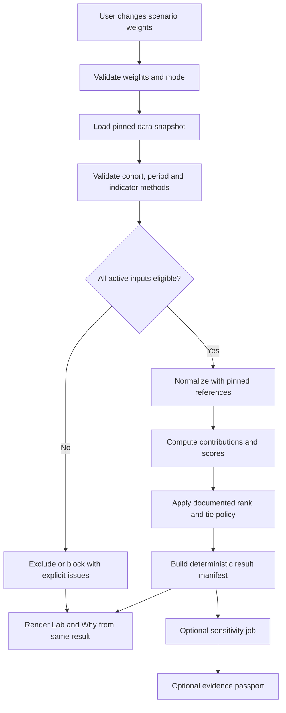

# 07 — Decision Engine: Scoring, Ranking, Explainability & Robustness

> **Product:** Nusa Matra — WIA 2026  
> **Path:** `docs/07-DECISION-ENGINE.md`  
> **Document version:** 1.0  
> **Updated:** 2026-10-19  
> **Audience:** Claude Code, data/domain engineers, frontend engineers, researchers, QA, reviewers  
> **Document language:** English · **User-facing language:** Bahasa Indonesia  
> **Status:** `SPECIFIED_FOR_DEMO` mathematical reference, **NOT** an approved public-policy model. Any use with `LIVE` observations requires documented methodology and source approval.

---

## 0. Read this before implementing anything

Nusa Matra's **decision engine** turns a reviewed, versioned set of indicator observations into a **conditional ordering of areas under explicit user-selected criteria**. It does **not** estimate a probability of disaster, prove causality, or independently establish where government must allocate funding.

Claude Code MUST implement this engine as **auditable pure domain logic**, separate from React, maps, animations, databases and API transport. In particular, **do not hardcode** the Figma illustration values such as `0.79`, ranks, `514` districts, `500` simulation trials or `92%` stability into real calculations.

### 0.1 Required companion documents

1. [`../CLAUDE.md`](../CLAUDE.md): execution requirements, Clean Code, implementation discipline.
2. [`../project_guidelines.md`](../project_guidelines.md): project identity and non-negotiable engineering quality.
3. [`01-PRODUCT-REQUIREMENTS.md`](./01-PRODUCT-REQUIREMENTS.md): `FR-LAB-*`, `FR-WHY-*`, `FR-SENS-*`, `FR-DQ-*`, `FR-EVID-*`.
4. [`02-USER-FLOWS.md`](./02-USER-FLOWS.md): `UF-07` weight interaction; `UF-08` why explanation; `UF-10` sensitivity; `UF-11` evidence.
5. [`03-UI-UX-DESIGN-SYSTEM.md`](./03-UI-UX-DESIGN-SYSTEM.md): display system; five priority colors are **presentational**, not statistical classes.
6. [`04-TECH-STACK-ARCHITECTURE.md`](./04-TECH-STACK-ARCHITECTURE.md): React + TypeScript (`LOCKED`); other technologies `PROPOSED`.
7. [`05-DATA-SOURCES.md`](./05-DATA-SOURCES.md): provenance, authorization, methodology and QA.
8. [`06-DATA-MODEL.md`](./06-DATA-MODEL.md): canonical identity, input snapshot, scenario/run, score/contribution, sensitivity, Paspor Bukti entities.
9. [`08-API-SPECIFICATION.md`](./08-API-SPECIFICATION.md): future transport contract; do not assume that its endpoints already exist.

**Authority resolution:** owner-approved methodological decision > reliable data publisher definitions > approved product requirement > illustrative Figma example > reversible implementation proposal. When policy is unresolved, fail safely instead of quietly choosing a statistical assumption.

### 0.2 Classification legend

| Tag                  | Meaning                                   | Implementation consequence                                                |
| -------------------- | ----------------------------------------- | ------------------------------------------------------------------------- |
| `LOCKED`             | Explicit project decision                 | React + TypeScript; UI language Indonesian; Clean Code required.          |
| `FIGMA-VERIFIED`     | Present in final design                   | Reproduce the UI pattern, not fake the demonstrated result.               |
| `SPECIFIED_FOR_DEMO` | Precisely defined educational behavior    | Implement/test with `DEMO` fixtures, visibly mark output as simulated.    |
| `PROPOSED`           | Architecture/method awaiting owner review | Keep configurable, document decision, do not present as policy consensus. |
| `TBD / BLOCKED_LIVE` | Missing approval or necessary facts       | No production ranking or source-derived claim.                            |

### 0.3 Unbreakable invariants (`DE-INV-*`)

| ID          | Rule                                                                                                                                |
| ----------- | ----------------------------------------------------------------------------------------------------------------------------------- |
| `DE-INV-01` | `MISSING` or `SUPPRESSED` is never converted into numerical zero. A **measured zero** is valid.                                     |
| `DE-INV-02` | No computation mixes `DEMO` with `LIVE` observations in one published result.                                                       |
| `DE-INV-03` | Every score uses an explicit immutable source snapshot, cohort, model version, indicator set and weight vector.                     |
| `DE-INV-04` | Rankings are **calculated**; React components never independently implement the ranking algorithm.                                  |
| `DE-INV-05` | Positive weights must add up to precisely 100% in canonical units.                                                                  |
| `DE-INV-06` | Ineligible/blocked region has `score = null` and `rank = null`, never a fabricated value.                                           |
| `DE-INV-07` | The normalized direction of each indicator is verified and recorded. A model cannot silently assume that higher always means worse. |
| `DE-INV-08` | Explanation contributions reconcile with stored score at the declared precision.                                                    |
| `DE-INV-09` | A repeated request with identical versioned inputs and seed produces identical results.                                             |
| `DE-INV-10` | Sensitivity percentages originate from actual completed valid trials and disclose their denominator.                                |
| `DE-INV-11` | Unapproved source/methodology or incompatible administrative scope blocks `LIVE` output.                                            |
| `DE-INV-12` | Never label the numeric priority score as a disaster probability, welfare index, or official government classification.             |
| `DE-INV-13` | A user's theme (Normal/Kaca), 3D preferences, chart type or viewport cannot change domain results.                                  |
| `DE-INV-14` | Screens, reports and exports must identify `DEMO` versus `LIVE` visibly and consistently.                                           |
| `DE-INV-15` | Ranking claims cannot outrun their source quality, geographical coverage, timestamp or policy approval.                             |

---

## 1. Scope, product intent and explicit non-goals

### 1.1 In scope

- Validate analytical scenario, cohort, selected metrics, bounds and source status.
- Map approved raw observations into **risk/need-oriented normalized numbers**.
- Apply user weights in a deterministic weighted average.
- Calculate regional ranking and a complete audit trail.
- Explain contributions to score and assess alternative weight settings.
- Expose data gaps/quality conditions in **Titik Buta Data**.
- Test ranking stability against explicit alternative assumptions in **Uji Rekomendasi**.
- Build an immutable evidence manifest for **Paspor Bukti**.
- Support `DEMO` reference implementation before live methodology is approved.

### 1.2 Out of scope

- Recommendation of specific public spending amounts, legal decisions, insurance pricing or investment advice.
- Claims that a composite index measures a physical probability of flooding.
- Causal inference, predictions or future loss modeling without separately validated models.
- Automatically selecting morally or politically correct weights for communities.
- Using generative AI to fabricate observations, uncertainty ranges, ranking positions or evidence citations.
- Inferring unmeasured missing values from color, nearby districts or map appearance.

### 1.3 Key conceptual distinction

| Concept                  | Meaning                                             | Example UI phrasing                                 |
| ------------------------ | --------------------------------------------------- | --------------------------------------------------- |
| Raw observation          | Publisher-measured metric with unit and time        | `Paparan banjir: 0,86 (2023)` only if verified.     |
| Normalized criterion     | Unitless model-specific transform                   | `Nilai terstandar: 0,86`.                           |
| Composite priority score | Weighted conditional score, not ground truth        | `Skor prioritas berdasarkan bobot terpilih`.        |
| Rank                     | Position within an explicitly named eligible cohort | `Peringkat 3 dari 25 wilayah yang memenuhi syarat`. |
| Sensitivity              | Stability under stated perturbations                | `Tetap dalam 5 besar pada 82 dari 100 uji valid`.   |
| Data health              | Description of quality/comparability risks          | `Perbandingan diblokir: definisi berbeda`.          |

A color legend like `Sangat tinggi` is meaningless without specifying **which metric**, normalization/classification rule, reference population, model version and direction it describes.

---

## 2. Figma traceability and what the screens actually specify

**Figma design URL:** https://www.figma.com/design/D8fuOoDZAGeBPG6nzxfFx4/PrioritasKita-%E2%80%94-UI-UX-WIA-2026?node-id=25-2

The historic Figma file name contains `PrioritasKita`; public product branding is **Nusa Matra**.

| Feature                | Figma node | `FIGMA-VERIFIED` detail                                                                            | Domain consequence                                                            |
| ---------------------- | ---------- | -------------------------------------------------------------------------------------------------- | ----------------------------------------------------------------------------- |
| Lab Prioritas          | `11:152`   | Weighted sliders, total `100%`, reset, ranked list, “Model v0.1 · rata-rata berbobot”.             | Implement actual normalization, redistribution, calculation and model label.  |
| Mengapa Diprioritaskan | `12:263`   | Criterion contributions `normalized × weight`, counterfactual presets and score explanations.      | Contribution sum must match score; rerun real counterfactual.                 |
| Bandingkan             | `12:840`   | Two regions, explicit years, blocked comparison for incompatible definitions.                      | Comparability service must precede narrative/ratios.                          |
| Titik Buta Data        | `14:541`   | Flags for incompatible definitions, old values, missing data, consequences.                        | Validator issues must be attached to scoring and exported evidence.           |
| Uji Rekomendasi        | `13:854`   | Relative weight perturbation `±10%`, leave-one-criterion-out, historical alternative if available. | Seed/trials/rules required; depicted `500` and `92%` are illustrative only.   |
| Paspor Bukti           | `13:446`   | Question, results, provenance, assumptions, limitations, reproducible report.                      | Generate evidence manifest only from actual pinned run(s).                    |
| Jelajahi               | `29:34`    | Map legend, priority bands, selected region and ranking.                                           | Clearly distinguish risk layer vs model priority layer; source-specific rank. |
| Peta Utama             | `61:1183`  | Map hub, Normal/Kaca variants.                                                                     | UI mode has no bearing on calculation.                                        |

**Example shown in Figma:** flood `45%`, social vulnerability `30%`, service capacity `15%`, landslide `10%`. This is a **design fixture**, not approved social weighting. Names, numeric values, ranks, totals and source years displayed in Figma MUST be treated as **illustrations** until verified against authoritative publications.

---

## 3. Domain boundaries and event flow



### 3.1 Clean separation of concerns

| Layer                | Allowed ownership                                              | Prohibited behavior                                                |
| -------------------- | -------------------------------------------------------------- | ------------------------------------------------------------------ |
| Data ingestion       | Fetch/authenticate, parse, transform with provenance and QA    | Invent data or update published snapshot in place.                 |
| Repository           | Retrieve exact versioned snapshots, runs and metadata          | Choose user weights implicitly.                                    |
| Analytics domain     | Validate, normalize, score, rank, explain and test             | Read browser `localStorage`, render JSX or call third-party HTTP.  |
| Orchestrator/service | Coordinate repository and domain; caching, cancellation, audit | Reimplement math in a second place.                                |
| React feature hooks  | Handle interaction, pending state and query keys               | Use JSX to derive authoritative ranking math.                      |
| UI components        | Visualize data and appropriate localized copy                  | Replace missing values with zeros or create fake stability values. |

### 3.2 Primary engine operations

```text
validateScenario(request)         -> ValidScenario | ValidationErrors
buildNormalizationManifest(...)   -> PinnedNormalizationManifest | BlockingIssue[]
scoreScenario(request, snapshot)  -> AnalysisResult
rankEligibleRegions(result)       -> RankedRegion[]
explainRegion(result, regionId)   -> RegionExplanation
compareScenarios(base, variant)   -> ScenarioDelta
runSensitivity(config, base)      -> SensitivityResult
buildEvidenceManifest(run, ...)  -> EvidenceManifest
```

Each call accepts its dependencies as explicit arguments. No singleton mutable model state.

---

## 4. Canonical input contract and validation

### 4.1 Snapshot binding

Each analysis must have the following IDs/versions (exact transport names belong to document 08):

```text
snapshot_id            immutable published data edition
cohort_id              explicit set of comparable regions
boundary_edition_id    administrative boundary edition
model_version_id       model + implementation digest
indicator_methodology  definition/unit/direction/version per criterion
reference_stats_id     version of min/max or other normalization anchors
scenario_id            selected criteria and weights (if persisted)
input_hash             canonical representation of all effective inputs
run_id                 immutable calculation result reference
mode                   DEMO | LIVE
```

The database schema in `06-DATA-MODEL.md` uses `priority_scenarios`, `scenario_weights`, `analysis_runs`, `analysis_scores`, `score_contributions`, `run_observation_inputs`, `sensitivity_runs`, and `evidence_snapshots`. Reuse those concepts rather than creating overlapping truth tables.

### 4.2 Required inputs

| Field              | Check                                               | Failure                           |
| ------------------ | --------------------------------------------------- | --------------------------------- |
| `mode`             | Exactly `DEMO` or `LIVE`; consistent with snapshot  | `MODE_MISMATCH`                   |
| `snapshotId`       | Exists, immutable and permitted for mode            | `SNAPSHOT_UNAVAILABLE`            |
| `cohortId`         | Exists, matches geography edition and intended unit | `COHORT_INVALID`                  |
| `modelVersionId`   | Registered; `LIVE` requires approved status         | `MODEL_NOT_APPROVED`              |
| `indicators[]`     | Distinct canonical stable IDs with method/direction | `INDICATOR_INVALID`               |
| `weights[]`        | Nonnegative fixed-unit integers; sum 10000          | `WEIGHTS_INVALID`                 |
| `observations[]`   | Consistent region/period/indicator/edition          | `OBSERVATION_INCOMPATIBLE`        |
| `referenceStats`   | Same snapshot/reference policy, complete and valid  | `NORMALIZATION_REFERENCE_INVALID` |
| `qualityIssues`    | Machine-readable, resolved/block state              | `DATA_QUALITY_BLOCKED`            |
| `algorithmVersion` | Explicit, immutable for run                         | `ALGORITHM_VERSION_MISMATCH`      |

No silent remapping of an indicator to a “similar” named indicator. Methods are compared using stable definitions and versions, not just display labels.

### 4.3 Eligibility states

Use exactly the storage-aligned classifications in `06-DATA-MODEL.md`:

- `ELIGIBLE`: all positively weighted inputs satisfy the approved policy; score and rank can be calculated.
- `EXCLUDED`: region is outside the analysis cohort or intentionally excluded by an explicit published rule; no score or rank.
- `BLOCKED`: region belongs to the target cohort but has insufficient, incompatible or unapproved required inputs; no score or rank.

A `BLOCKED` candidate remains visible in result metadata with issue codes; excluding it from calculations must not hide the extent of missing coverage.

### 4.4 Indicator direction (`SPECIFIED_FOR_DEMO`; domain review required for LIVE)

| Key                     | Rule                                          | Typical use                  | Need for review                                     |
| ----------------------- | --------------------------------------------- | ---------------------------- | --------------------------------------------------- |
| `HIGHER_IS_HIGHER_NEED` | Higher raw value -> higher priority component | Hazard exposure, deprivation | Is risk proxy correctly defined?                    |
| `LOWER_IS_HIGHER_NEED`  | Lower raw value -> higher priority component  | Service capacity/access      | Is inversion ethically and substantively justified? |
| `UNDEFINED`             | Do not normalize/score                        | Ambiguous direction          | Publisher or domain expert must decide.             |

The chosen direction belongs to the **versioned indicator methodology**. A change creates a new model/input snapshot, never mutates a completed run.

---

## 5. Safe demo-only methodology

The following is a **reference computation suitable for deterministic illustrative fixtures**. It is **not** an endorsement of min–max normalization, specific weights or compensatory aggregation as suitable for public investment decisions. Promote to `LIVE` only after the approval checklist in §20.

### 5.1 Selected approach

| Element               | Demo reference rule                                                       | Status                              |
| --------------------- | ------------------------------------------------------------------------- | ----------------------------------- |
| Indicator scale       | Min–max to `[0,1]` using frozen normalization reference                   | `SPECIFIED_FOR_DEMO`                |
| Orientation           | All `1.0` values represent more need under the chosen model               | `SPECIFIED_FOR_DEMO`                |
| Aggregation           | Nonnegative weighted arithmetic mean                                      | `SPECIFIED_FOR_DEMO`                |
| User weight precision | Integer basis points (`0`–`10000`), total `10000`                         | `SPECIFIED_FOR_DEMO`                |
| Default missing rule  | Block affected region if _any positively weighted_ required input invalid | `SPECIFIED_FOR_DEMO` + safe interim |
| Zero-range indicator  | Assign neutral `0.5`, flag uninformative criterion                        | `PROPOSED` for demo only            |
| Ranking               | Higher score first, exact equal displayed values tied                     | `SPECIFIED_FOR_DEMO`                |
| Equal-rank policy     | Competition ranks: `1,1,3`                                                | `SPECIFIED_FOR_DEMO`                |
| Uncertainty           | No invented confidence intervals; optional simulated rank ranges          | `SPECIFIED_FOR_DEMO`                |
| Output classification | Explicit `DEMO` watermark/label                                           | `LOCKED`                            |

### 5.2 Why weighted averaging is not neutral

- High score in one metric can offset low score in another (**compensability**).
- Min–max is sensitive to selected reference population and outliers.
- Different administrative units may have different underlying denominators/measurement error.
- Varying active indicators can change the set of eligible regions.
- Rankings can look precise even when input years or definitions differ.

The UI MUST describe this as **a user-adjustable scenario**, not an objective or official need assessment. Later a reviewed method could use capped transformations, robust percentiles, winsorization, constrained weights, multi-criteria outranking or explicit minimum-service thresholds. These are alternatives, not automatically approved features.

---

## 6. Normalization specification

### 6.1 Frozen reference boundaries

For each indicator `i`, record `L_i` and `U_i` from the **versioned, approved normalization reference set** attached to the snapshot. They must not change merely because a user drags a slider, changes map theme, opens a detail panel or selects an explanation.

For a verified observation `x_(r,i)` within inclusive reference bounds:

\[
N_{r,i} =
\begin{cases}
\dfrac{x_{r,i} - L_i}{U_i-L_i} & \text{if higher is more need},\\[6pt]
\dfrac{U_i - x_{r,i}}{U_i-L_i} & \text{if lower is more need}.
\end{cases}
\]

The displayed `N_(r,i)` is unitless. The source observation keeps its original unit and year; do not overwrite it with the normalized value.

### 6.2 Reference manifest specification

```ts
interface NormalizationAnchor {
  indicatorId: string;
  methodologyVersionId: string;
  direction: 'HIGHER_IS_HIGHER_NEED' | 'LOWER_IS_HIGHER_NEED';
  lowerBoundDecimal: string;
  upperBoundDecimal: string;
  referencePopulationId: string;
  referencePeriodId: string;
  provenanceId: string;
  referenceStatus: 'VALID' | 'CONSTANT' | 'INVALID';
}

interface NormalizationManifest {
  snapshotId: string;
  normalizationVersion: string;
  referenceStatsId: string;
  anchors: readonly NormalizationAnchor[];
}
```

All IDs, source ranges, coverage selection and transformation versions must be auditable and included in the canonical run input fingerprint (or referenced through an immutable digest).

### 6.3 Edge cases and responses

| Case                                                  | Correct behavior                                                                                       |
| ----------------------------------------------------- | ------------------------------------------------------------------------------------------------------ |
| `U > L`; raw in range                                 | Apply formula.                                                                                         |
| `U = L`; criterion constant                           | For demo, set `0.5` for each valid observation; flag `CONSTANT_CRITERION`; cannot distinguish regions. |
| `U < L`                                               | Reject reference manifest.                                                                             |
| `x < L` or `x > U`                                    | Reject by default. Do **not** silently clip to 0 or 1; investigate reference edition.                  |
| `x = 0` and valid measured value                      | Normalize normally.                                                                                    |
| `x = null`, `MISSING`                                 | Block if weight > 0; score remains null.                                                               |
| `SUPPRESSED`                                          | Block if weight > 0; do not reconstruct disclosed value.                                               |
| Unit mismatch                                         | Block; only convert using approved versioned conversion.                                               |
| Direction `UNDEFINED`                                 | Block.                                                                                                 |
| Incompatible methodology, region definition or period | Block under interim policy.                                                                            |
| Nonfinite numeric value / malformed decimal           | Reject during input validation.                                                                        |
| Reference depends on regions outside target cohort    | Allowed only if reference population documented; explain meaning of scale.                             |

**Policy nuance:** if an indicator's weight is exactly **zero**, missingness of that unused indicator does not by itself block scoring; however, zero-weight presence must not conceal an unrelated data-quality issue. The audit still lists it. React must never change eligibility by independently guessing which indicator is optional.

### 6.4 Example test vectors

| Raw value `x` | Reference `L`, `U` | Direction              |                  Normalized |
| ------------: | ------------------ | ---------------------- | --------------------------: |
|          `15` | `10`, `20`         | Higher need            |                       `0.5` |
|          `15` | `10`, `20`         | Lower need             |                       `0.5` |
|          `20` | `10`, `20`         | Higher need            |                       `1.0` |
|          `20` | `10`, `20`         | Lower need             |                       `0.0` |
|          `10` | `10`, `20`         | Lower need             |                       `1.0` |
|          `42` | `42`, `42`         | Constant demo fallback |                `0.5` + flag |
|           `0` | `0`, `100`         | Higher need            | `0.0` (valid measured zero) |

---

## 7. Weights: canonical representation and slider behavior

### 7.1 Canonical units

Represent user-controlled weights as **integer basis points** (bps):

```text
10000 bps  = 100.00%
 4500 bps  = 45.00%
 3000 bps  = 30.00%
 1500 bps  = 15.00%
 1000 bps  = 10.00%
```

All authoritative scoring inputs use bps, not a separately rounded percentage from JSX. Displaying rounded percentage text must preserve a displayed 100% total, e.g. render at `0.01%` precision, use exact bps values and apply locale formatting.

**Do not confuse storage:** `06-DATA-MODEL.md` stores `scenario_weights.weight` as decimals between `0` and `1`. Convert `4500 bps` into an exact decimal string `'0.450000000000'` at the repository/API boundary; the engine can remain in integer bps.

### 7.2 Weight validation

```ts
const TOTAL_BPS = 10_000;

type BasisPoints = number; // value is integer; validate at boundary

interface CriterionWeight {
  indicatorId: string;
  basisPoints: BasisPoints;
}

function validateWeights(weights: readonly CriterionWeight[]): void {
  if (weights.length === 0) throw new Error('NO_ACTIVE_CRITERIA');
  if (new Set(weights.map((w) => w.indicatorId)).size !== weights.length) {
    throw new Error('DUPLICATE_CRITERION');
  }
  if (
    weights.some(
      (w) => !Number.isSafeInteger(w.basisPoints) || w.basisPoints < 0 || w.basisPoints > TOTAL_BPS,
    )
  ) {
    throw new Error('INVALID_WEIGHT');
  }
  if (weights.reduce((sum, w) => sum + w.basisPoints, 0) !== TOTAL_BPS) {
    throw new Error('WEIGHT_SUM_INVALID');
  }
}
```

_This code is reference domain pseudocode; wrap failures in typed discriminated results and localized messages in the actual application._

### 7.3 Proportional redistribution on slider change (`PROPOSED`, demo reference)

When a user sets criterion `j` to `t` basis points:

1. Clamp/validate `t` to `[0,10000]` and the configured slider increment (the increment is `TBD`; avoid inventing a Figma value).
2. Set `w_j = t`.
3. Compute target remainder `R = 10000 - t`.
4. Redistribute `R` among the remaining criteria **in proportion to their previous weights**.
5. For fractional quotas, allocate floor units first, then distribute the leftover units to the largest remainders, breaking equal-remainder ties by **stable indicator ID**.
6. If the sum of all other previous weights is zero and `R > 0`, redistribute **equally** among the other criteria using the same largest-remainder/tie rule (demo fallback).
7. If there is no other criterion, its weight must remain `10000`; reject attempts to lower it.
8. `Atur ulang` restores the exact baseline weight vector from the versioned scenario, not a hardcoded frontend constant.

Example: current weights `45%,30%,15%,10%`, user sets first to `60%`:

```text
first:             6000 bps
other 30% ->       2182 bps
other 15% ->       1091 bps
other 10% ->        727 bps
                  ----------
TOTAL             10000 bps
```

### 7.4 Stable largest-remainder algorithm

```ts
interface Allocation {
  id: string;
  previousUnits: number;
}

function allocateProportionally(
  targets: readonly Allocation[],
  remainingUnits: number,
): ReadonlyMap<string, number> {
  if (targets.length === 0) {
    if (remainingUnits === 0) return new Map();
    throw new Error('NO_ALLOCATION_TARGET');
  }
  if (!Number.isSafeInteger(remainingUnits) || remainingUnits < 0) {
    throw new Error('INVALID_REMAINDER');
  }
  if (
    new Set(targets.map((t) => t.id)).size !== targets.length ||
    targets.some((t) => !Number.isSafeInteger(t.previousUnits) || t.previousUnits < 0)
  ) {
    throw new Error('INVALID_ALLOCATION_INPUT');
  }

  const totalPrior = targets.reduce((s, t) => s + t.previousUnits, 0);
  const denominator = totalPrior > 0 ? totalPrior : targets.length;
  const quotas = targets.map((t) => {
    const numerator = totalPrior > 0 ? t.previousUnits : 1;
    const product = remainingUnits * numerator; // <= 1e8 for <= 10000 bps
    return {
      id: t.id,
      floorUnits: Math.floor(product / denominator),
      remainder: product % denominator,
    };
  });

  const floorSum = quotas.reduce((s, q) => s + q.floorUnits, 0);
  const leftover = remainingUnits - floorSum;
  quotas.sort((a, b) => b.remainder - a.remainder || a.id.localeCompare(b.id));

  const result = new Map(quotas.map((q) => [q.id, q.floorUnits]));
  for (const q of quotas.slice(0, leftover)) {
    result.set(q.id, result.get(q.id)! + 1);
  }
  return result;
}
```

For many criteria or wider units use `bigint`/a carefully checked rational implementation; the bounded product comment applies only to these 10,000-bps inputs. Use one pure function in the domain layer and test it. Dragging must not allocate based on rounded UI strings.

---

## 8. Scoring formula and contribution ledger

### 8.1 Weighted arithmetic model

For eligible region `r`, criterion `i` with normalized `N_(r,i)` and weight `W_i` in bps:

\[
S_r = \sum_{i \in I} \left(\frac{W_i}{10000}\right) N_{r,i},
\qquad \sum_i W_i = 10000,
\qquad 0\le N_{r,i}\le1.
\]

The contribution for criterion `i` is:

\[
C_{r,i} = \left(\frac{W_i}{10000}\right) N_{r,i}
\quad\text{and}\quad
S_r = \sum_i C_{r,i}.
\]

If all inputs are valid and weights nonnegative, `0 ≤ S_r ≤ 1`. This `0..1` model score is **not** a percentage probability. It only has meaning under its model/reference cohort, year, directions and chosen weights.

### 8.2 Exact arithmetic and rounding

- Use a decimal/rational implementation for authoritative domain calculations. `decimal.js` is a possible **PROPOSED** library, not an already adopted dependency.
- In a prototype with tightly bounded test vectors, JavaScript `number` may be used internally only if outputs are validated against exact decimal fixtures and floating error is controlled. Do **not** fingerprint raw `number.toString()` results without canonical quantization.
- Preserve unrounded contributions through score computation; quantize only at the declared storage/output boundary, e.g. **12 fractional decimals** to match `numeric(24,12)` in the proposed schema. The exact rounding mode (e.g. `HALF_EVEN`) must be specified in `ModelVersion` and shared across implementations.
- Sum raw contributions first, quantize the final score once. Display 2 decimals separately; the display must not imply high precision.
- To reconcile display tables, either show sufficient decimals or report that displayed contributions may differ from the visible total due to rounding.
- **Never** rank using the two-decimal displayed score; ranking uses canonical precision values.

### 8.3 Calculated example — **synthetic, pre-normalized demo inputs**

The next test fixture uses pre-normalized risk-oriented values to isolate the weighted averaging logic. It is **not** a dataset from Indonesia and its numbers are **not derived from min–max normalization of these three rows**.

| Region fixture |  Flood | Social vulnerability | **Low** service capacity (inverted) | Landslide |
| -------------- | -----: | -------------------: | ----------------------------------: | --------: |
| `R-A`          | `0.90` |               `0.80` |                              `0.70` |    `0.60` |
| `R-B`          | `0.70` |               `0.50` |                              `0.60` |    `0.80` |
| `R-C`          | `0.30` |               `0.60` |                              `0.10` |    `0.50` |

Demo weights: `45%`, `30%`, `15%`, `10%`.

| Region |   Flood |  Social | Services | Landslide | **Exact score** | Rank |
| ------ | ------: | ------: | -------: | --------: | --------------: | ---: |
| `R-A`  | `0.405` | `0.240` |  `0.105` |   `0.060` |     **`0.810`** |  `1` |
| `R-B`  | `0.315` | `0.150` |  `0.090` |   `0.080` |     **`0.635`** |  `2` |
| `R-C`  | `0.135` | `0.180` |  `0.015` |   `0.050` |     **`0.380`** |  `3` |

If the user changes weights to `[20%,45%,25%,10%]`:

| Region | New score | New rank |
| ------ | --------: | -------: |
| `R-A`  |   `0.775` |      `1` |
| `R-B`  |   `0.595` |      `2` |
| `R-C`  |   `0.405` |      `3` |

These fixture outputs should become unit-test golden vectors. The point is to prove that score, contribution, interpretation and ranking derive from the **same** inputs.

### 8.4 Ineligible example

If `R-C` lacks a **positively weighted landslide** observation, the interim demo rule yields:

```json
{
  "regionId": "R-C",
  "eligibility": "BLOCKED",
  "score": null,
  "rankPosition": null,
  "issueCodes": ["MISSING_REQUIRED_INDICATOR"]
}
```

No `0.33` approximated score or redistributed weight is permitted under this default. If landslide weight becomes zero, the engine may re-evaluate eligibility; the resulting cohort/rank denominator changes and must be disclosed.

---

## 9. Ranking algorithm, ties and cohort changes

### 9.1 Inputs to ranking

- Only `ELIGIBLE` region scores computed in the **same run**.
- Each score is canonicalized using one declared precision/rounding policy.
- Cohort membership and administrative edition are explicit.
- Maintain counts: `cohortCount`, `eligibleCount`, `blockedCount`, `excludedCount`.

### 9.2 Deterministic ordering

1. Sort by canonical score **descending**.
2. For equal canonical score, sort by stable canonical region ID **ascending** only to ensure deterministic visual order.
3. Assign **competition rank**: `1, 1, 3` when first two scores are exactly equal at canonical precision; the secondary sort is **not** a substantive superiority claim.
4. Store both the tie-aware `rank_position` and presentation sort index if needed; do not overload rank with row number.
5. Avoid using a floating `epsilon` with undocumented behavior; tie is equality of fixed-precision canonical score.

```text
scores: 0.810000000000, 0.810000000000, 0.635000000000, 0.380000000000
ranks:               1,              1,              3,              4
```

**UI text:** `Peringkat 1 bersama dari 4 wilayah yang memenuhi syarat` when tied. Do not show false single-winner headlines.

### 9.3 Denominator disclosure

A visible label such as `Peringkat 12 dari 514` must be generated from the current run **and its eligible region count**. Never hardcode `514`, because the run may target a province, a subset of districts, an earlier boundary edition, or fewer eligible regions due to data gaps.

Proposed copy:

> `Peringkat 12 bersama dari 80 wilayah yang memenuhi syarat; 3 wilayah tidak dihitung karena keterbatasan data.`

### 9.4 Dynamic eligibility and normalization references

Eligibility may change when the user assigns a criterion exactly `0` bps; previously missing observations may no longer be necessary. Keep normalization **anchors pinned** for the whole model/snapshot even if the active eligible region set changes. Otherwise adjusting weights secretly changes the normalization formula as well.

When comparing scenarios with different eligible candidate sets:

- Show eligible counts for both scenarios.
- Do not represent a rank delta as a change driven only by weight when the denominator changed.
- Provide `RANK_NOT_DIRECTLY_COMPARABLE` and explanatory UI copy.
- Optional analytic “fixed common cohort” comparisons may be computed separately using only regions eligible in **both** scenarios, clearly labeled.

---

## 10. Counterfactual explanations: “Mengapa Diprioritaskan?”

A good explanation answers **what contributed**, **under which inputs**, and **how the outcome changes under an explicit alternative**. An explanation is not generated by asking an LLM to improvise why a region is vulnerable.

### 10.1 Single source of analytical truth

`explainRegion(run, regionId)` MUST use exactly the same:

- snapshot, cohort, region identity and administrative edition;
- model version, criteria directions, normalization references;
- effective integer weight vector and quality policy;
- observation IDs, normalized values, contributions and ranking rules.

Never recompute an explanation from a user-visible chart's rounded labels. A completed result is immutable; navigation to Why must carry `runId` and `regionId`, or an equivalent canonical reproducible scenario when run persistence is intentionally disabled.

### 10.2 Minimal explanation payload

```ts
interface CriterionExplanation {
  indicatorId: string;
  labelId: string; // localized string key, not a source of truth
  rawValueDecimal: string; // source measurement, NOT normalized
  rawUnit: string;
  sourceObservationId: string;
  sourceEditionId: string;
  periodId: string;
  normalizedValueDecimal: string; // 0..1
  weightBps: number; // 0..10000
  contributionDecimal: string;
  direction: 'HIGHER_IS_HIGHER_NEED' | 'LOWER_IS_HIGHER_NEED';
  qualityIssueCodes: readonly string[];
}

interface RegionExplanation {
  runId: string;
  regionId: string;
  scoreDecimal: string;
  rankPosition: number;
  rankIsShared: boolean;
  eligibleCount: number;
  contributions: readonly CriterionExplanation[];
  methodologyVersionId: string;
  normalizationReferenceId: string;
  mode: 'DEMO' | 'LIVE';
  limitations: readonly string[];
}
```

`sourceObservationId` and `sourceEditionId` must point to actual records for `LIVE`. For `DEMO` examples, use isolated fixture IDs whose origin visibly states **simulated**. Never supply an official publisher name for an invented observation.

### 10.3 Contribution vs causality

Allowed:

> `Paparan banjir menyumbang 0,405 dari total skor 0,810 pada bobot yang dipilih.`

Not allowed without independent causal evidence:

> `Banjir menyebabkan 50% dari persoalan pembangunan wilayah ini.`

Contribution shares can be presented as the fraction of **this mathematical sum** if `score > 0`:

\[
\text{share}_{r,i}=\frac{C_{r,i}}{S_r}.
\]

If `S_r = 0`, shares are undefined; do not divide by zero or show `NaN`. Do not label mathematical contribution shares as “impact shares” or “root causes”.

### 10.4 Contribution ranking

- Sort largest positive contributions first, with stable indicator-ID tie sorting.
- Include all positively weighted contributions, not only the top two.
- A zero-weight indicator may be displayed as disabled/unused but must not be attributed to the score.
- The largest contribution may reflect the **user's preference for that criterion**, not an intrinsically worse condition in the area.
- Summaries must be generated from validated data, not template phrases picked from a static region-name lookup.

### 10.5 Alternative weighting/counterfactual workflow

1. Starting from **one pinned base run**, read the full criterion set and normalization manifest.
2. Apply a documented alternate weight preset or user-entered valid weight vector.
3. Validate all positively weighted inputs again; changes may affect eligibility.
4. Execute `scoreScenario` using the same model/snapshot unless an explicitly different scenario is being tested.
5. Compare the selected region's score and rank only if both runs have a comparable eligible universe; otherwise show a noncomparable status and details.
6. Report the alternative weight vector, difference, chosen reference cohort and whether rank ties exist.
7. Allow reset to the exact original run, not a mutated shared global object.

**Figma context:** “Bobot standar (banjir 30%)”, “Fokus sosial (sosial 45%)”, “Semua kriteria sama (25%)” are sample alternate UI labels. Their **complete** vectors, feasibility and domain authorization are `TBD`; Claude Code may implement demo presets with an explicit all-criteria vector but must never infer missing preset values from one percentage.

### 10.6 Rank-difference language

| Situation                                                 | Appropriate output                                                                                  |
| --------------------------------------------------------- | --------------------------------------------------------------------------------------------------- |
| Same cohort and tied-rank policy, base 5 -> alternative 2 | `Peringkat berubah dari 5 menjadi 2 dalam skenario ini.`                                            |
| Same score to visible precision but higher rank           | Explain raw canonical score/ties and other candidates' changed scores.                              |
| Different eligible cohorts                                | `Peringkat tidak dapat dibandingkan langsung karena jumlah wilayah yang memenuhi syarat berubah.`   |
| Alternative run blocked                                   | `Perhitungan alternatif belum dapat dilakukan: data atau definisi indikator tidak memenuhi syarat.` |
| Scenario `DEMO`                                           | `Simulasi — bukan rekomendasi resmi.`                                                               |

---

## 11. Missing values, data-quality and comparability policy

This section is particularly important because Figma illustrates a case where the unavailable landslide criterion's weight was redistributed for one city. **That is a design scenario, not authorization to adopt region-specific renormalization.**

### 11.1 Interim default (`SPECIFIED_FOR_DEMO` + conservative `LIVE` hold)

**Complete-case scoring by positively weighted criteria:** a region is `BLOCKED` if any required observation is absent, suppressed, unapproved or methodologically incompatible. An affected region is not assigned a calculated priority score. The quality report counts and displays all blockers.

This conservative default prevents incomparable areas from receiving deceptively similar-looking scores based on different effective criteria.

### 11.2 Alternative strategies require separate model versions

| Strategy                              | Advantage                   | Risk / prerequisite                                     | Default?         |
| ------------------------------------- | --------------------------- | ------------------------------------------------------- | ---------------- |
| Complete case / block missing         | Transparent, no fabrication | Reduces eligible coverage and may create selection bias | **Yes, interim** |
| Reweight available criteria by region | More scored regions         | Same displayed score may mean different criterion mix   | **No**           |
| Statistical imputation                | Potentially larger coverage | Uncertainty, bias and unjustified inferences            | **No**           |
| Group-relative surrogate measure      | Fills some gaps             | Construct validity / data lineage risk                  | **No**           |
| Historical substitution               | May increase coverage       | Staleness and changing methodology                      | **No**           |

If product owner later approves region-specific redistribution, define a **new, versioned model** with explicit per-region effective weights, original missingness, review notes and limits on comparisons. Old run manifests remain immutable.

### 11.3 Issue taxonomy (`DE-QA-*`)

| Code                            | Typical severity for scoring                  | Must display? | Example response                                           |
| ------------------------------- | --------------------------------------------- | ------------- | ---------------------------------------------------------- |
| `MISSING_REQUIRED_INDICATOR`    | `BLOCKED`                                     | Yes           | `Indikator yang diperlukan belum tersedia.`                |
| `SUPPRESSED_SOURCE_VALUE`       | `BLOCKED`                                     | Yes           | `Angka tidak dipublikasikan oleh sumber.`                  |
| `UNVERIFIED_SOURCE`             | `BLOCKED_LIVE`                                | Yes           | `Sumber data belum diverifikasi.`                          |
| `INCOMPATIBLE_DEFINITION`       | `BLOCKED`                                     | Yes           | `Definisi indikator berbeda.`                              |
| `INCOMPATIBLE_METHOD`           | `BLOCKED`                                     | Yes           | `Metode pengukuran tidak sebanding.`                       |
| `INCOMPATIBLE_UNIT`             | `BLOCKED` until approved conversion           | Yes           | `Satuan belum dapat disetarakan.`                          |
| `INCOMPATIBLE_PERIOD`           | `BLOCKED` by default                          | Yes           | `Periode data tidak memenuhi syarat.`                      |
| `GEOGRAPHY_EDITION_MISMATCH`    | `BLOCKED`                                     | Yes           | `Batas wilayah yang digunakan berbeda.`                    |
| `LOW_COVERAGE`                  | `BLOCKED` or `WARNING` via approved threshold | Yes           | `Cakupan data terbatas.`                                   |
| `CONSTANT_CRITERION`            | `INFO` or methodological warning              | Yes           | `Indikator ini tidak membedakan wilayah.`                  |
| `UNDEFINED_INDICATOR_DIRECTION` | `BLOCKED`                                     | Yes           | `Arah penilaian indikator belum ditetapkan.`               |
| `OUT_OF_REFERENCE_RANGE`        | `BLOCKED`                                     | Yes           | `Nilai berada di luar rentang normalisasi yang disetujui.` |
| `MISSING_SOURCE_PROVENANCE`     | `BLOCKED_LIVE`                                | Yes           | `Asal data belum terdokumentasi.`                          |
| `COHORT_TOO_SMALL`              | `WARNING` / `BLOCKED` by rule                 | Yes           | `Wilayah pembanding terlalu sedikit.`                      |
| `RANK_NOT_DIRECTLY_COMPARABLE`  | `WARNING`                                     | Yes           | `Himpunan wilayah yang dihitung berbeda.`                  |

The exact severity of `LOW_COVERAGE` and minimum-cohort requirement is **TBD** and must be added to a versioned policy instead of hardcoding a threshold.

### 11.4 No silent missingness laundering

Incorrect:

```ts
const value = observation.value ?? 0; // FORBIDDEN
const contribution = Number(value || 0) * weight; // FORBIDDEN
```

Correct approach:

```ts
type ObservedValue =
  | { status: 'AVAILABLE'; decimal: string; observationId: string }
  | { status: 'MISSING'; reasonCode: string }
  | { status: 'SUPPRESSED'; reasonCode: 'SUPPRESSED' };

function isAvailable(value: ObservedValue): value is Extract<ObservedValue, { status: 'AVAILABLE' }> {
  return value.status === 'AVAILABLE';
}
```

Validate parsed decimals even after narrowing to `AVAILABLE`. The union is illustrative; reuse the validated schema contract from `06-DATA-MODEL.md` when writing actual code.

### 11.5 Audit counts and data health panel

Emit an aggregate quality summary for each run:

```ts
interface RunQualitySummary {
  cohortCount: number;
  eligibleCount: number;
  blockedCount: number;
  excludedCount: number;
  issuesByCode: Readonly<Record<string, number>>;
  warnings: readonly string[];
  dataMode: 'DEMO' | 'LIVE';
  snapshotId: string;
}
```

The following should be a checked invariant:

```text
cohortCount = eligibleCount + blockedCount + excludedCount
```

If `excludedCount` represents regions outside the cohort rather than excluded **within** it, adjust the definition so counts don't double count. Prefer “candidateUniverseCount” and “targetCohortCount” as separate fields if the product truly needs both. The contract above adopts **all three statuses within the selected candidate cohort**.

“Titik Buta Data” must report coverage **and** why results were blocked, including applicable year mismatches, incompatible definitions and missing values. Do not show “no problems” when an audit did not run.

---

## 12. Sensitivity analysis: “Uji Rekomendasi”

Sensitivity explores how much an ordering depends on uncertain or subjective **assumptions**, not necessarily on the statistical uncertainty of the underlying survey measurements. A stable ordering under the tested assumptions can still be wrong if the sources or model are inadequate.

### 12.1 Types of experiment

| Experiment                       | Definition                                                                                        | Figma cue                     | Eligibility                                                                         |
| -------------------------------- | ------------------------------------------------------------------------------------------------- | ----------------------------- | ----------------------------------------------------------------------------------- |
| Relative weight perturbation     | Each active weight is multiplied by a seeded random factor in `[1 - p, 1 + p]`, then renormalized | `Goyangkan bobot ±10%`        | Available for validated baseline.                                                   |
| Leave-one-criterion-out          | For each currently nonzero criterion, set its weight to 0 and renormalize remaining               | `Hilangkan satu indikator`    | Requires at least 2 positive criteria.                                              |
| Historical substitution          | Use earlier source period/methodology in an explicitly new run                                    | `Pakai data tahun sebelumnya` | Only with compatible verified historical data and separate cohort/reference checks. |
| Alternative reference population | Refit normalization on a pre-approved second reference set                                        | Not mandatory Figma behavior  | Future research; **off by default**.                                                |

**Never** silently combine these experiments into one misleading “all experiments” stability percentage. Display results separately unless a pre-registered combined methodology explicitly defines the sampling scheme and denominator.

### 12.2 Weight perturbation rule (`SPECIFIED_FOR_DEMO`)

Given baseline weights `w_i` summing to 1, trial index `t`, relative perturbation bound `p` with `0 ≤ p < 1`:

\[
\tilde{w}_{i,t}=w_i(1+u_{i,t}), \quad u_{i,t} \sim U[-p,p]
\]

\[
w_{i,t}=\frac{\tilde{w}_{i,t}}{\sum_j\tilde{w}_{j,t}}.
\]

- The Figma `±10%` example is a **relative** change to each weight, not an absolute `±10 percentage point` change.
- `w_i = 0` remains zero under this experiment.
- Renormalize to precisely `10000` bps using an audited largest-remainder allocator (not unchecked floating arithmetic), with deterministic tie policy.
- Declare the trial count `T` explicitly; **500 in Figma is illustrative** and is not the mandatory number for every deployment.
- Use the **same pinned snapshot, normalization anchors and region population** as baseline. Track which candidates are eligible in all trials.
- A trial that fails validation is not silently counted as a successful stable trial.

### 12.3 Seeded pseudorandom number generator

`Math.random()` is prohibited for stored or shareable sensitivity runs because it cannot replay the same sequence. Use an approved fixed PRNG with a named version and integer seed. E.g., for demo-only educational reproducibility, the following deterministic unsigned-32-bit generator is acceptable once golden-vector tests freeze its behavior:

```ts
/** Deterministic demo PRNG; NOT suitable for security-sensitive randomness. */
function mulberry32(seed: number): () => number {
  let state = seed >>> 0;
  return () => {
    state = (state + 0x6d2b79f5) | 0;
    let x = Math.imul(state ^ (state >>> 15), 1 | state);
    x ^= x + Math.imul(x ^ (x >>> 7), 61 | x);
    return ((x ^ (x >>> 14)) >>> 0) / 4294967296;
  };
}
```

A production engine may choose another well-specified PRNG, but it MUST store the algorithm identifier/version along with seed and trial order. Persist an integer seed fitting the chosen generator; a database `bigint` seed must be explicitly mapped, not truncated without a documented rule. Do not reuse this PRNG for IDs, authorization, secrets or cryptography.

### 12.4 Stable trial protocol

1. Validate a **completed** base run, its pinned input manifest and nonzero criteria.
2. Fix `T`, perturbation bound `p`, seed, experiment key, PRNG version, rank/tie policy and result schema.
3. Generate each trial's weights deterministically.
4. Re-score the **same pinned normalized observations**. Do not fetch a changing API inside the trial loop.
5. Rank eligible candidates; record positions, ties, score ranges and any trial issues.
6. Compute metrics using the **declared count of valid comparable trials**, and emit coverage of rejected/skipped trials.
7. Attach the result to `baseAnalysisRunId`; require matching model/snapshot/anchor in the result manifest.
8. Cache by canonical base fingerprint + sensitivity configuration + seed + algorithm version.
9. Expose download/share only if evidence can be reproduced and licensed.

### 12.5 Metric definitions

For region `r`, with `T_valid` comparable completed trials and the corresponding trial competition rank `rank(r,t)`:

- **Minimum/maximum observed rank** over valid comparable trials: `minRank`, `maxRank`.
- **Top-k frequency**: count of valid trials with `rank(r,t) ≤ k` divided by `T_valid`.
- **Median rank**: median of the valid trial competition-rank distribution; state whether even-trial ranks are averaged or lower-median selected.
- **Rank range width**: `maxRank - minRank` (do not confuse range width with count of discrete ranks).
- **Top-k set retention**: percentage of valid trials containing **all** members of a precisely defined baseline top-k set, with ties policy explicit. Different from per-region top-k frequency.
- **Trial coverage**: `T_valid / T_requested`; a tiny valid denominator must be presented as weak evidence, not a confident percentage.

\[
\mathrm{TopKFrequency}(r,k) =
\frac{1}{T_\mathrm{valid}}\sum_{t=1}^{T_\mathrm{valid}}\mathbf{1}[\mathrm{rank}(r,t) \le k].
\]

The canonical metric must record its denominator and filter rules. `T_valid = 0` yields no frequency (`null`), not zero percent.

### 12.6 Handling ties at the top-k boundary

Competition ranking may produce more than `k` regions with `rank ≤ k`. Choose and document one of these policies **per sensitivity configuration**:

1. **Inclusive tie policy (PROPOSED default for demo):** `rank ≤ k` includes all tied areas; a “top-5” set may have more than 5 areas. Make that fact visible.
2. Strict cardinality: deterministically select exactly `k` by stable ID but clearly identify it as a display/order device, **not** superiority.

Never switch definitions between charts, summary copy and Paspor Bukti.

### 12.7 Leave-one-out calculation

For each active criterion `i`:

- Construct alternate scenario with that criterion set to zero.
- Renormalize other **positive** weights proportionally to sum to `10000` bps.
- Use the pinned original normalization manifest; do not “refit” min/max without explicit different experiment definition.
- Rerun scoring with policy-selected comparison cohort; mark if eligibility differs.
- Compare changes against base only on directly comparable cohorts, otherwise mark incompatible and show counts.
- Store one result record per omitted criterion, not as a pseudorandom sample.

With only one positive-weight criterion, leave-one-out is undefined because no nonzero total remains: disable that option and explain why.

### 12.8 Historical substitution rules

Historical experiments are **not equivalent** to weight perturbations:

- Require approved comparable indicator definitions, units, data years, region crosswalks and missingness handling.
- Use a new historical snapshot or explicit alternative period manifest.
- A different geography edition or changing candidate cohort may make ranks not directly comparable.
- Never fabricate prior-year observations to enable the toggle.
- Show `Data tahun sebelumnya tidak tersedia untuk analisis yang setara.` when appropriate.

### 12.9 Example interpretation restrictions

**Permitted only if calculated:**

> `Dari 100 percobaan yang berhasil dan dapat dibandingkan, wilayah ini tetap berada dalam lima besar pada 82 percobaan (82%).`

**Forbidden:**

> `Rekomendasi 92% akurat.`

The number `92%` in the Figma sample reflects a mock stability statistic, **not model accuracy** and not verified research evidence.

### 12.10 Execution and performance

- Never run expensive hundreds-of-trials work synchronously within React render or a hot slider handler.
- Debounce/commit scenario edits; show a pending indicator for changes still being evaluated.
- Use a worker or cancellable server job when benchmarked complexity would block the UI; no worker is compulsory for tiny fixtures.
- Expose `PENDING`, `RUNNING`, `COMPLETED`, `FAILED` aligned to schema; only completed results may be presented as final.
- On cancellation, mark transient operation status honestly. A cancelled request must not overwrite a newer scenario result.
- A `DEMO` result may be computed entirely client-side, but it must never include API secrets or make unreviewed official claims.

---

## 13. Evidence integrity: “Paspor Bukti”

### 13.1 Purpose

Paspor Bukti is a **reproducibility and limitations record**, not a certificate that a ranking is officially correct. It answers: What question was asked? Which places and criteria? Which observations and assumptions? Which score/rank result? Which missingness, limitations and robustness evidence?

### 13.2 Preconditions

- Base analysis run is `COMPLETED` and references an immutable snapshot/model.
- A `LIVE` passport requires a `LIVE`-approved model and verified permitted sources; do not sign off a `DEMO_ONLY` model as official.
- A sensitivity result, if included, is `COMPLETED` and belongs to the **same** base run, model and snapshot.
- Quality issues and exclusions are captured and included.
- Exports reflect exactly the stored manifest, not current browser slider values at render time.

### 13.3 Required evidence manifest fields

```ts
interface EvidenceManifestV1 {
  schemaVersion: 'nm.evidence.v1';
  reportId: string;
  generatedAtUtc: string;
  publicProductName: 'Nusa Matra';
  dataMode: 'DEMO' | 'LIVE';
  question: string;
  snapshotId: string;
  boundaryEditionId: string;
  cohortId: string;
  regionUnit: string;
  modelVersionId: string;
  algorithmDigestSha256: string;
  normalizationReferenceId: string;
  scenarioId: string | null;
  analysisRunId: string;
  inputHashSha256: string;
  weights: readonly { indicatorId: string; bps: number }[];
  indicatorMethods: readonly {
    indicatorId: string;
    methodologyVersionId: string;
    unit: string;
    direction: string;
  }[];
  sourceObservationIds: readonly string[];
  sourceEditionIds: readonly string[];
  results: readonly {
    regionId: string;
    eligibility: 'ELIGIBLE' | 'EXCLUDED' | 'BLOCKED';
    scoreDecimal: string | null;
    rankPosition: number | null;
  }[];
  qualityIssueCodes: readonly string[];
  limitations: readonly string[];
  sensitivityRunId: string | null;
  hashAlgorithm: 'SHA-256';
}
```

A manifest hash is computed from the **canonical manifest before adding the hash field**. If a signature is ever added, handle key custody separately; a checksum alone does not confer official certification. Reconcile names with `06-DATA-MODEL.md` and future wire DTOs in `08-API-SPECIFICATION.md` before implementation.

### 13.4 Evidence preservation rules

- Existing passport artifacts never change when user edits a new scenario.
- Snapshot retirement does not silently rewrite reports made at an earlier timestamp.
- Display both source data dates and report creation date.
- Include `DEMO` banner when inputs were simulated.
- Do not invent publisher citations or report numbers from Figma examples.
- If user-visible text differs from stored canonical number, apply explicit locale formatting; do not modify the audited score.
- PDF export is **optional** until approved and implemented. Do not show an inert “Unduh PDF” button.
- Avoid disclosing personal or sensitive information in public evidence. Data retention and access details belong in `11-SECURITY-AND-PRIVACY.md`.

---

## 14. Canonical input hashing, determinism and caching

### 14.1 Fingerprint payload

Build a canonical structure containing all inputs that can materially influence a result:

```json
{
  "schemaVersion": "nm.decision-input.v1",
  "dataMode": "DEMO",
  "snapshotId": "demo-snapshot-v1",
  "boundaryEditionId": "demo-boundary-v1",
  "cohortId": "demo-cohort-v1",
  "modelVersionId": "demo-weighted-v0.1",
  "implementationDigest": "demo-implementation-digest",
  "normalizationReferenceId": "demo-reference-v1",
  "methodologyVersions": [
    { "indicatorId": "demo-flood", "version": "demo-method-v1" },
    { "indicatorId": "demo-social", "version": "demo-method-v1" }
  ],
  "weightsBps": [
    { "indicatorId": "demo-flood", "bps": 6000 },
    { "indicatorId": "demo-social", "bps": 4000 }
  ],
  "missingnessPolicyVersion": "demo-complete-case-v1",
  "tiePolicyVersion": "demo-competition-v1",
  "roundingPolicyVersion": "demo-fixed12-v1"
}
```

**Fixture-only IDs are placeholders**, not actual database values, SHA-256 hashes or deployed versions. When persisted, use the database's canonical UUID/reference model from `06-DATA-MODEL.md`.

### 14.2 Canonicalization steps

1. Validate payload types and permitted values before hashing.
2. Sort logically unordered arrays by stable canonical IDs.
3. Encode decimals as canonical decimal strings or bps integers.
4. Normalize key order using a **versioned canonical JSON serializer** (do not assume ordinary object insertion order constitutes an eternal wire contract).
5. Hash the UTF-8 canonical payload with SHA-256 in a trusted implementation.
6. Store the hash and canonicalization version with the result.
7. Avoid including UI theme, locale, floating animation state or request completion timestamp if they do not influence the score.
8. Sensitivity configuration adds seed, trial count, experiment definition, fixed PRNG version and rank policy to a **separate** fingerprint.

A run must also pin the exact input observation IDs, as defined in the data model. Include their immutable checksums or a signed/versioned snapshot digest when the run fingerprint does not embed every observation.

### 14.3 Caching and stale results

- Memoize/cache only on complete canonical fingerprints.
- Cancel or ignore superseded asynchronous runs using request generation IDs or cancellation signals.
- Never reuse results between different source snapshots, region cohorts, model versions, indicator methodologies or weight vectors.
- Changing theme should not invalidate domain results.
- Swapping a region selection in Bandingkan should not recalculate unrelated Lab scenarios.
- If the source dataset has changed, create a **new** snapshot and invalidate relevant caches; do not mutate the old run.
- Do not persist every transient slider position as a durable user scenario unless product requirements and retention policy justify it.

---

## 15. API-facing domain types and typed errors

Document 08 will specify final endpoints and DTO naming. For now, implement transport-independent domain contracts to prevent frontend-backend semantic drift.

### 15.1 Core TypeScript types

```ts
type DataMode = 'DEMO' | 'LIVE';
type RegionEligibility = 'ELIGIBLE' | 'EXCLUDED' | 'BLOCKED';

type DomainResult<T> = { ok: true; value: T } | { ok: false; errors: readonly DecisionIssue[] };

interface DecisionIssue {
  code: DecisionErrorCode;
  severity: 'BLOCKED' | 'WARNING' | 'INFO';
  regionId?: string;
  indicatorId?: string;
  details?: Readonly<Record<string, string | number | boolean | null>>;
}

type DecisionErrorCode =
  | 'MODE_MISMATCH'
  | 'SNAPSHOT_UNAVAILABLE'
  | 'COHORT_INVALID'
  | 'MODEL_NOT_APPROVED'
  | 'INDICATOR_INVALID'
  | 'WEIGHTS_INVALID'
  | 'DUPLICATE_CRITERION'
  | 'WEIGHT_SUM_INVALID'
  | 'OBSERVATION_INCOMPATIBLE'
  | 'MISSING_REQUIRED_INDICATOR'
  | 'UNDEFINED_INDICATOR_DIRECTION'
  | 'OUT_OF_REFERENCE_RANGE'
  | 'NORMALIZATION_REFERENCE_INVALID'
  | 'DATA_QUALITY_BLOCKED'
  | 'INSUFFICIENT_ELIGIBLE_REGIONS'
  | 'RANK_NOT_DIRECTLY_COMPARABLE'
  | 'SENSITIVITY_TRIALS_INVALID'
  | 'SENSITIVITY_NOT_COMPARABLE'
  | 'EVIDENCE_RUN_MISMATCH'
  | 'CALCULATION_FAILED';

interface WeightedIndicator {
  indicatorId: string;
  methodologyVersionId: string;
  basisPoints: number;
}

interface DecisionRequest {
  dataMode: DataMode;
  snapshotId: string;
  cohortId: string;
  modelVersionId: string;
  normalizationReferenceId: string;
  indicators: readonly WeightedIndicator[];
}

interface RegionScore {
  regionId: string;
  eligibility: RegionEligibility;
  scoreDecimal: string | null;
  rankPosition: number | null;
  contributionDecimals: Readonly<Record<string, string>>;
  issues: readonly DecisionIssue[];
}

interface AnalysisResult {
  runId: string;
  fingerprintSha256: string;
  dataMode: DataMode;
  modelVersionId: string;
  snapshotId: string;
  cohortId: string;
  status: 'COMPLETED';
  scores: readonly RegionScore[];
  quality: RunQualitySummary;
}
```

If storage or transport conventions differ, **write explicit adapters** rather than distributing casting throughout React components. Runtime-validate incoming JSON (Zod is `PROPOSED` if not already used by the repository).

### 15.2 Typed failures and public UI messages

| Error code                        | Indonesian message (suggested, confirm in design review)           | User action                                           |
| --------------------------------- | ------------------------------------------------------------------ | ----------------------------------------------------- |
| `MODEL_NOT_APPROVED`              | `Metode analisis belum tersedia untuk data resmi.`                 | Switch to labeled demo or wait for verified model.    |
| `WEIGHT_SUM_INVALID`              | `Total bobot harus 100%.`                                          | Correct weights; UI should prevent this state.        |
| `MISSING_REQUIRED_INDICATOR`      | `Beberapa wilayah belum dapat dihitung karena data tidak lengkap.` | Open Titik Buta Data.                                 |
| `NORMALIZATION_REFERENCE_INVALID` | `Rentang penilaian belum dapat diverifikasi.`                      | Inspect model/snapshot metadata.                      |
| `COHORT_INVALID`                  | `Himpunan wilayah yang dipilih tidak dapat digunakan.`             | Choose permitted region group.                        |
| `RANK_NOT_DIRECTLY_COMPARABLE`    | `Dua peringkat berasal dari himpunan wilayah yang berbeda.`        | Show common subset if supported.                      |
| `SENSITIVITY_TRIALS_INVALID`      | `Konfigurasi uji rekomendasi tidak valid.`                         | Correct seed/trials/parameters.                       |
| `EVIDENCE_RUN_MISMATCH`           | `Laporan tidak sesuai dengan hasil analisis yang dipilih.`         | Re-open matching completed run.                       |
| `CALCULATION_FAILED`              | `Perhitungan gagal. Silakan coba lagi.`                            | Retry; preserve prior valid result as stale, labeled. |

Do not expose internal stack traces, database keys, provider tokens or raw SQL errors to public users. Logs should include a safe correlation ID and version identifiers where permitted.

---

## 16. Reference implementation modules (`PROPOSED`)

Avoid growing a single giant `decision-engine.ts` or mixing data providers with calculation code.

```text
src/
  domain/
    analytics/
      decision.types.ts
      decision-errors.ts
      weight-units.ts
      redistribute-weights.ts
      normalization.ts
      eligibility.ts
      score.ts
      rank.ts
      explain.ts
      counterfactual.ts
      sensitivity.ts
      canonical-fingerprint.ts
      evidence-manifest.ts
      fixtures/
        synthetic-3-regions.ts
      __tests__/
        normalization.test.ts
        redistribute-weights.test.ts
        score.test.ts
        rank.test.ts
        explain.test.ts
        sensitivity.test.ts
        eligibility.test.ts
        fingerprint.test.ts
  services/
    analysis/
      analysis-service.ts
      analysis-repository.interface.ts
  features/
    priority-lab/
      components/
      hooks/
    why-prioritized/
      components/
    recommendation-testing/
      components/
    evidence-passport/
      components/
```

**Adjust paths to the actual repository**, as `04-TECH-STACK-ARCHITECTURE.md` specifies. Do not create duplicates if the project already has equivalent modules.

### 16.1 Suggested orchestration

```ts
interface AnalysisServiceDeps {
  snapshots: SnapshotRepository;
  models: ModelRepository;
  runner: DecisionRunner;
  cache: ResultCache;
}

// Example responsibilities; define concrete interfaces after inspecting the repo.
async function requestAnalysis(
  deps: AnalysisServiceDeps,
  request: DecisionRequest,
): Promise<DomainResult<AnalysisResult>> {
  // 1. Validate DTO and model approval.
  // 2. Retrieve exactly the requested immutable snapshot/anchors.
  // 3. Validate source/method/period/cohort/eligibility.
  // 4. Construct canonical fingerprint, check cache.
  // 5. Invoke pure runner and audit reconciliation.
  // 6. Cache/persist result and return immutable DTO.
  throw new Error('Reference skeleton only; implement before using.');
}
```

**Important:** This is an illustrative **non-executable placeholder**, not a working feature. Claude Code must replace it with a real implementation and tests; do not ship stubs that throw as though they were finished. Avoid coding a repository abstraction if only a static-demo fixture is in scope; prefer the smallest reversible boundary that meets requirements.

### 16.2 Engine module dependency rule

```text
React UI -> feature hooks -> service/orchestrator -> domain functions
                                    |
                                    v
                              data repository

Domain functions must NOT import React, browser APIs, chart components,
MapLibre, animation libraries, HTTP clients or database drivers.
```

### 16.3 Numerical library policy

- Inspect `package.json` before installing anything.
- Use an existing audited decimal library if present, or explicitly propose one.
- Do not mix multiple decimal conventions in different features.
- The reference SQL uses `NUMERIC` and the React display uses Indonesian locale (`id-ID`) formatting: keep those conversions at appropriate boundaries.
- Declare rounding and precision in test vectors; do not rely on accidental binary floating-point behavior.

---

## 17. Testing strategy: required golden, property and workflow tests

### 17.1 Foundational mathematical tests (`DE-T-*`)

| ID         | Fixture/test                                                  | Expected proof                                          |
| ---------- | ------------------------------------------------------------- | ------------------------------------------------------- |
| `DE-T-001` | Higher-need min–max                                           | `x=15,L=10,U=20 => 0.5`.                                |
| `DE-T-002` | Lower-need min–max                                            | `x=20,L=10,U=20 => 0`; `x=10 => 1`.                     |
| `DE-T-003` | Measured zero                                                 | Numerically valid; no missing flag.                     |
| `DE-T-004` | Missing value                                                 | `BLOCKED`; score and rank null.                         |
| `DE-T-005` | Suppressed value                                              | Block; no reconstruction or substituting 0.             |
| `DE-T-006` | Constant criterion                                            | Demo fallback `0.5` + `CONSTANT_CRITERION`.             |
| `DE-T-007` | Wrong direction/method/unit                                   | Block, explanatory issue code.                          |
| `DE-T-008` | Out-of-reference observation                                  | Block; never silently clamp.                            |
| `DE-T-009` | Weight vector `[4500,3000,1500,1000]`                         | Sum is exactly `10000` and valid.                       |
| `DE-T-010` | Slider change `4500 -> 6000`                                  | Others `[2182,1091,727]` under stable IDs; sum `10000`. |
| `DE-T-011` | Only one criterion                                            | Its weight remains `10000`; cannot lower it.            |
| `DE-T-012` | Other criteria all zero, reduce chosen criterion              | Deterministic equal fallback among others.              |
| `DE-T-013` | Synthetic scores                                              | `R-A=0.810`, `R-B=0.635`, `R-C=0.380`.                  |
| `DE-T-014` | Alternative synthetic weights                                 | `R-A=0.775`, `R-B=0.595`, `R-C=0.405`.                  |
| `DE-T-015` | Contributions                                                 | Exact contribution sum matches canonical score.         |
| `DE-T-016` | Exact tie                                                     | Competition ranks `1,1,3`, stable presentation order.   |
| `DE-T-017` | Eligibility changes when missing criterion weight set to zero | Re-evaluated, never recalculated in JSX.                |
| `DE-T-018` | Different normalization reference                             | Different input fingerprint; no stale cache reuse.      |
| `DE-T-019` | Same full inputs                                              | Identical canonical outputs and hash.                   |
| `DE-T-020` | Theme switch Normal/Kaca                                      | Score and hashes unchanged.                             |

### 17.2 Robustness and evidence tests

| ID         | Scenario                                            | Expected proof                                    |
| ---------- | --------------------------------------------------- | ------------------------------------------------- |
| `DE-T-021` | Same PRNG version/seed/weights/trials               | Identical trial sequence and rank distribution.   |
| `DE-T-022` | Change seed                                         | Sensitivity fingerprint changes; results rerun.   |
| `DE-T-023` | Zero valid trials                                   | Frequency null, not `0%` or fabricated stability. |
| `DE-T-024` | Leave-one-out with one nonzero criterion            | Explicit unsupported result.                      |
| `DE-T-025` | Request nonexistent past-year data                  | Historical test disabled with reason.             |
| `DE-T-026` | Rank tie at top-k boundary                          | Inclusive tie rule enforced and labeled.          |
| `DE-T-027` | Different eligible cohorts between scenarios        | `RANK_NOT_DIRECTLY_COMPARABLE`.                   |
| `DE-T-028` | Sensitivity attached to unrelated passport base run | Reject with `EVIDENCE_RUN_MISMATCH`.              |
| `DE-T-029` | Old evidence then new slider changes                | Passport remains identical to pinned run.         |
| `DE-T-030` | Attempt to publish demo inputs as LIVE              | Block mode/source mismatch.                       |
| `DE-T-031` | Partial failed async job                            | No completed output published; retry safe.        |
| `DE-T-032` | Missing source edition/method definition            | No LIVE published ranking.                        |
| `DE-T-033` | Source yields infinity/NaN, malformed decimal       | Reject at input boundary.                         |
| `DE-T-034` | Sensitive report fields in public export            | Redacted/omitted according to security policy.    |
| `DE-T-035` | Quick slider drag while older async result resolves | Old result cannot overwrite newest scenario.      |

### 17.3 Example Vitest golden-vector tests

```ts
import { describe, expect, it } from 'vitest';
// Import only implemented pure domain functions from the project's real paths.
// This snippet is a *test plan*, not executable until functions exist.

describe('weighted priority engine — synthetic demo vectors', () => {
  it('uses all four contributions for R-A', () => {
    const contributions = [0.9 * 0.45, 0.8 * 0.3, 0.7 * 0.15, 0.6 * 0.1];
    expect(contributions.reduce((a, b) => a + b, 0)).toBeCloseTo(0.81, 12);
  });

  it('validates alternative weights independent of UI render', () => {
    const score = 0.9 * 0.2 + 0.8 * 0.45 + 0.7 * 0.25 + 0.6 * 0.1;
    expect(score).toBeCloseTo(0.775, 12);
  });

  it('does not treat missing values as measured zero', () => {
    const missing = { status: 'MISSING', reasonCode: 'NOT_PUBLISHED' } as const;
    expect('decimal' in missing).toBe(false);
  });
});
```

**Required follow-up:** once actual domain APIs exist, replace arithmetic-in-test with imports of the engine functions so tests execute the **real implementation**. Keep independent oracle vectors (computed separately) to detect regressions rather than copying engine code into its tests.

### 17.4 Property-based checks (`PROPOSED`)

For generated nonnegative bps vectors and valid normalized observations, assert:

- `sum(weights) === 10000` after each redistribution.
- `0 ≤ score ≤ 1` for eligible scores.
- `sum(contributions) ≈ score` to declared decimal rounding tolerance.
- Permuting input region order does not change results.
- Permuting indicator input order does not change result where criterion identities are stable.
- Increasing a single normalized need component cannot decrease a region's score when its weight is positive and other inputs/anchors fixed.
- A `0` weight makes the corresponding criterion contribution exactly `0` and its raw value irrelevant to that score.
- All executions of an identical seeded trial set produce identical fingerprints/results.
- No operation assigns a rank to `BLOCKED` or `EXCLUDED` regions.

### 17.5 End-to-end feature scenarios

1. User visits Lab, changes a slider; bps remain 100%, ranking and summary update from a committed calculation.
2. User opens Mengapa Diprioritaskan from a region row; run ID and score match Lab exactly.
3. User chooses an alternate scenario; counterfactual result is genuinely recomputed.
4. User visits Titik Buta Data; any scoring exclusions correspond to the same validation issues.
5. User initiates sensitivity with a reproducible seed; percentages and ranges come from real trial counts.
6. User creates Paspor Bukti; screenshot/print/export preserves the frozen scenario despite further UI edits.
7. User switches Normal/Kaca and reduces motion; analytical outputs remain identical.
8. Data API fails; UI shows error, does not silently fall back from LIVE to DEMO.

### 17.6 Test isolation

All golden fixtures should be small and **clearly synthetic**. Name files `synthetic-*.ts` and ensure they are excluded from live ingestion/data publishing pipelines. Mock provider requests at adapter boundaries, not inside scoring functions. Review which test assumptions are `SPECIFIED_FOR_DEMO` vs production-approved before deployment.

---

## 18. Observability and operational safeguards

### 18.1 Safe structured log fields

```text
correlation_id
run_id
analysis_mode (DEMO/LIVE)
snapshot_id / cohort_id / model_version_id
normalization_reference_id
input_fingerprint (not source credential)
region_count, eligible_count, blocked_count
calculation_duration_ms
warning/error_codes
sensitivity_trials_requested/valid/failed
```

**Never** log API keys, personal identifiers, raw user secrets, unpublished/suppressed values or private full reports. Set retention and access controls with `11-SECURITY-AND-PRIVACY.md`.

### 18.2 Fail-safe operation

- Reject unauthorized sources and malformed input **before** expensive runs.
- Time out or cancel expensive requests with explicit failure status.
- Prefer bounded concurrency for sensitivity jobs; do not introduce queues/workers without demonstrated need.
- Do not run arbitrary user-provided JavaScript, SQL, formula strings or code as part of the scoring engine.
- Never interpolate a model-generated paragraph into an evidence claim without validating its referenced data.
- Report missing coverage and excluded candidate count alongside ranked results.
- If historical datasets have incompatible methodology, use separate analyses rather than unreviewed comparisons.

### 18.3 Performance targets (`PROPOSED`, measurable not guaranteed)

The project should benchmark real devices and representative cohort sizes before setting production budgets. Do not invent fixed promises without measurements. Initial testing should capture:

- P50/P95 processing time for a single scenario.
- P50/P95 end-to-end update latency after slider commit.
- Memory footprint per scenario and during 100/500 trial sensitivity workloads.
- Browser responsiveness while rendering map/3D simultaneously.
- Reduced-motion and low-powered device fallbacks.
- API/database request counts, cache hits, and stale request cancellations.

Specific SLOs, thresholds and load sizes remain `TBD` until baseline benchmarking.

---

## 19. Clean Code and Claude Code implementation rules

### 19.1 MUST

1. Read existing code and `package.json` before choosing calculation/storage libraries.
2. Implement domain logic as pure, deterministic functions with typed inputs and outputs.
3. Keep React components presentational; use feature hooks/services to consume computed results.
4. Centralize **one** weight redistribution, normalization, scoring and tie-handling implementation.
5. Use stable canonical IDs and versioned metadata, not region display names, to join records.
6. Use immutable arrays/records for model input and output; never mutate a completed run.
7. Reject unsupported `LIVE` models, sources and invalid statistical assumptions.
8. Maintain exact precision rules and explicit rounding policies.
9. Use typed domain error codes that map to human-readable Indonesian messages.
10. Test edge cases and audit reconciliation before building animated UI.
11. Reuse approved Figma visual system without allowing animation to affect mathematical state.
12. Make ranking/counterfactual/sensitivity result reproducible from its pinned manifest.
13. Validate data at adapter boundaries and after combining datasets.
14. Keep all demo datasets visibly flagged at every use and export.
15. Update technical documentation and decision log when selecting unresolved policies.
16. Report which automated checks actually ran, pass/fail status, and any unsupported feature.
17. Fail closed rather than making scientific assumptions on the user's behalf.
18. Avoid optional caching, state-management or worker dependencies until they are justified.

### 19.2 MUST NOT

- Build a 2,000-line `App.tsx` that computes scores inside JSX.
- Hardcode Cianjur, Garut, Semarang scores, ranking counts or Figma sensitivity outcomes into production code.
- Treat the Figma `Model v0.1` label as scientific validation.
- Present calculated ranks as “official government priorities” without owner/source authorization.
- Infer missing source values, including through AI summaries.
- Average incomparable raw units directly.
- Refit normalization whenever the slider moves.
- Use per-region effective weights under the complete-case model.
- Apply client-side `Math.random()` for reproducible sensitivity claims.
- Hide source uncertainty, year gaps, missingness or blocked comparisons.
- Mark a feature as complete with stubs, fabricated output or failing tests.

### 19.3 Recommended engineering order

```text
1. Validate domain contracts / source semantics
2. Build synthetic fixture snapshot and normalization anchors
3. Implement weight bps validation and redistribution
4. Implement eligibility policy and QA issue output
5. Implement normalization with golden vectors
6. Implement contribution/score calculation and reconciliation
7. Implement deterministic tie-aware ranking
8. Implement run manifest + fingerprint + cache key
9. Integrate read-only Lab UI against actual result objects
10. Implement Why explanation and counterfactuals
11. Implement quality/exclusion reporting
12. Implement reproducible sensitivity experimentation
13. Implement immutable Paspor Bukti manifest
14. Integrate approved LIVE source only after methodology review
15. Run typecheck, lint, unit/integration/E2E, accessibility and perf checks
16. Inspect Figma and verify final interaction fidelity
```

Stop and seek an explicit decision when a required `TBD` choice is reached; do not silently override the conservative interim rules.

---

## 20. LIVE rollout / model governance gate

`SPECIFIED_FOR_DEMO` is a software demonstration contract, not sufficient scientific/policy justification. To enable `LIVE` ranking, all items below must be answered and the model must be marked `APPROVED` in versioned metadata.

### 20.1 Required approval checklist

- [ ] Exact decision question and intended policy use documented.
- [ ] Region level, geographic coverage and boundary edition approved.
- [ ] Every indicator's publisher, definition, unit, period, denominator and transformation approved.
- [ ] Indicator orientation (`higher/lower need`) justified by domain review.
- [ ] Statistical rationale for chosen normalization method and reference population reviewed.
- [ ] Coverage and outlier handling, including constant metrics, reviewed.
- [ ] Weight baseline justified; clearly state whether weights reflect user preference, evidence, expert review or mandate.
- [ ] Aggregation and compensability explicitly accepted for use case.
- [ ] Missingness, data freshness and eligibility policies approved.
- [ ] Rank ties, insufficient cohort size and uncertainty disclosure defined.
- [ ] Sensitivity experiments/definitions and their limitations documented.
- [ ] Findings checked for misleading interpretation, geographic bias and distributional consequences.
- [ ] Legal/licensing and API permissions from data-source document reviewed.
- [ ] Human review of sample explanations and Paspor Bukti for factual correctness performed.
- [ ] Reproducibility tests and checksum capture pass.
- [ ] Public UI clearly explains model limits and “not an official decision” where relevant.

### 20.2 Approval record (`PROPOSED` template)

```yaml
model_key: weighted-priority
version_key: v0.1-demo # fixture version, not approval
status: DEMO_ONLY
owner_approval: null
reviewer_names: []
validated_datasets: []
cohort_id: null
indicator_directions_approved: false
normalization_policy: demo-minmax-frozen-v1
missingness_policy: demo-complete-case-v1
weight_policy: demo-user-adjustable-bps-v1
ranking_policy: demo-competition-rank-v1
sensitivity_protocol: demo-relative-perturbation-v1
known_limitations:
  - weights are illustrative
  - demo inputs are synthetic
  - model not suitable for official policy decisions
```

Promoting the model requires a **new reviewed entry/version**. Do not simply change `DEMO_ONLY` to `APPROVED` in a seed fixture. Preserve archival demo histories.

---

## 21. Open owner decisions (`DE-TBD-*`)

| ID          | Unresolved decision                                              | Temporary implementation rule                        | Blocks LIVE?       |
| ----------- | ---------------------------------------------------------------- | ---------------------------------------------------- | ------------------ |
| `DE-TBD-01` | Which province/district cohort and boundary edition?             | Explicit synthetic cohort, no `514` hardcode         | Yes                |
| `DE-TBD-02` | Exact authoritative indicators and source editions?              | Versioned demo indicators only                       | Yes                |
| `DE-TBD-03` | What policy objective and ethical trade-offs justify direction?  | Demo orientation only                                | Yes                |
| `DE-TBD-04` | How should min/max be chosen and outliers treated?               | Frozen demo reference, reject out-of-range           | Yes                |
| `DE-TBD-05` | Is arithmetic weighted mean suitable for public claims?          | Demo weighted average only                           | Yes                |
| `DE-TBD-06` | What is an approved baseline weight vector?                      | Figma/example fixture only; user-set demo weights    | Yes                |
| `DE-TBD-07` | Complete-case vs redistribution/imputation?                      | Block region with active missing criteria            | Yes for deviations |
| `DE-TBD-08` | How fresh and comparable must data years be?                     | Fail closed on incompatible periods                  | Yes                |
| `DE-TBD-09` | Minimum acceptable completeness/cohort count?                    | Flag/report; avoid claims when inadequate            | Yes                |
| `DE-TBD-10` | Can model scores be presented as discrete 5 priority categories? | UI demo five-color legend only                       | Yes                |
| `DE-TBD-11` | Sensitivity trial count, bounds and meaningful thresholds?       | Configurable seeded demo; no implicit `500/92%`      | For LIVE claims    |
| `DE-TBD-12` | Which robust comparison statistic should be primary?             | Show descriptive statistics with definitions         | For LIVE claims    |
| `DE-TBD-13` | Exact precision / `HALF_EVEN` vs other rounding?                 | Document and test a single demo convention           | Yes                |
| `DE-TBD-14` | Server vs browser and caching/persistence target?                | Pure domain module, reversible adapter               | No                 |
| `DE-TBD-15` | Publication, report retention and sharing policy?                | Keep ephemeral by default, no sharing without review | For export         |
| `DE-TBD-16` | Is cross-region policy recommendation wording allowed?           | Neutral, conditional, transparent copy               | Yes                |

---

## 22. Acceptance criteria — Decision Engine (`DE-AC-*`)

| ID         | Acceptance criterion                                                     | Evidence required             |
| ---------- | ------------------------------------------------------------------------ | ----------------------------- |
| `DE-AC-01` | Pure engine functions have no React, WebGL, HTTP or DB imports.          | Dependency/static review.     |
| `DE-AC-02` | Every scenario is pinned to snapshot/cohort/model/reference.             | Input contract & unit tests.  |
| `DE-AC-03` | `DEMO`/`LIVE` never silently mix.                                        | Invalid cross-mode fixture.   |
| `DE-AC-04` | Every active criterion has valid direction/method/period.                | Validation tests.             |
| `DE-AC-05` | Weight redistributions always total 10000 bps.                           | Unit/property tests.          |
| `DE-AC-06` | Missing/suppressed input never interpreted as zero.                      | Quality and score tests.      |
| `DE-AC-07` | Out-of-reference and constant reference cases obey written policy.       | Normalization fixtures.       |
| `DE-AC-08` | Scores reconcile with contributions and match synthetic golden vectors.  | Precise score tests.          |
| `DE-AC-09` | Tie ranks and stable sorting are deterministic.                          | Tie golden vectors.           |
| `DE-AC-10` | Rank denominators come from actually eligible cohorts.                   | Cohort/blocked-case tests.    |
| `DE-AC-11` | Why page reads exactly the same run as Lab.                              | Integration test.             |
| `DE-AC-12` | Counterfactual rank claims are calculated, not templated.                | Scenario comparison test.     |
| `DE-AC-13` | Data-quality issues are consistently reflected in result/panel/passport. | Cross-feature test.           |
| `DE-AC-14` | Sensitivity trial seed/configuration reproduce identical results.        | Fixed-seed repeated run test. |
| `DE-AC-15` | Trials report valid denominator and unavailable metrics explicitly.      | Zero/partial trial fixture.   |
| `DE-AC-16` | Historical mode runs only with approved comparable historical data.      | Negative test.                |
| `DE-AC-17` | Evidence manifest is immutable and checksum-verifiable.                  | Snapshot test.                |
| `DE-AC-18` | Demo data and output visibly labeled in all screens/reports.             | E2E/UI test.                  |
| `DE-AC-19` | Normal/Kaca/reduced motion do not change scoring.                        | UI-state invariant test.      |
| `DE-AC-20` | Async stale calculation cannot overwrite a newer request.                | Race-condition test.          |
| `DE-AC-21` | Unapproved LIVE model is blocked safely.                                 | Authorization/approval test.  |
| `DE-AC-22` | Reproducibility manifest contains source and implementation lineage.     | Contract/integration test.    |
| `DE-AC-23` | Typecheck, lint and relevant suites actually run successfully.           | CI logs/artifacts.            |
| `DE-AC-24` | No fabricated sample metric or official claim ships to production.       | Release gate/content audit.   |

### Definition of Done (this document)

Do not mark the engine complete until:

- [ ] Code, mathematical reference tests and typed domain contracts agree.
- [ ] All `DE-INV-*` invariants have automated coverage appropriate to criticality.
- [ ] Exact weight bps behavior and ranking ties match specification.
- [ ] A synthetic fixture can be recomputed and explained end-to-end.
- [ ] Sensitivity reruns reproduce with identical seed/model/inputs.
- [ ] Frontend views do not invent or duplicate the calculation.
- [ ] Quality issues block/report according to policy.
- [ ] All `DEMO` presentation includes explicit simulation labels.
- [ ] `LIVE` remains gated until the methodology record is approved.
- [ ] The implementation report identifies actual test commands and outcomes.

---

## 23. Handoff contract to upcoming documents

### `08-API-SPECIFICATION.md`

Define validated request/response DTOs for:

- Loading current versioned snapshot/cohort/indicator metadata.
- Validating/committing a scenario's bps weight vector.
- Calculating or retrieving analysis runs and per-region explanations.
- Reading data-quality issues with reasons and severities.
- Starting/status-checking reproducible sensitivity calculations.
- Fetching immutable Paspor Bukti manifests/approved exports.

The API may be a backend HTTP service **or** a prebuilt/static snapshot adapter for initial scope. Do not invent endpoints that do not exist; document them as **proposed** contracts until implemented. All numeric data must travel in a canonical precision-safe form and all mode/version IDs must be visible in API response metadata.

### `09-ANIMATION-GUIDELINES.md`

Animation may visualize changes in ranking, slider adjustments and uncertainty ranges; it may **never change values** or imply a completed calculation before the engine returns a validated result. Follow approved Figma motion, support reduced-motion and avoid scroll hijacking.

### `10-TESTING-STRATEGY.md`

Convert `DE-T-*` and `DE-AC-*` into executable test suites, fixtures, coverage targets, integration tests and release checks.

### `11-SECURITY-AND-PRIVACY.md`

Define limits for reporting, retention, user scenario data, API credentials, audit logs and public evidence sharing.

### `12-IMPLEMENTATION-ROADMAP.md` and `13-ACCEPTANCE-CRITERIA.md`

Schedule the DEMO engine first, source/method review next, and LIVE promotion only after explicit approval. Link acceptance scenarios to each `DE-AC-*` requirement.

---

## 24. Final instruction to Claude Code

> **Build an explainable, reproducible scenario calculator—not a black-box authority.** A visually impressive Lab Prioritas page is incomplete unless its numbers are obtained from pinned, validated inputs and the same calculation powers ranking, explanations, sensitivity and evidence export. When a required source or methodology is unknown, mark it `TBD`, implement an explicitly labeled DEMO fixture if helpful, and block LIVE claims. Clean Code, traceability and scientific restraint are as important as a polished React interface.

**End of document — `docs/07-DECISION-ENGINE.md`, version 1.0.**
