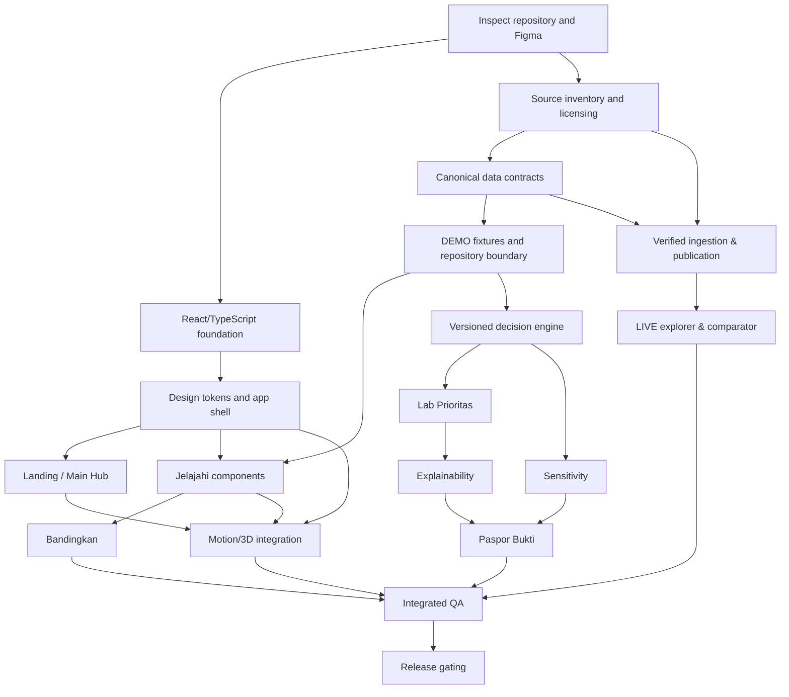

# 12 — Implementation Roadmap, Milestones & Engineering Handoff

**Product:** Nusa Matra · **Version:** 1.0 · **Updated:** 2026-10-19  
**Audience:** Claude Code, implementation lead, designer, data engineer, QA  
**Status:** Ordered delivery plan; timeline and team capacity are `TBD`

## 0. Roadmap principles

> **Deliver working, testable vertical slices, not isolated screenshots.** React + TypeScript and Clean Code are mandatory. The final Figma is the visual source of truth. A DEMO may be used as long as it is clearly marked; a LIVE claim is gated on verified data and methodology.

This roadmap orders dependencies for `01`–`13` docs without inventing calendar dates. It distinguishes an engineering _demo MVP_, a _verified-data preview_, and a _public production release_.

### Authority and status

- `LOCKED`: React, TypeScript, Nusa Matra product name, Figma design, clean code, accessibility and original-animation instruction.
- `FIGMA-VERIFIED`: Existing desktop frames `25:2` and subnodes detailed in `03` and `09`.
- `PROPOSED`: Vite, React Router, TanStack Query, MapLibre, GSAP/Motion, Three.js, PostgreSQL, CI provider.
- `TBD`: Actual hosting, backend deployment, official source permission, live scoring approval, target geography, team size, launch deadline.

## 1. Workstreams

| Workstream          | Owner role (assign actual person later) | Main deliverables                                                |
| ------------------- | --------------------------------------- | ---------------------------------------------------------------- |
| `WS-A` Product & UX | Product owner / designer                | Route decisions, Figma handoff, responsive behavior, terminology |
| `WS-B` Frontend     | React engineers                         | App shell, screens, components, accessibility, visual fidelity   |
| `WS-C` Data         | Data engineer / analyst                 | Source register, geography mapping, snapshots, ingestion         |
| `WS-D` Decision     | Domain/method reviewer                  | Normalization, weights, eligibility, ranking, sensitivity        |
| `WS-E` Backend      | API engineer                            | Typed contracts, storage, analysis/evidence services             |
| `WS-F` Motion       | Frontend/creative engineer              | G1–G11, 3D-1–3D-4, liquid modes, fallback                        |
| `WS-G` Quality      | QA/security                             | Unit, E2E, source reviews, CI, release hardening                 |

Roles can be combined in a small team, but responsibilities and evidence must remain distinct. Claude Code is a coding assistant, not a substitute for data-source or methodological approval.

## 2. Product release definitions

### Release A — Interactive DEMO MVP

- Brand-compliant landing, main map hub, Jelajahi and Bandingkan.
- Functional React app with transparent synthetic fixtures.
- Clear origin label such as **“Data simulasi untuk demonstrasi”** on synthetic ranking/data.
- Critical keyboard, reduced-motion, responsive and API/UI error paths pass.
- Primary code-quality checks pass.
- No implication of government-endorsed ranking.

### Release B — Verified Data Preview (`LIVE` gated)

- Real published observations and geometry from approved source(s).
- Dataset provenance, periods, comparability and completeness review.
- Proper data-mode isolation and predictable pipeline publication.
- Search, map, comparison and quality notices powered by real verified data.
- Ranking features remain DEMO/disabled until methodology approved.

### Release C — Decision & Evidence (`P1/P2` gated)

- Lab Prioritas, explanation, sensitivity, Paspor Bukti and further storytelling.
- Mathematically correct model version, source snapshot and calculation ledger.
- Formal methodology/domain review before production claims.
- Operational integrity, export and abuse safeguards verified.

## 3. Dependency DAG



`C` and `B` may happen in parallel. Demo UI does not wait for provider credentials; LIVE activation does.

## 4. Milestones and exit gates

| ID    | Milestone                                  | Dependencies              | Exit gate                                                    |
| ----- | ------------------------------------------ | ------------------------- | ------------------------------------------------------------ |
| `M0`  | Repository + requirements audit            | Existing project          | Decision log, docs verified, baseline tests observed         |
| `M1`  | React foundation and design system         | M0                        | Build/lint/typecheck pass; tokens and shell reviewed         |
| `M2`  | Landing + Peta Utama hub                   | M1                        | Screen interaction and Figma parity; fallback available      |
| `M3`  | DEMO data foundation + Jelajahi            | M1, fixture contract      | Search/map/filters/details work; DEMO clear                  |
| `M4`  | Bandingkan                                 | M3                        | Comparable/warning/blocked behavior correct                  |
| `M5`  | Source registry + ingestion LIVE readiness | M0, provider approval     | Snapshot/provenance/quality gate passes                      |
| `M6`  | Model engine + Lab Prioritas               | M3, 07 approval for DEMO  | Golden vectors, weights and rankings pass                    |
| `M7`  | Mengapa Diprioritaskan + Titik Buta Data   | M6, quality contract      | Explanation and quality issues agree with run                |
| `M8`  | Uji Rekomendasi + Paspor Bukti             | M6–M7                     | Seed reproducibility; immutable evidence and export          |
| `M9`  | Cerita Wilayah + richer animations         | M2/M3 + design handoff    | Text equivalent; no scroll hijack or performance regressions |
| `M10` | Full QA / security / release preparation   | Required prior milestones | All acceptance gates met; rollback approved                  |

### M0 — Discovery & baseline

Tasks:

1. Inspect repository, current package scripts and branch state.
2. Read `CLAUDE.md`, `project_guidelines.md`, docs `01–13`.
3. Inspect Figma frames, tokens, screenshot and motion annotations.
4. Record open choices: routing, styling, animation libraries, backend option, target geography.
5. Inventory provider/API keys **without exposing values**; choose DEMO vs LIVE workstream.
6. Record exact baseline command outcomes rather than claiming a clean state.
7. Create architecture-decision notes for any critical stack choices.

**Deliverables:** audit note, dependency matrix, starter issues, feature priorities, risks.

**Exit:** owner can identify what is built, what is proposed and what is blocked.

### M1 — React shell and shared design primitives

Tasks:

1. Set up/adapt React + strict TypeScript, routing and linting.
2. Define CSS variables matching verified Kapur & Kobalt tokens.
3. Set Lexend typography and responsive container system.
4. Build `Button`, `Input`, `RegionSelector`, `Switch`, `Status`, panel/card primitives as needed.
5. Implement floating navbar and contextual page pill as per Figma.
6. Add Normal/Kaca semantic modes, persisted preference and reduced-motion handling.
7. Establish test fixtures, error boundary, router-level loading/not-found states.

**Exit:** basic navigation works; no `App.tsx` god component; keyboard and initial theme behavior pass.

### M2 — Landing and Peta Utama

Tasks:

1. Match `27:2` / `27:118` landing variants and `61:1183` / `61:1619` hub.
2. Implement semantic hero, search/CTA, page sections and source disclosure areas.
3. Integrate initial motion G1–G3 with static fallback.
4. Build initial diorama `3D-1` only if performance budget/asset licenses permit; otherwise deliver polished original SVG/CSS alternative and keep 3D as separate acceptance gate.
5. Route CTA correctly to Jelajahi/map hub.
6. Validate visual parity at 1440 reference and agreed responsive widths.

**Exit:** no visually pleasing but dead buttons; all primary routes function.

### M3 — DEMO contracts and Jelajahi

Tasks:

1. Define canonical region, indicator, observation, snapshot and data-origin contracts.
2. Build explicit `DemoDataRepository` with runtime validation.
3. Support search by stable region IDs, not names as keys.
4. Implement map layer, accessible region list fallback, filters and five-level priority legend.
5. Show selected region with values, years, source/origin/quality state.
6. Model `loading`, `empty`, `missing`, `error`, `stale` and `ready` UI states.
7. Keep illustrative hexagon/3D geometry separate from true geospatial layers.

**Exit:** synthetic data is labeled, missing ≠ 0, map and region selection work without WebGL.

### M4 — Bandingkan

Tasks:

1. Build pairwise region selector and “Tukar posisi”.
2. Use the shared comparability evaluator—not a component-local numeric comparison.
3. Render values, units, years, delta language, source links and separate `blocked` warnings.
4. Use cobalt solid and orange dashed distinctions.
5. Test mixed-period warnings, incompatible survey/admin definitions and missing observations.

**Exit:** no misleading difference calculated for incompatible indicators.

### M5 — Verified source pipeline (`TBD` until authorized)

> **Repository scope (owner decision 2026-10-20):** this website repository is the React frontend only. Backend, database, ingestion and validated datasets belong to the separate **Data Hub** service and repository. Read the backend sections of this document as the contract the Data Hub is expected to satisfy, not as code to build here. See `docs/adr/0001-frontend-foundation.md`.

Tasks:

1. Verify official sources listed in `05-DATA-SOURCES.md` and their permitted use.
2. Confirm indicator definitions, geography/code crosswalk, publication and update frequency.
3. Build ingestion in an isolated server-side process; no public provider token.
4. Stage raw and parsed data, validate and publish versioned snapshots atomically.
5. Record provider URL, retrieval date, source period, license and data-quality issues.
6. Turn on LIVE capability only after publication review and acceptance tests.

**Exit:** published data can be reproduced, source metadata is accessible, no DEMO contamination.

### M6 — Decision engine & Lab Prioritas

Tasks:

1. Implement normalization, direction and weight algorithm from `07-DECISION-ENGINE.md`.
2. Keep weights as canonical integer basis points and ensure sum = 10000.
3. Pin inputs: snapshot ID, model version, cohort and normalization reference.
4. Compute contribution ledger, score, ranking, eligibility and denominator.
5. Implement sliders and reactive ordering; do not recalculate algorithm in UI components.
6. Validate golden vectors and rank ties before expanding to UI.

**Exit:** deterministic DEMO engine, data mode visible; no unapproved LIVE recommendations.

### M7 — Explainability and Titik Buta Data

Tasks:

1. Implement why-this-region explanation from the same engine run.
2. Expose criterion contributions and alternative weighting scenarios.
3. Implement data-quality findings: missing, stale, blocked, incompatible and coverage issues.
4. Include provenance and limitations in explanation output.
5. Keep explanations synchronized with selected run/weights/snapshot.

**Exit:** explanation totals agree with Lab; quality warnings never disappear in downstream views.

### M8 — Sensitivity & Paspor Bukti

Tasks:

1. Add seeded repeatable perturbation and leave-one-out tests.
2. Run expensive jobs asynchronously and limit resource usage.
3. Surface percentile/rank ranges and caveats accurately.
4. Generate immutable evidence manifest bound to source/model/inputs.
5. Export snapshot-aware JSON/PDF only when properly implemented and tested; avoid declaring an export working because a button exists.
6. Protect private evidence if user accounts/sharing introduced.

**Exit:** reproducibility, job lifecycle, export and audit tests pass.

### M9 — Story and advanced motion

Tasks:

1. Add `Cerita Wilayah` with explicit chapters, controls and static text alternatives.
2. Implement remaining G4–G11 and `3D-2`–`3D-4` where approved.
3. Source or create original motion; track licensing of third-party references.
4. Test touch/reduced motion/contrast, resource cleanup and mobile fallbacks.
5. Record performance results; remove expensive effects if they prevent core product usability.

**Exit:** engaging presentation does not hinder navigation, data comprehension or battery-limited devices.

### M10 — Hardening & release

Tasks:

1. Run CI quality checks, contract/integration/E2E tests and manual accessibility.
2. Compare desktop against approved Figma nodes and review responsive variants.
3. Test secrets, headers, data origins, cache isolation, export permissions and source disclosures.
4. Document deployment, rollback, environment configuration, monitoring and incident owner.
5. Publish final source/method approvals and unresolved limitation disclosures.
6. Freeze a release candidate and collect sign-off against `13-ACCEPTANCE-CRITERIA.md`.

**Exit:** release criteria passed or a written decision explicitly scopes the release back to DEMO.

## 5. Prioritization under limited time

If evaluation time is constrained, deliver in this order:

1. **Correct and readable React foundation** (quality cannot be deferred).
2. Figma-faithful landing/navigation with limited but working motion.
3. Working Jelajahi with clear DEMO fixtures and source/year labels.
4. Bandingkan with correct blocked/warning logic.
5. Decision engine and Lab if time permits.
6. Explainability/data health, then sensitivity/evidence and storytelling.
7. Elaborate 3D effects only after functional flows and QA gates are stable.

Never remove required safety disclaimers or fake LIVE data to speed up a demo.

## 6. Story slicing and PR guidelines

**Recommended PR scope:** one coherent vertical slice with clear entry/exit state and tests. Examples:

- Design tokens + `Button` primitive + visual tests.
- Region search input + repository mock + typed results + keyboard test.
- Comparison verdict evaluator + blocked UI state + contract tests.
- Weight allocator + golden vector suite + slider accessibility.
- Theme switch state + overlay animation + reduced-motion test.

PR must state:

```text
Story / requirement IDs:
Design nodes:
Type: DEMO | LIVE-ready | production
Files changed and architecture impact:
Dependencies added (reason/license):
Tests run and observed result:
Accessibility and responsive checks:
Data/source/model caveats:
Screenshots or evidence paths:
Known limitations / open decisions:
```

## 7. Work breakdown for Claude Code

### Per-task execution loop

1. Read current user request and impacted docs; search source code before writing.
2. Confirm which architecture options are actually installed and approved.
3. Identify flow/acceptance IDs; prepare deterministic fixture/test.
4. Propose smallest verifiable implementation slice.
5. Implement typed domain/API logic first; UI should consume it.
6. Reuse existing components and design tokens; avoid duplication.
7. Implement motion with explicit cleanup and accessibility fallback.
8. Run focused tests and broader quality gates relevant to change.
9. Verify against Figma node(s) and record discrepancies.
10. Report what passed, what did not run, and why; do not pretend unbuilt features exist.

### Recommended task format for Claude

```text
Implement milestone M3, slice: RegionSearch + selection only.
Read CLAUDE.md, project_guidelines.md, docs/02, 03, 04, 06, 08, 10, 13.
Use current repository dependencies and design primitives.
Input: synthetic region repository and stable region ID.
Output: searchable, keyboard-accessible selector with empty/error/loading states.
Do not integrate external provider tokens or pretend data is live.
Test: unit + component + E2E smoke + responsive review.
Return: code diff summary, test results, risks and Figma node references.
```

## 8. Blocking decisions and approval requests

| Decision                                 | Status                                | Required before              |
| ---------------------------------------- | ------------------------------------- | ---------------------------- |
| React + TypeScript                       | LOCKED                                | All coding                   |
| Build tool, router, styling, query cache | PROPOSED                              | Foundation finalization      |
| Backend/BFF framework                    | TBD                                   | Server implementation        |
| PostgreSQL/PostGIS adoption              | TBD                                   | SQL migration deployment     |
| MVP geographic level                     | TBD                                   | LIVE completeness definition |
| Official data endpoint/license           | Verification required                 | Live ingestion               |
| Priority methodology for policy use      | Formal review required                | LIVE ranking claims          |
| User auth/sharing                        | TBD, not needed for baseline browsing | Private evidence features    |
| Hosting/CI vendor and domains            | TBD                                   | Deployment pipeline          |
| Responsive mobile Figma frames           | Not confirmed in available context    | Pixel-perfect mobile claim   |
| External animation licenses              | Per asset                             | Component/asset shipping     |

If a blocker occurs, continue an independent DEMO task safely rather than guessing credentials, licenses or policy choices.

## 9. Risk register

| Risk                                | Likelihood / impact (to assess) | Mitigation / owner                                  |
| ----------------------------------- | ------------------------------- | --------------------------------------------------- |
| Provider access restricted          | Unknown / high                  | Verify early; parallel DEMO repo                    |
| Region code systems disagree        | Unknown / high                  | Stable crosswalk, source-identity mapping tests     |
| Unavailable/mixed-year indicators   | Expected / high                 | Coverage, comparability, data-health UX             |
| Figma animations too expensive      | Unknown / medium-high           | Performance profiling, reduced quality tier         |
| Overengineering before MVP          | Common / high                   | Vertical slices, ADRs, dependency caps              |
| Inconsistent math across UI/API     | High impact                     | Single model service, golden tests, run version IDs |
| Demo mistaken for government policy | High impact                     | Visible disclaimer, approval gates, evidence labels |
| Missing mobile design references    | Known uncertainty / medium      | Responsive proposal with owner review               |
| Team/AI-generated code drift        | Common / high                   | CI, PR checklist, shared architecture boundaries    |

## 10. Definition of milestone completion

A milestone is complete only if:

- Deliverables work end-to-end for the agreed scope.
- Frontend is modular, typed, linted and readable.
- Source or fixture origin is explicit; method/snapshot pinned where appropriate.
- Expected error, empty, loading and accessibility states are implemented.
- Relevant automated tests execute successfully.
- Figma screenshot/differences are reviewed, not assumed.
- Open risks/decisions are written down.
- Deployment/rollout dependencies are not misrepresented as resolved.

## 11. Output packages and handoff

Recommended handoff outputs:

- Updated source and targeted tests.
- Brief implementation report with feature IDs, screenshots and CI links if available.
- ADRs for architecture additions or deviations.
- `CHANGELOG.md` entry (if repository uses it).
- Updated documentation when API/data/model interfaces changed.
- Rollback and known-limitation notes for significant migrations.

## 12. Roadmap traceability to core documentation

| Deliverable                | Main source documents |
| -------------------------- | --------------------- |
| Requirements and MVP       | `01`, `02`            |
| Design and motion          | `03`, `09`            |
| React architecture         | `04`, `CLAUDE.md`     |
| Live source verification   | `05`, `11`            |
| Persistence and provenance | `06`, `08`            |
| Analytical correctness     | `07`, `10`, `13`      |
| API interactions           | `08`, `10`, `11`      |
| QA and deployment          | `10`, `11`, `13`      |

---

Related: [`01 Requirements`](./01-PRODUCT-REQUIREMENTS.md) · [`10 Testing`](./10-TESTING-STRATEGY.md) · [`11 Security`](./11-SECURITY-AND-PRIVACY.md) · [`13 Acceptance`](./13-ACCEPTANCE-CRITERIA.md).
